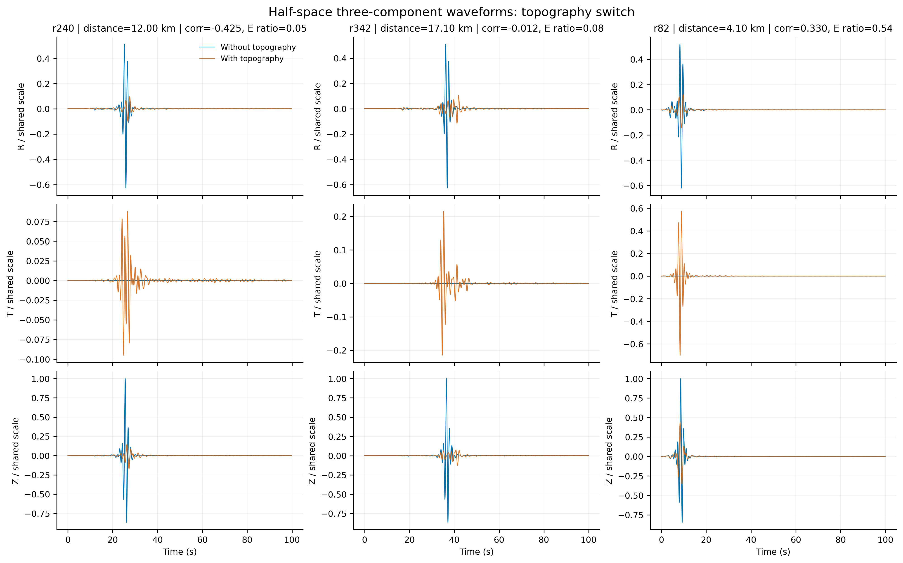
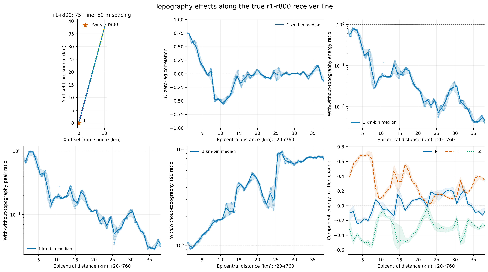
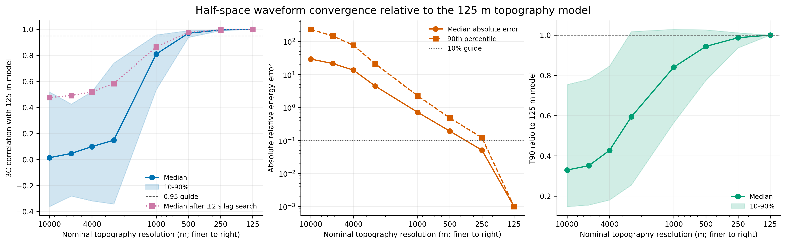
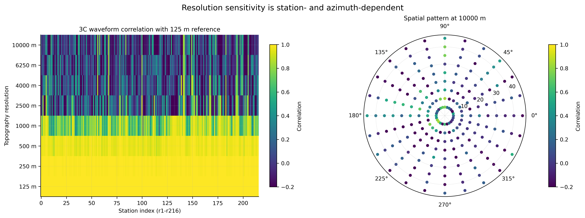
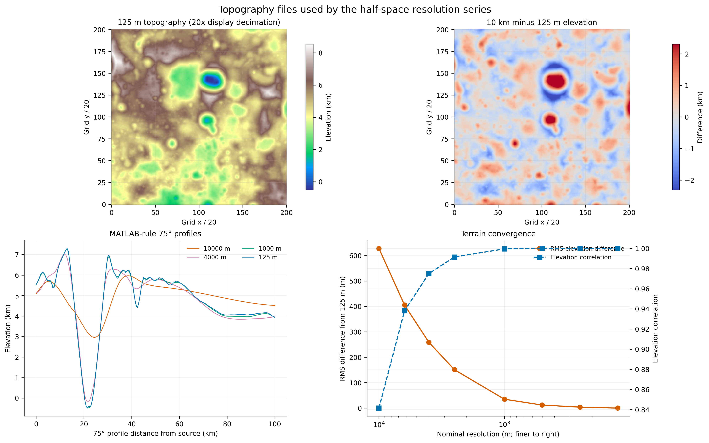
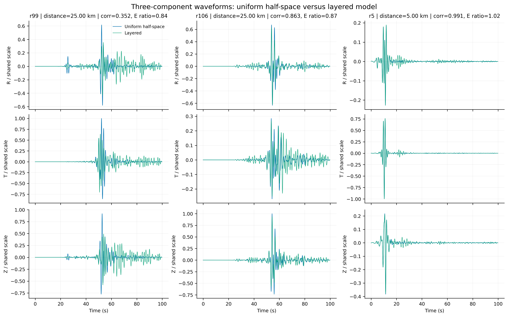
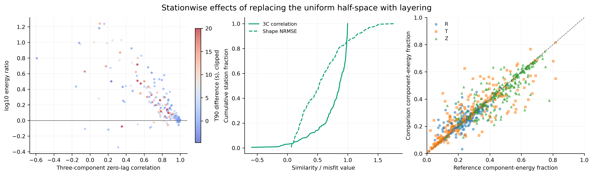
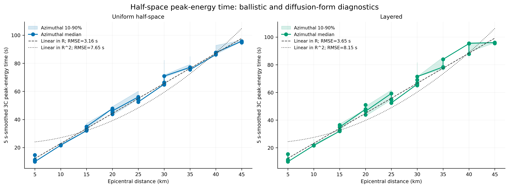
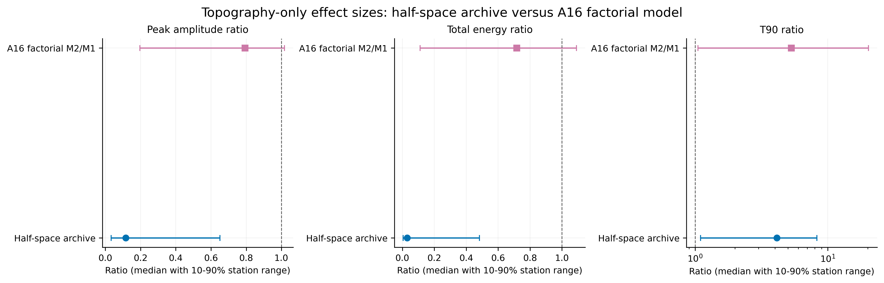

# 半空间区域数据分析与交叉核对报告

日期：2026-08-17  
处理频带：0.3-0.9 Hz  
分析范围：有/无地形、地形分辨率、有/无分层、峰值能量时间-距离关系，以及与 A16/S12 四模型结果的交叉比较

## 1. 结论摘要

1. 在用户指定的 800 台站半空间对比中，加入地形后，三分量波形发生强烈重构：三分量零时滞相关系数中位数为 -0.012，峰值振幅和总能量分别降至无地形模型的 0.116 和 0.0296，T90 中位数增至 4.13 倍，并延长 6.25 s。根据真实 75° 台站方位将 X/Y 旋转到 R/T 后，T 分量能量占比中位数由近零升至 27.6%，Z 分量由 72.4% 降至 42.3%，R 分量则由 27.6% 变为 28.5%。这直接表明主要变化是 Z 向 T 的模式转换，而不是原先基于错误台站文件推断的 X/Y 变化。
2. 分辨率结论必须拆成两个阈值。若只考察允许 ±2 s 对齐后的波形形状，0.5 km 模型相对 0.125 km 参考的中位相关为 0.976，10 分位仍为 0.950，支持审稿回复中“约 0.5 km 的波形相似性阈值”。若按审稿人建议同时要求能量和相关性，0.5 km 的中位能量误差仍为 19.4%，而 0.25 km 降至 5.1%，中位相关为 0.996，因此联合阈值应收紧为约 0.25 km。
3. “半空间与分层模型波形并无明显差异”只能作为有限条件下的表述。分层/均匀半空间的峰值振幅比中位数为 1.02，分量能量比例中位变化接近零；但三分量相关中位数仅 0.864，只有 42.1% 台站达到 0.90，能量和 T90 中位数分别增加 22.1% 和 37.8%。更准确的说法是：多数台站的主峰和分量比例相近，但分层会在部分方位显著改变尾波能量与持续时间。
4. 5 s 平滑下，均匀半空间的峰值能量时间用线性距离拟合的 RMSE 为 3.16 s，而 R² 扩散形式为 7.65 s；分层模型分别为 3.65 s 和 8.15 s。2、5、10 s 平滑窗均得到相同排序。这直接支持第二审稿人的推断，也与当前 A16 稿件中“线性距离优于扩散形式”的结论一致：本组地形与分层模型仍以弹道传播为主，不能据此解释月震扩散包络或数千秒长尾波。

## 2. 数据登记与质量控制

所有用户指定路径、实际地形文件名、A16 外部路径与项目内打包路径已写入 `config/data_catalog.json`；文件大小、修改时间、NetCDF 维度和 SHA-256 写入 `provenance/halfspace_input_audit.csv`。路径审计的详细说明见 `provenance/HALFSPACE_DATA_AUDIT.md`。

分辨率文件名需要特别说明：`400/200/100/40/25/16/10` 不是米数，而分别对应约 0.25/0.5/1/2.5/4/6.25/10 km；`0.125_old` 是 0.125 km 参考模型。这一解释同时满足原稿列出的 0.125、1、2.5、4、6.25、10 km 六档，以及审稿回复新增的 0.25、0.5 km 两档。

800 台站主对比的真实几何已经恢复。`newfigure6_part3_3.m` 明确使用 `epi_dist = station_index × 50 / 1000` km 和 75° 方位；运行脚本 `cgfd3d.revise.use1.topo.0.125.Q.sh` 则逐点列出了 r1-r800 坐标。震源为 (50,000, 50,000) m，台站沿 75° 方向每 50 m 一个，r1 距震源 0.05 km、r800 为 40 km。公式坐标与运行脚本坐标的最大误差小于 0.001 mm。当前项目文件夹中的 r1-r216 `test.station` 属于另一套台站几何，不能用于这两个 800 台站 NetCDF。分辨率与分层对比仍使用其各自的 216 台站文件。

## 3. 处理方法

- 对每个模型的 Vx、Vy、Vz 分量分别线性去趋势，在各自原始采样率上执行四阶零相位 Butterworth 0.3-0.9 Hz 带通滤波，再插值到 0.02 s 公共采样，比较窗为 0-99.88 s。
- 对 800 台站有/无地形对比，按每个台站的真实 75° 方位旋转为 `R = Vx cos75° + Vy sin75°`、`T = -Vx sin75° + Vy cos75°`，再计算 R/T/Z 分量能量。全体效果量使用 r1-r800；距离剖面遵循原 MATLAB 脚本，使用 r20-r760，即 1-38 km。
- 三分量相关系数用所有分量和时间样点的归一化内积计算；分辨率试验另计算 ±2 s 内最大相关，以对应审稿回复中的滑动/对齐相似性思路。
- 总能量定义为三分量速度平方的时间积分；T90 为累计能量从 5% 到 95% 的时间差；峰值振幅为三分量瞬时矢量幅值最大值。
- 分辨率能量误差为相对 0.125 km 参考模型的绝对相对误差。报告同时给出中位数与台站 10-90% 范围，避免由少数路径主导结论。
- 峰值能量时间分别在 2、5、10 s 平滑窗下拟合 `t=a+bR` 和 `t=a+bR²`，以 RMSE、R² 和 AIC 比较。

## 4. 有无地形：半空间三分量响应

代表性台站的共同尺度 R/T/Z 波形显示，地形不仅降低主脉冲，还把能量分散到更长时间，并在无地形模型近乎为零的 T 分量中产生显著波列。相关系数 10-90% 范围为 -0.425 至 0.333；能量比为 0.00466 至 0.483；T90 比为 1.10 至 8.28。这说明效应高度依赖传播距离和沿线地形，不能用单一“衰减系数”概括。

真实距离剖面揭示了此前无法识别的系统变化。在 MATLAB 建议的 r20-r760 范围内，1-10 km、10-25 km 和 25-38 km 三段的能量比中位数分别为 0.227、0.0524 和 0.00922，峰值振幅比分别为 0.479、0.147 和 0.0550，T90 比则由 1.31 增至 3.66 和 8.07。与此同时，T 分量能量占比增加的全 800 台站中位数为 27.6 个百分点，R 分量仅增加 0.86 个百分点，Z 分量降低 30.2 个百分点。因此原稿中“横向分量衰减”应明确改为“地形造成 Z 向 T 的模式转换”。这些距离趋势仅适用于该 75° 单剖面和 100 s 记录窗，不能直接作为介质本征衰减律。

## 5. 地形分辨率：波形形状与能量收敛并不同步

相对 0.125 km 参考，0.25 km 的零时滞相关中位数为 0.995，±2 s 最大相关中位数为 0.996；0.5 km 分别为 0.970 和 0.976；1 km 则降至 0.810 和 0.865。与此同时，中位能量误差从 0.25 km 的 5.1% 增至 0.5 km 的 19.4% 和 1 km 的 72.0%。因此：

- 仅以形状相似性定义“不可区分”，0.5 km 阈值有数据支持；
- 以“中位相关 ≥0.95 且中位能量误差 ≤10%”作为透明的联合判据，0.25 km 才满足；
- “0.5 km 能够完整体现地形影响”应修改为“0.5 km 基本保持 0.3-0.9 Hz 波形形状，但能量尚未完全收敛”。

收敛具有显著方位与距离依赖。0.5 km 绝大多数台站的形状相关已高，但 1 km 开始出现成片低相关；2.5 km 及更粗模型只有少数方位保留较高相似性。这与审稿人指出路径 C 与起伏强烈路径 A/B 不应使用同一阈值的意见一致。

地形文件本身也显示逐级平滑：相对 0.125 km 地形，0.25、0.5、1 km 的全场高程相关分别为 0.999995、0.999947、0.999542，RMS 高程差分别为 3.65、11.9、34.9 m；10 km 模型的相关降至 0.842，RMS 差为 628 m。小的高程差仍可产生明显能量差，说明不能只凭 DEM 图像“看起来相似”判断波场收敛。

## 6. 有无分层：主峰接近，但尾波和路径差异不可忽略

分层模型相对均匀半空间的三分量相关 10-90% 范围为 0.357-0.991，中位数 0.864；峰值振幅比中位数 1.02，能量比 1.22，T90 比 1.38。代表台站显示，有些记录几乎重合，有些在主到时之后出现明显的相位和尾波差异。

分量能量比例总体沿 1:1 线分布，支持“分层不显著改变总体分量分配”的限定结论；但能量-T90 散点和相关系数分布否定了“所有波形均无明显差异”的广义结论。审稿回复可改为：“分层对多数台站的主峰振幅和分量比例影响较小，但会在部分传播方向显著改变后续能量与持续时间。”

## 7. 峰值能量时间：线性距离优于 R² 扩散形式

5 s 平滑下，均匀半空间与分层模型均表现出近线性距离趋势。均匀模型线性拟合 R²=0.987、RMSE=3.16 s，扩散形式 R²=0.924、RMSE=7.65 s；分层模型分别为 R²=0.983、RMSE=3.65 s 和 R²=0.917、RMSE=8.15 s。2 s 与 10 s 平滑窗结论不变。

这与第二审稿人的物理判断一致：若观测月震包络满足近场扩散 `R²/D`，而模拟只给出线性 R，则当前地形和分层结构没有进入解释真实月震包络的扩散状态。当前 A16 稿件把“地形影响早期包络”与“不能解释数千秒长尾波”分开陈述，是比原稿“上升时间趋势与观测吻合”更稳健的框架。

## 8. 与 A16/S12 四模型结果的交叉比较

半空间地形效应的峰值振幅比和能量比分别为 0.116 和 0.0296，显著低于 A16 分层背景中 M2/M1 的 0.792 和 0.716；T90 比则分别为 4.13 和 5.31。也就是说，半空间中地形造成更强的主能量损失，但 A16 分层模型的持续时间相对增幅更大。两区域的台站几何、源、背景结构和模拟长度不同，因此该图用于效果量定位，不用于把差异唯一归因于分层。

半空间记录仅 100 s，A16 合成记录约 250 s，而 Apollo 观测主要能量延续到约 3,000 s。半空间结果不能直接参与“是否拟合长尾波”的定量检验，但其线性距离趋势和有限 T90 仍与 A16 的否定性结论一致。

## 9. 原稿与审稿意见交叉结论

| 议题 | 原稿/回复中的主张 | 新分析结果 | 建议写法 |
|---|---|---|---|
| 地形散射 | 地形降低振幅、延长尾波并转换能量 | 半空间能量比 0.0296、T90 比 4.13；真实方位旋转显示 T 增加 27.6 个百分点、Z 降低 30.2 个百分点 | 保留，但明确为 Z 向 T 的模式转换和单剖面距离分布，不用单一衰减系数 |
| 0.5 km 阈值 | 回复称 0.5 km 可“完整体现”地形影响 | 形状相关支持；能量中位误差 19.4% | 拆成 0.5 km 形状阈值与 0.25 km 联合阈值 |
| D/5 经验律 | 原稿给出 crater diameter / 5 | 当前全台站数据表明显著路径依赖 | 不作为普适律；仅保留为特定频带、特定地形的经验观察 |
| 分层影响 | 回复称半空间与分层波形无明显差异 | 主峰和分量比例接近，但能量与 T90 存在系统和路径差异 | 使用限定表述，报告分布而非“无差异” |
| 线性 R 与扩散 R² | 审稿人认为线性 R 暗示地形不能解释月震包络 | 两模型及三种平滑窗均为线性 R 明显更优 | 明确支持“未进入扩散长尾波状态” |
| 半空间与 A16 | 原稿把两部分串联为地形解释 | 半空间效应远强于 A16 振幅/能量效应，不能直接外推 | 半空间用于机制与分辨率；A16 用于真实背景和观测排除检验 |

## 10. 可复用产物

- 路径目录：`config/data_catalog.json`
- 输入审计：`provenance/halfspace_input_audit.csv`
- 审计说明：`provenance/HALFSPACE_DATA_AUDIT.md`
- 可复现脚本：`code/analyze_halfspace_models.py`
- 真实 800 台站几何：`data/derived/halfspace_800_receiver_geometry.csv`
- 1 km 距离分箱：`data/derived/halfspace_topography_switch_distance_bins.csv`
- 派生表：`data/derived/halfspace_*.csv` 与 `halfspace_analysis_summary.json`
- 数据图：`figures/halfspace/Figure_HS1` 至 `Figure_HS9`

进入主稿前不再需要恢复 800 台站 `test.station`：运行脚本中的逐点坐标和 MATLAB 距离公式已经相互验证。仍需作者确认 `project_use1_layer` 与 `project_use1_topo_0.125` 除自由表面外的介质参数完全一致。800 台站距离趋势可用于该 75° 单剖面，但若要归因于具体撞击坑或地形单元，还需把该剖面与地形网格进行路径级联合分析。
