# 月球地形、分层、散射与低速层全模型综合分析（证据分级终审版）

从半空间机制试验到 A16/S12、M5/M6 与 Apollo 的完整投稿证据链

本报告含76个结论-图件证据单元。

## 统一处理与证据规则

- 原采样率去趋势与四阶0.3-0.9 Hz零相位滤波；
- t05/t50/t95/T90使用三分量滤波速度平方累计能量；
- A16逐站旋转到R/T；正值指标用对数比，时间/占比用差值；
- 575主站、57个非重叠10站块；带区间/检验的推断量基于相同块中位数，指定的旧四模型T90与分量占比为575站描述性中位数；
- M5/M6缺少完整运行清单，绝对幅能量只作条件性运行级对比。

## 第一部分｜半空间机制、分辨率与分层

半空间试验建立地形三分量机制、数值收敛标准、分层边际效应和真实800台站距离诊断。

### HS01 半空间地形会重构三分量波形，而非只改变 Z

**正向确定性证据：** 起伏自由表面使原本近二维的 R-Z 波场产生显著 T 分量，并改变主脉冲与尾波。

**定量依据：** 800 台站为从 (50,000,50,000) m 出发、75°方位、50 m 间距的单剖面；Vx/Vy 必须按 75°旋转为 R/T。

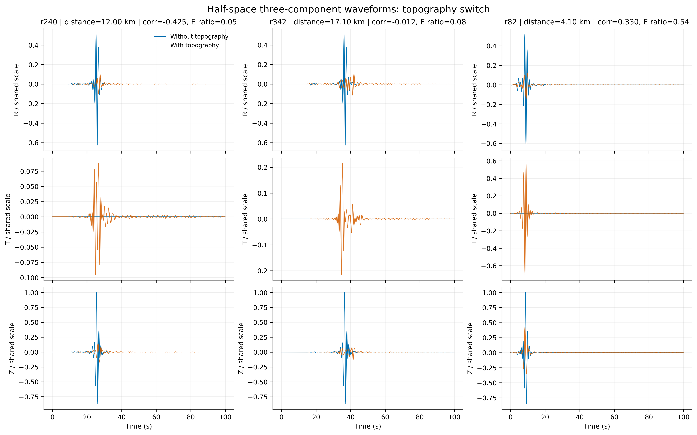

**科学解释：** 地形产生反射、绕射和模式转换，三分量联合分析是识别地形效应的最低要求。

**适用边界：** 该 800 台站几何不能与另一套 r1-r216 test.station 混用。

**建议英文表述：** Topography restructures all three components in the half-space experiment and generates substantial transverse motion.

*半空间分析权威来源：data/derived/halfspace_analysis_summary.json 及对应派生 CSV。*

### HS02 半空间地形显著削弱有限窗能量并延长持续时间

**正向确定性证据：** 在全部 800 个同名剖面台站的总体配对统计中，地形造成强能量下降与持续时间增加。

**定量依据：** 峰值比 0.116，有限窗能量比 0.0296，T90 比 4.126，绝对增加约 6.25 s；相关仅 -0.0116，表明波形形状已重构。

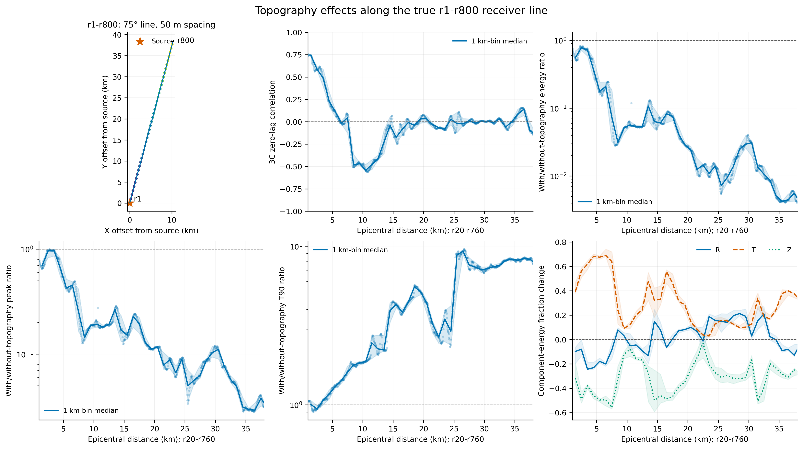

**科学解释：** 地形的主要效应组合是相干峰值/能量损失、分量重分配和低振幅尾波延长。

**适用边界：** 这些总体统计使用全部 800 站；只有距离拟合使用 r20-r760（1-38 km）。能量比依赖当前输出和有限窗，不能直接等价为内禀吸收。

**建议英文表述：** In the half-space profile, topography strongly reduces finite-window energy and prolongs T90 while destroying waveform similarity.

*半空间分析权威来源：data/derived/halfspace_analysis_summary.json 及对应派生 CSV。*

### HS03 地形分辨率具有形状阈值和联合收敛阈值

**正向确定性证据：** 约 0.5 km 可保持波形形状，但能量仍未收敛；约 0.25 km 才同时满足形状与能量要求。

**定量依据：** 0.5 km：允许 ±2 s 对齐后中位相关 0.976、全部台站 >=0.90，但能量中位误差 19.4%；0.25 km：相关 0.996、能量误差 5.1%。

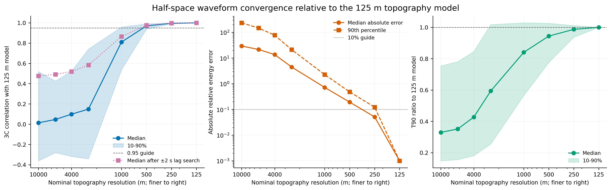

**科学解释：** 数值地形收敛不能只看波形相关，必须联合检查能量。

**适用边界：** 该阈值适用于当前频带、网格和地形谱，不应无条件推广到其他模拟。

**建议英文表述：** A 0.5 km DEM resolves waveform shape, whereas approximately 0.25 km is required for joint waveform-and-energy convergence.

*半空间分析权威来源：data/derived/halfspace_analysis_summary.json 及对应派生 CSV。*

### HS04 分辨率误差具有空间结构，而非均匀噪声

**正向确定性证据：** 粗化地形后，不同距离位置的波形与能量误差差异显著。

**定量依据：** 站点级相关和能量误差沿单剖面呈成组变化，说明局部路径地形谱控制收敛。

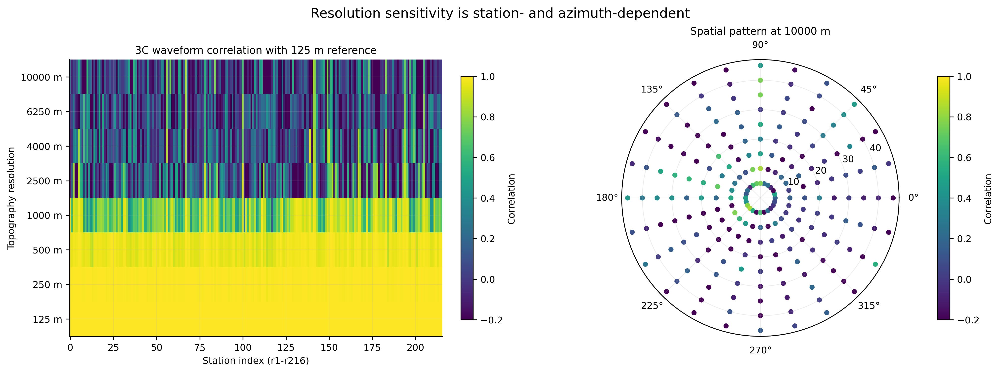

**科学解释：** 同一 DEM 分辨率可能对平滑路径足够、对陡峭或多尺度路径不足。

**适用边界：** 单剖面不能完整代表二维方位分布。

**建议英文表述：** Resolution error is spatially structured along the profile rather than a uniform numerical perturbation.

*半空间分析权威来源：data/derived/halfspace_analysis_summary.json 及对应派生 CSV。*

### HS05 DEM 外观相似不等于波场能量收敛

**反向/排除性证据：** 不同采样地形在大尺度轮廓上可以相似，却保留不同的小尺度坡度和曲率谱。

**定量依据：** 地形栅格对比与 HS03 能量误差共同显示，视觉相似不能替代波形和能量验证。

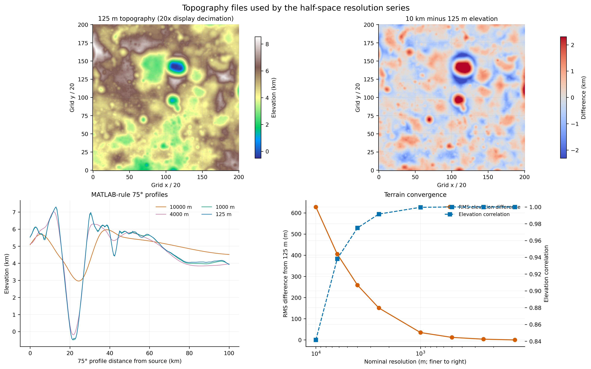

**科学解释：** 波场对界面坡度、曲率和短波长成分敏感，因此必须报告 DEM 频谱和数值收敛。

**适用边界：** 不能从一张地形图肉眼判断模拟已收敛。

**建议英文表述：** Visually similar DEMs do not guarantee energy convergence because small-scale slope and curvature remain dynamically important.

*半空间分析权威来源：data/derived/halfspace_analysis_summary.json 及对应派生 CSV。*

### HS06 加入分层后主峰可接近，但尾波与持续时间仍变化

**正向确定性证据：** 半空间与分层模型的主要到时可保持相似，同时部分路径的后续能量和波列宽度改变。

**定量依据：** 216 台站配对比较使用其自身 test.station 几何，不使用 800 台站剖面的坐标。

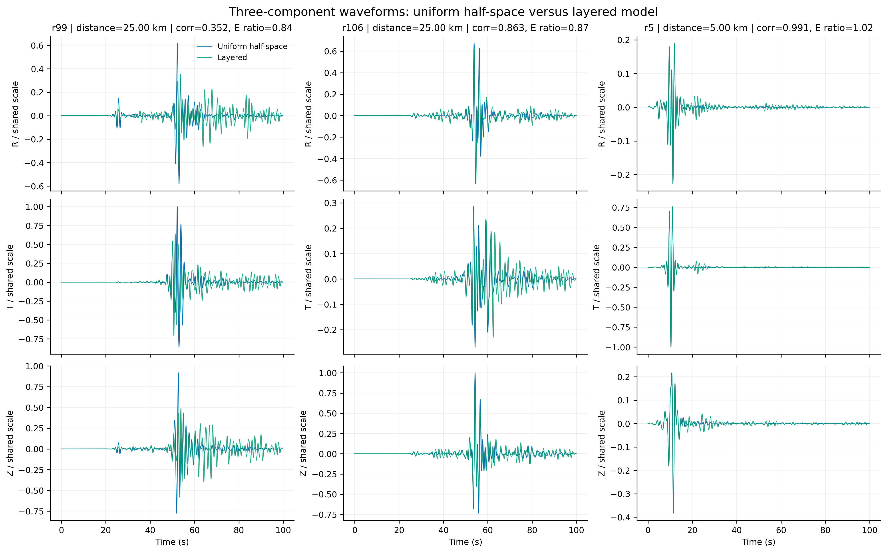

**科学解释：** 分层的敏感信号主要位于尾波、能量和持续时间，而不是只看首个主峰。

**适用边界：** 不能再写“分层前后无明显差异”；应限定为主峰或部分台站相近。

**建议英文表述：** Layering leaves many primary peaks similar but measurably changes later energy and duration on selected paths.

*半空间分析权威来源：data/derived/halfspace_analysis_summary.json 及对应派生 CSV。*

### HS07 分层对有限窗能量与 T90 有可量化影响

**正向确定性证据：** 在 216 台站集合中，分层总体提高能量和持续时间，但空间离散明显。

**定量依据：** 中位相关 0.864，峰值比 1.020，能量比 1.221，T90 比 1.378，绝对增加 2.74 s。

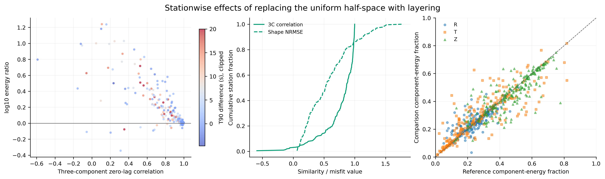

**科学解释：** 分层不是主峰幅值的简单放大，而是更集中地影响尾部能量。

**适用边界：** 这些值属于 216 台站几何，不能和 800 台站 r20-r760 的距离统计直接拼接。

**建议英文表述：** Layering increases finite-window energy and T90 despite near-unity median peak amplitude.

*半空间分析权威来源：data/derived/halfspace_analysis_summary.json 及对应派生 CSV。*

### HS08 半空间主能量迁移更接近线性距离而非 R²

**反向/排除性证据：** 能量峰时随距离近似线性增长，简单扩散型 R² 形式没有改善解释。

**定量依据：** 距离拟合使用真实 800 台站几何中的 r20-r760，即 1-38 km；不得使用另一套 216 台站坐标。

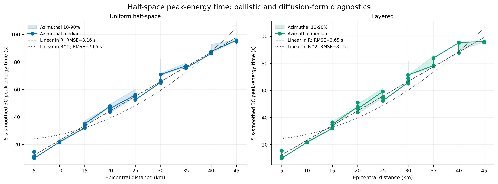

**科学解释：** 地形和分层增加多路径，却没有把主能量脊推进简单强扩散状态。

**适用边界：** 该检验针对主能量峰，不排除弱尾波存在散射扩散成分。

**建议英文表述：** Peak-energy migration in the half-space profile remains closer to linear distance than to a simple R-squared diffusion form.

*半空间分析权威来源：data/derived/halfspace_analysis_summary.json 及对应派生 CSV。*

### HS09 半空间地形倍率不能直接外推到 A16/S12

**反向/排除性证据：** 半空间与 A16 的地形边际效应在能量、持续和三分量分配上明显不同。

**定量依据：** 半空间能量比 0.0296、T90 比 4.126；A16 中地形效应强烈依赖散射和低速背景。

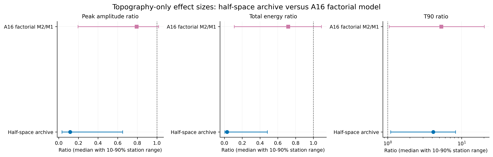

**科学解释：** 区域几何、传播距离、结构和散射背景共同决定地形边际效应。

**适用边界：** 跨区域比较用于揭示背景依赖，不用于把一个区域的倍率校正另一区域。

**建议英文表述：** Topographic effects are strongly background dependent and cannot be transferred as fixed multipliers from the half-space profile to A16/S12.

*半空间分析权威来源：data/derived/halfspace_analysis_summary.json 及对应派生 CSV。*

## 第二部分｜A16/S12 地形×随机非均匀性基线

四模型因子设计建立区域路径、三分量、非加性和观测失配的基线证据。

### A01 四模型形成地形×随机非均匀性 2×2 基线

**正向确定性证据：** M1-M4 可分离地形、随机非均匀性及其二阶交互。

**定量依据：** M1 平坦无散射、M2 地形无散射、M3 平坦有散射、M4 地形有散射；575 个主射线台站来自三条剖面首尾各去 5 站。

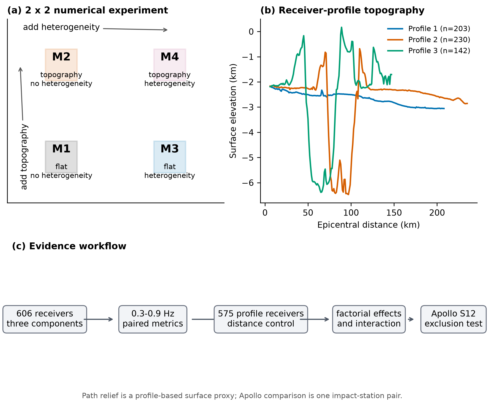

**科学解释：** 该结果与同组波形、分量能量和路径统计相互约束，避免仅依赖单一标量。

**适用边界：** 数值只在当前 0.3-0.9 Hz、50-245 s 处理口径和对应几何内有效；不能跨几何或跨窗口直接拼接。

**建议英文表述：** The four baseline models form a topography-by-random-heterogeneity factorial design that separates two main effects and their second-order interaction.

*A16/S12 权威来源：figures/main、figures/supporting 与 data/derived 当前版本；旧 REL3 卡片仅作版式参考。*

### A02 A16 水平分量必须逐站旋转到 R/T

**正向确定性证据：** 三条射线方位不同，直接把 Vx/Vy 当作 R/T 会混合径向与横向能量。

**定量依据：** 源坐标为 (161310,207630) m；R=Vx sin(phi)+Vy cos(phi)，T=Vx cos(phi)-Vy sin(phi)。

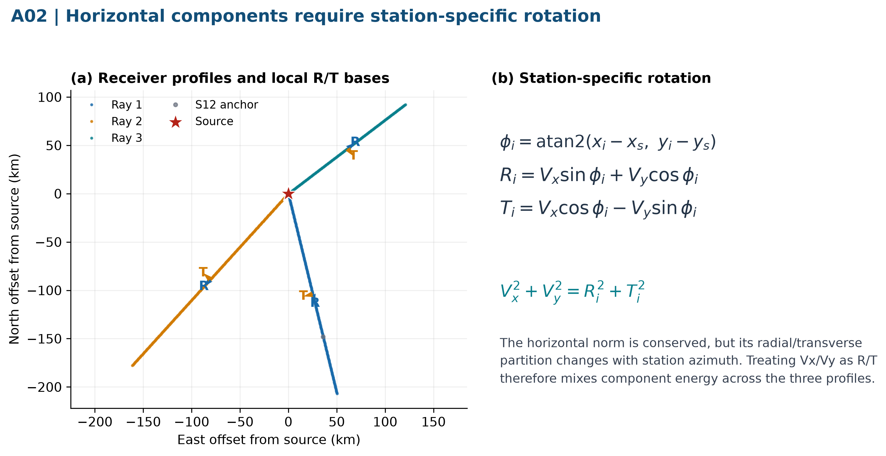

**科学解释：** 该结果与同组波形、分量能量和路径统计相互约束，避免仅依赖单一标量。

**适用边界：** 数值只在当前 0.3-0.9 Hz、50-245 s 处理口径和对应几何内有效；不能跨几何或跨窗口直接拼接。

**建议英文表述：** Horizontal synthetics must be rotated from Vx/Vy into station-specific radial and transverse components before component-energy interpretation.

*A16/S12 权威来源：figures/main、figures/supporting 与 data/derived 当前版本；旧 REL3 卡片仅作版式参考。*

### A03 随机非均匀性显著展宽平坦背景波列

**正向确定性证据：** M3 相对 M1 的主峰变弱、尾波增长，持续时间是最稳定的散射判据。

**定量依据：** 575 个主台站的描述性中位数：T90 因子 M3/M1=18.170。

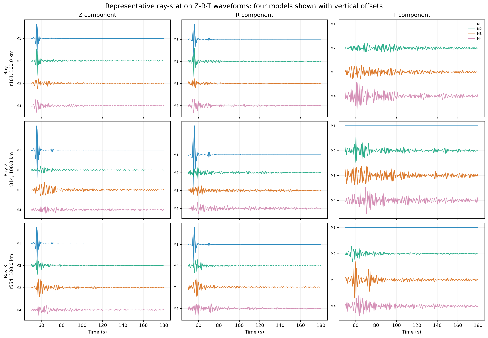

**科学解释：** 该结果与同组波形、分量能量和路径统计相互约束，避免仅依赖单一标量。

**适用边界：** 数值只在当前 0.3-0.9 Hz、50-245 s 处理口径和对应几何内有效；不能跨几何或跨窗口直接拼接。

**建议英文表述：** Random heterogeneity strongly broadens waveforms in the flat-background model, making duration a more stable scattering diagnostic than peak time alone.

*A16/S12 权威来源：figures/main、figures/supporting 与 data/derived 当前版本；旧 REL3 卡片仅作版式参考。*

### A04 地形单独也能展宽并改变三分量

**正向确定性证据：** M2 相对 M1 产生有限多路径和 T 分量，但弱于随机非均匀性对长尾的总体影响。

**定量依据：** 575 个主台站的描述性中位数：T90 因子 M2/M1=5.309。

**科学解释：** 该结果与同组波形、分量能量和路径统计相互约束，避免仅依赖单一标量。

**适用边界：** 数值只在当前 0.3-0.9 Hz、50-245 s 处理口径和对应几何内有效；不能跨几何或跨窗口直接拼接。

**建议英文表述：** Topography alone broadens the wave train and generates transverse motion, although its duration effect is weaker than that of random heterogeneity.

*A16/S12 权威来源：figures/main、figures/supporting 与 data/derived 当前版本；旧 REL3 卡片仅作版式参考。*

### A05 组合模型波形不是两个独立效应的线性叠加

**正向确定性证据：** M4 的新增相位、多脉冲和持续振荡不能由地形修正加散射尾波简单相加得到。

**定量依据：** 575 个主台站的描述性中位数：M4/M2 T90=2.181，M4/M3 T90=1.162，显示明显背景依赖。

**科学解释：** 该结果与同组波形、分量能量和路径统计相互约束，避免仅依赖单一标量。

**适用边界：** 数值只在当前 0.3-0.9 Hz、50-245 s 处理口径和对应几何内有效；不能跨几何或跨窗口直接拼接。

**建议英文表述：** The combined topography-plus-heterogeneity waveform cannot be reproduced by linearly adding the two isolated effects.

*A16/S12 权威来源：figures/main、figures/supporting 与 data/derived 当前版本；旧 REL3 卡片仅作版式参考。*

### A06 六模型比较必须使用三分量联合尺度

**正向确定性证据：** 每个模型只允许一个 3C RMS 源尺度，避免逐分量或逐台站归一化掩盖分量失配。

**定量依据：** 相同原则用于 S12 与 Apollo 对比。

**科学解释：** 该结果与同组波形、分量能量和路径统计相互约束，避免仅依赖单一标量。

**适用边界：** 数值只在当前 0.3-0.9 Hz、50-245 s 处理口径和对应几何内有效；不能跨几何或跨窗口直接拼接。

**建议英文表述：** Model-observation comparisons use one shared three-component RMS source scale per model and prohibit component- or station-specific normalization.

*A16/S12 权威来源：figures/main、figures/supporting 与 data/derived 当前版本；旧 REL3 卡片仅作版式参考。*

### A07 M1 的 T 能量近零验证对称基准

**正向确定性证据：** 平坦、无散射、近各向同性背景中的波场主要位于 R-Z 平面。

**定量依据：** 575 个主台站的描述性中位数：M1 Z/R/T=70.15/29.85/近0%。

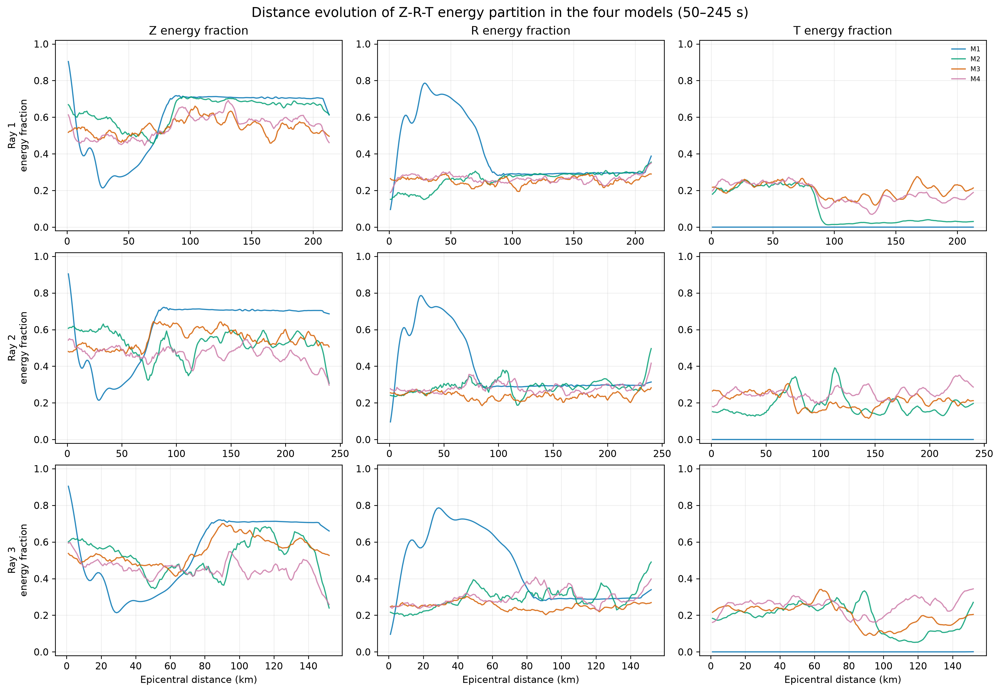

**科学解释：** 该结果与同组波形、分量能量和路径统计相互约束，避免仅依赖单一标量。

**适用边界：** 数值只在当前 0.3-0.9 Hz、50-245 s 处理口径和对应几何内有效；不能跨几何或跨窗口直接拼接。

**建议英文表述：** The near-zero transverse energy of M1 provides a symmetry-consistent baseline for identifying three-dimensional conversion.

*A16/S12 权威来源：figures/main、figures/supporting 与 data/derived 当前版本；旧 REL3 卡片仅作版式参考。*

### A08 随机非均匀性是强 T 转换源

**正向确定性证据：** 平坦背景加入散射后，T 占比增加约 20.45 个百分点。

**定量依据：** 575 个主台站的描述性中位数：M3 Z/R/T=54.58/24.69/20.45%。

**科学解释：** 该结果与同组波形、分量能量和路径统计相互约束，避免仅依赖单一标量。

**适用边界：** 数值只在当前 0.3-0.9 Hz、50-245 s 处理口径和对应几何内有效；不能跨几何或跨窗口直接拼接。

**建议英文表述：** Random heterogeneity is a strong source of transverse conversion in the flat-background model.

*A16/S12 权威来源：figures/main、figures/supporting 与 data/derived 当前版本；旧 REL3 卡片仅作版式参考。*

### A09 地形单独产生路径依赖的 T 转换

**正向确定性证据：** 无散射背景加入地形后，T 占比达到 16.13%，其中射线1明显较弱。

**定量依据：** 575 个主台站的描述性中位数：M2 Z/R/T=56.37/27.63/16.13%。

**科学解释：** 该结果与同组波形、分量能量和路径统计相互约束，避免仅依赖单一标量。

**适用边界：** 数值只在当前 0.3-0.9 Hz、50-245 s 处理口径和对应几何内有效；不能跨几何或跨窗口直接拼接。

**建议英文表述：** Topography alone generates path-dependent transverse energy, with the weakest response along the smoothest profile.

*A16/S12 权威来源：figures/main、figures/supporting 与 data/derived 当前版本；旧 REL3 卡片仅作版式参考。*

### A10 组合模型 T 占比最高但增量饱和

**正向确定性证据：** M4 的 T 占比为 23.43%，小于 M3 与 M2 T 增量的线性相加。

**定量依据：** 575 个主台站的描述性中位数：M4 Z/R/T=48.92/27.28/23.43%。

**科学解释：** 该结果与同组波形、分量能量和路径统计相互约束，避免仅依赖单一标量。

**适用边界：** 数值只在当前 0.3-0.9 Hz、50-245 s 处理口径和对应几何内有效；不能跨几何或跨窗口直接拼接。

**建议英文表述：** The combined model has the largest transverse fraction, but the increment saturates relative to linear addition of the isolated effects.

*A16/S12 权威来源：figures/main、figures/supporting 与 data/derived 当前版本；旧 REL3 卡片仅作版式参考。*

### A11 Z 占比下降不能直接解释为内禀吸收

**反向/排除性证据：** M4 的 Z 减少同时伴随 R/T 增加，主要证据是分量重分配。

**定量依据：** 需要总能量、Q 和通量才能区分转换与吸收。

**科学解释：** 该结果与同组波形、分量能量和路径统计相互约束，避免仅依赖单一标量。

**适用边界：** 数值只在当前 0.3-0.9 Hz、50-245 s 处理口径和对应几何内有效；不能跨几何或跨窗口直接拼接。

**建议英文表述：** A reduced vertical fraction cannot be interpreted as intrinsic absorption because radial and transverse fractions increase concurrently.

*A16/S12 权威来源：figures/main、figures/supporting 与 data/derived 当前版本；旧 REL3 卡片仅作版式参考。*

### A12 射线2和3存在稳定路径高差控制

**正向确定性证据：** 去除距离趋势后，更大累计路径高差对应更低峰值/能量与更长 T90。

**定量依据：** 综合空间块相关：峰值 -0.736、能量 -0.731、T90 +0.679。

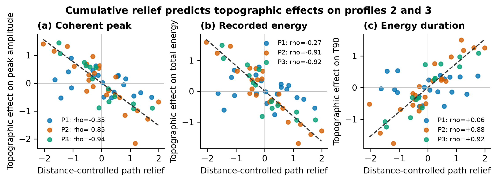

**科学解释：** 该结果与同组波形、分量能量和路径统计相互约束，避免仅依赖单一标量。

**适用边界：** 数值只在当前 0.3-0.9 Hz、50-245 s 处理口径和对应几何内有效；不能跨几何或跨窗口直接拼接。

**建议英文表述：** After distance detrending, larger cumulative path relief is associated with lower peak and total energy and longer T90 along Rays 2 and 3.

*A16/S12 权威来源：figures/main、figures/supporting 与 data/derived 当前版本；旧 REL3 卡片仅作版式参考。*

### A13 射线1不支持把路径高差定律推广到所有方向

**反向/排除性证据：** 射线1地形最平滑，路径高差与峰值/能量/T90 的相关接近零。

**定量依据：** 对应相关约 -0.130/-0.095/+0.044。

**科学解释：** 该结果与同组波形、分量能量和路径统计相互约束，避免仅依赖单一标量。

**适用边界：** 数值只在当前 0.3-0.9 Hz、50-245 s 处理口径和对应几何内有效；不能跨几何或跨窗口直接拼接。

**建议英文表述：** Ray 1 does not support extrapolating the path-relief relationship as a universal law across all azimuths.

*A16/S12 权威来源：figures/main、figures/supporting 与 data/derived 当前版本；旧 REL3 卡片仅作版式参考。*

### A14 平均绝对坡度是第二个有效路径描述量

**正向确定性证据：** 平均绝对坡度与幅度、能量和 T90 的相关接近累计高差，能够区分缓坡与重复陡坡路径。

**定量依据：** 无/有散射背景中，平均坡度对 T90 的块相关为 +0.624/+0.629，累计高差为 +0.679/+0.722（57 块）。

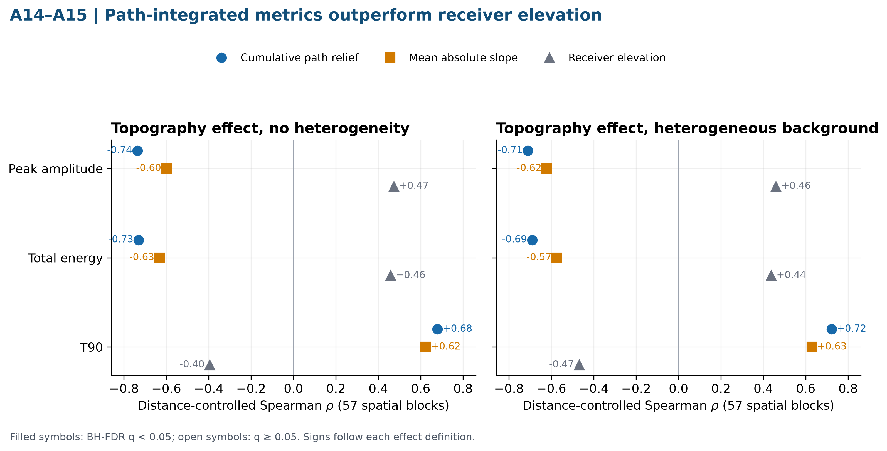

**科学解释：** 该结果与同组波形、分量能量和路径统计相互约束，避免仅依赖单一标量。

**适用边界：** 数值只在当前 0.3-0.9 Hz、50-245 s 处理口径和对应几何内有效；不能跨几何或跨窗口直接拼接。

**建议英文表述：** Mean absolute slope provides a second path-integrated descriptor with correlations close to cumulative relief, although the two predictors are not statistically independent.

*A16/S12 权威来源：figures/main、figures/supporting 与 data/derived 当前版本；旧 REL3 卡片仅作版式参考。*

### A15 单点台站高程不能替代整条传播路径

**反向/排除性证据：** 波形由源到台站整条路径累积形成，接收点高程只描述末端。

**定量依据：** 峰值、能量与 T90 的单点高程 |rho| 约 0.40-0.47，系统低于累计路径高差的 0.68-0.74。

**科学解释：** 该结果与同组波形、分量能量和路径统计相互约束，避免仅依赖单一标量。

**适用边界：** 数值只在当前 0.3-0.9 Hz、50-245 s 处理口径和对应几何内有效；不能跨几何或跨窗口直接拼接。

**建议英文表述：** Receiver elevation alone cannot substitute for an integrated source-to-receiver path metric.

*A16/S12 权威来源：figures/main、figures/supporting 与 data/derived 当前版本；旧 REL3 卡片仅作版式参考。*

### A16 地形与散射交互波形与主效应同量级

**正向确定性证据：** 交互项 I=M4-M2-M3+M1 在 Z/R/T 上均不可忽略。

**定量依据：** 交互 RMS 与两个主效应 RMS 和的中位比约 Z 0.69、R 0.70、T 1.00。

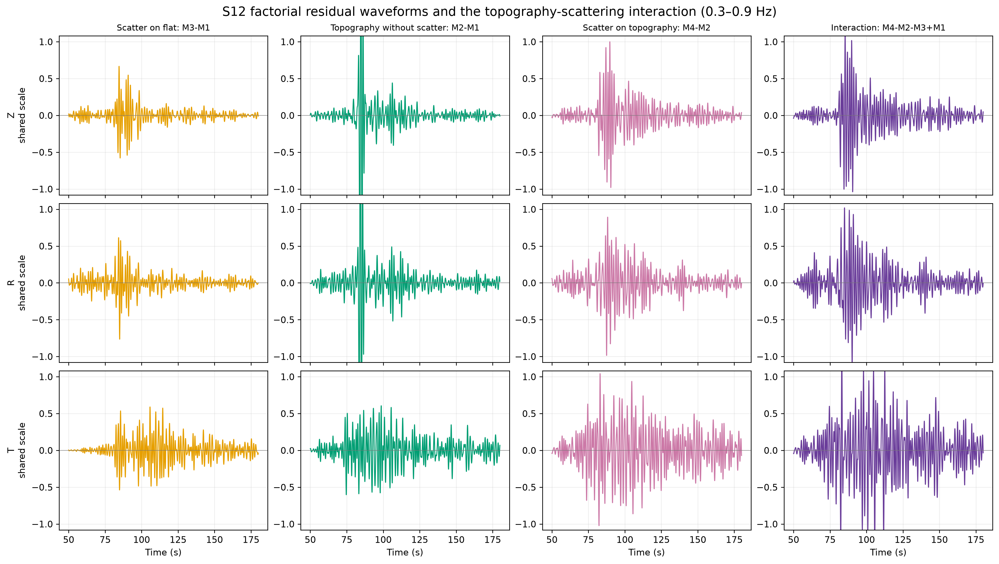

**科学解释：** 该结果与同组波形、分量能量和路径统计相互约束，避免仅依赖单一标量。

**适用边界：** 数值只在当前 0.3-0.9 Hz、50-245 s 处理口径和对应几何内有效；不能跨几何或跨窗口直接拼接。

**建议英文表述：** The factorial interaction waveform is comparable in magnitude to the isolated main effects and is therefore dynamically non-negligible.

*A16/S12 权威来源：figures/main、figures/supporting 与 data/derived 当前版本；旧 REL3 卡片仅作版式参考。*

### A17 非线性主要集中在 T/SH 代理分量

**正向确定性证据：** T 交互与主效应同量级，说明横向转换对背景组合最敏感。

**定量依据：** S12 的交互比约 Z 0.55、R 0.53、T 1.02。

**科学解释：** 该结果与同组波形、分量能量和路径统计相互约束，避免仅依赖单一标量。

**适用边界：** 数值只在当前 0.3-0.9 Hz、50-245 s 处理口径和对应几何内有效；不能跨几何或跨窗口直接拼接。

**建议英文表述：** Nonlinear coupling is strongest on the transverse, SH-proxy component.

*A16/S12 权威来源：figures/main、figures/supporting 与 data/derived 当前版本；旧 REL3 卡片仅作版式参考。*

### A18 不能用地形振幅修正加独立尾波卷积替代 M4

**反向/排除性证据：** 差分波形在主脉冲之后生成新相位和持续振荡。

**定量依据：** 组合模型必须直接计算。

**科学解释：** 该结果与同组波形、分量能量和路径统计相互约束，避免仅依赖单一标量。

**适用边界：** 数值只在当前 0.3-0.9 Hz、50-245 s 处理口径和对应几何内有效；不能跨几何或跨窗口直接拼接。

**建议英文表述：** A topographic amplitude correction followed by an independent scattering convolution cannot substitute for the directly simulated combined model.

*A16/S12 权威来源：figures/main、figures/supporting 与 data/derived 当前版本；旧 REL3 卡片仅作版式参考。*

### A19 M1-M4 的 12 组主能量距离关系均不支持简单 R²

**反向/排除性证据：** 三条射线、四模型均偏好线性 a+bR。

**定量依据：** 线性 RMSE 1.54-2.88 s，R² RMSE 4.56-10.03 s，Delta AIC 268-672。

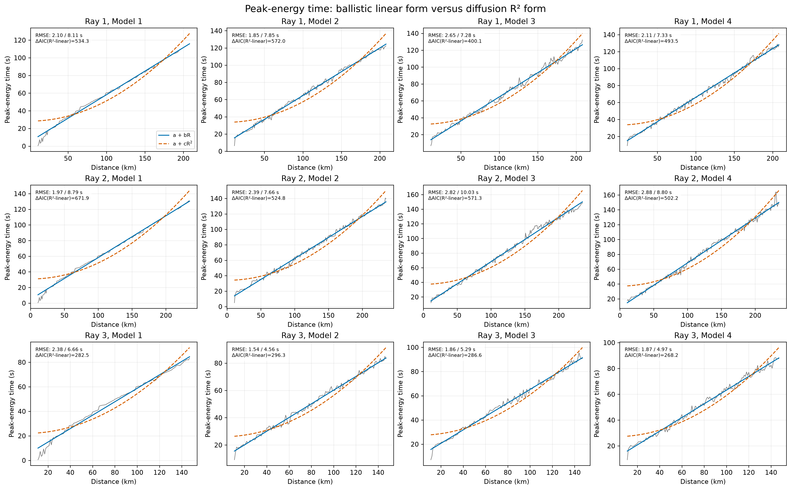

**科学解释：** 该结果与同组波形、分量能量和路径统计相互约束，避免仅依赖单一标量。

**适用边界：** 数值只在当前 0.3-0.9 Hz、50-245 s 处理口径和对应几何内有效；不能跨几何或跨窗口直接拼接。

**建议英文表述：** All 12 A16 peak-energy distance relations favor a linear-distance form over a simple squared-distance diffusion form.

*A16/S12 权威来源：figures/main、figures/supporting 与 data/derived 当前版本；旧 REL3 卡片仅作版式参考。*

### A20 当前 A16 模型仍由弹道/准弹道主能量脊主导

**正向确定性证据：** 地形与散射增加多路径，但主能量峰仍沿近线性距离传播。

**定量依据：** R² 曲线系统偏离主能量脊。

**科学解释：** 该结果与同组波形、分量能量和路径统计相互约束，避免仅依赖单一标量。

**适用边界：** 数值只在当前 0.3-0.9 Hz、50-245 s 处理口径和对应几何内有效；不能跨几何或跨窗口直接拼接。

**建议英文表述：** The main energy ridge remains ballistic or quasi-ballistic despite topographic and random-heterogeneity multipathing.

*A16/S12 权威来源：figures/main、figures/supporting 与 data/derived 当前版本；旧 REL3 卡片仅作版式参考。*

### A21 单一 S12 观测不能拟合观测距离幂律

**待验证/受限证据：** Apollo A16S12 只在约 152 km 提供一个长尾锚点。

**定量依据：** 检验观测 R²/D 需要多个事件-台站距离组合。

**科学解释：** 该结果与同组波形、分量能量和路径统计相互约束，避免仅依赖单一标量。

**适用边界：** 数值只在当前 0.3-0.9 Hz、50-245 s 处理口径和对应几何内有效；不能跨几何或跨窗口直接拼接。

**建议英文表述：** A single observed S12 record cannot establish an observational distance-scaling exponent.

*A16/S12 权威来源：figures/main、figures/supporting 与 data/derived 当前版本；旧 REL3 卡片仅作版式参考。*

### A22 平滑改变 tmax 数值，但不改变低速层前的基本失配方向

**正向确定性证据：** 多种平滑窗下，模型峰时都显著早于观测。

**定量依据：** 旧四模型观测 tmax 约 658.29 s，而 M1-M4 仅 85.73-96.53 s。

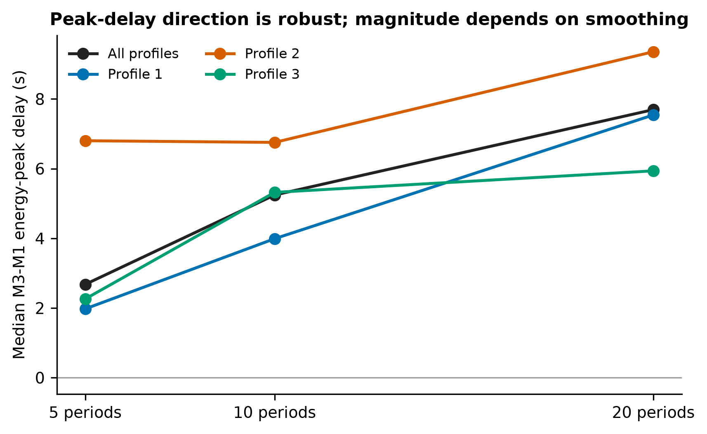

**科学解释：** 该结果与同组波形、分量能量和路径统计相互约束，避免仅依赖单一标量。

**适用边界：** 数值只在当前 0.3-0.9 Hz、50-245 s 处理口径和对应几何内有效；不能跨几何或跨窗口直接拼接。

**建议英文表述：** Smoothing changes exact peak-time estimates but not the large timing mismatch between M1-M4 and the observation.

*A16/S12 权威来源：figures/main、figures/supporting 与 data/derived 当前版本；旧 REL3 卡片仅作版式参考。*

### A23 初始到达量级接近，但能量峰演化完全不相容

**反向/排除性证据：** 模型与观测均在约 80-100 s 起振，此后模型衰减而观测继续增长。

**定量依据：** 主要矛盾不是首波速度量级，而是能量输运寿命。

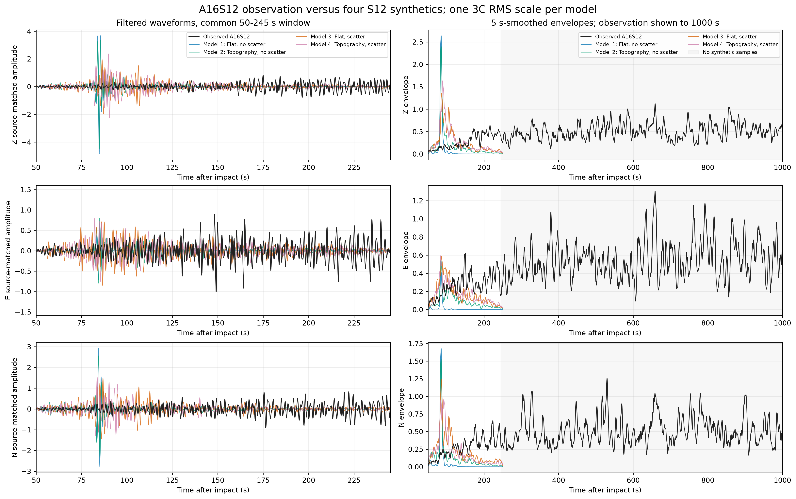

**科学解释：** 该结果与同组波形、分量能量和路径统计相互约束，避免仅依赖单一标量。

**适用边界：** 数值只在当前 0.3-0.9 Hz、50-245 s 处理口径和对应几何内有效；不能跨几何或跨窗口直接拼接。

**建议英文表述：** Observed and synthetic onsets are broadly comparable, whereas their subsequent energy-envelope evolution is incompatible.

*A16/S12 权威来源：figures/main、figures/supporting 与 data/derived 当前版本；旧 REL3 卡片仅作版式参考。*

### A24 M1-M4 的 t95 远短于 Apollo

**反向/排除性证据：** 随机非均匀性延长尾波方向正确，但仍止于约 160 s。

**定量依据：** M1/M2/M3/M4 t95=86.47/110.49/160.68/152.52 s，观测=2804.63 s。

**科学解释：** 该结果与同组波形、分量能量和路径统计相互约束，避免仅依赖单一标量。

**适用边界：** 数值只在当前 0.3-0.9 Hz、50-245 s 处理口径和对应几何内有效；不能跨几何或跨窗口直接拼接。

**建议英文表述：** The M1-M4 t95 values remain far shorter than the Apollo A16S12 coda even when random heterogeneity is present.

*A16/S12 权威来源：figures/main、figures/supporting 与 data/derived 当前版本；旧 REL3 卡片仅作版式参考。*

### A25 共享源尺度不能修复相位与包络形状

**反向/排除性证据：** 统一源能量后，早期三分量相关仍接近零。

**定量依据：** M1-M4 相关约 -0.010 至 0.036，NRMSE 1.39-1.42。

**科学解释：** 该结果与同组波形、分量能量和路径统计相互约束，避免仅依赖单一标量。

**适用边界：** 数值只在当前 0.3-0.9 Hz、50-245 s 处理口径和对应几何内有效；不能跨几何或跨窗口直接拼接。

**建议英文表述：** A shared source-amplitude scale cannot repair the phase and envelope-shape mismatch.

*A16/S12 权威来源：figures/main、figures/supporting 与 data/derived 当前版本；旧 REL3 卡片仅作版式参考。*

### A26 250 s 合成只覆盖观测约 4% 的记录能量

**反向/排除性证据：** 观测主要能量位于旧模型截点之后。

**定量依据：** 观测 t50=984.92 s、t95=2804.63 s，前 250 s 约占 4.00%。

**科学解释：** 该结果与同组波形、分量能量和路径统计相互约束，避免仅依赖单一标量。

**适用边界：** 数值只在当前 0.3-0.9 Hz、50-245 s 处理口径和对应几何内有效；不能跨几何或跨窗口直接拼接。

**建议英文表述：** The 250 s synthetics sample only the early few percent of the recorded Apollo energy.

*A16/S12 权威来源：figures/main、figures/supporting 与 data/derived 当前版本；旧 REL3 卡片仅作版式参考。*

### A27 模型频谱与晚期能量分配同时失配

**反向/排除性证据：** 模型频带峰整体偏高，且 120 s 后三分量能量比例远低于观测。

**定量依据：** 观测 Z/R/T 时频主频约 0.399/0.448/0.399 Hz；模型多为 0.55-0.80 Hz。

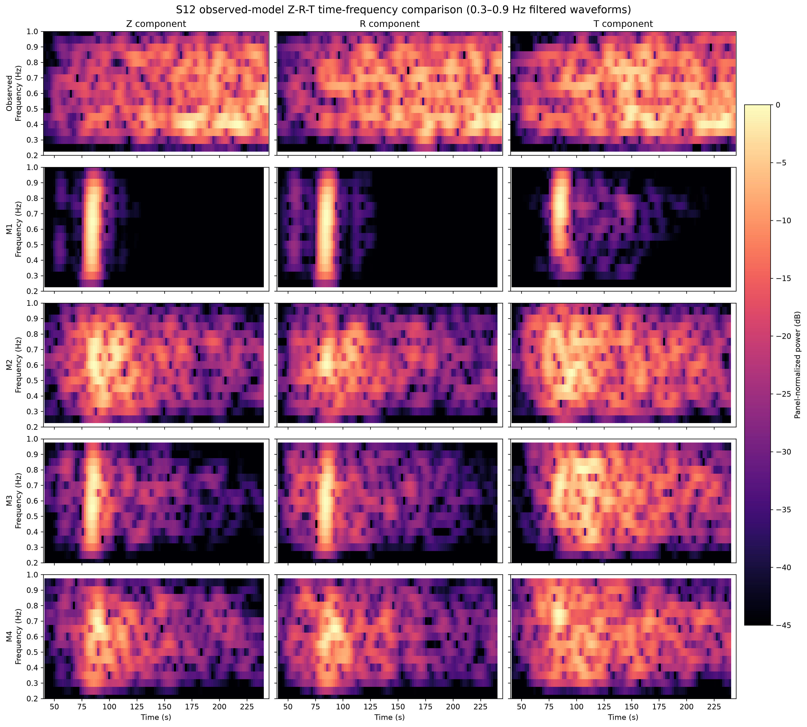

**科学解释：** 该结果与同组波形、分量能量和路径统计相互约束，避免仅依赖单一标量。

**适用边界：** 数值只在当前 0.3-0.9 Hz、50-245 s 处理口径和对应几何内有效；不能跨几何或跨窗口直接拼接。

**建议英文表述：** The baseline models jointly miss the observed spectral range and late three-component energy partition.

*A16/S12 时频权威来源：data/derived/A16S12_s12_time_frequency_metrics.csv；图像来源 figures/supporting 当前版本。*

### A28 四模型的主要缺口是频率-持续时间-三维转换机制

**反向/排除性证据：** 振幅系数或小幅静态时移不能同时修复时频、持续与偏振失配。

**定量依据：** 需要更强/多尺度散射、低速层、Q、域尺寸与多随机实现联合试验。

**科学解释：** 该结果与同组波形、分量能量和路径统计相互约束，避免仅依赖单一标量。

**适用边界：** 数值只在当前 0.3-0.9 Hz、50-245 s 处理口径和对应几何内有效；不能跨几何或跨窗口直接拼接。

**建议英文表述：** The dominant model deficiency is a coupled frequency-duration-three-dimensional-conversion mechanism rather than a single source-amplitude coefficient.

*A16/S12 权威来源：figures/main、figures/supporting 与 data/derived 当前版本；旧 REL3 卡片仅作版式参考。*

## 第三部分｜低速层六模型条件扩展

M5/M6 将记录延长到400 s，首次直接检验低速层对能量滞留、路径迁移和地形边际效应的影响。

### LV01 六模型结构可比，但记录长度不同，必须采用双窗口

**正向确定性证据：** M5/M6 可以与 M1-M4 进行同名台站、同分量的配对比较；记录长度差异不能通过简单截断后被忽略。

**定量依据：** 六个文件均包含 r1-r606、seq_no 0-605 和有限 Vx/Vy/Vz；M1-M4 约 250 s，M5/M6 约 400 s。公共效应窗口为 50-245 s，低速层延长诊断窗口为 50-395 s。

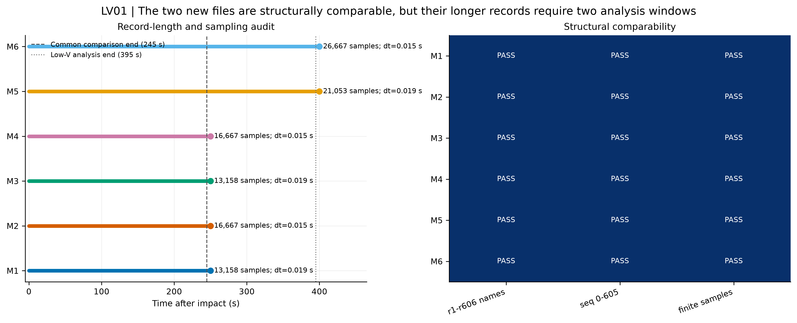

**科学解释：** 双窗口把两个问题分开：公共窗回答模型之间的可比边际效应，延长窗回答低速层运行内部的晚期演化和删失风险。

**适用边界：** NetCDF 不编码完整运行条件；结构一致只证明输出格式和台站序列可比，不证明源、网格、Q、边界和随机实现完全相同。

**建议英文表述：** The six outputs share the same receiver sequence, but unequal record lengths require a common 50-245 s comparison window and a separate 50-395 s low-velocity diagnostic window.

*输入审计与 SHA-256：provenance/low_velocity_input_audit.csv。*

### LV02 当前只能识别含非均匀背景下的地形×低速层条件设计

**反向/排除性证据：** M3/M4/M5/M6 形成一个所有单元均含随机非均匀性的条件 2×2 设计，而不是完整的地形×散射×低速层三因素设计。

**定量依据：** 可识别对比为 M5/M3、M6/M4、M4/M3、M6/M5 以及 (M6-M5)-(M4-M3)；缺少“低速层+无散射”两单元。

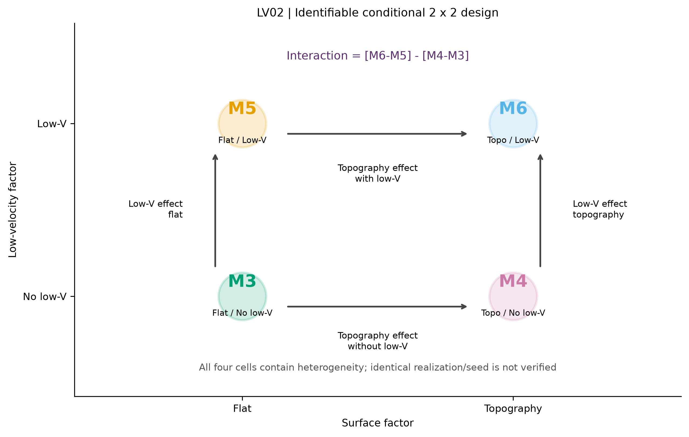

**科学解释：** 因此可以检验低速层在两种表面背景中的运行级差异，也可以检验条件交互；不能估计低速层×散射或完整三阶交互。

**适用边界：** 随机实现/种子未保存，图中“均含非均匀性”不能进一步提升为“使用同一随机实现”。

**建议英文表述：** The available models identify a heterogeneity-present topography-by-low-velocity contrast, not a complete three-factor design.

*设计边界由现有六个 station.nc 与缺失运行清单共同决定。*

### LV03 低速层改变 S12 三分量相位结构，而非统一振幅缩放

**正向确定性证据：** 在共享三分量尺度下，M5 相对 M3、M6 相对 M4 的 Z/R/T 都出现新的相位、脉冲和持续振荡。

**定量依据：** 图中同一对比使用共享 3C 尺度，没有逐分量归一化；变化同时存在于 Z、R 和 T。

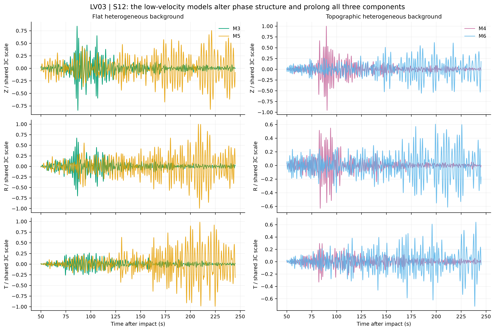

**科学解释：** 低速层运行改变能量储存、转换和出射过程；单一静态时移或振幅系数不能把基准波形变成低速层波形。

**适用边界：** 这是波形形状证据，不反演具体层厚、速度或界面形态。

**建议英文表述：** Shared-scale S12 waveforms show that the low-velocity runs alter phase structure on all three components rather than applying a scalar amplitude correction.

*波形先逐站旋转到 Z/R/T；无逐分量归一化。*

### LV04 S12 的大量低速层能量位于原 245 s 截点之后

**正向确定性证据：** M5/M6 在 245 s 后仍持续出现能量峰和累计能量增长，旧的四模型窗口会截掉关键低速层响应。

**定量依据：** S12 延长窗 t95 为 M5 368.22 s、M6 381.88 s；两者都接近 400 s 记录末端。

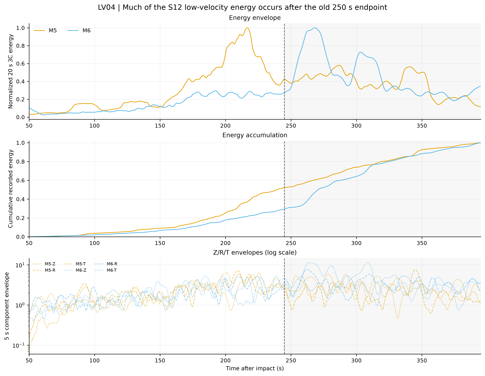

**科学解释：** 延长记录使低速层能量滞留首次被直接看见，也解释了公共窗与延长窗持续时间指标的差异。

**适用边界：** 接近末端的 t95 仍可能被右删失；这些数值是当前记录内下限，不是完整尾波寿命。

**建议英文表述：** A substantial fraction of the S12 low-velocity response occurs after 245 s, and its t95 approaches the 400 s record limit.

*延长窗口仅用于 M5/M6 内部诊断。*

### LV05 低速层运行的主效应是能量积累、持续时间增加和峰时延迟

**条件性运行级证据：** 两个表面背景中，低速层运行都显著增强累计能量并延迟包络演化；峰值放大较不均一。

**定量依据：** 平坦背景：空间块中位数 19.72 倍，95%区间 12.20-87.29 倍；站点级描述中位数 19.07 倍；空间块中位数 1.50 倍，95%区间 1.29-1.57 倍；站点级描述中位数 1.46 倍。地形背景：空间块中位数 12.04 倍，95%区间 6.72-65.61 倍；站点级描述中位数 11.59 倍；空间块中位数 1.41 倍，95%区间 1.25-1.57 倍；站点级描述中位数 1.39 倍。

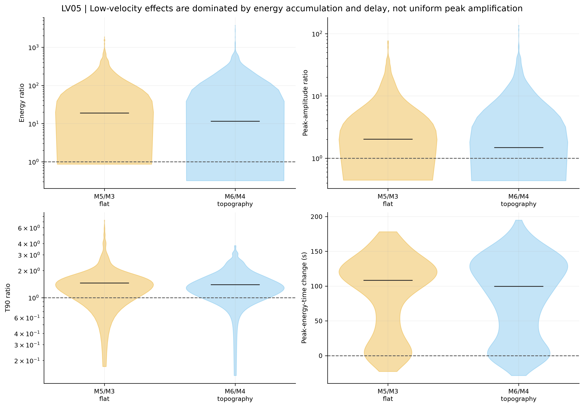

**科学解释：** 能量因子远大于峰值因子，说明新增响应主要表现为长时间能量积累，而不是所有位置同步提高瞬时主峰。

**适用边界：** 绝对能量和振幅的因果归因以源与其余运行设置不变为前提；时间与分量占比结论更稳健。

**建议英文表述：** The low-velocity runs primarily enhance integrated energy and delay rather than producing a uniform peak-amplitude increase, conditional on unchanged run settings.

*小提琴为站点级分布；推断值与区间来自 57 个空间块中位数。*

### LV06 低速层响应具有显著射线路径差异

**正向确定性证据：** 三条剖面的能量、持续和峰时效应幅度明显不同，不能用一个全区常数概括低速层响应。

**定量依据：** 射线分组均去除首尾各 5 站后计算；每条射线的能量因子、T90 因子和 tmax 变化均呈不同中位值与四分位范围。

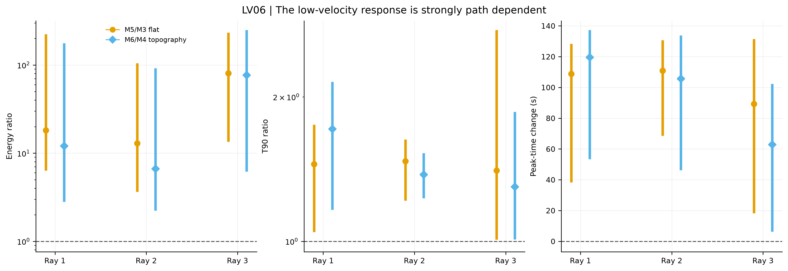

**科学解释：** 这说明低速层与传播方向、路径起伏、局部结构或边界几何耦合；路径差异是物理信号而非仅是总体离散。

**适用边界：** 现有三条单向剖面不足以把路径差异唯一归因于某一种界面或三维结构。

**建议英文表述：** Ray-specific effect distributions demonstrate that the low-velocity response is path dependent rather than a model-wide constant.

*分射线结果是描述性；跨全样本推断使用 57 个非重叠空间块。*

### LV07 低速层进一步把 Z 能量重新分配到 R/T

**正向确定性证据：** 从 M1 到 M6，复杂结构逐步降低 Z 占比并提高水平与横向能量，M5/M6 延续并强化这一趋势。

**定量依据：** M1-M4 的 Z/R/T 中位占比为 70.15/29.85/~0、54.58/24.69/20.45、56.37/27.63/16.13、48.92/27.28/23.43%；M5/M6 的当前值由统一脚本在相同公共窗重算。

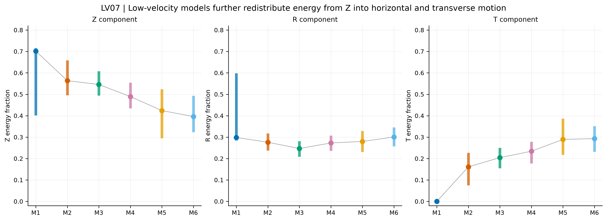

**科学解释：** 分量重分配是三维模式转换和多路径改变的重要证据；Z 下降不等价于能量吸收增强。

**适用边界：** Z/R/T 是台站坐标分量；严格 P/SV/SH 分离仍需要波场散度-旋度或阵列慢度。

**建议英文表述：** The low-velocity runs further redistribute energy from Z into horizontal and transverse motion, extending the three-dimensional conversion trend seen in M1-M4.

*占比按三分量平方速度能量计算，T 基准近零时不使用倍数。*

### LV08 T 分量转换依赖地表和低速背景

**正向确定性证据：** 低速层导致的 T 占比增量在平坦与地形背景中不同，地形的 T 边际效应也会因低速层背景而改变。

**定量依据：** M5/M3：空间块中位变化 10.43 个百分点，95%区间 7.47 至 15.43 个百分点；站点级描述中位数 10.89 个百分点；M6/M4：空间块中位变化 4.31 个百分点，95%区间 1.16 至 7.65 个百分点；站点级描述中位数 4.86 个百分点。

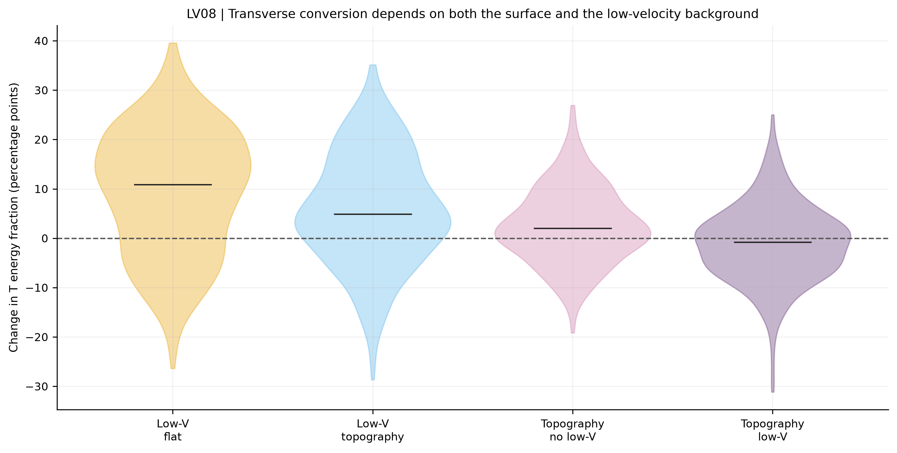

**科学解释：** T 是对三维不对称、散射和地表转换最敏感的分量之一；背景依赖排除了固定转换率解释。

**适用边界：** T 只能作为 SH 代理，不能单凭单台站三分量唯一分解所有模式。

**建议英文表述：** Transverse-energy conversion depends on both the surface and low-velocity background, precluding a universal conversion factor.

*使用百分点差而非相对 M1 近零 T 能量的倍数。*

### LV09 低速层运行使地形边际能量效应由放大转为近中性

**条件性运行级证据：** 无低速层时，地形在非均匀背景中总体提高能量；加入低速层后，点估计接近中性并略偏抑制，但区间跨越中性值。

**定量依据：** M4/M3：空间块中位数 1.78 倍，95%区间 1.23-2.12 倍；站点级描述中位数 1.66 倍；M6/M5：空间块中位数 0.99 倍，95%区间 0.76-1.19 倍；站点级描述中位数 0.94 倍。

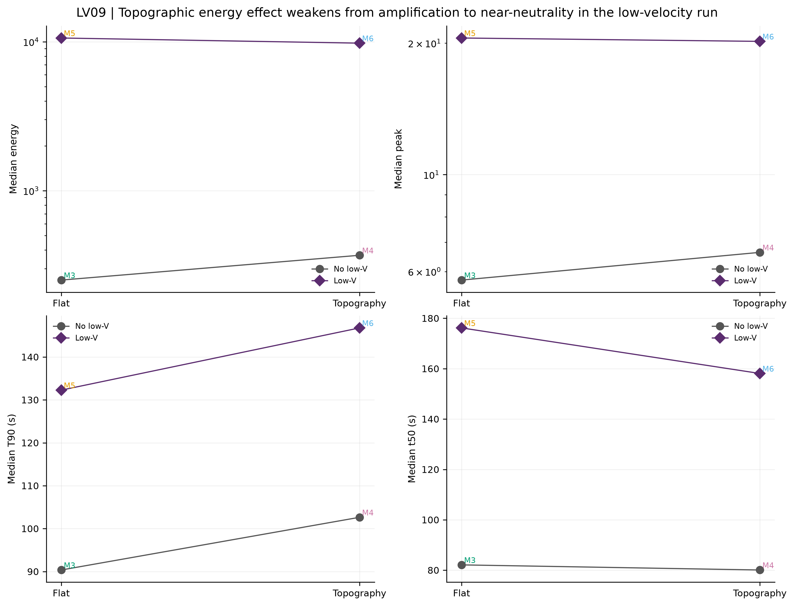

**科学解释：** 地形不是可以从简单模型直接乘到复杂模型上的固定修正量；其边际效应取决于波场已经被散射和低速滞留改造的程度。

**适用边界：** M6/M5 的能量点估计为 0.985，但 95%区间 0.757-1.185 跨 1，因此只支持由显著放大转为近中性，不能声称抑制方向显著；唯一归因仍要求源、随机实现、Q、网格和边界完全一致。

**建议英文表述：** The marginal topographic energy effect changes from amplification without the low-velocity run to a statistically neutral estimate with it, conditional on run equivalence.

*绝对幅能量结论带运行清单限制。*

### LV10 地形×低速层交互是指标选择性的混合效应

**正向确定性证据：** 能量、峰值、t05、t50、晚期能量比例和 T 占比支持非零交互；T90、tmax、t95、Z/R 占比区间跨零。

**定量依据：** 交互项定义为 (M6-M5)-(M4-M3)，正值指标在对数比值域计算，时间和占比使用差值；图按单位分面，避免混合尺度。

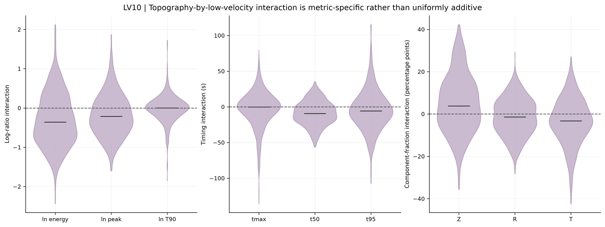

**科学解释：** 结果支持“非加性集中在部分传播属性”，不支持“所有指标都存在同方向强交互”。

**适用边界：** 物理原因可能包括陷获、转换、聚焦/散焦和散射饱和，现有台站输出不能唯一拆分。

**建议英文表述：** Topography-by-low-velocity interaction is metric specific: selected energy, timing, late-energy, and transverse-partition measures are nonzero, whereas several duration and component intervals include zero.

*交互区间由相同 57 个空间块中位数估计。*

### LV11 峰值与能量地形空间指纹在低速背景中部分保留，T90 不显著

**正向确定性证据：** 同一位置的地形强弱格局在有无低速层之间并非完全消失，但保留程度取决于指标。

**定量依据：** 总能量地形效应的距离控制块相关 rho=0.53、q=0.00011；T90 为 rho=0.26、q=0.095。

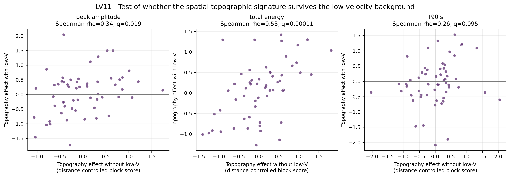

**科学解释：** 能量指纹的中等相关说明地形热点有一定跨背景稳定性；T90 不显著说明持续时间格局更容易被低速层重排。

**适用边界：** 这是空间格局相关，不是 M4 与 M3 或 M6 与 M5 原始波形相关。

**建议英文表述：** The spatial topographic fingerprint persists for energy more clearly than for T90, whose distance-controlled correlation is not significant.

*每条射线先去三次距离趋势，再标准化与分块。*

### LV12 低速背景下路径高差仍对应峰值/能量降低和 T90 延长

**正向确定性证据：** 路径累计高差必须在新背景中重新检验；结果表明它仍与地形边际效应具有系统关系。

**定量依据：** 能量效应与路径高差的距离控制相关 rho=-0.47、q=0.00072；T90 为 rho=0.52、q=0.00014。

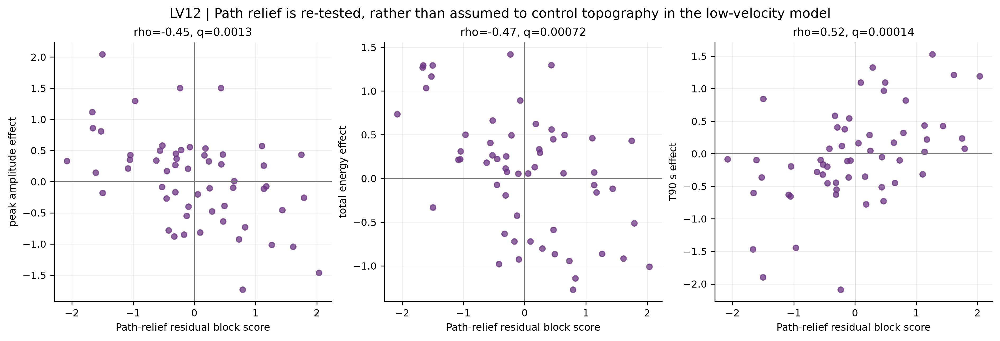

**科学解释：** 更大路径起伏仍倾向于削弱相干幅能量并延长持续，但相关强度与无低速层背景不同。

**适用边界：** 路径使用地表投影直线，尚未包含有限频率 Fresnel 走廊、三维射线弯曲或波场通量。

**建议英文表述：** Path relief remains associated with reduced coherent energy and prolonged duration in the low-velocity background, but the relationship must be re-estimated rather than transferred from the baseline models.

*路径指标来自当前 A16/S12 几何和既有路径派生表。*

### LV13 低速层运行使能量峰迁移变慢且空间离散增大

**正向确定性证据：** M5/M6 的能量峰随距离迁移斜率显著高于 M1-M4，同时同距离散布明显变大。

**定量依据：** M5/M3：空间块中位变化 111.74 s，95%区间 91.23 至 123.39 s；站点级描述中位数 108.43 s；M6/M4：空间块中位变化 100.99 s，95%区间 83.66 至 119.35 s；站点级描述中位数 99.64 s。删失安全斜率覆盖 0.84-1.90 s/km。

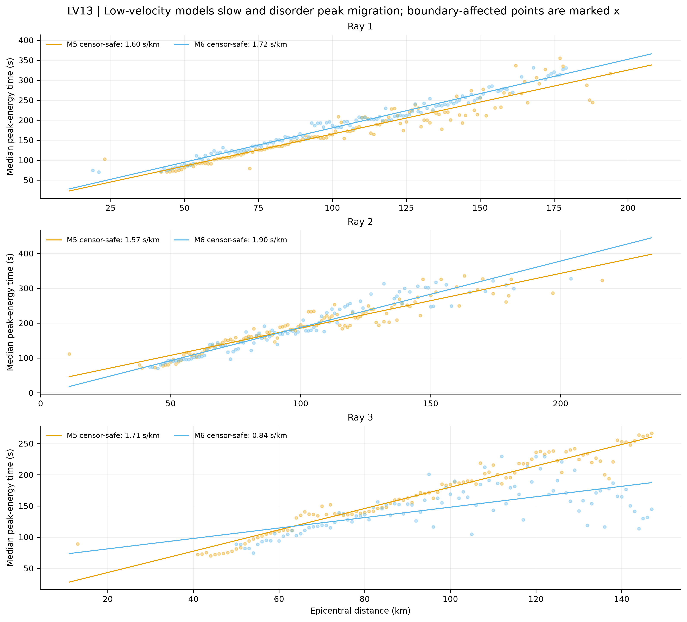

**科学解释：** 低速结构显著减慢峰能量迁移并提高路径敏感性，但仍保留清晰距离结构。

**适用边界：** 斜率来自 50-395 s 记录内 tmax；边界受限点以 x 标出并从敏感性斜率中剔除。

**建议英文表述：** The low-velocity runs slow and disorder peak-energy migration, with larger distance slopes and substantially greater path-dependent scatter.

*边界受影响点单独标识；拟合为 400 s 窗内描述。*

### LV14 低速层仍未使主能量迁移进入简单 R² 扩散状态

**反向/排除性证据：** 全部主样本和删失安全敏感性样本中，线性距离形式均优于简单 R² 形式。

**定量依据：** 删失安全六组拟合的最小 Delta AIC(R²-线性) 为 12.79，所有 preferred_form 均为 linear。

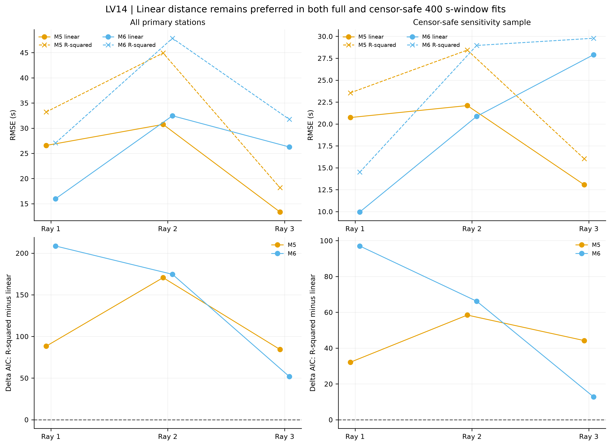

**科学解释：** 低速层使传播更慢、更离散，但主能量脊仍更接近弹道/准弹道距离标度，而非简单强扩散峰时标度。

**适用边界：** 该检验只比较两个简化经验形式，不能排除更复杂的非高斯扩散、频散或多阶段输运。

**建议英文表述：** Even after censor-safe filtering, the main energy ridge remains better described by linear distance than by a simple R-squared diffusion form.

*仅作当前 400 s 记录窗内传播状态诊断。*

### LV15 包络相似性提高并不意味着相位波形拟合成功

**正向确定性证据：** 低速层运行可以保持或改善缓慢能量包络演化，同时零时滞三分量波形相关仍集中在零附近。

**定量依据：** 图同时给出零时滞 3C 波形相关与允许 ±10 s 的 5 s 包络最佳相关；两者的经验分布和散点关系明显分离。

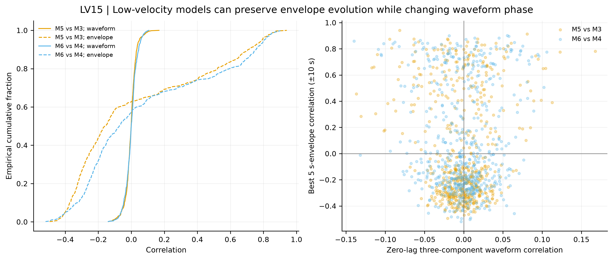

**科学解释：** 包络比较检验能量迁移，波形相关检验相位与脉冲结构；论文必须并列报告，不能用前者替代后者。

**适用边界：** 允许时移会提高包络相关，不能据此声称走时、相位和源机制均已匹配。

**建议英文表述：** Improved envelope similarity does not imply phase agreement; the two diagnostics capture distinct aspects of the waveform.

*相关性不做逐台站自由振幅拟合。*

### LV16 数据选取的代表台站验证总体分布不是单迹异常

**正向确定性证据：** 代表波形依据效应分位数、同距离和交互强度规则自动选取，而非根据视觉效果挑选。

**定量依据：** 图包含平坦/地形背景的中位能量效应、高延迟、强正/负地形交互和约 100 km 同距台站。

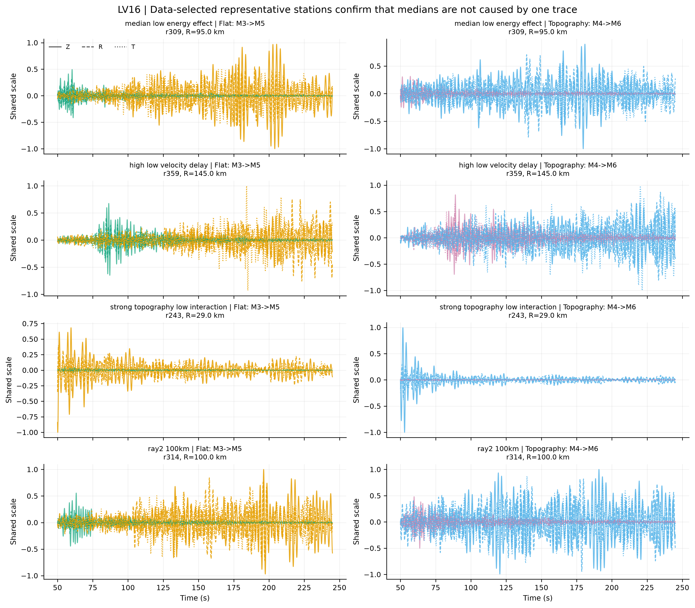

**科学解释：** 这些波形把统计量对应到真实相位、尾波和分量变化，防止只用中位数隐藏空间异质性。

**适用边界：** 代表台站用于解释，不替代 575 站和 57 空间块的总体统计。

**建议英文表述：** Data-selected representative traces confirm that the reported distributions correspond to reproducible waveform changes rather than a single visually chosen station.

*选择规则与台站编号保存在 low_velocity_representative_stations.json。*

### LV17 低速层把 S12 早期包络推向 Apollo，但仍远短于观测长尾

**正向确定性证据：** M5/M6 的包络能量峰和累积能量明显晚于 M1-M4，方向上改善了观测对比。

**定量依据：** M5/M6 tmax 为 213.22/272.45 s，观测为 658.29 s；t95 为 368.22/381.88 s，观测为 2804.62 s。

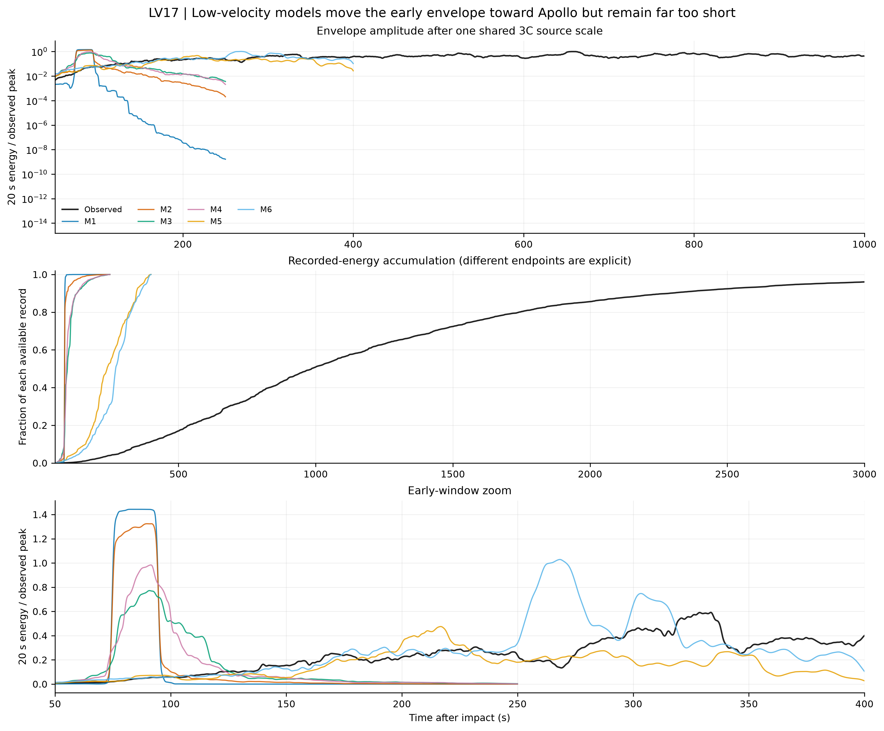

**科学解释：** 低速层是现有试验中最强的延迟机制，但仍只覆盖 Apollo 长尾的早期部分。

**适用边界：** 模型和观测终止时间不同；累计曲线明确使用各自可用记录，不能把模型终点解释为完整 100% 物理能量。

**建议英文表述：** The low-velocity runs move the early S12 envelope toward Apollo, but their peak and t95 times remain far earlier than the observed long coda.

*每个模型只使用一个共享 3C RMS 源尺度。*

### LV18 时间改善没有解决相位和完整持续时间失配

**反向/排除性证据：** M5/M6 的 tmax 和包络相关改善，但早期三分量相位相关仍很低，完整 t95 差距仍接近一个数量级。

**定量依据：** 早期 3C 相关为 M5 -0.058、M6 0.080；观测 t95=2804.6 s。

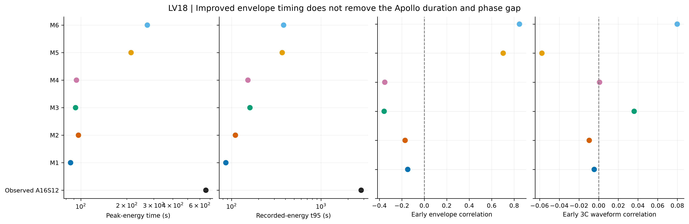

**科学解释：** 新增低速机制改善了“何时积累能量”，却没有同时修复“每个脉冲的相位”和“数千秒持续时间”。

**适用边界：** 单台站观测不能建立距离幂律，但足以排除当前模型已经再现该站长尾的说法。

**建议英文表述：** Improved envelope timing does not resolve the near-zero phase correlation or the order-of-magnitude duration gap to Apollo.

*观测值来自 A16S12；模型按共享源尺度比较。*

### LV19 低速层时频能量仍远短于 Apollo

**反向/排除性证据：** M5/M6 把 0.3-0.9 Hz 能量延长到 400 s 左右，但观测在更长时间保持宽频带能量。

**定量依据：** 图使用统一 0.2-1.2 Hz 展示范围和每面板相对功率标度，M4、M5、M6 与观测的持续时间和频带演化可直接比较。

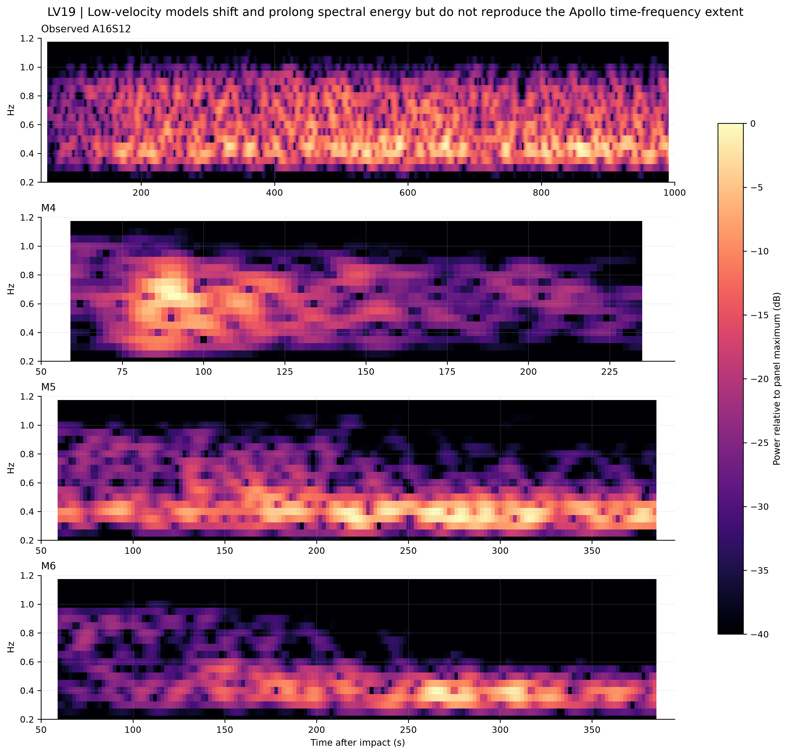

**科学解释：** 失配同时存在于时间和频率：不仅尾波太短，能量中心与频带演化也不同。

**适用边界：** 面板采用相对功率，不能用于绝对谱幅比较；它支持的是时频形态与持续范围判断。

**建议英文表述：** The low-velocity synthetics prolong band-limited energy but still fail to reproduce the observed time-frequency extent of the Apollo coda.

*颜色为各面板相对最大功率 dB。*

### LV20 400 s 记录仍右删失一部分低速层台站

**待验证/受限证据：** 延长到 400 s 显著提高覆盖，但一部分台站的 t95 仍落在记录最后 20 s，尾部能量尚未稳定结束。

**定量依据：** 575 个主样本中，t95 位于最后 20 s 的台站为 M5 118 个、M6 132 个。

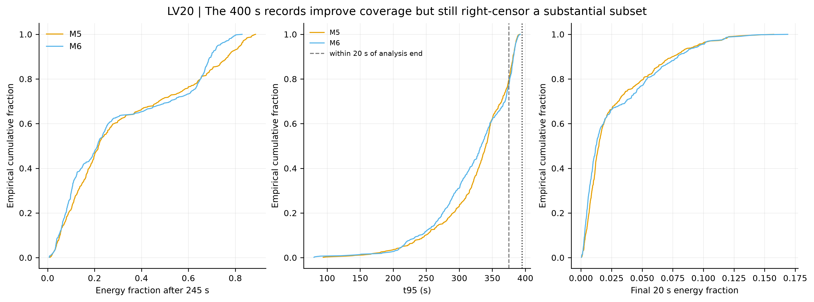

**科学解释：** 这些台站的 t95/T90 是下限或窗口依赖估计；应在论文图表和统计中明确标记。

**适用边界：** 右删失不否定早期延迟和三分量转换，但限制对完整尾波寿命、距离斜率和长时能量比例的推断。

**建议英文表述：** The 400 s records still right-censor a substantial subset, so late t95 and T90 values are lower bounds for those stations.

*375 s 被用作距 395 s 分析终点 20 s 的删失阈值。*

### LV21 低速层延迟具有距离结构、非单调性和路径差异

**正向确定性证据：** tmax 差值随距离先增长，随后在不同射线上饱和或回落，不能表示为常数静态时移。

**定量依据：** 三条剖面分别用 11 站平滑显示 M5-M3 与 M6-M4 的局部距离结构；站点散点保留真实离散。

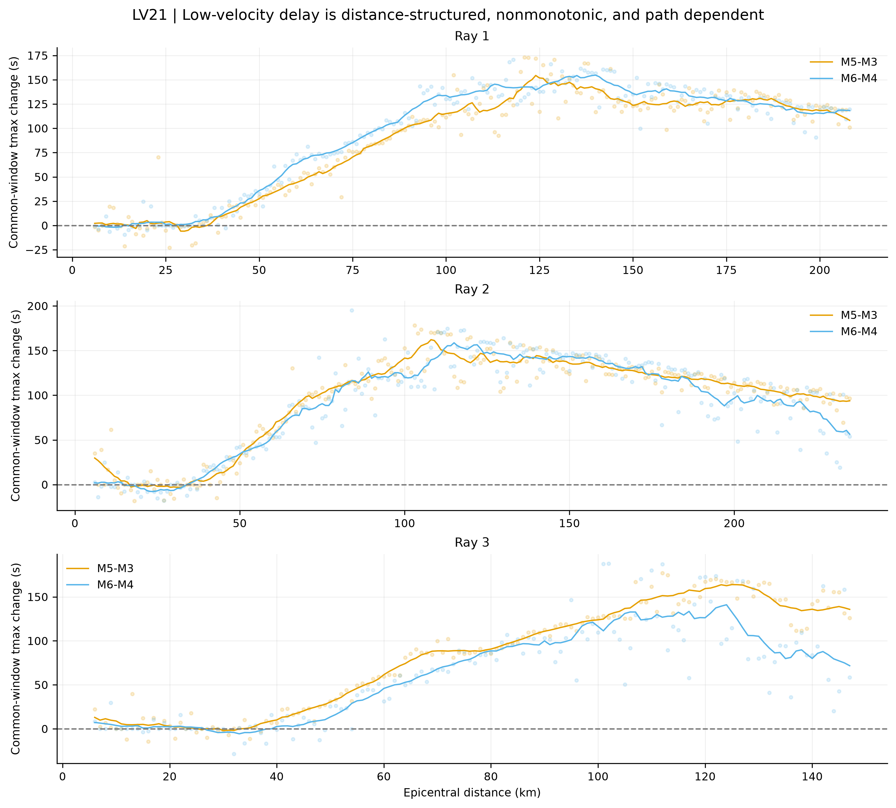

**科学解释：** 距离结构说明低速层效应随传播路径累积和重分配，可能包含多次波、模式转换及出射位置变化。

**适用边界：** 非单调曲线不应被拟合为单一全区线性延迟定律；它是机制诊断而非层厚反演。

**建议英文表述：** Low-velocity delay is distance structured and nonmonotonic, ruling out representation by a single static time correction.

*曲线为局部平滑，不用于声明全程单调。*

### LV22 一致的空间块估计确认能量、持续与延迟效应稳健

**正向确定性证据：** 点估计、bootstrap 区间和 Wilcoxon 检验均使用相同的 57 个非重叠 10 站块中位数。

**定量依据：** M5/M3 能量：空间块中位数 19.72 倍，95%区间 12.20-87.29 倍；站点级描述中位数 19.07 倍；M6/M4 能量：空间块中位数 12.04 倍，95%区间 6.72-65.61 倍；站点级描述中位数 11.59 倍。

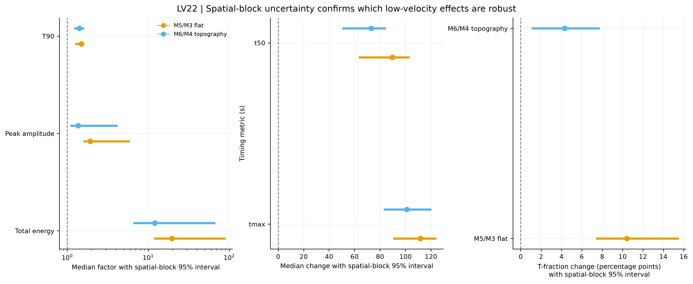

**科学解释：** 空间块避免把相邻台站错误当作 575 个独立重复，区间宽度也揭示了路径异质性。

**适用边界：** 块区间仍依赖三条剖面代表性；不能替代新的方位覆盖或随机实现重复。

**建议英文表述：** Consistent spatial-block estimators confirm robust energy, duration, and delay contrasts without treating neighboring receivers as independent replicates.

*同一块中位数用于点估计、区间和符号秩检验。*

### LV23 低速模型的 T 转换沿三条剖面系统变化

**正向确定性证据：** M5/M6 的 T 占比并非固定百分比，而是随距离与射线呈连续起伏和局部峰谷。

**定量依据：** 图在每条剖面同时展示 M3、M4、M5、M6 的 11 站平滑 T 占比，便于识别背景和低速层的条件差异。

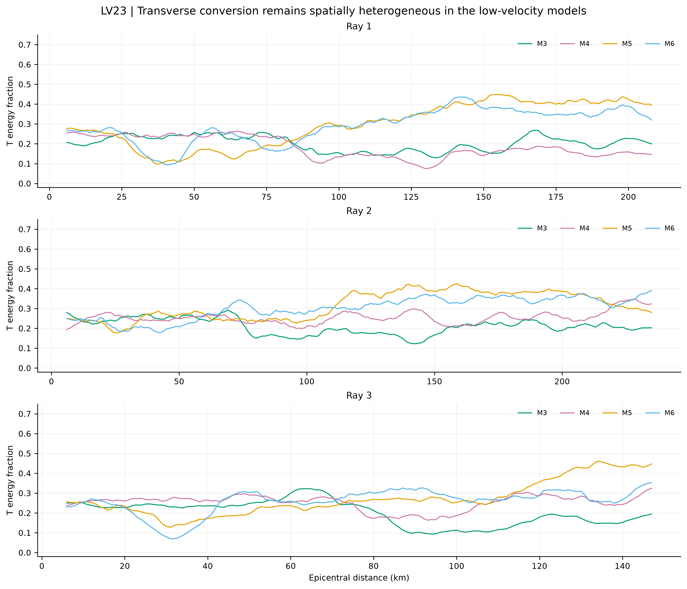

**科学解释：** 空间结构支持路径控制的三维转换；低速层和地形共同改变转换发生的位置与强度。

**适用边界：** 平滑曲线不提供独立自由度；统计显著性仍来自分块推断。

**建议英文表述：** Transverse-energy conversion varies systematically along all three profiles, indicating spatially structured three-dimensional coupling rather than a model-wide fraction.

*T 占比使用能量分数，避免近零基准倍数发散。*

### LV24 峰时和持续时间估计强烈依赖可用记录窗

**反向/排除性证据：** M5/M6 的 tmax 在公共窗与延长窗相对稳定程度不同，而 t95/T90 在延长窗显著增加。

**定量依据：** 图直接连接 50-245 s 和 50-395 s 的主样本中位值，分开显示 tmax、t95 与 T90。

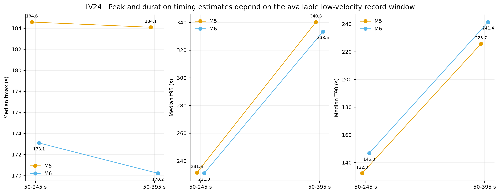

**科学解释：** 公共窗适合模型间效应比较；延长窗适合低速层内部尾波诊断，两者不能混成同一结论。

**适用边界：** 延长窗仍可能右删失，因此更长记录是下一轮验证所必需的，而不是可选的版式改动。

**建议英文表述：** Peak and duration estimates are strongly window dependent, so common-window contrasts and extended-window tail diagnostics must be reported separately.

*t05/t50/t95/T90 均按三分量滤波速度平方累计能量定义。*

## 第四部分｜跨尺度、跨背景综合判断

只在几何和指标边界清楚的前提下整合不同阶段，形成可进入JGR: Planets的机制层级。

### SYN01 地形效应从来不是背景无关的固定修正量

**正向确定性证据：** 半空间、A16 非均匀背景与低速背景给出的地形边际效应幅度显著不同，点估计方向也随背景改变。

**定量依据：** 半空间能量比 0.0296；A16 M4/M3 空间块能量因子约 1.78；M6/M5 约 0.99，但后者区间跨 1。

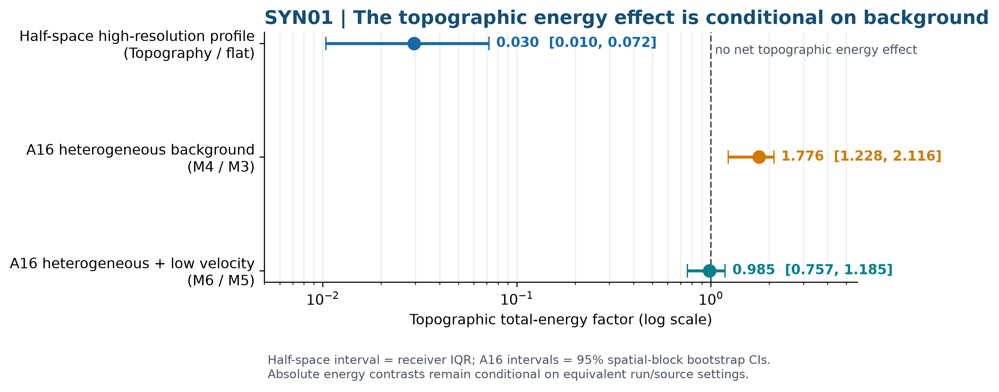

**科学解释：** 跨阶段结论只在不同实验共同支持同一方向时成立；不相容的几何、窗口和参数不直接合并成单一倍率。

**适用边界：** 该综合结论的边界由对应分区的几何、记录窗和缺失运行信息共同限定。

**建议英文表述：** Topographic effects are not background-independent corrections: their magnitude and point-estimate direction vary across the half-space, heterogeneous, and low-velocity experiments.

*综合判断同时引用半空间、A16/S12、低速层和 Apollo 对比；每条仍由所示图件直接约束。*

### SYN02 地形分辨率应采用 0.5 km 形状阈值与 0.25 km 联合阈值

**正向确定性证据：** 只有同时报告相关和能量误差，才能形成可审稿的收敛论证。

**定量依据：** 0.5 km 相关 0.976 但能量误差 19.4%；0.25 km 相关 0.996、能量误差 5.1%。

**科学解释：** 跨阶段结论只在不同实验共同支持同一方向时成立；不相容的几何、窗口和参数不直接合并成单一倍率。

**适用边界：** 该综合结论的边界由对应分区的几何、记录窗和缺失运行信息共同限定。

**建议英文表述：** Topographic resolution should be reported with a 0.5 km waveform-shape threshold and a stricter approximately 0.25 km joint waveform-energy threshold.

*综合判断同时引用半空间、A16/S12、低速层和 Apollo 对比；每条仍由所示图件直接约束。*

### SYN03 分层主要改变尾部能量，而非统一改变主峰

**正向确定性证据：** 分层峰值比接近 1，但能量和 T90 增加。

**定量依据：** 峰值 1.020、能量 1.221、T90 1.378。

**科学解释：** 跨阶段结论只在不同实验共同支持同一方向时成立；不相容的几何、窗口和参数不直接合并成单一倍率。

**适用边界：** 该综合结论的边界由对应分区的几何、记录窗和缺失运行信息共同限定。

**建议英文表述：** Layering primarily modifies later energy and duration rather than uniformly rescaling the main peak.

*综合判断同时引用半空间、A16/S12、低速层和 Apollo 对比；每条仍由所示图件直接约束。*

### SYN04 随机非均匀性比单独地形更强地展宽 A16 波列

**正向确定性证据：** M3/M1 的 T90 增长明显大于 M2/M1。

**定量依据：** 权威 T90 因子 18.170 与 5.309。

**科学解释：** 跨阶段结论只在不同实验共同支持同一方向时成立；不相容的几何、窗口和参数不直接合并成单一倍率。

**适用边界：** 该综合结论的边界由对应分区的几何、记录窗和缺失运行信息共同限定。

**建议英文表述：** Random heterogeneity broadens the A16 wave train more strongly than topography alone under the current baseline design.

*综合判断同时引用半空间、A16/S12、低速层和 Apollo 对比；每条仍由所示图件直接约束。*

### SYN05 低速层是现有试验中最强的峰时延迟机制

**正向确定性证据：** M5/M6 将 S12 能量峰推至约 213/272 s，显著超过 M1-M4。

**定量依据：** 公共剖面 tmax 延迟约 112/101 s；S12 tmax 仍早于观测 658 s。

**科学解释：** 跨阶段结论只在不同实验共同支持同一方向时成立；不相容的几何、窗口和参数不直接合并成单一倍率。

**适用边界：** 该综合结论的边界由对应分区的几何、记录窗和缺失运行信息共同限定。

**建议英文表述：** The low-velocity runs provide the largest peak-energy delay among the tested mechanisms, but remain much earlier than the Apollo peak.

*综合判断同时引用半空间、A16/S12、低速层和 Apollo 对比；每条仍由所示图件直接约束。*

### SYN06 T 分量是最敏感的三维转换指标

**正向确定性证据：** 从半空间到 A16 六模型，地形、散射和低速层都在 T 上留下强背景依赖。

**定量依据：** M1 T 近零，M2/M3/M4 为 16.13/20.45/23.43%，M5/M6 继续变化。

**科学解释：** 跨阶段结论只在不同实验共同支持同一方向时成立；不相容的几何、窗口和参数不直接合并成单一倍率。

**适用边界：** 该综合结论的边界由对应分区的几何、记录窗和缺失运行信息共同限定。

**建议英文表述：** Transverse energy is the most sensitive component diagnostic of three-dimensional conversion across the staged experiments.

*综合判断同时引用半空间、A16/S12、低速层和 Apollo 对比；每条仍由所示图件直接约束。*

### SYN07 地形空间指纹可以跨背景部分保留，但持续时间更易重排

**正向确定性证据：** 能量地形效应在有无低速层间相关显著，T90 相关不显著。

**定量依据：** 能量 rho 0.53、q 1.1e-4；T90 q 0.095。

**科学解释：** 跨阶段结论只在不同实验共同支持同一方向时成立；不相容的几何、窗口和参数不直接合并成单一倍率。

**适用边界：** 该综合结论的边界由对应分区的几何、记录窗和缺失运行信息共同限定。

**建议英文表述：** The spatial topographic energy fingerprint partly persists across low-velocity backgrounds, whereas the duration fingerprint is more strongly reorganized.

*综合判断同时引用半空间、A16/S12、低速层和 Apollo 对比；每条仍由所示图件直接约束。*

### SYN08 从半空间到 M6，主能量峰仍不符合简单 R² 强扩散

**反向/排除性证据：** 不同尺度与复杂度的全部主要测试仍偏好线性距离。

**定量依据：** 低速层删失安全最小 Delta AIC 12.79；旧 A16 为 268-672。

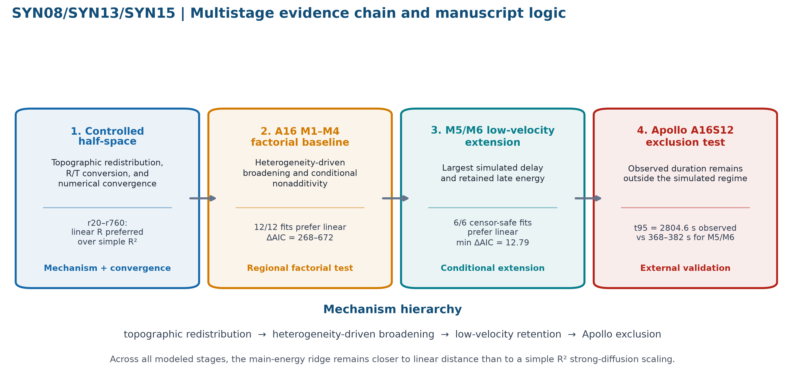

**科学解释：** 跨阶段结论只在不同实验共同支持同一方向时成立；不相容的几何、窗口和参数不直接合并成单一倍率。

**适用边界：** 该综合结论的边界由对应分区的几何、记录窗和缺失运行信息共同限定。

**建议英文表述：** From the half-space experiment through M6, the main peak-energy ridge remains inconsistent with a simple squared-distance strong-diffusion scaling.

*综合判断同时引用半空间、A16/S12、低速层和 Apollo 对比；每条仍由所示图件直接约束。*

### SYN09 低速层改善包络而不改善相位，二者必须分开评价

**正向确定性证据：** M6 的早期包络相关可较高，但三分量相位相关仍仅约 0.08。

**定量依据：** 包络相似性衡量缓慢能量演化，波形相关衡量相位和脉冲结构。

**科学解释：** 跨阶段结论只在不同实验共同支持同一方向时成立；不相容的几何、窗口和参数不直接合并成单一倍率。

**适用边界：** 该综合结论的边界由对应分区的几何、记录窗和缺失运行信息共同限定。

**建议英文表述：** Envelope improvement and phase agreement must be evaluated separately because low-velocity trapping can improve the former without repairing the latter.

*综合判断同时引用半空间、A16/S12、低速层和 Apollo 对比；每条仍由所示图件直接约束。*

### SYN10 当前最复杂模型仍未解释 Apollo 完整长尾

**反向/排除性证据：** M5/M6 t95 接近 370-382 s，观测约 2805 s；时频能量范围亦不足。

**定量依据：** 记录延长方向正确，但差距仍超过 2400 s。

**科学解释：** 跨阶段结论只在不同实验共同支持同一方向时成立；不相容的几何、窗口和参数不直接合并成单一倍率。

**适用边界：** 该综合结论的边界由对应分区的几何、记录窗和缺失运行信息共同限定。

**建议英文表述：** The most complex current models still fail to reproduce the full Apollo duration and time-frequency extent.

*综合判断同时引用半空间、A16/S12、低速层和 Apollo 对比；每条仍由所示图件直接约束。*

### SYN11 绝对幅能量结论必须附运行清单前提

**条件性运行级证据：** M5/M6 文件中没有源、Q、网格、随机种子和完整介质参数。

**定量依据：** 时间、占比、形状的比较较稳健；绝对能量归因必须写成 conditional run-level contrast。

**科学解释：** 跨阶段结论只在不同实验共同支持同一方向时成立；不相容的几何、窗口和参数不直接合并成单一倍率。

**适用边界：** 该综合结论的边界由对应分区的几何、记录窗和缺失运行信息共同限定。

**建议英文表述：** Absolute amplitude and energy contrasts require an explicit run-equivalence assumption until complete source and simulation manifests are recovered.

*综合判断同时引用半空间、A16/S12、低速层和 Apollo 对比；每条仍由所示图件直接约束。*

### SYN12 400 s 是进步但不是低速层尾波收敛终点

**待验证/受限证据：** 约五分之一以上主样本 t95 落入最后 20 s。

**定量依据：** 需要更长记录并预先规定删失处理。

**科学解释：** 跨阶段结论只在不同实验共同支持同一方向时成立；不相容的几何、窗口和参数不直接合并成单一倍率。

**适用边界：** 该综合结论的边界由对应分区的几何、记录窗和缺失运行信息共同限定。

**建议英文表述：** A 400 s record improves low-velocity coverage but does not establish complete tail convergence for all receivers.

*综合判断同时引用半空间、A16/S12、低速层和 Apollo 对比；每条仍由所示图件直接约束。*

### SYN13 最有说服力的机制层级是地形分配、散射展宽、低速层滞留

**正向确定性证据：** 三类因素具有不同主效应并发生条件非加性。

**定量依据：** 地形控制路径和分量，散射强展宽，低速层产生最大延迟和后期能量。

**科学解释：** 跨阶段结论只在不同实验共同支持同一方向时成立；不相容的几何、窗口和参数不直接合并成单一倍率。

**适用边界：** 该综合结论的边界由对应分区的几何、记录窗和缺失运行信息共同限定。

**建议英文表述：** The most defensible mechanism hierarchy is topographic redistribution, heterogeneity-driven broadening, and low-velocity energy retention with conditional coupling among them.

*综合判断同时引用半空间、A16/S12、低速层和 Apollo 对比；每条仍由所示图件直接约束。*

### SYN14 不能用单一参数微调替代缺失机制

**反向/排除性证据：** 源振幅、静态时移或一条固定地形倍率都不能同时修复相位、持续、频谱和三分量。

**定量依据：** 需要联合改变多尺度散射、低速层、Q、域尺寸和随机实现。

**科学解释：** 跨阶段结论只在不同实验共同支持同一方向时成立；不相容的几何、窗口和参数不直接合并成单一倍率。

**适用边界：** 该综合结论的边界由对应分区的几何、记录窗和缺失运行信息共同限定。

**建议英文表述：** No single amplitude, static-time, or topographic correction can replace the missing coupled propagation mechanisms.

*综合判断同时引用半空间、A16/S12、低速层和 Apollo 对比；每条仍由所示图件直接约束。*

### SYN15 最终论文应按证据链而非模型文件夹顺序组织

**正向确定性证据：** 半空间用于机制与收敛，A16 M1-M4 用于因子基线，M5/M6 用于低速层扩展，Apollo 用于排除检验。

**定量依据：** 每一节只保留最有辨识力的图，把完整证据图册放入 Supporting Information。

**科学解释：** 跨阶段结论只在不同实验共同支持同一方向时成立；不相容的几何、窗口和参数不直接合并成单一倍率。

**适用边界：** 该综合结论的边界由对应分区的几何、记录窗和缺失运行信息共同限定。

**建议英文表述：** The final paper should follow the evidential sequence from controlled half-space tests to A16 factorial models, low-velocity extensions, and Apollo exclusion tests.

*综合判断同时引用半空间、A16/S12、低速层和 Apollo 对比；每条仍由所示图件直接约束。*

## 推荐论文结构与最终结论

完整章节、主图选择和最终结论见同名Word文档。

## 可复现性

输入审计、派生CSV、24幅低速层图及分析脚本均保存在 h/jgr_planets_submission 内。
