# 第一册｜事件、台站、地形与实际记录图册

版本：2026-10-29。主样本为9次Apollo人工撞击，非完整天然撞击或深浅月震目录。本册把源站位置、地形底图、覆盖范围、实际波形和缺失项集中展示。原始数据身份和处理方法见第三册；模型及范围选择见第二、四册。

## 1. 已核实覆盖及统计口径

本项目实际取得21个事件—台站配对的现代档案，63个候选中周期分量位置中60条有返回，3条S14 MHZ未返回并落在已知故障期；另存81个旧档案SAC供对照。Nunn2024将21对中的16对判为清晰、5对判为低信噪比。这是文献分类，不等于最终可反演配对数。

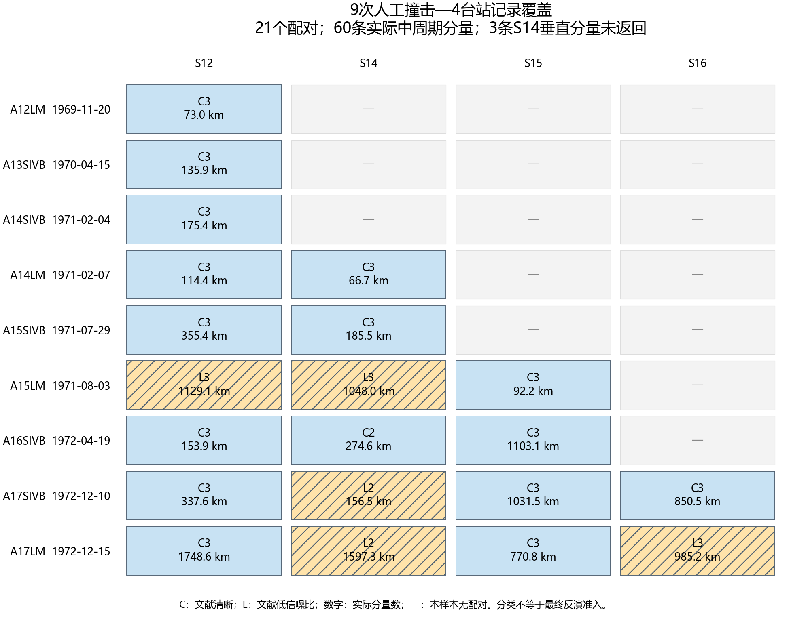

图1：C/L分别表示文献清晰/低信噪比，后随实际分量数；距离来自统一球面重算。灰格表示本样本无配对，不自动判定该站当时停机。最终频带和时间窗仍须逐道准入。

## 2. 台站坐标、观测覆盖与研究角色

坐标使用NASA公布的ALSEP位置，而非登月舱位置；东经、北纬为正，西经、南纬为负。参考系为DE421的Mean Earth/Polar Axis。小数位保留来源精度，不表示已经独立测到相应定位精度。[NASA台站来源](https://nssdc.gsfc.nasa.gov/planetary/lunar/lunar_sites.html)

| 台站 | 纬度°N | 经度°E | LOLA像元高程/m | 记录事件 | 文献清晰 | 实有MP分量 | 距离范围/km | 研究角色 |
|---|---|---|---|---|---|---|---|---|
| S12 | -3.0098 | -23.4249 | -1428.5 | 9 | 8 | 27 | 73.0–1748.6 | 风暴洋/月海邻近参考走廊；两条已研究S-IVB路径为起点 |
| S14 | -3.64419 | -17.47768 | -1063.0 | 6 | 3 | 15 | 66.7–1597.3 | Fra Mauro喷出物与破碎区背景；与S12共同事件联合 |
| S15 | 26.13406 | 3.62991 | -1924.0 | 4 | 4 | 12 | 92.2–1103.1 | Hadley–Apennine/盆缘背景；A15LM近距验证 |
| S16 | -8.9759 | 15.4986 | 2.0 | 2 | 1 | 6 | 850.5–985.2 | Descartes/Cayley高地背景；目前以远距检验为主 |

S12与S14球面相距约181.1 km，可作为联合研究走廊，但不能合成一个虚拟台站。表中LOLA高程来自原生像元，相对1737.4 km参考球，不是独立测量的台站精密海拔。S15台站位于低处不意味着周边没有山地；“高地”地质单元也不能按高程正负简单划分。

本样本中S12有9次记录、S14有6次、S15有4次、S16有2次。S16只有一条文献清晰人工撞击配对，距离约851 km，无法独立约束局地高地的a、σv、H三个参数。S12短周期传感器故障；S14部分垂直通道故障；当前主比较限定中周期MHZ/MH1/MH2，不能以旧SP文件存在认定SP可用。

按Zhang2025 Table1整理的LP运行总跨度如下，首末时刻取到秒；这不表示跨度内没有停机、模式切换或通道故障。

| 台站 | 表中LP最早起始/UTC | 最后结束/UTC | 本样本的模式及限制 |
|---|---|---|---|
| S12 | 1969-11-19 14:23:23 | 1977-09-30 18:50:51 | 本批事件处于peaked模式时段；SP故障 |
| S14 | 1971-02-05 17:44:33 | 1977-09-30 18:50:51 | 本批处于peaked时段；1972年三次撞击的MHZ未返回 |
| S15 | 1971-07-31 18:52:00 | 1977-09-30 18:50:51 | 本批记录处于peaked时段；A15 S-IVB早于部署 |
| S16 | 1972-04-21 20:20:00 | 1977-09-30 18:50:51 | 本批记录处于peaked时段；A16 S-IVB早于部署 |

模式判断来自运行表，仍须用具体响应历元和增益历史逐道复核，不能取代仪器检查。[Zhang2025原文Table1](https://doi.org/10.1029/2025EA004710)。

## 3. 全部事件及源参数

事件名称中的A16表示Apollo16任务撞击，并不表示由S16接收。A16 S-IVB撞击时S16尚未部署。LM表示登月舱上升级，S-IVB表示土星上面级；两类入射条件不同。[NASA撞击来源](https://nssdc.gsfc.nasa.gov/planetary/lunar/apollo_impact.html)

| 事件 | 地面接收时刻/UTC | 纬度°N | 经度°E | 撞速/km s⁻¹ | 撞击动能/J | 相对水平入射角/° | 记录台站 |
|---|---|---|---|---|---|---|---|
| A12LM | 1969-11-20 22:17:17.7 | -3.94 | -21.2 | 1.68 | 3360000000 | 3.7 | S12 |
| A13SIVB | 1970-04-15 01:09:41.0 | -2.555 | -27.8875 | 2.58 | 46300000000 | 76 | S12 |
| A14SIVB | 1971-02-04 07:40:55.4 | -8.181 | -26.0305 | 2.54 | 45200000000 | 69 | S12 |
| A14LM | 1971-02-07 00:45:25.7 | -3.42 | -19.67 | 1.68 | 3250000000 | 3.6 | S12、S14 |
| A15SIVB | 1971-07-29 20:58:42.9 | -1.2897 | -11.8245 | 2.58 | 46100000000 | 62 | S12、S14 |
| A15LM | 1971-08-03 03:03:37.0 | 26.36 | 0.25 | 1.70 | 3440000000 | 3.2 | S12、S14、S15 |
| A16SIVB | 1972-04-19 21:02:04 | 1.921 | -24.623 | 2.5–2.6 | 45900000000 | 约79 | S12、S14、S15 |
| A17SIVB | 1972-12-10 20:32:42.3 | -4.1681 | -12.3307 | 2.55 | 47100000000 | 55 | S12、S14、S15、S16 |
| A17LM | 1972-12-15 06:50:20.8 | 19.97 | 30.49 | 1.67 | 3150000000 | 4.9 | S12、S14、S15、S16 |

NASA原表能量单位erg，本表仅乘10⁻⁷转为J；撞击动能不等于地震辐射能。时刻为地面接收，约晚于月面真实撞击1.3 s；现有图未擅自扣除。A16 S-IVB时刻与能量为估计，起时约有4 s不确定性；源方位和耦合效率尚待核实。元数据见[tables/events_and_domains.csv](tables/events_and_domains.csv)。

## 4. 地形底图与范围框

底图为NASA/PDS LOLA LDEM_64 V3.1，原生64像元/度，即0.015625°，南北间距约474 m；东西间距乘cos纬度。相对早期0.25°底图线性采样细16倍，但采样间距不等于所有位置的独立地形分辨率。产品包含栅格化插值；正式模型若网格更细，不得把插值出来的细节当作新观测。[LOLA产品入口](https://pds-geosciences.wustl.edu/missions/lro/lola.htm)

当前裁片覆盖38°W–40°E、18°S–40°N，DN×0.5得到米高程，相对1737.4 km参考球，像元中心注册。地形提取和经度拼接核验见[地形溯源](sources/lola_data_provenance.json)。旧尺寸不符的float图未采用。

星号为源、三角为台站；大圆连线是地理示意，不代表散射能量只走线附近。全记录框包含该事件全部已记录站，近距候选框按文献清晰且<400 km选择。两类框都不是地质单元边界或已收敛的生产域。图上不另标不足2 km的窄小地貌；该制图要求不限制地下相关尺度a。

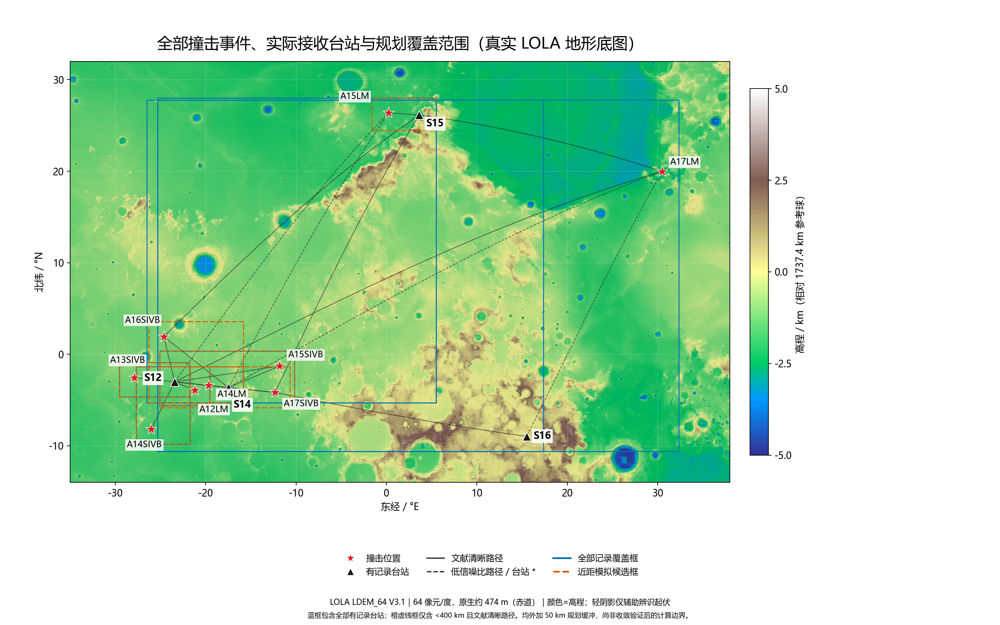

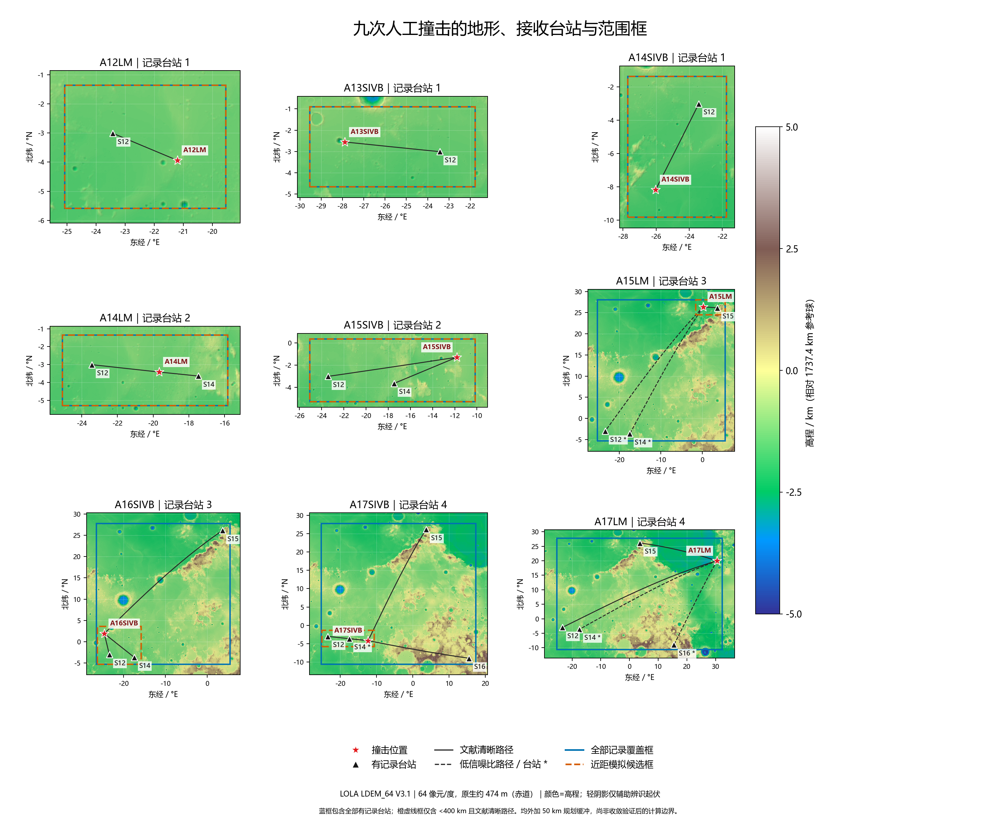

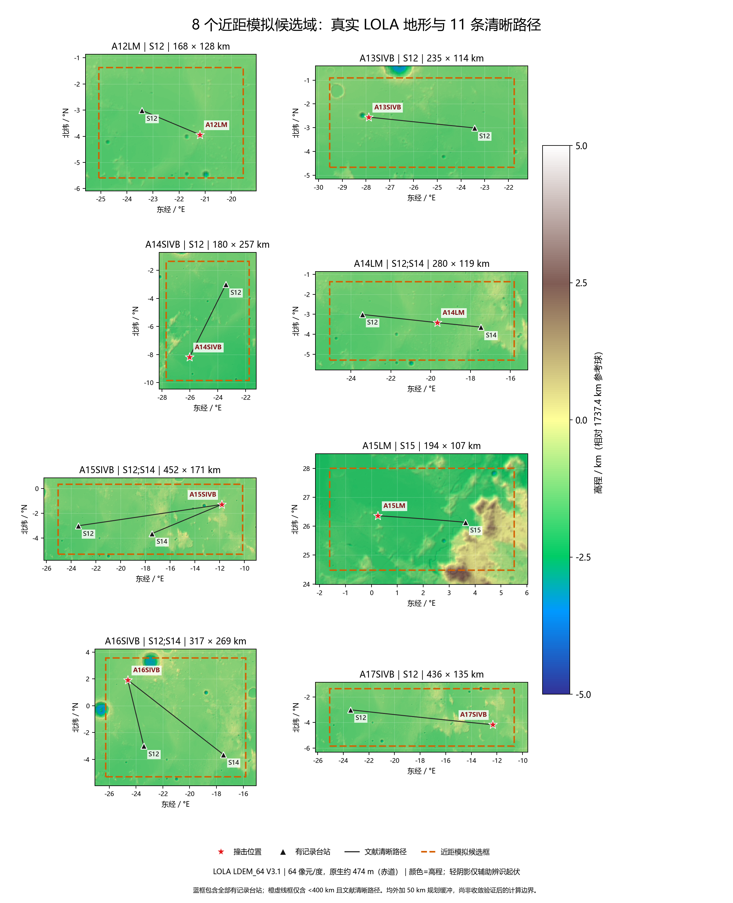

## 5. 21个实际配对与缺失分量

距离统一以R=1737.4 km及NASA坐标重算。保留文献距离列用于追溯，原波形图注可能仍使用文献距离，差异不能被误判成源站身份改变。缺样率范围为实际返回分量在ATT −300至3600 s展示窗内的最小—最大值；不是整日档案覆盖率。

| 事件 | 站 | 重算/km | 文献/km | 文献类别 | 实有分量 | 缺失 | 原始缺样/% | 逐站检查图 |
|---|---|---|---|---|---|---|---|---|
| A12LM | S12 | 73.0 | 73.5 | 清晰 | MHZ/MH1/MH2 | 无 | 0.00–0.17 | [三阶段](assets/A12LM_S12_three_stages.png) |
| A13SIVB | S12 | 135.9 | 135.9 | 清晰 | MHZ/MH1/MH2 | 无 | 1.16–1.28 | [三阶段](assets/A13SIVB_S12_three_stages.png) |
| A14SIVB | S12 | 175.4 | 175.4 | 清晰 | MHZ/MH1/MH2 | 无 | 3.14–3.36 | [三阶段](assets/A14SIVB_S12_three_stages.png) |
| A14LM | S12 | 114.4 | 115.3 | 清晰 | MHZ/MH1/MH2 | 无 | 3.46–3.73 | [三阶段](assets/A14LM_S12_three_stages.png) |
| A14LM | S14 | 66.7 | 65.7 | 清晰 | MHZ/MH1/MH2 | 无 | 1.15–1.96 | [三阶段](assets/A14LM_S14_three_stages.png) |
| A15SIVB | S12 | 355.4 | 355.3 | 清晰 | MHZ/MH1/MH2 | 无 | 1.38–1.45 | [三阶段](assets/A15SIVB_S12_three_stages.png) |
| A15SIVB | S14 | 185.5 | 185.5 | 清晰 | MHZ/MH1/MH2 | 无 | 2.33–2.90 | [三阶段](assets/A15SIVB_S14_three_stages.png) |
| A15LM | S12 | 1129.1 | 1128.9 | 低SNR | MHZ/MH1/MH2 | 无 | 0.00–0.00 | [三阶段](assets/A15LM_S12_three_stages.png) |
| A15LM | S14 | 1048.0 | 1047.8 | 低SNR | MHZ/MH1/MH2 | 无 | 0.00–0.01 | [三阶段](assets/A15LM_S14_three_stages.png) |
| A15LM | S15 | 92.2 | 92.2 | 清晰 | MHZ/MH1/MH2 | 无 | 0.41–1.64 | [三阶段](assets/A15LM_S15_three_stages.png) |
| A16SIVB | S12 | 153.9 | 153.9 | 清晰 | MHZ/MH1/MH2 | 无 | 1.67–1.76 | [三阶段](assets/A16SIVB_S12_three_stages.png) |
| A16SIVB | S14 | 274.6 | 274.5 | 清晰 | MH1/MH2 | MHZ | 2.33–2.61 | [三阶段](assets/A16SIVB_S14_three_stages.png) |
| A16SIVB | S15 | 1103.1 | 1102.9 | 清晰 | MHZ/MH1/MH2 | 无 | 0.00–0.28 | [三阶段](assets/A16SIVB_S15_three_stages.png) |
| A17SIVB | S12 | 337.6 | 337.5 | 清晰 | MHZ/MH1/MH2 | 无 | 1.31–1.46 | [三阶段](assets/A17SIVB_S12_three_stages.png) |
| A17SIVB | S14 | 156.5 | 156.5 | 低SNR | MH1/MH2 | MHZ | 17.52–17.80 | [三阶段](assets/A17SIVB_S14_three_stages.png) |
| A17SIVB | S15 | 1031.5 | 1031.4 | 清晰 | MHZ/MH1/MH2 | 无 | 0.00–0.22 | [三阶段](assets/A17SIVB_S15_three_stages.png) |
| A17SIVB | S16 | 850.5 | 850.3 | 清晰 | MHZ/MH1/MH2 | 无 | 0.00–0.53 | [三阶段](assets/A17SIVB_S16_three_stages.png) |
| A17LM | S12 | 1748.6 | 1748.5 | 清晰 | MHZ/MH1/MH2 | 无 | 0.03–0.03 | [三阶段](assets/A17LM_S12_three_stages.png) |
| A17LM | S14 | 1597.3 | 1597.2 | 低SNR | MH1/MH2 | MHZ | 3.58–3.62 | [三阶段](assets/A17LM_S14_three_stages.png) |
| A17LM | S15 | 770.8 | 771.1 | 清晰 | MHZ/MH1/MH2 | 无 | 0.02–0.02 | [三阶段](assets/A17LM_S15_three_stages.png) |
| A17LM | S16 | 985.2 | 984.9 | 低SNR | MHZ/MH1/MH2 | 无 | 0.00–0.01 | [三阶段](assets/A17LM_S16_three_stages.png) |

三条S14 MHZ缺失对应A16SIVB、A17SIVB、A17LM；没有拿其他事件/分量填补。文件存在不等于数据完整，原始缺样也不同于处理裁边；分量级63行明细见[tables/trace_stage_comparison.csv](tables/trace_stage_comparison.csv)。

## 6. 近距候选域清单

8个事件域覆盖11条首轮目标路径。一个事件的多个接收器可以由同次传播同时输出，所以配对数不等于作业数。地理框已有50 km缓冲，仍需第四册的扩域、底界与PML验证。

| 事件 | 目标接收器 | 西/东边界°E | 南/北边界°N | 东西×南北/km |
|---|---|---|---|---|
| A12LM | S12 | -25.08167 / -19.54323 | -5.58889 / -1.36091 | 167.6 × 128.2 |
| A13SIVB | S12 | -29.54186 / -21.77054 | -4.65869 / -0.90611 | 235.4 × 113.8 |
| A14SIVB | S12 | -27.70396 / -21.75144 | -9.82989 / -1.36091 | 179.6 × 256.8 |
| A14LM | S12、S14 | -25.08086 / -15.82172 | -5.29308 / -1.36091 | 280.3 × 119.2 |
| A15SIVB | S12、S14 | -25.08086 / -10.16854 | -5.29308 / 0.35919 | 451.8 × 171.4 |
| A15LM | S15 | -1.61764 / 5.49755 | 24.48517 / 28.00889 | 193.5 × 106.9 |
| A16SIVB | S12、S14 | -26.27896 / -15.82172 | -5.29308 / 3.56989 | 317.1 × 268.8 |
| A17SIVB | S12 | -25.08233 / -10.67327 | -5.81699 / -1.36091 | 436.1 × 135.1 |

## 7. 逐事件记录图册：先原始，再处理

每组先显示地形/范围，再显示未去响应DU，最后显示名义响应校正的0.3–0.9 Hz速度。原始总览为名义时间；处理总览为ATT校正时间，两者不宜直接作亚秒对齐判断。单站三阶段图使用同一ATT轴。各图不逐道归一化；纵轴刻度可能不同，应读单位和刻度。

橙色为处理边缘标记，灰色为原始缺样；短段未处理和缺失分量另列。图件是现有处理的可追溯展示，不等同最终反演准入。0.3–0.5 Hz位移参照另列链接，与速度图区分。

### 7.1 A12LM

地面接收时刻：1969-11-20T22:17:17.7；源位置：-3.94°N，-21.2°E。配对：S12 73.0 km。

近距目标站：S12；规划尺寸约167.6×128.2 km。[近距图](assets/A12LM_local_terrain_domain.png)。

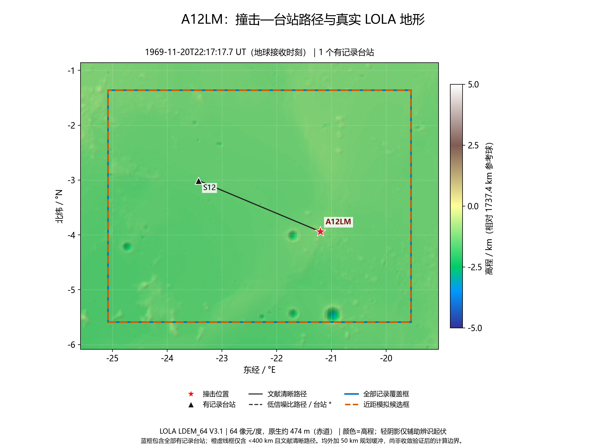

**原始档案：DU，名义时间。**

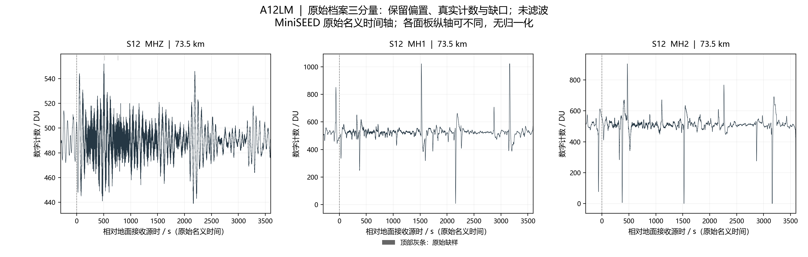

**处理预览：0.3–0.9 Hz名义速度，ATT时间。**

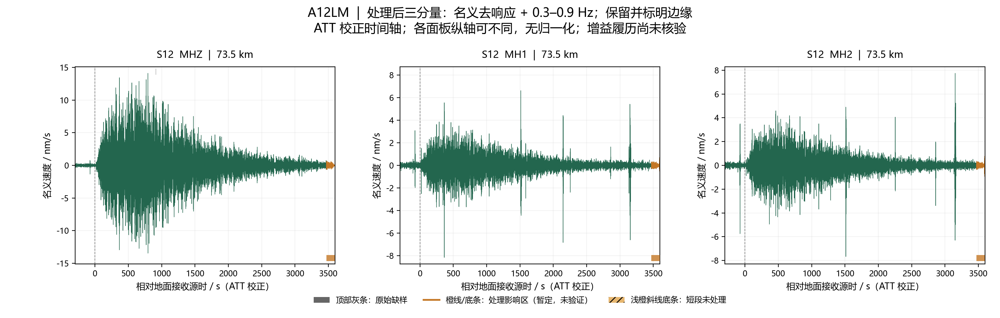

[独立0.3–0.5 Hz位移参照](assets/A12LM_literature_displacement_03_05_overview.png)；[S12三阶段](assets/A12LM_S12_three_stages.png)。

### 7.2 A13SIVB

地面接收时刻：1970-04-15T01:09:41.0；源位置：-2.555°N，-27.8875°E。配对：S12 135.9 km。

近距目标站：S12；规划尺寸约235.4×113.8 km。[近距图](assets/A13SIVB_local_terrain_domain.png)。

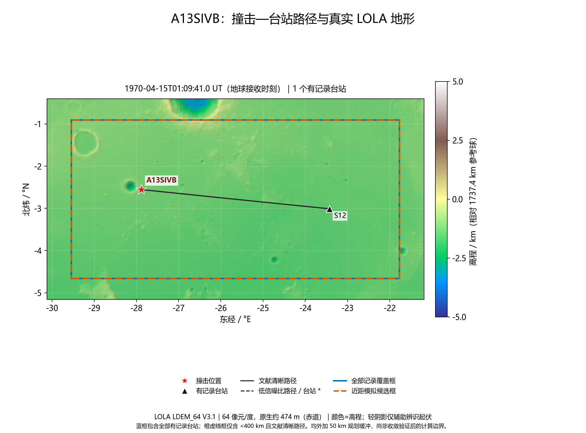

**原始档案：DU，名义时间。**

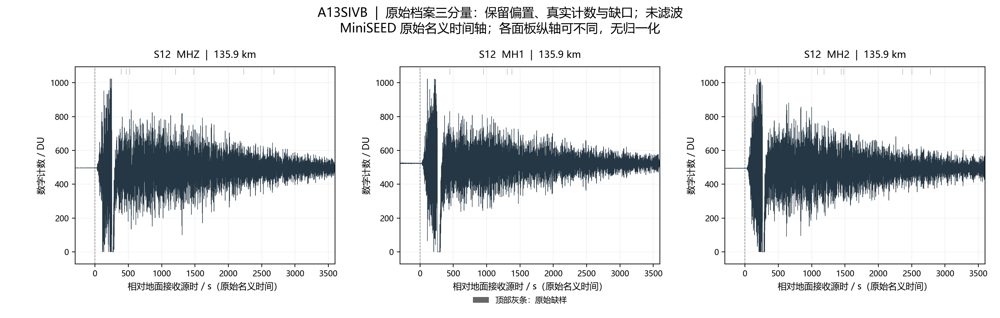

**处理预览：0.3–0.9 Hz名义速度，ATT时间。**

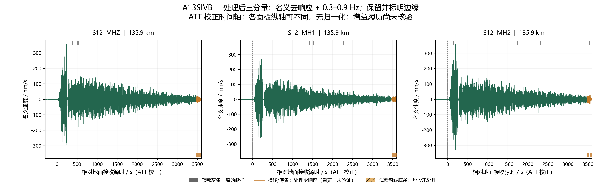

[独立0.3–0.5 Hz位移参照](assets/A13SIVB_literature_displacement_03_05_overview.png)；[S12三阶段](assets/A13SIVB_S12_three_stages.png)。

### 7.3 A14SIVB

地面接收时刻：1971-02-04T07:40:55.4；源位置：-8.181°N，-26.0305°E。配对：S12 175.4 km。

近距目标站：S12；规划尺寸约179.6×256.8 km。[近距图](assets/A14SIVB_local_terrain_domain.png)。

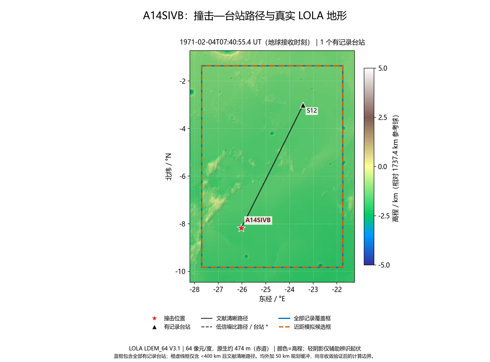

**原始档案：DU，名义时间。**

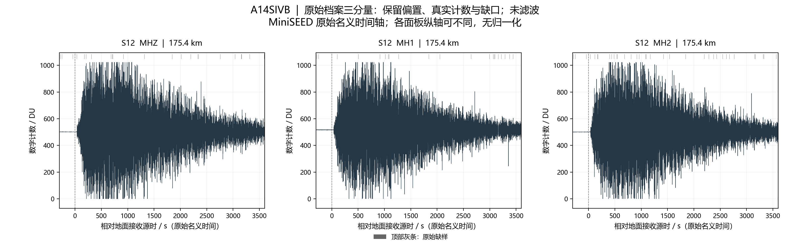

**处理预览：0.3–0.9 Hz名义速度，ATT时间。**

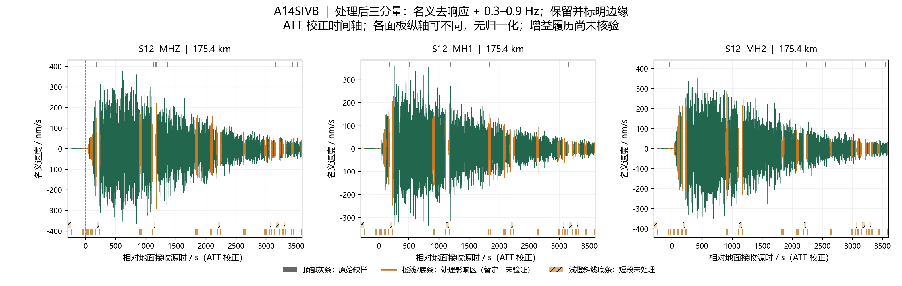

[独立0.3–0.5 Hz位移参照](assets/A14SIVB_literature_displacement_03_05_overview.png)；[S12三阶段](assets/A14SIVB_S12_three_stages.png)。

### 7.4 A14LM

地面接收时刻：1971-02-07T00:45:25.7；源位置：-3.42°N，-19.67°E。配对：S12 114.4 km；S14 66.7 km。

近距目标站：S12、S14；规划尺寸约280.3×119.2 km。[近距图](assets/A14LM_local_terrain_domain.png)。

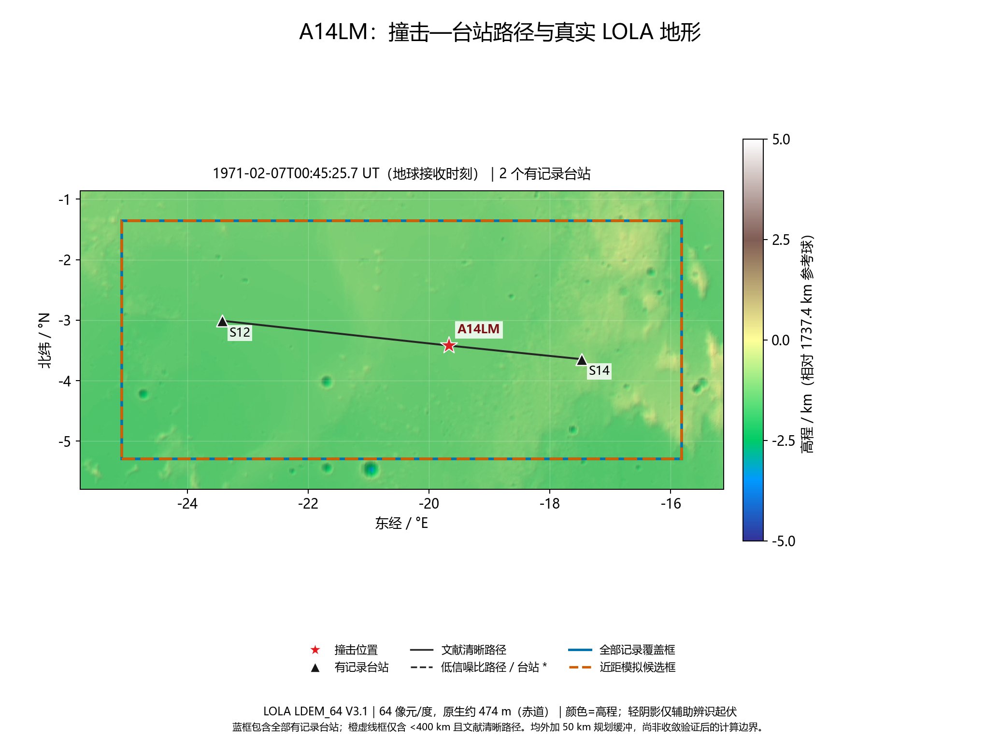

**原始档案：DU，名义时间。**

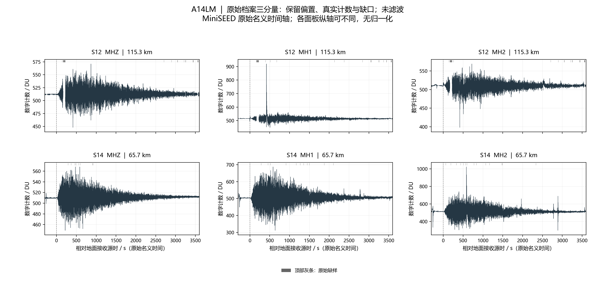

**处理预览：0.3–0.9 Hz名义速度，ATT时间。**

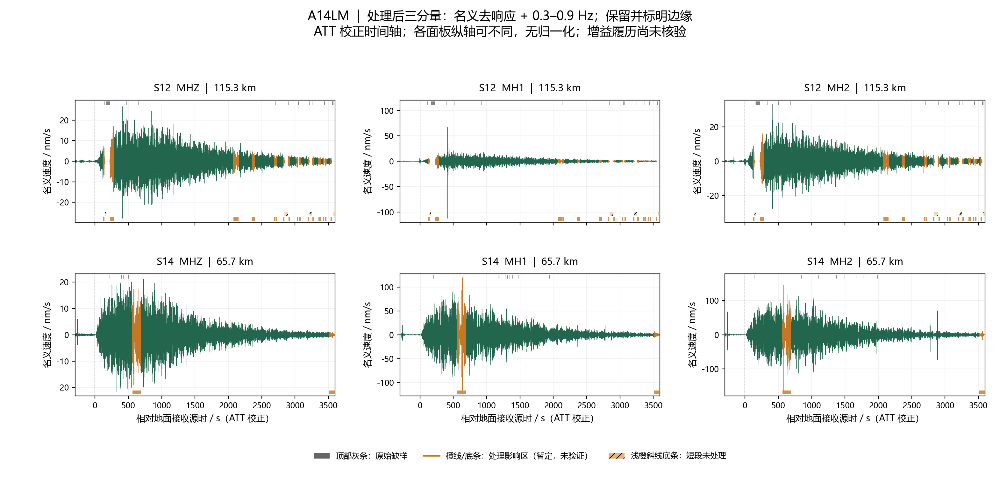

[独立0.3–0.5 Hz位移参照](assets/A14LM_literature_displacement_03_05_overview.png)；[S12三阶段](assets/A14LM_S12_three_stages.png)；[S14三阶段](assets/A14LM_S14_three_stages.png)。

### 7.5 A15SIVB

地面接收时刻：1971-07-29T20:58:42.9；源位置：-1.2897°N，-11.8245°E。配对：S12 355.4 km；S14 185.5 km。

近距目标站：S12、S14；规划尺寸约451.8×171.4 km。[近距图](assets/A15SIVB_local_terrain_domain.png)。

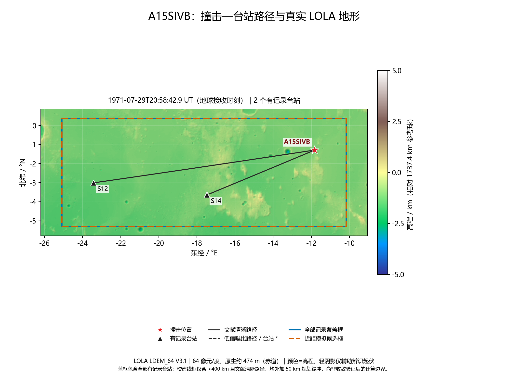

**原始档案：DU，名义时间。**

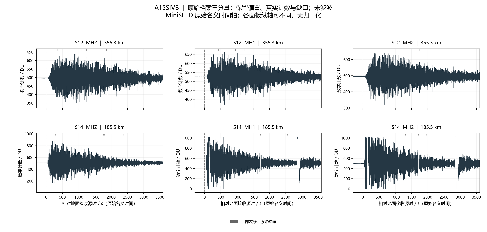

**处理预览：0.3–0.9 Hz名义速度，ATT时间。**

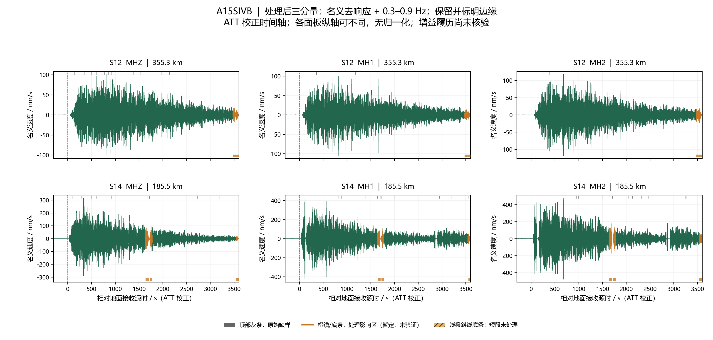

[独立0.3–0.5 Hz位移参照](assets/A15SIVB_literature_displacement_03_05_overview.png)；[S12三阶段](assets/A15SIVB_S12_three_stages.png)；[S14三阶段](assets/A15SIVB_S14_three_stages.png)。

### 7.6 A15LM

地面接收时刻：1971-08-03T03:03:37.0；源位置：26.36°N，0.25°E。配对：S12 1129.1 km（低SNR）；S14 1048.0 km（低SNR）；S15 92.2 km。

近距目标站：S15；规划尺寸约193.5×106.9 km。[近距图](assets/A15LM_local_terrain_domain.png)。

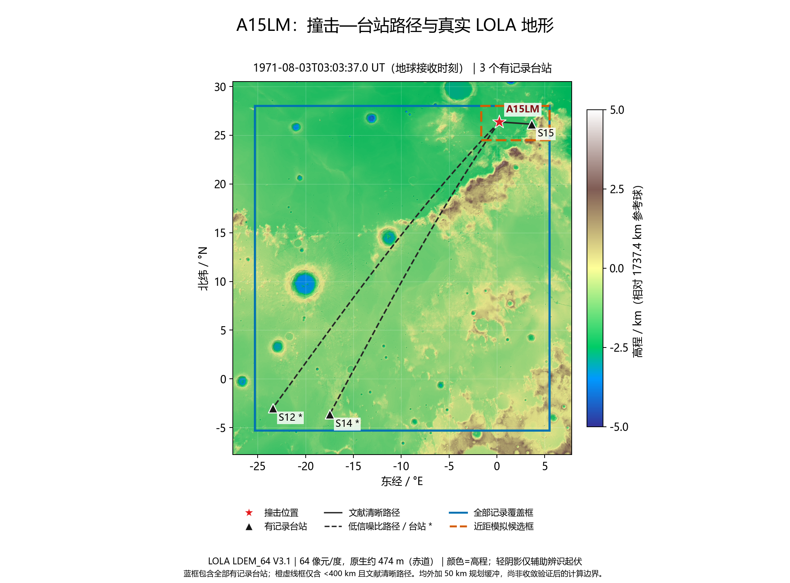

**原始档案：DU，名义时间。**

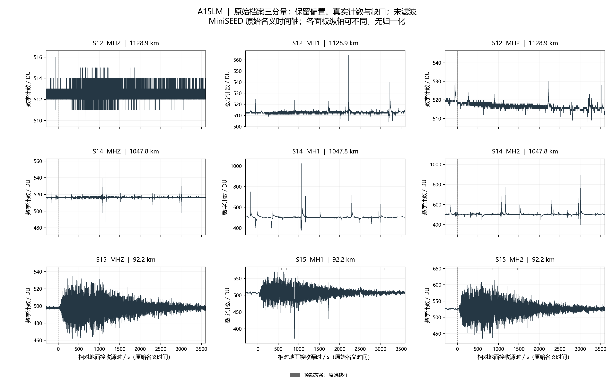

**处理预览：0.3–0.9 Hz名义速度，ATT时间。**

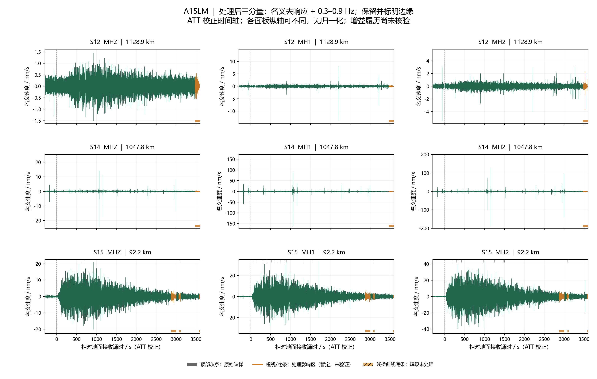

[独立0.3–0.5 Hz位移参照](assets/A15LM_literature_displacement_03_05_overview.png)；[S12三阶段](assets/A15LM_S12_three_stages.png)；[S14三阶段](assets/A15LM_S14_three_stages.png)；[S15三阶段](assets/A15LM_S15_three_stages.png)。

### 7.7 A16SIVB

地面接收时刻：1972-04-19T21:02:04；源位置：1.921°N，-24.623°E。配对：S12 153.9 km；S14 274.6 km；S15 1103.1 km。

近距目标站：S12、S14；规划尺寸约317.1×268.8 km。[近距图](assets/A16SIVB_local_terrain_domain.png)。

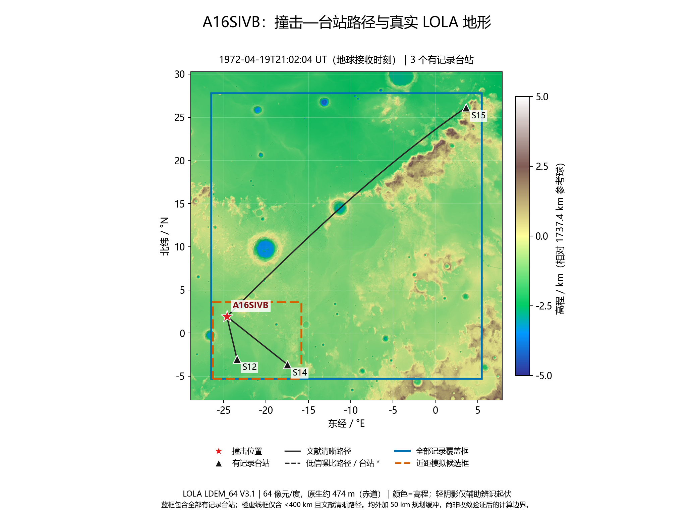

**原始档案：DU，名义时间。**

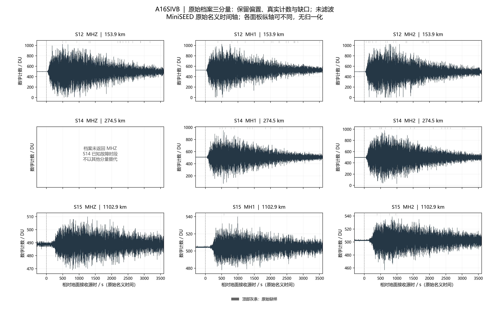

**处理预览：0.3–0.9 Hz名义速度，ATT时间。**

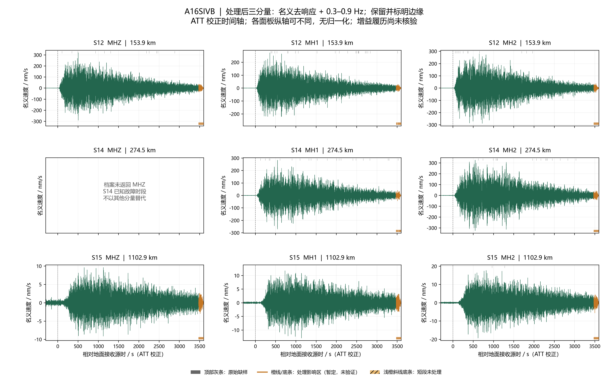

[独立0.3–0.5 Hz位移参照](assets/A16SIVB_literature_displacement_03_05_overview.png)；[S12三阶段](assets/A16SIVB_S12_three_stages.png)；[S14三阶段](assets/A16SIVB_S14_three_stages.png)；[S15三阶段](assets/A16SIVB_S15_three_stages.png)。

### 7.8 A17SIVB

地面接收时刻：1972-12-10T20:32:42.3；源位置：-4.1681°N，-12.3307°E。配对：S12 337.6 km；S14 156.5 km（低SNR）；S15 1031.5 km；S16 850.5 km。

近距目标站：S12；规划尺寸约436.1×135.1 km。[近距图](assets/A17SIVB_local_terrain_domain.png)。

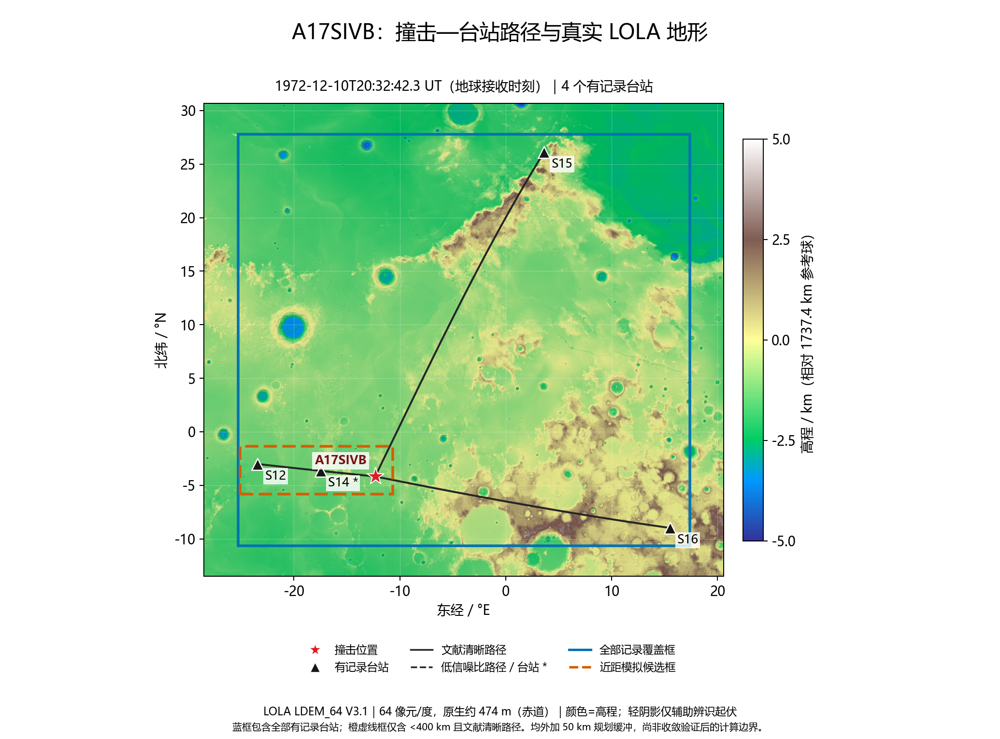

**原始档案：DU，名义时间。**

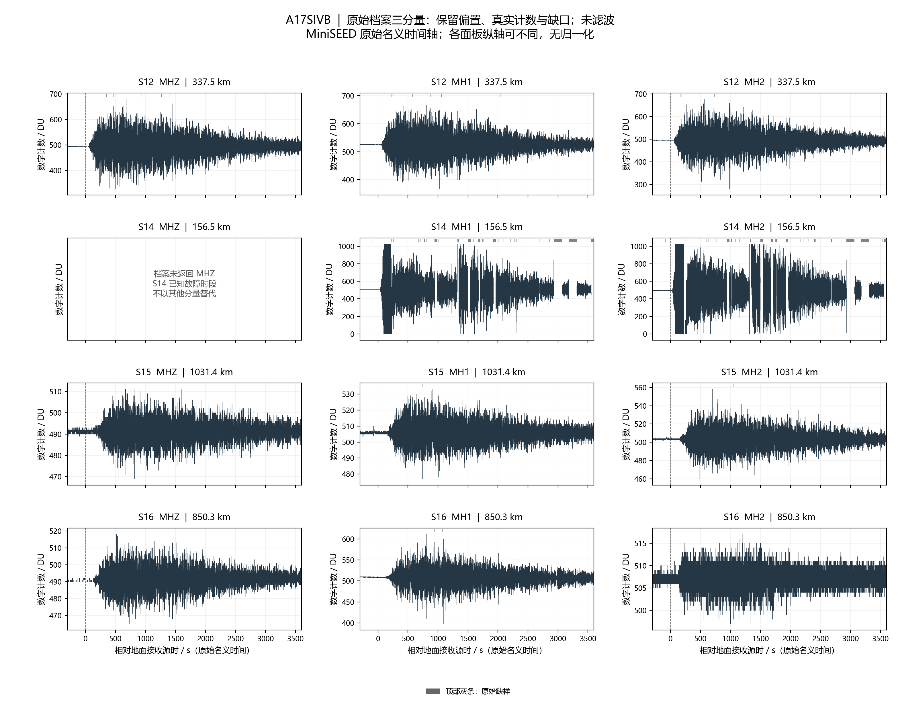

**处理预览：0.3–0.9 Hz名义速度，ATT时间。**

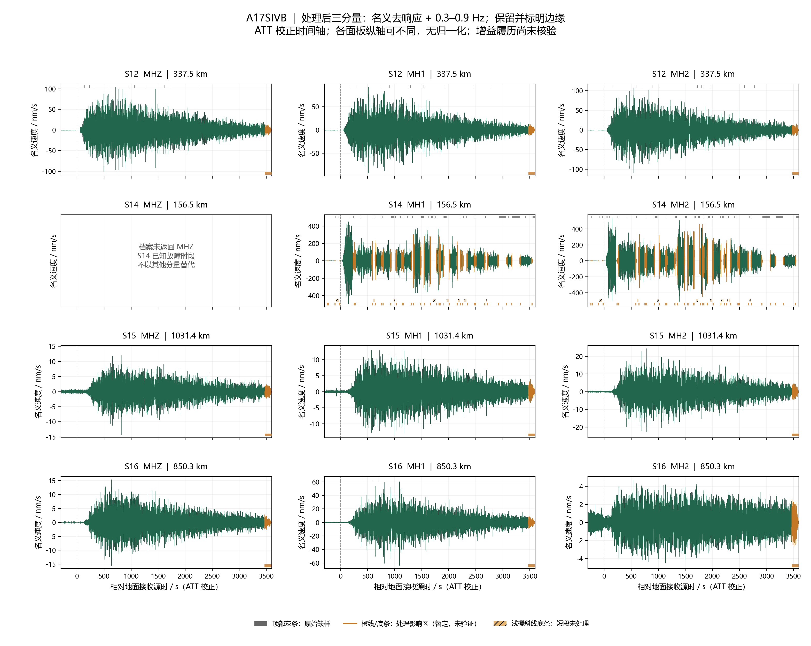

[独立0.3–0.5 Hz位移参照](assets/A17SIVB_literature_displacement_03_05_overview.png)；[S12三阶段](assets/A17SIVB_S12_three_stages.png)；[S14三阶段](assets/A17SIVB_S14_three_stages.png)；[S15三阶段](assets/A17SIVB_S15_three_stages.png)；[S16三阶段](assets/A17SIVB_S16_three_stages.png)。

### 7.9 A17LM

地面接收时刻：1972-12-15T06:50:20.8；源位置：19.97°N，30.49°E。配对：S12 1748.6 km；S14 1597.3 km（低SNR）；S15 770.8 km；S16 985.2 km（低SNR）。

本事件保留远距记录，尚未列入近距首批CGFD3D域。

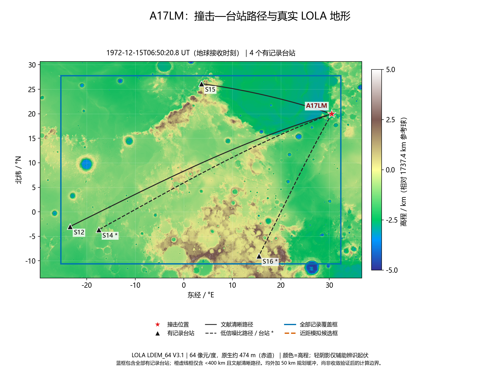

**原始档案：DU，名义时间。**

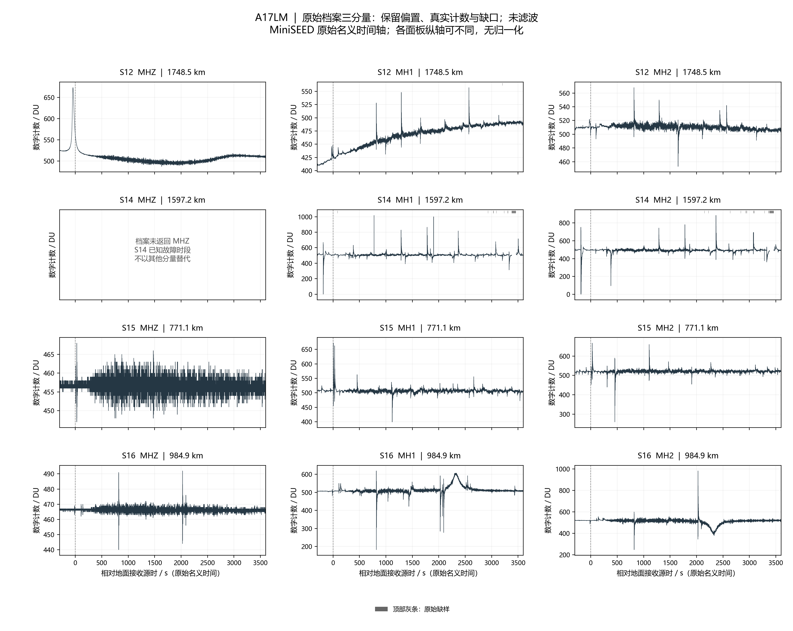

**处理预览：0.3–0.9 Hz名义速度，ATT时间。**

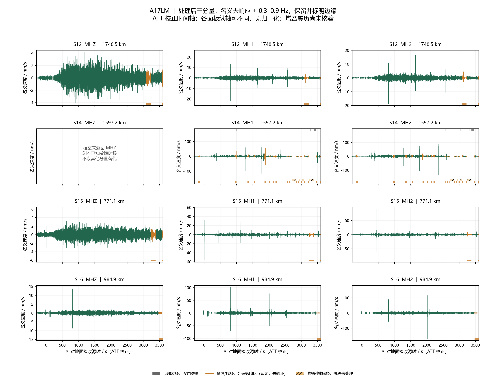

[独立0.3–0.5 Hz位移参照](assets/A17LM_literature_displacement_03_05_overview.png)；[S12三阶段](assets/A17LM_S12_three_stages.png)；[S14三阶段](assets/A17LM_S14_three_stages.png)；[S15三阶段](assets/A17LM_S15_three_stages.png)；[S16三阶段](assets/A17LM_S16_three_stages.png)。

## 8. 资料使用边界与下一步

本图册的“丰富记录”指当前人工撞击样本中已审计配对，不是各地貌均有均衡独立样本。S12资料最多，S16不足以开展同等自由度的局地反演；特定陨石坑的独立样本尚未成立。天然撞击、深月震及浅月震可作为扩展，但需新的震源和覆盖审计。

阅读包包含完整图件、统计表和模型规范，不复制原始MiniSEED、旧SAC、派生NPZ或大幅DEM。原始文件在工程中的路径已写入[tables/pair_record_summary_current.csv](tables/pair_record_summary_current.csv)，此前波形资料包保存可复核数据。本次整理没有改写任何观测样点。
