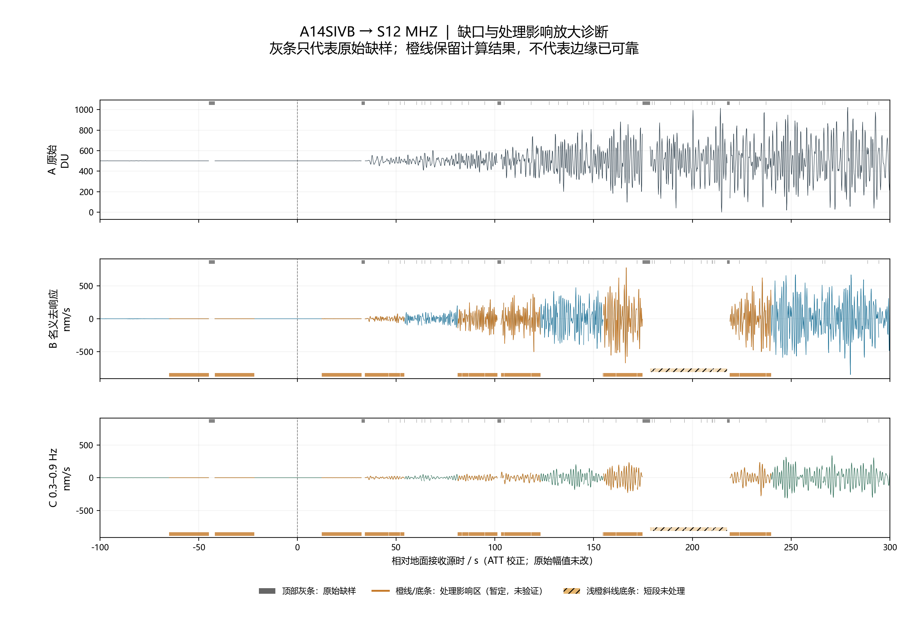
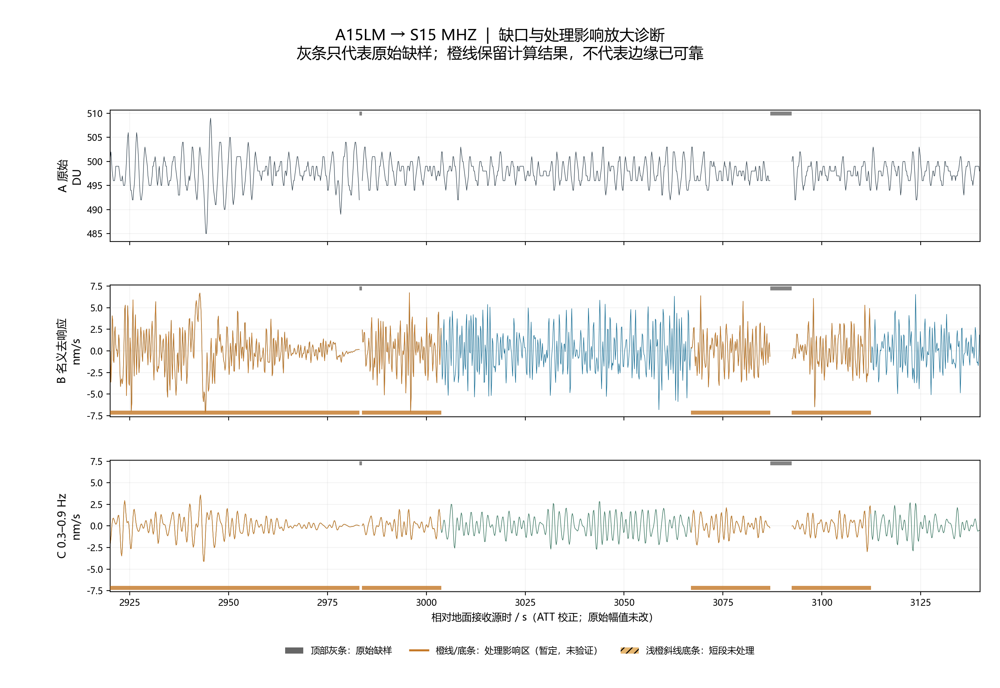

# 第三册｜原始记录、处理方法、清洗与反演准入

版本：2026-10-29。现有波形已完成原始计数核对和分阶段预览，本册统一方法、状态与下一步质控；不将已有滤波结果称为已完成Zhang2025清洗。全部逐事件图见[第一册](01_事件台站与记录图册.md)，文献依据见[第五册](05_文献依据与论文组织.md)。

## 1. 数据的四个层次

| 层次 | 本项目含义 | 当前数量或状态 |
|---|---|---|
| 档案存在 | 已下载的事件—台站现代MiniSEED文件 | 21份；含时标及实际返回的中周期分量 |
| 原始分量存在 | MHZ/MH1/MH2候选63个位置中有实际数据 | 60条；3条S14 MHZ未返回，保留缺失说明 |
| 处理可追溯 | 原始DU、掩码、时间轴及名义响应处理可核对 | 60条；生成速度和独立位移参照 |
| 可用于指定反演 | 人工异常、响应/增益、频段和时间窗等均通过 | 尚未签发最终准入清单；不能写成60条全合格 |

另有81份JAXA旧档案SAC作为对照来源；其单位和既有处理历史未全部核实，不能对它们盲目重复去响应。现代档案的“原始”指本次下载的未去响应数字计数，不是从未经过档案恢复的遥测比特流。〔N22〕

## 2. 时间、单位、分量与文件保全

原始数据数字计数为DU。缺样sentinel −1被转为缺测掩码，不画成负振幅；0和1023作为实际返回值保留，可能涉及轨值/削顶但不能直接删除。60条记录的raw_counts及original_gap_mask已逐点与原始MiniSEED核对一致。

原始总览使用MiniSEED名义时间；三阶段对照和处理图使用ATT局部仿射校正时间。本轮只改变样点时间坐标，没有重采样原始计数。零点沿用NASA地面接收撞击时刻，未额外减约1.3 s。因此不能从原始总览与处理总览的横坐标差异直接判断滤波造成了真实相位偏移；应查看统一ATT轴的三阶段图。

ATT局部校正不替代全天复杂时钟异常恢复。相位级比较还需核对：响应使用的标称采样参数与有效时间步长的差异、跳时或拼接段、地面接收/事件源时刻转换，以及A16 S-IVB起时不确定性。

MHZ为垂直分量，MH1/MH2保留仪器水平轴。本轮未将其直接命名为径向/切向或南北/东西。要计算R/T分量，应先核查方位、极性及响应，再按每条源—站路径旋转；同事件所有分量共用时间与幅值约定。故障垂直分量不能用水平分量冒充。

所有新增清洗应生成派生文件，保留原始文件SHA-256、处理版本和修改区间。未通过质量门的样点继续保留原始数据供复查；不能把“未用于拟合”变成“从档案中删除”。

## 3. 当前已经执行的处理链

### 3.1 速度分支

原始DU → 临时补最多2个缺样点 → 按更长缺口切为连续段 → ≥60 s段去线性趋势/均值 → 3%渐消与名义响应校正 → 带通 → 恢复原始缺口掩码。

| 步骤 | 当前明确设置 | 身份及限制 |
|---|---|---|
| 临时插值 | 最多2个样点，线性插值，只供算子执行 | 项目规则；输出恢复缺样，邻近样点仍可能受影响 |
| 段长 | 至少60 s | 项目计算规则；不足段有原始值但未处理 |
| 响应 | StationXML名义响应，output=VEL | 完整增益命令历史尚未重建，物理幅值为名义校准 |
| 预滤波四角 | 0.05、0.1、1.5、2.0 Hz | 是去响应的稳定化范围，不是最终有效通带 |
| water-level | 不使用 | 与四角预滤波共同定义当前处理 |
| 渐消 | 每端3% | 需做长尾与短段敏感性，不视为无影响 |
| 带通 | 0.3–0.9 Hz，另存0.3–0.5 Hz | Butterworth N=4设计、前后向零相执行；N=4不是前后向组合的总阶数 |
| 边缘标记 | 每段端部max(20 s, 段长3%) | 橙色保留显示；此宽度仅是初步标记，不保证外侧绝无污染 |

已有图不逐道峰值归一化、不自动去尖峰、不实施glitch响应拟合，也未修复S14采集畸变。按名义nm/s显示便于阅读，不能据此声称跨站绝对振幅已经认证。

### 3.2 独立位移参照

位移分支采用Nunn官方示例的四角预滤波[0.1,0.3,0.9,1.1] Hz，output=DISP，再作0.3–0.5 Hz带通，单位nm；沿用本项目短缺口和渐消策略。它不是把速度图纵轴改个单位，也不是对带通速度简单数值积分。

Nunn2024图件还涉及约25 s包络平滑。当前位移参照展示有符号波形，未做该包络步骤，故不能声称完整复现其图1。后续比较文献时应另建对应分支，并保存处理差异。〔N22、N24、O21、O22〕

## 4. 波形空白、边缘和异常如何区分

| 图中现象 | 数据含义 | 统计处理 |
|---|---|---|
| 灰色缺口条 | 原始档案缺样 | 不补零算能量；原始/处理均保留缺测 |
| 短段无处理曲线 | 原始存在，但未满足60 s段长 | 单列未处理比例，不能算作档案缺失 |
| 橙色曲线 | 已计算但位于处理边缘标记区 | 显示供检查；拟合排除或单独验证 |
| 连续有值的尖峰/缓慢回归 | 可能为spike、glitch或真实信号 | 在DU域结合采样形态、响应及多通道判断 |
| 固定DU平台 | 可能为内部削顶或量化 | 检查直方图与连续平台；不仅查0/1023 |
| 缺失分量文字占位 | 档案未返回该道 | 不生成替代曲线；不纳入三分量完整能量 |

本轮通过每段只执行一次完整处理链，减少了旧流程重复裁边产生的空白。显示增加不等于新增可靠观测。以下示例统计均针对ATT轴−300至3600 s，不等于整份档案的缺失率。

<!-- GAP_EXAMPLES -->
| 记录 | 原始缺样 | 旧显示空白 | 新显示空白 | 新边缘标记 | 短段未处理 |
|---|---|---|---|---|---|
| A14SIVB→S12 MHZ | 3.36% | 30.51% | 9.73% | 16.27% | 6.38% |
| A15LM→S15 MHZ | 0.41% | 2.96% | 0.41% | 4.82% | 0.00% |
<!-- END_GAP_EXAMPLES -->

处理完整性核验得到60/60原始计数和掩码一致；共221个连续段完成计算、106个短段未处理，速度与位移分支均无执行失败段。这说明处理执行可追溯，不代替地震学质量判断。[完整统计](tables/trace_stage_comparison.csv)

## 5. 文献候选频带与本项目有效频带

| 用途 | 候选范围 | 来源及使用条件 |
|---|---|---|
| 初始公共比较 | 0.3–0.5 Hz | N24人工撞击比较；需逐事件/分量/时窗质控 |
| 第一扩展 | 0.5–0.9 Hz | N24经验范围；与主带独立检查，合并图可显示0.3–0.9 |
| 高频条件扩展 | 0.9–1.5 Hz | O22两条S12路径先例，不能推广为所有台站固有通带 |
| 低频诊断 | 0.1–0.3 Hz | 当前旧自动筛查包含此带；不作为默认反演通带 |
| 另一文献场景 | 0.05–0.4 Hz | J15二维自然月震模型，须重新核验本数据的低频响应与噪声 |

台站的有效滤波频段不能用一行固定数字概括。最终应写成“事件×台站×分量×物理量×时间窗×处理版本”的准入表，分别说明增长段和晚时尾波；奈奎斯特频率不是可用通带。

### 5.1 现存240项初筛的准确含义

旧处理文件中60道各检查4个子带，共240项，30项满足当时保守初筛。噪声窗为−500至−50 s；信号窗从max(50 s, 文献距离/8 km/s)到1800 s。通过规则包括：RMS信号/噪声≥3、带内至少60% PSD频点功率比≥9、噪声与信号有效比例≥95%、ATT通过，以及未触发粗量化/粗削顶排除。以上阈值是项目初筛选择。

这套表引用的是`impact_reference`旧处理版本，**尚未按新版waveform_comparison_v2重新运行**。因此表中的不通过不等于原始记录不可用，30项也不能作为新版处理的新增合格数量。旧规则仅查ADC两端，亦未覆盖Zhang2025指出的内部削顶。新版本显示恢复后，需要以最终掩码重算筛查，并人工核验，而非直接继承结论。

旧表还标记26条分量前噪声粗量化。噪声RMS很小可能夸大SNR，应检查计数分布、PSD噪声底及其他安静窗口；不能因此称前噪声为人为填充。文献清晰但自动初筛不通过的矛盾必须记录并解释。

<!-- BAND_SCREEN_TABLE -->
| 事件 | 台站 | 0.1–0.3 Hz | 0.3–0.5 Hz | 0.5–0.9 Hz | 0.9–1.5 Hz |
|---|---|---|---|---|---|
| A12LM | S12 | — | — | — | — |
| A13SIVB | S12 | — | — | — | — |
| A14SIVB | S12 | — | — | — | — |
| A14LM | S12 | — | — | — | — |
| A14LM | S14 | — | — | — | — |
| A15SIVB | S12 | — | — | — | — |
| A15SIVB | S14 | — | — | — | — |
| A15LM | S12 | — | — | — | — |
| A15LM | S14 | — | — | — | — |
| A15LM | S15 | — | — | — | — |
| A16SIVB | S12 | — | — | — | — |
| A16SIVB | S14 | — | — | — | — |
| A16SIVB | S15 | — | MHZ | MHZ | MHZ |
| A17SIVB | S12 | — | — | — | — |
| A17SIVB | S14 | — | — | — | — |
| A17SIVB | S15 | — | MHZ | MHZ | MHZ |
| A17SIVB | S16 | — | — | — | MH2 |
| A17LM | S12 | MH1/MH2 | MHZ/MH1/MH2 | MHZ/MH1/MH2 | MHZ/MH1/MH2 |
| A17LM | S14 | — | — | — | — |
| A17LM | S15 | — | MHZ | MHZ/MH2 | MH2 |
| A17LM | S16 | MH1/MH2 | MH1/MH2 | MH1/MH2 | MH1/MH2 |
<!-- END_BAND_SCREEN_TABLE -->

表中“—”表示未通过旧自动筛查，不表示无记录。所有最终qualified_band当前留空。完整240项数值与原因见[历史初筛明细](tables/impact_modern_band_screen.csv)。

## 6. 按Zhang2025建立清洗分支

该论文的关键是区分技术伪信号，并针对机制处理。Glitch采用仪器对加速度、速度和位移阶跃的组合响应，在原始DU域拟合并减去；偏置与线性趋势不随伪信号一并减去。LP插值8倍到约53 samples/s是发生时刻细化，不创造新的真实带宽。S14幅值偏移按数字代码异常修正，但失真机制及残余削顶仍有限制。〔Z25〕

当前九个人工撞击早于Table2从1973年开始的两段明确幅值偏移时段，不能直接套其DU平移表。论文指出的早期511 DU削顶及其他计数异常仍值得检查。原文公开116个较大天然撞击的部分垂直分量清洗结果，不是本项目人工撞击的现成清洗产品。

| 新分支 | 输入与操作 | 要验证什么 | 状态 |
|---|---|---|---|
| C0 保留异常基线 | 现有原始→响应→带通 | 作为比较基线，标异常而不删除 | 已有预览 |
| C1 去spike | 明确的单点/少点异常，保留判定依据 | 不删除真实高频波包，检查局部谱 | 待分类与试验 |
| C2 单glitch拟合 | 孤立、未饱和、响应明确的DU段 | 残差不吸收真实到时、包络增长和长尾 | 待实现/作者代码核验 |
| C3 S14采集诊断 | 多通道直方图、内部平台和位结构 | 区分偏移、削顶及真实非平稳信号 | 待逐道检查；不直接套表 |
| C4 受控注入 | 较干净真实片段加入已知伪信号 | 检查恢复误差、误删率及指标偏差 | 待执行 |

清洗效果应同时展示原始DU、拟合伪信号、残差、物理波形、谱及能量包络。残差变小或图像更平滑不足以证明更接近真值。严重削顶丢失的信息仍可不可恢复，应保留排除或降权状态。详尽方法和图表导读见[Zhang2025附录综述](附录_Zhang2025数据清洗论文综述.md)。

## 7. 推荐的反演准入协议

每个事件—台站—分量应依次回答以下问题，生成一条带理由和版本的记录：

1. **身份和文件：**源、台站、通道、地点码、日期、起止时间、来源、原始哈希能否互相对应？旧SAC是否重复校准？
2. **时标：**名义时间、ATT、源时刻和可能跳时是否明确？相位/峰时的允许误差是否大于尚未解决的时钟误差？
3. **仪器：**模式、响应历元、增益、方向、极性和故障期是否核对？若只做名义校准，允许哪些形状指标、禁止哪些绝对能量结论？
4. **异常：**缺样、spike、glitch、内部削顶、标定信号是否分类？哪些区间原样保留、修复、排除或待定？
5. **子带和时窗：**对早期、峰值邻域及晚尾分别评估SNR和有效覆盖；处理边缘、长缺口、平滑支持窗附近均须评估。
6. **处理敏感性：**预滤波、渐消、滤波器、清洗分支、时间校正和包络窗的合理变化，是否比模型差异还大？
7. **准入签发：**允许的指标、分量、频带与时间窗；无法判断者填待核，不能猜填合格。

建议表字段见[tables/qualification_template.csv](tables/qualification_template.csv)。模板没有预填通过结论。初筛阈值不宜在看完模型拟合之后反复调整，避免择优保留支持某模型的数据。

## 8. 包络、峰时和能量的统一定义

建议先保存每个带通速度分量v_c(t)，再定义平滑平方包络I_c(t)=K_W * v_c²(t)，其中K_W是归一化窗核，宽度W、边界处理与单位要记录；如果改用Hilbert包络或RMS包络，需要另立指标版本，不能混算。

三分量总量可定义Σ_c I_c，但只允许在分量齐全、方向和增益可比且采用共同有效掩码时使用。只有两水平分量时，标为水平和，不与三分量总能量直接比值。几何扩散、震源及散射也会改变振幅，单条能量衰减不是纯吸收测量。

定义两种延迟：t_peak−t_origin与t_peak−t_first_arrival；分别保存。Z25使用首波至最大能量延迟，不能混入从撞击时刻计时的结果。首波不清楚时给区间或标不可用，不人为选一个有利到时。

累计能量E(t)=∫v²dt仅在有效样点和明确支持窗上估计，保留实际Δt。不能将缺口填零后计算T90并称完整持续时间；可报告共同连续窗内的部分能量指标，或将未见尾波结束的记录标为右删失。采样覆盖率高也不保证缺口没有恰好覆盖峰值。

Q_c拟合须记录采用的是振幅包络还是平方能量包络，因为指数衰减系数相差因子；同时记录频率、几何时间因子、噪声底与拟合窗。一般模型可写I(t,f)∝t^(−p)exp(−2πft/Q_c)，但p及该形式的适用性必须由所选方法确定，不能视为所有散射条件下恒成立。Q_c不直接等于Qᵢ或Q_sc。〔G17、Z25；本项目观测算子定义〕

## 9. 下一步最小可完成工作

先复核A14/A16 S-IVB→S12，逐道标出原始异常、时钟和响应问题；选一个孤立glitch作受控示范，不从最复杂饱和段开始。再以同一新版掩码重跑子带/分窗检查，形成“允许形状指标”和“允许绝对幅值”的分级准入。

只有在这些观测选择冻结之后，才向模型比较流程交付具体目标窗和误差范围。若两条参考路径的清洗不确定性暂时大于模型差异，可以先做合成恢复与数值基准，但不能把处理不确定性隐藏在散射参数中。
