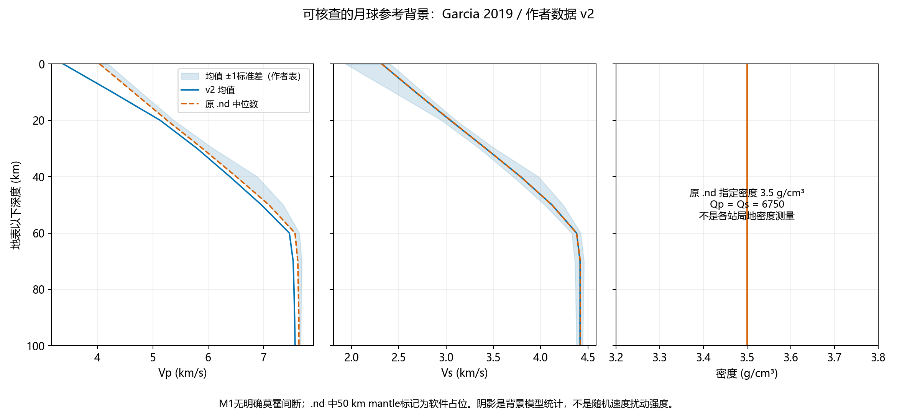
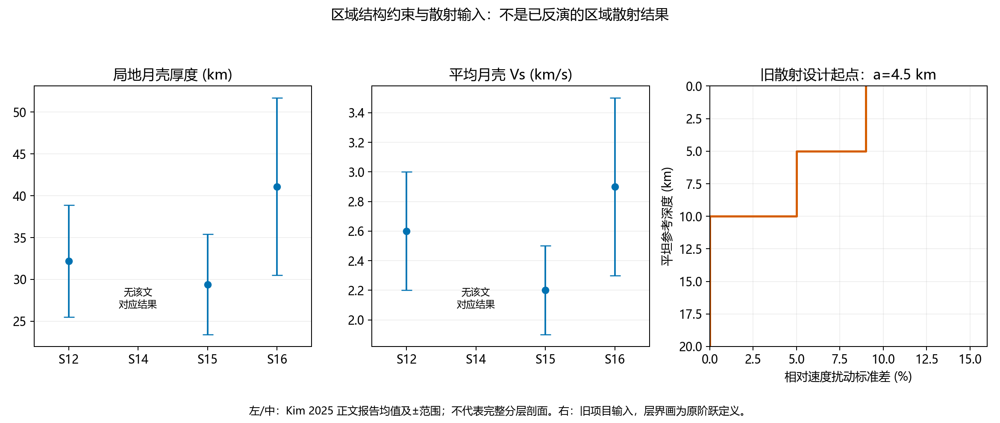

# 具体背景模型参数与图件

> 区域结构更新（2026-11-05）：当前只采用S12、S14、S15三套独立模型，固定背景、莫霍、Q及材料CSV以[第08章](08_S12_S14_S15三个区域模型.md)和[第09章](09_三区域结构文献核对与背景更新.md)为准。本章旧M1/完整VPREMOON共同背景、W共享区域、12 km共同内壳界面及旧计算计数均保留追溯，不再作为执行输入。冯卡尔曼数学定义可继续参考，深度函数莫霍截断须换为本次区域界面；不新增其他模型族。尚未运行新波场。

2026-11-05。已获取作者原始数值文件，以下区分完整参考模型、局地观测约束和项目散射输入。未执行传播或区域反演。

## 1. 已取得的完整背景参数

来源：[Garcia2019作者数据v2](https://zenodo.org/records/21476963)。原`.nd`为集合中位数，新`.dat`为集合均值/±1标准差，作者readme已随原文件保存。为避免混合不同统计量，当前完整后备背景选原M1中位数`.nd`；新均值仅单独展示和导出，不与旧密度/Q拼成“作者均值模型”。这是对前版“均值背景”措辞的具体修正。

表中密度和Q为作者文件指定值，不宣称它们全部由独立观测反演。M1连续变化，无明确定义的莫霍；50 km占位标签不得用作各地区域壳厚。节点之间线性插值是本项目实施选择，不人为添加层间跳跃。

| 深度 km | Vp km/s | Vs km/s | 密度 g/cm³ | Qp | Qs |
|---:|---:|---:|---:|---:|---:|
| 0 | 4.04 | 2.32 | 3.5 | 6750 | 6750 |
| 10 | 4.65 | 2.68 | 3.5 | 6750 | 6750 |
| 20 | 5.26 | 3.05 | 3.5 | 6750 | 6750 |
| 30 | 5.9 | 3.42 | 3.5 | 6750 | 6750 |
| 40 | 6.51 | 3.79 | 3.5 | 6750 | 6750 |
| 50 | 7.1 | 4.12 | 3.5 | 6750 | 6750 |
| 60 | 7.57 | 4.38 | 3.5 | 6750 | 6750 |
| 70 | 7.62 | 4.42 | 3.5 | 6750 | 6750 |
| 80 | 7.63 | 4.42 | 3.5 | 6750 | 6750 |
| 90 | 7.64 | 4.42 | 3.5 | 6750 | 6750 |
| 100 | 7.64 | 4.42 | 3.5 | 6750 | 6750 |

[完整节点CSV](tables/M1_median_0_100km.csv)；[均值速度CSV](tables/M1_mean_velocity_0_100km.csv)。图只展示上100 km，原始.nd保留全深度；不得以图的100 km截断替代长路径计算域设计。Qp/Qs为P/S波吸收设置，不是散射Q。

## 2. 已有的具体区域约束

[Kim2025](https://doi.org/10.1029/2024GL114506)正文§3（本地PDF第7页，期刊第6页）给出：

| 台站 | 壳厚 km | 平均月壳Vs km/s | 完整局地Vp/Vs/密度层表 |
|---|---|---|---|
| S12 | 32.2±6.7 | 2.6±0.4 | 不能由这两个数唯一确定 |
| S14 | 该文无对应结果 | 该文无对应结果 | 暂用统一后备背景 |
| S15 | 29.4±6.0 | 2.2±0.3 | 不能由这两个数唯一确定 |
| S16 | 41.1±10.6 | 2.9±0.6 | 不能由这两个数唯一确定 |

图中误差按作者正文的±报告值展示，不另命名为95%区间。当前四区域都可以使用上述完整M1作为有来源的后备背景；这不代表四区真实结构相同。S12/S15/S16存在局地约束，尚不能因此宣称已建立最可靠的完整区域剖面。禁止把平均Vs直接填满整个深度，或在M1上任意移动莫霍并称为论文模型。

## 3. 可直接审阅的散射模型输入

统一三维冯卡尔曼。旧起点a=4.5 km，浅0–5 km标准差9%，5–10 km为5%；ν待生产配置核齐后固定。它是搜索起点，不是四区各自最优结果。

首轮a={0.2,0.65,1.3,2,4.5,6} km，σ₁={3,5,9,12,15}%，σ₂=(5/9)σ₁，h₁=5 km，H=10 km，共30种散射参数组合/区域。随后在入围a/σ附近搜索H={10,15,20,30} km。各区用同一范围，观测决定地区差别。所有离散取值的文献动机见第二册；这些范围是项目设计，不是局地区域观测区间。

上述右图画旧阶跃幅度；新模型若采用第二册1 km余弦渐变，H为过渡中心，不应把两者冒称同一离散实现。真实起伏域按对应层界定义深度。随机介质三维切片暂不伪造：ν尚未核定，仅画明确的参数剖面。

[首轮30组候选参数CSV](tables/首轮30组散射候选参数.csv)。该表供四区域共同搜索使用，不是已完成的120次模拟。完整来源与各尺度的设计动机见[第二册](02_散射模型与参数设计.md)。

数据留档：`data/raw/background_models`下保存原始压缩包及提取文件。主模型压缩包MD5为`01ce54281b0df0e308bcd5d91e11664c`，已与作者仓库核对。均值不确定性绘图将上下界深度网格线性插值到均值网格；不将插值解释为新增分辨率。
