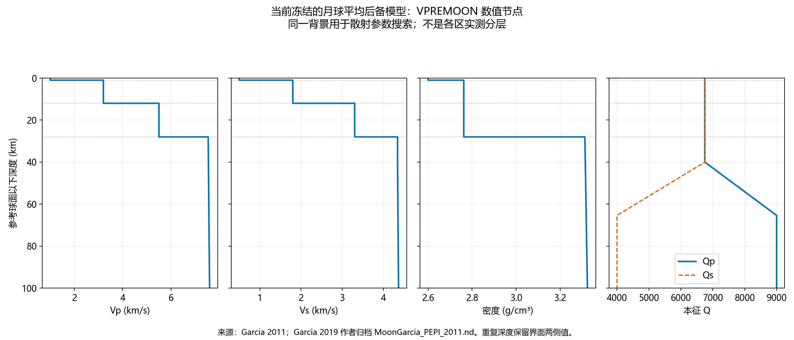
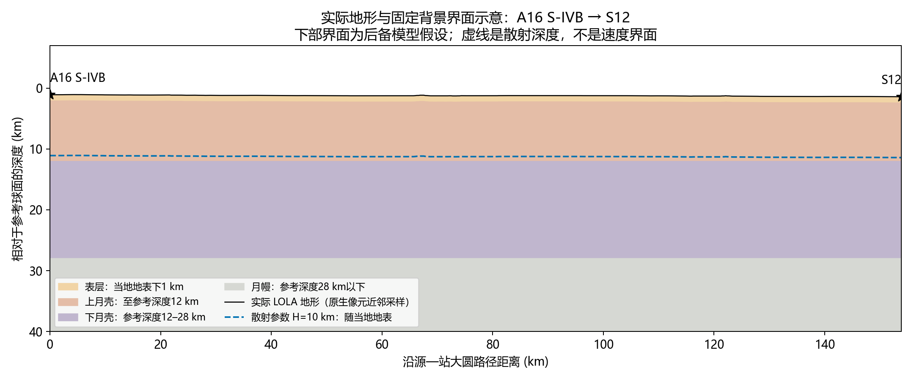
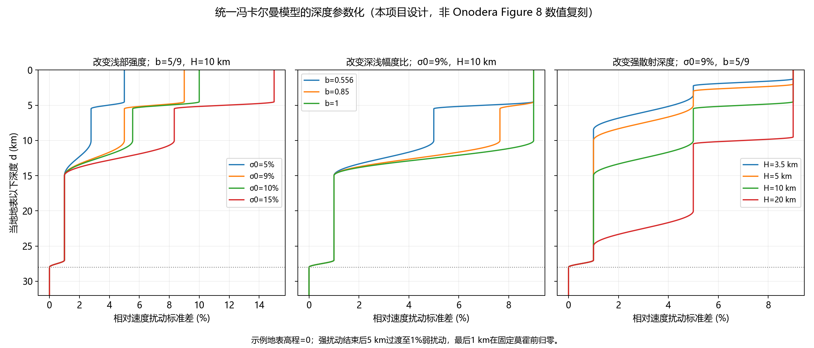

# 源—站路径与固定背景下的三维冯卡尔曼散射模拟方案

> 区域结构更新（2026-11-05）：当前只采用S12、S14、S15三套独立模型，固定背景、莫霍、Q及材料CSV以[第08章](08_S12_S14_S15三个区域模型.md)和[第09章](09_三区域结构文献核对与背景更新.md)为准。本章旧M1/完整VPREMOON共同背景、W共享区域、12 km共同内壳界面及旧计算计数均保留追溯，不再作为执行输入。冯卡尔曼数学定义可继续参考，深度函数莫霍截断须换为本次区域界面；不新增其他模型族。尚未运行新波场。

版本：2026-11-05（详细方案）。本文件更新第二册中的区域组织、背景选择、深度参数化和计算矩阵。旧30组参数表保留追溯，本版首轮改为24组。**这是有明确数值的科学设计及材料表，不是已运行的CGFD3D配置，也不是区域反演结果。**

## 1. 首先决定：到底反演什么区域

建议采用“**源—站对提供观测，多条覆盖路径联合确定一个有效区域模型**”的组织方式。

单个台站只是接收位置。其波形受到震源附近、整条传播路径、台站附近及地下界面共同影响，强散射尾波还会访问直达路径之外的体积。把所有S12记录拟合出的参数直接称为“S12台站下方参数”是不成立的。另一方面，每个源—站对独立设置一套任意介质，会让同一地点在不同事件中拥有不同参数，也无法形成自洽的区域模型。

因此区分三种对象：

| 对象 | 本项目定义 | 如何使用 |
|---|---|---|
| 观测单元 | 一个撞击事件、一台站、一个有效分量及频带 | 保存质量掩码，计算单条残差 |
| 正演单元 | 一个事件及本次域内所有有效台站 | 一次波场计算同时提取多个站，避免按配对重复计算 |
| 反演单元 | 具有相互覆盖路径的一组空间区域 | 多个事件共享固定背景及散射统计参数；重叠位置使用同一随机场实现 |

本版不增加一套地质分区竞争试验。先做可辨识的路径组有效模型；只有现有记录支持空间拆分时，才将有效参数进一步解释为局地参数。

### 1.1 当前观测集合允许的实际分组

距离来自项目已核查的[源站几何表](../../results/impact_audit/event_station_domains.csv)，不是本轮重新定位结果。“清晰”是先前文献审计状态，仍须按实际处理后记录核验准入。

| 组 | 首轮训练记录 | 独立事件检查 | 当前能回答的问题 |
|---|---|---|---|
| W：S12/S14西部重叠传播走廊 | A14SIVB→S12，175.41 km；A16SIVB→S12/S14，153.87/274.55 km；A15SIVB→S12/S14，355.35/185.54 km | A13SIVB→S12，135.86 km；A17SIVB→S12，337.58 km；A12LM→S12，73.01 km；A14LM→S12/S14，114.36/66.70 km | 首先估一个西部路径组有效散射模型；S12与S14残差分开报告，不预设二者相同地质性质 |
| N15：A15LM—S15近距走廊 | A15LM→S15，92.18 km | 当前集合无独立近距事件；长距记录只能作额外一致性检查 | 一条盆缘路径的条件性有效模型，不能扩称整个Hadley–Apennine区域 |
| L16：含S16的长距路径 | A17SIVB→S16，850.55 km | A17LM→S16为低信噪比，不自动纳入 | 暂不单独反演Descartes/Cayley局地散射参数；需要全路径建模及新增近距记录 |

W组为3个训练事件、5条源—站记录，4个检查事件、5条记录；加N15为原有8事件、11近距候选配对。A16SIVB→S14缺MHZ，仅合格水平分量参与，不补零。A17SIVB→S14低信噪比及缺分量记录不进入上述主集合。N15的单事件不能将随机种子重复当成新的观测事件。

**回答台站还是源站对：优先按实际源—站路径覆盖组织区域；台站名称只用于索引。** W组初始共用参数是当前数据条件下减少未知数的选择，不是证明月海与Fra Mauro高地散射相同。若共同模型持续不能同时解释合格记录，停止称其为统一地区结果；先排查数据、震源和固定背景偏差，而不是为了拟合任意增加分区。

## 2. 从Onodera 2022具体学习什么

本轮核对了本地论文正文§2.2–2.6、§3.1–3.3以及Figure 3、5、8、10；还核对了[作者公开仓库](https://github.com/Onodera0726/JGR_Onodera2022)。正文出处：[Onodera et al., 2022](https://doi.org/10.1029/2022JE007558)。

| 项目 | 原文能够确认的内容 | 对本方案的落实 |
|---|---|---|
| 事件逻辑 | 用A16SIVB→S12约束后，再用A14SIVB→S12检查并调整 | 多事件共享参数，不逐事件无限调参 |
| 随机场 | 三维各向同性指数自相关，是冯卡尔曼的特例；正文主比较a=650 m，生成速度场1σ约5%–10% | 本版明确固定ν=0.5，搜索a及实际场标准差 |
| 输入幅度 | 生成器ε=0.024–0.042与生成场1σ=5%–10%并列出现 | 不把ε原样移植到CGFD3D；统一用生成后的相对速度标准差验收 |
| 深度分布 | 初始强扰动约至5 km；Figure 8再比较渐弱、3.5 km薄强层、10 km厚强层，深部仍有弱扰动 | 用一个连续参数化表达强度、深浅幅度比及强散射厚度，保留深部弱尾段 |
| 拟合对象 | 峰值到达、能量变化、包络形状和三分量共同约束 | 不仅拟合尾波衰减斜率；不要求随机尾波逐相位重合 |
| 背景 | GRAIL/样品约束的密度—孔隙率—速度关系；地形与莫霍独立定义 | 平均背景与随机场分开冻结，H不控制背景速度界面 |

Figure 8不能支持“浅部10%一直恒定至10 km、10 km以下严格为零”这个简化。它也不能单凭图像给出所有小台阶的精确数字。本版没有将图上估读值冒充作者表格。

正文可直接重建的浅部关系为：

\[
\rho(d)=2308+786[1-\exp(-d/9.8)]\quad\mathrm{kg/m^3},
\]
\[
\phi(d)=1-\rho(d)/3094,\qquad
V_P(d)=\frac{7.15}{\sqrt{1-\phi}}\exp\left[\frac{(\phi^2-7)\phi}{2(1-\phi)}\right]\quad\mathrm{km/s}.
\]

这是A12相关建模背景，d以km计。原文以散射层Vp/Vs=2、固结层√3构造Vs。**本方案不让这个比值分界随待反演H移动**，否则每次修改“散射层厚度”也修改了平均Vs，违背只搜索散射参数的目标。

本轮出版社SI链接返回403，未取得Table S1、S4及各层完整输入；公开GitHub树只有README和9个模拟波形CSV，没有材料生成器或完整输入层表。故本版不声称逐项复现Onodera原始背景、Q或Case 4γ。公开波形已降采样至6.6 Hz并经过0.3–1.5 Hz滤波，它们适合方法对照，不能标成未滤波原始观测。

## 3. 固定背景的明确选择

### 3.1 当前采用一个完整、有数值来源的月球平均后备模型

本版选用**Garcia 2011 VPREMOON在Garcia 2019作者归档中的`MoonGarcia_PEPI_2011.nd`**。前版M1保留为背景资料，不再作为本版生产设计的分层输入，也不与本版构成背景竞争试验。

选择理由是：原M1的50 km标签不是被定义/反演的莫霍，且上部密度统一指定为3.5 g/cm³；目前需要一个同时含明确浅层界面、壳幔跃变、Vp、Vs、ρ、Qp、Qs的可重建后备背景。选择VPREMOON并不意味着它是最新或唯一最优模型，而是当前有完整公开数值、且符合“缺完整区域结构时使用月球平均模型”的后备选择。

来源：[Garcia 2011](https://doi.org/10.1016/j.pepi.2011.06.015)、[2012勘误](https://doi.org/10.1016/j.pepi.2012.03.009)、[Garcia 2019综述](https://doi.org/10.1007/s11214-019-0613-y)、[作者归档](https://zenodo.org/records/21476963)。采用归档节点，不凭旧图重建；勘误涉及源位置及压力计算，长距扩展到深部前须另核其影响。本文件导出的0–110 km节点来自作者归档。

Kim2025给出的S12/S15/S16壳厚32.2±6.7、29.4±6.0、41.1±10.6 km及平均Vs是局地约束，不是完整速度、密度、Q剖面；尤其不能把单站壳厚平铺到数百km源站走廊。暂不把这些数强行拼入全域背景。S16局地壳厚与后备28 km差异较大，是不能声称本方案已完成S16局地模型的重要原因。Zhang2026等区域层表尚待完整核齐，未完成这一步不称“最终最可靠区域模型”。

### 3.2 固定数值表

在高程h=0的参考柱中，输入如下。速度单位km/s，密度kg/m³。重复深度是界面上、下两侧，不可平均掉。

| 深度/层段 | Vp | Vs | ρ | Qp | Qs | 实施方式 |
|---|---:|---:|---:|---:|---:|---|
| 0–1 km | 1.00 | 0.50 | 2600 | 6750 | 6750 | 表层固定常值 |
| 1–12 km | 3.20 | 1.80 | 2762 | 6750 | 6750 | 上月壳固定常值 |
| 12–28 km | 5.50 | 3.30 | 2762 | 6750 | 6750 | 下月壳固定常值 |
| 28 km下侧 | 7.54 | 4.34 | 3312 | 6750 | 6750 | 明确壳幔跃变 |
| 40 km | 7.55 | 4.34 | 3314 | 6750 | 6750 | 与相邻节点线性插值 |
| 65.4 km | 7.57 | 4.35 | 3318 | 9000 | 4000 | 与相邻节点线性插值 |
| 90 km | 7.59 | 4.36 | 3322 | 9000 | 4000 | 与相邻节点线性插值 |
| 110 km | 7.61 | 4.37 | 3325 | 9000 | 4000 | 供100 km试算域插值；不把110 km当全模型底界 |

源文件：[原始.nd](../../data/raw/background_models/MoonGarcia_PEPI_2011.nd)；[导出节点CSV](tables/固定背景_Garcia2011_原始节点_0_110km.csv)。在12、28 km处保留跃变；连续段内包括Q均使用作者节点线性插值，此插值规则是本项目固定实施规则。ρ以SI单位输入CGFD3D；图/原始CSV仍标g/cm³，明确乘1000转换。

### 3.3 Q具体怎样固定

表中的Qp、Qs表示P/S波**本征吸收**，不是散射Q。随机速度起伏已经显式产生散射，不能再将文献散射Q当吸收输入，否则重复衰减。上述Q是归档材料字段，不称各走廊独立反演得到的Q。

选择目标为准入频带内近似常Q，参考频率1 Hz；采用CGFD3D实际支持的吸收实现。松弛机制参数须由目标Q和频带转换，不能把Q数值直接当阻尼率。材料输入验收时做均匀介质传播检查，在0.3、0.6、1.0、1.5 Hz等落入准入带的频点核对衰减和相速度。目标Q偏差不超过5%作为项目验收阈值，验证之后固定；超差先修正吸收实现，不靠加大σ弥补。未确认求解器接口前，不能称已完成吸收配置。

固定Q得到的是“条件于这个Q背景”的散射参数。不同时反演Q，不宣称Q不确定性已经消失。尾波衰减严重不符时，应停止区域物性解释并查明背景问题。

## 4. 地形与地下界面的三维几何

采用R=1737.4 km参考球。对位置(λ,φ,r)，定义LOLA高程h(λ,φ)、地表半径rs=R+h，以及当地地表以下深度d=rs−r。背景深部参考深度z=R−r。两种深度不可混用。

固定界面如下：

1. 自由表面r=R+h，取真实LOLA，不扫描平地版本。
2. 表层底r=R+h−1 km，即当地地表下1 km；表层厚度固定。
3. 上/下月壳界面r=R−12 km；莫霍r=R−28 km，为后备模型同心球面。
4. 28 km以下按参考球深度读取月幔节点。地形不能简单向下复制到所有深部界面。

上述浅层随地形、深层同心球面的组合是**本项目三维化规则**，不是从LOLA观测到了地下界面。LOLA只约束地表。在获得可靠区域地下界面图之前，不凭陨石坑轮廓或DEM颜色创造地下结构。固定背景在所有散射候选中逐网格相同。

当前已核验LOLA LDEM_64原生裁片，64像元/度，南北采样约474 m。文件`data/raw/lola_impact_64/ldem_64_W38_E40_S18_N40_native.npz`包含原始DN、经纬度及比例。高程m=DN×0.5，不能重复减参考半径。旧`ldem_64_float.img`尺寸异常，不使用。生产映射统一采用双线性插值，保存映射后的高程数组与哈希；不因速度模型不同再次平滑地形。不标注小于2 km的地貌名称，但也不以2 km作为擅自删除地形的阈值。

LDEM_64是已验证的当前产品，并非处处独立474 m测量。如果正式网格需要更高采样的LOLA产品，先统一更换并冻结全组地形，然后全部候选重用；把474 m插到25 m不叫获得25 m新地形。来源：[PDS产品说明](https://ode.rsl.wustl.edu/moon/pagehelp/Content/Missions_Instruments/Lunar%20Reconnaissance%20Orbiter%20%28LRO%29/LOLA/GDR/GDRDEM.htm)。

图沿A16SIVB—S12大圆路径，从实际原生地形近邻取样，仅用于展示；生产插值规则见上。横轴距离、纵轴深度采用不同尺度，图有垂向夸大，不能据此判断真实坡角。蓝虚线是示例H=10 km，和速度界面不相同。

## 5. 唯一随机介质族：三维冯卡尔曼

\[
V_P(\mathbf x)=V_{P0}(\mathbf x)[1+q(\mathbf x)],\qquad
V_S(\mathbf x)=V_{S0}(\mathbf x)[1+q(\mathbf x)],
\]
\[
q(\mathbf x)=\sigma(d;\theta)\eta(\mathbf x),\quad
\langle\eta\rangle=0,\quad\langle\eta^2\rangle=1.
\]

P/S使用同一个相对扰动场，因此局地Vp/Vs保持背景比值；ρ、Qp、Qs不加随机扰动。此耦合是明确的项目选择，不声称Onodera和旧项目都采用相同设置。

各向同性三维谱为：

\[
P_\eta(k)=A\,[1+(ak)^2]^{-(\nu+3/2)},\qquad k\text{以rad/km计}.
\]

本版新设计固定ν=0.5，因而P∝[1+(ak)²]⁻²，自相关为exp(−r/a)，与Onodera指数特例一致。**这不是声称查明旧论文生产ν=0.5**；旧ν仍未核定。旧项目继承的是a=4.5 km、浅/深9%/5%的设计参照，不能将本版波形称作旧生产模型复现。若后续必须严格继承已核定的另一ν，应统一改版后冻结，不增加ν竞争分支。

FFT生成要乘√P而非P；实空间白噪声经谱滤波后回到实场，去均值并归一化，再乘σ(d)。k=2πf空间，不能把cycles/km直接代入ak。随机场在物理距离坐标中生成，不在拉伸曲线网格的索引距离中生成。地形和非均匀深度包络会使最终场非平稳，冯卡尔曼定义针对母体场η。

每个候选、每个种子在W母域生成一份场，各事件截取相同位置的同一场。禁止每个事件重抽介质来挑最好拟合。初筛使用共同随机相位，减少候选比较中的随机差；最终用5个种子检查统计稳定性。

## 6. 速度扰动强度—深度关系：明确函数和数值

采用四个待估统计量：**θ=(a,σ0,b,H)**。σ0是浅层相对速度标准差，b控制下部强散射层相对浅层的幅度，H是强散射平台结束深度。所有深度相对当地地表，H不是莫霍，不改变Vp0或ρ。

### 6.1 名义分段关系

| 地表下深度 | 相对扰动标准差 | 参数地位 |
|---|---|---|
| 0至H/2 | σ0 | 待搜索幅度 |
| H/2至H | bσ0 | 待搜索深浅比例 |
| H至H+5 km | 从bσ0余弦衰减至1% | 过渡长度固定5 km |
| H+5 km至莫霍上方1 km | 1% | 固定深部弱扰动假设 |
| 莫霍上方最后1 km | 平滑降至0 | 固定终止规则 |
| 月幔 | 0 | 当前只反演月壳随机非均质 |

H/2处采用全宽1 km余弦平滑，避免随机场幅度硬截断。弱扰动1%、5 km尾段及莫霍处归零均为项目闭合假设，**不是Onodera原文精确数值**。如果H+5已接近/超过莫霍，尾段受莫霍窗截断，不强行扩展到月幔；保存该位置实际σ(d)。这些假设固定，不新增深部尾段竞争模型。

给出可直接编码的函数。定义下降窗

\[
T(d;c,w)=\begin{cases}
1,&d\le c-w/2,\\
\tfrac12[1+\cos(\pi(d-c+w/2)/w)],&|d-c|<w/2,\\
0,&d\ge c+w/2.
\end{cases}
\]

则

\[
\sigma(d)=\{0.01+(b\sigma_0-0.01)T(d;H+2.5,5)
+(\sigma_0-b\sigma_0)T(d;H/2,1)\}\,
T(d;d_M-0.5,1),
\]

其中dM=rs−(R−28)=28+h，是当地地表到固定莫霍的距离。单位均为km；σ是小数而非百分数。这样H改变时，仅随机扰动深度分布变化，背景材料和所有界面完全不变。

参考输入取a=4.5 km、σ0=0.09、b=5/9、H=10 km：浅平台9%，第二平台5%，10–15 km衰减至1%，更深为弱扰动至莫霍。这保留旧设计的浅层幅度参照，同时显式补充本次的弱深部尾段，**不再称为旧模型逐点复制**。

图中改变的均是同一冯卡尔曼随机介质族的参数，不是引入不同物理机制；所有曲线都是项目设计，未拟合观测。

### 6.2 参数搜索的具体取值及来源

| 参数 | 本次节点 | 依据与限定 |
|---|---|---|
| a/km | 0.2、0.65、1.3、2、4.5、6 | 0.65直接对应Onodera2022主对照；0.2来自Onodera2021浅层尺度背景；2来自已有月壳数值研究背景；4.5为旧最终设计；1.3和6为项目布点。二维尺度不作为三维已反演值 |
| σ0 | 5%、9%、10%、15% | 5%/10%覆盖Onodera生成场标准差，9%继承旧设计，15%为项目外扩 |
| b | 5/9、0.85、1.0 | 5/9继承旧幅度比；0.85与1为检查深部维持强扰动的项目节点，不称Figure 8精确读数 |
| H/km | 3.5、5、10、20 | 3.5/5/10对应Onodera薄层、初始、较厚强层的深度动机；20为项目外扩；本版不同时搜索50/80 km |
| ν | 固定0.5 | 明确采用冯卡尔曼指数特例 |
| 深部弱σ | 固定1% | 项目闭合假设；不由论文图像反推 |

浅平台分界采用H/2，是本项目参数化选择，可让H=3.5 km时仍有两段有效平台，且在旧H=10 km时恰为5 km。不能同时又固定h1=5 km，否则H<5 km时产生空层及冗余参数。

同一(a,σ)在不同背景Vs、频率和深度下散射效率不同。最终同时报告a、σ(d)、H、频带及固定背景，不能只以σ大小给所有地区排“散射最强”。a不是平均自由程，也不直接等于陨石坑直径。

## 7. 从统计模型到材料网格的检查

1. 先生成并冻结背景Vp0、Vs0、ρ0、Qp、Qs和界面；哈希写入每个候选清单。
2. 在加宽母域生成η，边界至少留6a的统计缓冲，生成后裁去FFT周期边界影响。缓冲不是波动计算PML。
3. 统一使用实际截断到网格可分辨波数的谱，在相同网格与带宽上归一化。提高网格分辨率会增加指数谱高波数功率，收敛检查时应固定物理谱截止，不能把介质改变误认为数值误差。
4. 在远离地表、界面与过渡的统计窗检查均值、标准差、三方向ACF及PSD；分层绘制实际RMS随深度。归一化母体η，不逐水平面强制标准化破坏垂向协方差。
5. 统计目标误差暂定：均值绝对值<0.05σ，充分大统计窗的RMS偏差<5%；小窗给出抽样误差，不强行修正。ACF与理论比较时以有限网格截断后的目标谱为准。
6. 检查Vp>0、Vs>0、ρ>0、μ=ρVs²>0、K=ρ(Vp²−4Vs²/3)>0；保存极值。高斯场无硬界限，若罕见实现产生非物理速度则拒绝该实现并记录，不能静默截断却仍称原分布。
7. 所有候选密度、Q、地形、源、吸收边界不变；随机种子固定为1105、2113、3251、4421、5563。这些种子是项目复现标识。

## 8. CGFD3D的计算域、网格与资源

### 8.1 域与曲率

采用[现有事件域表](../../results/impact_audit/local_simulation_candidates.csv)作为几何起点，同一事件的S12/S14一起输出。原表50 km缓冲仅为初始值，不能认定适用于尾波。有效空间先含源、所有接收站及50 km侧向缓冲，底深先取参考深度100 km；PML在此之外。

PML初始20个网格点，作为数值试算设置而非通过验证的结论。对入围模型将侧向缓冲50增至100 km、底深100增至150 km，检查所拟合0–600 s窗的包络、峰时和能量。如果差异超过5%或峰时超过15 s，继续扩域或缩短可解释时间窗。吸收边界仅能减小假反射，不能补回被小域移除的真实散射回返能量。域检查属于同一模型的数值验收。

月球曲率必须保留：本项目175 km路径弓高约2.2 km，355 km路径更大，已经不可忽略。使用球面/曲面映射的真实物理度量；CGFD3D若只有平面地形实现，需要先核实曲率接入，不能仅把经纬度乘常数后当作球面波场。850 km以上记录不纳入本轮局地计算预算。

### 8.2 频率、网格和时间步不能凭经验写死

候选分析带为0.3–0.9 Hz，扩展至0.9–1.5 Hz须逐记录响应、噪声及清洗结果支持。它们是设计候选，不是所有站已验收频段。用户不要求固定0.3–0.5 Hz，故本版不使用该窄带作为唯一目标。观测与合成必须采用相同带宽和算子；原始/已发表清洗波形另外保存，不覆盖。

网格要求采用实际扰动后最小Vs和最大Vp计算：

\[
\Delta_{\max}\le \min\{V_{S,\min}/(N_\lambda f_{\max}),a_{\min}/5\},
\]

Nλ暂取8作为设计值，最终依CGFD3D实际差分算子及色散测试。以Vs,min=0.30 km/s、fmax=0.9 Hz计，波长限制约41.7 m，a_min=0.2 km要求40 m；取浅层25 m作为试算目标。若fmax=1.5 Hz，波长限制为25 m。实际场Vs更低则继续加密，不能将0.30视为保证下界。

时间步初始采用保守估计Δt≤0.35/[Vp,max√(Δx⁻²+Δy⁻²+Δz⁻²)]。均匀25 m、Vp,max=8 km/s给约0.00063 s，可先取0.0005 s；这不是曲线网格的稳定性证明，最终用实际度量、吸收实现和代码CFL条件计算。

上述表层Vs=0.5 km/s会使成本很高，这是采用真实低速背景需要正视的代价。仅按300×200×100 km、均匀25 m估计就有约3840亿节点；每节点20个float32字段约30.7 TB，尚未含PML、通信和临时数组。**不直接提交整个候选矩阵。** 先核实旧CGFD3D是否支持稳定的分层加粗/非均匀网格、已有生产并行规模与可用资源。深部加粗只能在真实算子允许、保持局部波长与a解析度时采用。资源不足时，统一调整可支持频带与网格，并明确哪些小a仍可分辨，不能悄悄提高最小速度或删去低速层。

初始模拟时长1200 s，主要拟合首波后至600 s内的能量增长及早尾波。若2倍峰时超出有效模拟/观测窗口，该记录不计算相应指标，不截短后冒称完整尾波。全1–2小时尾波不作为首轮要求。

## 9. 震源与观测算子也必须冻结

每个事件建立唯一源文件：坐标、月面撞击时刻、源类型、埋深、时间函数、方向/矩张量、幅度及来源。已有NASA时间字段有Earth-received含义，不能不作时间基准核对就称月面t0。不得重复减1.3 s修正。

S-IVB优先沿用旧项目已验证源实现及该事件已发表参数；LM单独建立事件源，不继承相同标定。没有可核验的事件源时间函数时，本版给出设计默认值：各向同性Mxx=Myy=Mzz、非对角为0，0.1 km等效埋深，因果半余弦矩率脉冲持续1 s、积分归一为1。该默认值是线性远场等效源假设，不是撞击深度测量或已证实最优源；源近场排除在拟合之外。1 s选择需在散射搜索前检查是否覆盖所有准入频带，有问题统一修订源文件后冻结，不逐候选修改。

若绝对矩/力未由独立证据确定，主拟合采用归一化包络、峰时及相对分量能量；不得声称恢复绝对能量或撞击效率。允许对每个事件用同一个标量振幅因子联合匹配其所有站及分量，并明确它是消去的干扰参数；不得每个台站/分量独立缩放而再声称解释了相对振幅。

保留合格处理结果的出处和缺样掩码。偏振滤波、去仪器响应及其他非标量算子须对模型施加相应观测算子，或在主拟合中使用对全波场能量无此选择性偏置的已发表处理产品。偏振增强后的直达波记录不自动适合散射尾波能量反演。对缺分量仅比较可观测子集，不把两分量能量称三分量总能量。

## 10. 具体计算矩阵：只比较散射模型

阶段A：固定b=5/9、H=10 km，6个a×4个σ0，共24个候选；先用种子1105。W组每候选3个事件，共72次传播，得到5条配对；N15每候选1事件，共24次。不是24×4台站重复计算。

阶段B：保留阶段A中3组不同(a,σ0)的优选组合，各扫描3个b×4个H，共36组；其中3组与阶段A已有b=5/9、H=10重复，实际新增33组。每个区域参数集合共57个不同组合。W累计171次事件传播，N15累计57次。

阶段C：每组最终3个候选增加4个种子，使总重复达到5。W新增3候选×4种子×3事件=36次；N15新增12次。W训练总计207次，N15总计69次。W的4个独立检查事件，对3个候选×5个种子计算，共60次。

**合计规划336次事件级传播**，不含域/网格验收、故障重跑及边界外扩。此数是预估计划，未执行；前期测算资源和统计区分度后允许缩小保留集合，但需记录删减规则。若最优贴在a、σ或H边界，下一批扩展边界，而不是把边界值当精确结果。

阶段B只围绕初筛前三点，可能漏掉与深度参数存在强权衡的另一a/σ盆地。因此这是分阶段模型筛选，不是穷尽288组全网格或已得到全局最优。检查入围集之外的近优a/σ是否具有明显不同残差形态；有则纳入同一参数族的扩展搜索，并更新作业数量。不得以57组称完成完整后验采样。

阶段A参数见[24组表](tables/新版首轮24组散射参数.csv)，固定项与搜索项见[方案JSON](tables/详细模拟方案_固定项与搜索项.json)。JSON是设计清单，不是可直接被CGFD3D读入的参数文件。

## 11. 怎样判定最合适的模型

首先使用所有候选共有的有效记录、分量、频带和时间窗。弱记录缺失率不能因某模型拟合更好而临时放宽。

对速度平方构造能量序列，扣除估计的噪声能量并保留掩码，再用30 s窗、15 s步长平滑作为Onodera方法参照。短事件若该窗不可用则在搜索前统一设定新窗。缺样窗口按实际有效占比判定，不插零造成虚假衰减。

主要评分采用有效窗内归一化对数能量包络残差，噪声底以下不取对数拟合；按事件等权、再在事件内按台站和合格分量等权，防止多站事件或长记录支配目标。正演的5个随机实现给出模型均值及离散度，不挑单个最好种子。

另外列出以下诊断，不重复堆叠为未经标定的总分：

- 首波至能量峰的时间差及包络上升宽度；30 s窗意味着峰时精度不能声称远优于15 s。
- 峰值/有效窗平均幅度比，明确采用幅度还是能量，不能直接混用Onodera的不同指标定义。
- 有效窗累计能量曲线及晚/早能量比。
- Z/R/T相对能量，在有效旋转和合格分量均齐全时使用。
- 文献预期表面波强峰是否仍明显存在；若缺失分量则相应诊断不计。

绝对波形相位仅辅助看首波及可辨识相位，随机尾波不以逐采样点L2作为唯一误差。最终报告“在冻结背景与频带下最受支持的候选集合”，包含多事件残差、随机种子离散、边界贴靠及参数权衡。未定义概率似然和先验时，不把候选排名称贝叶斯后验。

W模型若在训练集表现良好但不能解释留出事件，不能称区域通用模型。N15因为只有一条近距事件，其(a,σ0,b,H)通常会高度权衡；报告接受范围，必要时固定b/H仅给a/σ条件约束，不强求四个精确值。S16现阶段不提供虚假的局地最优表。

## 12. 实施顺序与交付状态

| 次序 | 具体工作 | 验收输出 |
|---|---|---|
| 1 | 按本版选择冻结背景，核对原文件及单位、双深度跃变、Q映射 | Vp0/Vs0/ρ/Q材料表与背景剖面 |
| 2 | 根据实际事件域读取LOLA，曲面坐标和地形/地下界面分别保存 | 地形数组、分层界面、源站位置图及剖面 |
| 3 | 接入CGFD3D实际源/吸收/网格接口并完成小规模稳定性和成本测量 | 可复核的单作业配置、内存与耗时估计 |
| 4 | 按本函数生成随机介质，验收σ(d)、ACF、PSD、极值和背景哈希一致性 | 各候选材料统计与切片 |
| 5 | A16/A14→S12先验证流程，再加入W训练的同源多站 | 数据与合成相同算子的包络对照 |
| 6 | 按A/B/C阶段筛选，保留同源多站联合残差 | 候选排名、接受集合、种子误差 |
| 7 | 运行W留出事件；单列N15条件结果；S16不越界解释 | 路径组参数表、预测能力和局限 |

本轮已完成：数值背景表、明确的固定几何规则、四参数深度函数、24组首轮表、作业计数、3张设计图，以及正文/公开仓库证据核对。尚未完成：Onodera补充输入获取、各走廊最可靠区域完整背景核齐、CGFD3D生产接口与资源核验、事件源冻结、正式传播和观测反演。**因此当前可以评审设计，但不能把图件称为三维材料生产验收或模拟结果。**

## 13. 关键来源与证据身份

| 来源 | 用途 | 不支持的推断 |
|---|---|---|
| Onodera2022，§2–3/Figure 8，doi:10.1029/2022JE007558 | 三维随机介质、两事件检查、深度分布和包络方法 | 不提供本方案4个地区已测得参数；未取得SI不能填原表Q |
| Onodera2021，doi:10.1029/2020JE006406 | 较小尺度及路径侧向变化的研究背景 | 二维幅度/上限不直接等于三维标准差 |
| Garcia2011及Garcia2019归档 | 本版完整固定背景数值节点 | 不是所有台站局地最可靠实测结构 |
| Kim2025，doi:10.1029/2024GL114506 | 台站局地壳厚/平均Vs约束 | 不能单独生成完整ρ/Q/Vp/Vs层表 |
| Nunn2024，doi:10.3847/PSJ/ad83d2 | 人工撞击记录与分量可用性审计 | 文献“清晰”不替代本项目逐记录准入 |
| PDS LOLA及本地下载溯源 | 真实地形表面 | 不观测地下界面，也不等于输出网格分辨率 |
| 旧最终论文设计文件 | a=4.5 km、0–5 km 9%及5–10 km 5%参照 | 不证明旧ν、随机耦合或吸收开关已核定 |

材料归档补充包MD5已核对为`0a21ba7875a3c22ecab76b30c936cd5d`。图表由本地作者数值节点、已核查源站几何及LOLA裁片生成；扰动深度曲线为明确标识的项目设计函数。
