# 月球散射研究设计完整合订本

2026-11-05区域结构更新。优先展示当前第08/09章；历史正文中的背景和计数不覆盖新版。新传播0项。

---

## 月球散射强度评估｜阅读指南与当前方案

更新：2026-11-05，版本2026-11-05-regional-v2。**当前任务仅为S12、S14、S15三套独立区域模型。浅部、莫霍及吸收背景已按新核对资料更新；新的CGFD3D传播仍为0项，尚无区域最优散射参数。**

### 1. 从哪里开始读

| 入口 | 内容与当前用途 |
|---|---|
| [第08章：三站当前模型](08_S12_S14_S15三个区域模型.md) | 最新数值摘要、三站结构对比图、各区总图和独立搜索安排；优先阅读 |
| [第09章：文献与采用理由](09_三区域结构文献核对与背景更新.md) | 原文完整浅层表、精确壳厚、密度/Q采用和舍弃理由、模型拼接限制 |
| [S12模型说明](三台站区域模型/S12_区域模型说明.md) | 7条近距候选，3训练/4留出；实际地形、逐层参数、事件与散射深度 |
| [S14模型说明](三台站区域模型/S14_区域模型说明.md) | 3条近距候选，2训练/1留出；最慢Vs=0.20 km/s，需要重新核算网格 |
| [S15模型说明](三台站区域模型/S15_区域模型说明.md) | 1条近距候选，无独立留出事件；不能把随机种子当独立观测 |
| [第一册：记录与分布](01_事件台站与记录图册.md) | 历史全目录9事件/4站/21对审计；当前仅使用三站合格子集 |
| [第二册：散射定义](02_散射模型与参数设计.md) | 冯卡尔曼场及来源；旧背景、区域分组和计数已由第08/09章覆盖 |
| [第三册：波形与准入](03_波形处理与反演准入.md) | 数据与缺口处理证据；本轮未重新处理波形或签发新质量准入 |
| [第四册：求解与验证](04_CGFD3D模拟与验证流程.md) | 求解器、几何、收敛原则；旧作业清单和资源估算仅作历史记录 |
| [第五册：论文与文献](05_文献依据与论文组织.md) | 前期证据矩阵和论文组织；本轮新增结构资料以第09章补充 |
| [第06章：旧背景参数](06_具体模型参数与剖面图.md) | 平均背景资料留档，不能再用旧图代替本次三站模型 |
| [第07章：数学和验证细节](07_源站路径与固定背景下的详细模拟方案.md) | 保留随机场与数值验收规则；区域、背景和计算总数由第08/09章覆盖 |
| [Zhang2025清洗综述](附录_Zhang2025数据清洗论文综述.md) | 原始方法综述，区别于本次Zhang2026结构论文 |
| [完整合订本](月球散射研究设计_完整合订本.md) | 先放最新第08/09章，再放其余完整分册；保留修订边界 |

### 2. 本轮真正完成的内容

1. 核对Amrouche 2022 Figure 11的三站Vp、Vs、密度与界面；区分原文参数和项目采用值。
2. 核对Zhang 2026补充表S8：S12/S14/S15壳厚分别35.6±2.7、37.5±3.5、40.8±7.4 km，固定均值用于本次设计。
3. 三地浅部结构及莫霍已分别入表；没有完整区域约束的深部速度、密度和本征吸收使用明确注明的共同后备。
4. 更新三套LOLA源站/结构图、一个结构对比图、三张散射深度候选图、背景CSV及模型定义JSON。
5. 完成来源取值、单位、分段、弹性正模量及Q公式核查；尚未完成正演波形、收敛或观测拟合验证。

模型的关键限制：Amrouche浅层是非唯一解释，密度替换和深部拼接影响响应；S14部分层的负泊松比及S12/S15密度逆转必须保留为弱证据/拼接限制。不能把这些混合输入称为已被原论文联合验证的三套地下模型。

### 3. 接下来执行的单一路线

先按最新各区固定背景验证无随机扰动的走时、场地响应和CGFD3D网格，再冻结背景，仅搜索各区三维冯卡尔曼θ=(a,σ0,b,H)。不再开展多个模型族或额外科学问题的比较矩阵。

初值a=4.5 km、σ0=9%、b=5/9、H=10 km；ν=0.5固定。a候选0.2/0.65/1.3/2/4.5/6 km，σ0为5/9/10/15%，b为5/9、0.85、1，H为3.5/5/10/20 km。Vp和Vs同相对扰动，ρ和Q固定。489次传播是分阶段规划总数，不是已经完成的计算，也不是全参数笛卡尔积。

### 4. 文件与版本边界

三台站区域模型目录中的CSV/JSON才是当前设计表，旧tables目录中的平均背景和旧运行矩阵保留供追溯。所有CSV字段、单位和来源见对应说明。旧三站共同平均背景已备份至历史版本/20261105_共同平均背景。

真实记录、LOLA和既有处理成果不因本轮结构更新而自动通过新版质控。JSON仍需接入用户此前提到的CGFD3D生产配置，不能直接视为已适配求解器的运行文件。

---

## S12、S14、S15三个台站区域的独立模型

版本：2026-11-05区域结构更新，`2026-11-05-regional-v2`。本版只交付M-S12、M-S14、M-S15，替代上一版三地完整共用平均背景的模型，也替代更早的W组共享参数方案。**固定背景以本章、第09章和三站CSV/JSON为准；散射随机场数学定义继续参考第07章，但莫霍截断使用本次区域界面。** 这是有条件的混合正演设计，尚未运行CGFD3D或得到最优散射参数。

### 1. 三套独立模型

| 模型 | 地区标识 | 近距候选数 | 训练/独立检查事件 | 模型说明与图 |
|---|---|---:|---|---|
| M-S12 | S12月海邻域 | 7 | 3/4 | [说明与总图](三台站区域模型/S12_区域模型说明.md) |
| M-S14 | S14 Fra Mauro喷出物/破碎高地 | 3 | 2/1 | [说明与总图](三台站区域模型/S14_区域模型说明.md) |
| M-S15 | S15 Hadley–Apennine盆地边缘 | 1 | 1/0 | [说明与总图](三台站区域模型/S15_区域模型说明.md) |

每区分别给出真实地形、源站关系、固定背景分层、Vp/Vs、ρ、Q及独立待估的(a,σ0,b,H)。浅部速度、界面及壳厚现已落实地区资料，只有未获完整地方约束的部分使用共同背景。事件数是此前审计的近距候选数，仍须逐记录质控，不能理解为全部已准入。

#### 1.1 三地实际采用了哪些差异

| 项目 | S12 | S14 | S15 | 来源/性质 |
|---|---|---|---|---|
| 两条浅部界面深度m | 60、250 | 60、200 | 120、300 | Amrouche 2022 Fig.11，非唯一场地解释 |
| 三层Vp km/s | 1.70 / 2.00 / 2.50 | 0.30 / 2.40 / 4.00 | 1.70 / 2.30 / 2.50 | 同上；第三层在本项目仅用到500 m |
| 三层Vs km/s | 0.80 / 1.40 / 1.70 | 0.20 / 1.40 / 3.00 | 0.80 / 1.60 / 1.70 | 同上 |
| 本项目三层ρ kg/m³ | 3200 / 2762 / 2762 | 2400 / 2762 / 2762 | 3200 / 2762 / 2762 | 第一层区域解释值；其余Garcia平均后备 |
| 固定壳厚km | 35.6 | 37.5 | 40.8 | Zhang 2026 Table S8后验均值 |
| 文献壳厚标准差km | 2.7 | 3.5 | 7.4 | 只显示来源不确定性，不作为本轮搜索参数 |

来源：[Amrouche 2022](https://doi.org/10.1029/2022JE007396)、[Zhang 2026及SI](https://doi.org/10.1029/2025JE009453)、[Garcia 2011](https://doi.org/10.1016/j.pepi.2011.06.015)。完整原文值、未采用的高拟合密度及其他研究分歧见[第09章](09_三区域结构文献核对与背景更新.md)。

#### 1.2 仍然相同的部分及理由

- **500–1000 m衔接段：**各区从自身浅层基底速度线性接至5.20/3.00 km/s；衔接深度是项目选择，不是原文发现的界面。
- **1 km至各自莫霍：**固定Vp=5.20、Vs=3.00 km/s，来自Zhang的网络平均壳速度；ρ=2762 kg/m³来自Garcia平均壳。没有将一组网络平均数包装成三套独立地方测量。
- **莫霍以下：**采用Garcia 2019 M2速度及Garcia 2011密度归档节点。三站莫霍不同，但月幔材料仍是共同后备。
- **本征吸收：**按[Nunn 2024 §4.1.2](https://doi.org/10.3847/PSJ/ad83d2)，Qκ=10⁶、壳内Qs=5000、上地幔Qs=2133。Qp由各层Vp/Vs换算；它的局部差异不是独立区域Q反演结果。尚未找到三站完整、可直接采用的独立本征Q层表，不能把尾波表观Q当作显式散射模拟中的吸收Q。

#### 1.3 本模型目前能支持到什么程度

Amrouche是解释模型；Zhang壳厚依赖其速度和浅层修正。将二者拼接、替换部分密度后，不能沿用任一原文的拟合优度。S14第三层Vp/Vs=4/3对应负泊松比−1/7，虽满足正体积模量条件，但物理证据较弱；S12/S15表层与平均密度的拼接也形成未经观测验证的密度逆转。这些限制在说明、参数来源和图中保留，正式散射搜索前须验证固定背景的走时和场地响应。当前交付不等于“已验证最终生产模型”。

### 2. 图件

总对比图把浅部放大到500 m，避免百公里纵轴掩盖薄层差异。下方区域图同时展示LOLA、源站路径、地下界面、速度、密度和Q。各图都有PNG及可编辑SVG。

### 3. 独立参数与共同实施规则

θ12、θ14、θ15分别拟合；三个初值都为a=4.5 km、σ0=9%、b=5/9、H=10 km，均为设计起点，不是最优值。相关尺度搜索0.2/0.65/1.3/2/4.5/6 km，σ0搜索5/9/10/15%，b搜索5/9、0.85、1，强散射深度H搜索3.5/5/10/20 km。三维各向同性冯卡尔曼Hurst参数ν=0.5固定，Vp/Vs使用同一相对扰动，密度和Q不加随机扰动。深度函数方法参考[Onodera 2022](https://doi.org/10.1029/2022JE007558)，各端点仍是本项目试验范围，不是该文分别给出的三地最优值。同一搜索范围避免预设哪个地区强。每区一个固定背景及吸收设置，任何候选都不修改背景来获得更好的散射拟合。

以台站名称命名的区域模型仍由对应的源站记录约束，不等同于本站正下方的纯局地物性。S12和S14规划域重叠，两套独立有效模型不可直接在重叠处拼成一张唯一三维物性图。现阶段分别报告；若以后要求跨区统一预测，需要另外定义一致的空间参数场。这不妨碍本次三台站区域的独立模型交付。

### 4. 更新后的计算计数

每区阶段A为24组、阶段B去重后累计57组；最终3候选新增4种子，每个训练事件合计69次候选传播。S12训练3事件为207次，S14训练2事件为138次，S15训练1事件为69次；合计414次。S12的4个及S14的1个留出事件按3候选×5种子检查，共75次。总体规划489次传播，不含网格/域验收；尚未运行。

因为S12/S14现在具有独立介质参数，同一撞击事件不能无条件复用一次波场；故上一版共享W组的336次计数作废。每区57组仍是分阶段筛选，并非完整288组全网格搜索。

### 5. 交付文件

每区包含Markdown说明、六面板PNG/SVG、散射深度候选图、逐层背景CSV、逐点剖面CSV、代表路径地形CSV和模型定义JSON。CSV改为逐层顶/底端点及独立来源列，不能按旧六列节点格式直接读入。JSON是模型设计描述，不是已适配CGFD3D的生产配置。

资料及采用/舍弃依据集中于[第09章文献核对](09_三区域结构文献核对与背景更新.md)。[数值检查记录](三台站区域模型/区域结构数值核验.json)仅验证参数有限/正值及弹性条件，不是求解器收敛或观测拟合。旧版保存于[历史目录](历史版本/20261105_共同平均背景/08_S12_S14_S15三个区域模型.md)。

当前用户下载的两份材料已核对完毕，不再需要重复下载。接入正式运行还需之前提到的CGFD3D生产配置；由于S14最低Vs降至0.20 km/s，需要据实际频带重新确定网格与算力，旧平均模型估算不能原样沿用。

---

## S12、S14、S15区域结构：文献核对与固定背景更新

核对日期：2026-11-05，版本 `2026-11-05-regional-v2`。用户补充下载的Amrouche正文及Zhang补充材料均已核对原图/原表。本章解释第08章三套区域模型的材料来源与拼接边界。**本轮工作是建立有条件的混合正演设计，不是完成区域散射反演，也未验证其波形拟合。**

### 1. 上一版的问题和本轮修正原则

上一版确实把Garcia 2011的完整月球平均背景原样用于三个区域，虽然列出了地方文献，但没有把地方结构落实到材料表。因此，图中的速度、密度、Q和分层相同不代表三地观测支持相同结构，而是输入尚未区域化。

本次按参数和深度分别决定来源，不能把一篇文献提供的某个参数外推成一套完整的区域实测模型。证据分为：

| 标记 | 含义 | 在本项目中的例子 |
|---|---|---|
| O | 台站记录反演或实测约束，依赖原研究假设 | 转换波约束的壳厚、平均Vs；岩样密度 |
| I | 为解释台站观测而提出的非唯一正演模型 | Amrouche 2022浅部场地模型 |
| G | 月球平均/网络平均背景或作者统一吸收设定 | Garcia的深部层表；Nunn的Qκ、Qμ |
| P | 本项目为衔接不同资料而明确规定的数值实现 | 过渡段、横向延拓、深度坐标映射 |
| U | 尚未提取或尚未找到适用约束 | 逐区完整本征Qp/Qs及连续密度剖面 |

“论文没有给出”“有论文但原图未提取”“有值但物理量不适用”是三种不同情况，不能混写成“没有研究”。

### 2. 逐台站的浅部结构

#### 2.1 Amrouche 2022：最直接的三台站场地模型参照

研究对象是Apollo各站的中周期场地响应。以下已按本地PDF第17页Figure 11逐项核对；原文第三层继续向下，500 m只是图中显示底界。本项目只将它借用到500 m，再另行衔接。数字并不是一次唯一反演同时测得。

| 台站 | 原图显示深度 m | 原文Vp km/s | 原文Vs km/s | 原文ρ kg/m³ | 本项目采用ρ kg/m³ | 采用说明 |
|---|---|---:|---:|---:|---:|---|
| S12 | 0–60 | 1.70 | 0.80 | 3200 | 3200 | 保留样品启发的表层等效密度 |
| S12 | 60–250 | 2.00 | 1.40 | 3800 | 2762 | 密度改用平均后备 |
| S12 | 250–500 | 2.50 | 1.70 | 4300 | 2762 | 密度改用平均后备 |
| S14 | 0–60 | 0.30 | 0.20 | 2400 | 2400 | 保留样品启发的表层等效密度 |
| S14 | 60–200 | 2.40 | 1.40 | 3200 | 2762 | 密度改用平均后备 |
| S14 | 200–500 | 4.00 | 3.00 | 4500 | 2762 | 密度改用平均后备；速度比见下文 |
| S15 | 0–120 | 1.70 | 0.80 | 3200 | 3200 | 保留样品启发的表层等效密度 |
| S15 | 120–300 | 2.30 | 1.60 | 3800 | 2762 | 密度改用平均后备 |
| S15 | 300–500 | 2.50 | 1.70 | 4300 | 2762 | 密度改用平均后备 |

来源：[Amrouche et al. (2022), §6.3–6.4、Figure 11](https://doi.org/10.1029/2022JE007396)。Vp、Vs及前两个界面保留原文值；“采用ρ”是本项目决策列，不能归于原文。本模型属于I类解释模型；表层参数也不是完整独立测井剖面。

这里的60/120 m层是中周期模拟的等效浅层，不是松散月壤的实际厚度；3200 kg/m³也不是松散月壤密度。作者使用了岩样与地质解释来构造场地模型，明确讨论了非唯一性。使用其速度和密度时应整体说明该模型的解释性质，不能把密度称为本站地下连续测井结果。

**一个必须保留的物理限制：**S14第三层Vp/Vs=4/3，对应泊松比νP=(Vp²−2Vs²)/[2(Vp²−Vs²)]=−1/7。体积模量K=ρ(Vp²−4Vs²/3)仍为正，因此不是数学上必然失稳的材料；但负泊松比缺乏独立月壳岩石证据。本版忠实列出这一弱证据输入，不能将其称为“最可靠的唯一实际结构”。νP与随机场的Hurst参数ν是两个不同量。正式运行前必须检查该固定背景的波形响应；这不是把多种背景模型加入散射搜索。

#### 2.2 更浅的独立资料为什么不能直接替代上表

[Horvath et al. (1980)](https://doi.org/10.1029/JB085iB11p06572)对各站H/V谱比提出近地表Vs分布；[Dal Moro (2015)](https://www.sciencedirect.com/science/article/abs/pii/S0019103515001177)联合分析S14/S16的瑞利波频散与H/V。这些研究说明米级月壤与百米级等效层需要区分。本轮没有把其他站的主动源结果移植给S12/S15，也没有把几十m/s的最表层速度替换成适用于整个数百米破碎层的值。

[Kiefer et al. (2012)](https://doi.org/10.1029/2012GL051319)提供岩样体密度、颗粒密度与孔隙度之间的约束。它支持按岩性选择材料，但岩样孔隙度不包含区域尺度裂隙/块间孔隙；岩样值不能不加说明地扩展到几百公里传播走廊。

### 3. 月壳厚度与深部速度：保留不同研究的分歧

| 研究/方法 | S12壳厚 km | S14壳厚 km | S15壳厚 km | 速度约束及采用边界 |
|---|---:|---:|---:|---|
| Chenet 2006，撞击走时 | 33±5 | 31±7 | 35±8 | 依赖该文的速度模型；误差为后验标准差 |
| Kim 2025，转换波 | 32.2±6.7 | 未反演 | 29.4±6.0 | S12平均Vs=2.6±0.4，S15=2.2±0.3 km/s；Vp/Vs弱约束 |
| **Zhang 2026，撞击走时并与重力比较，本次采用** | **35.6±2.7** | **37.5±3.5** | **40.8±7.4** | Table S8后验均值±标准差；网络统一壳Vp=5.20±0.05、Vs=3.00±0.03 km/s；不是三套独立深部速度 |

来源：[Chenet et al. (2006)](https://doi.org/10.1016/j.epsl.2005.12.017)、[Kim et al. (2025), §3](https://doi.org/10.1029/2024GL114506)、[Zhang et al. (2026), §3–5及Table S8](https://doi.org/10.1029/2025JE009453)。

Kim对S15的较小壳厚、较低平均Vs指出了较差数据质量和较弱偏振的影响；不能仅据两个均值断言S15一定显著慢于S12。Zhang以较少S波走时固定Vp/Vs关系，且在模型中对浅部低速层作了单独走时处理。不同研究中的壳厚与速度存在协方差，不能把A论文的壳厚与B论文的均匀速度随意组合后仍称为原论文模型。

本次统一选用Zhang补充材料**PDF第27页Table S8的三站均值**作为固定壳厚，理由是同一方法同时覆盖三个目标站，便于保持方法一致。选用不是因为年份最新就必然最准确。正文Figure 6及上表显示它与Kim的结果并不完全一致，尤其S15；三站误差范围也有重叠，不能把均值次序写成已证明的显著地区差异。不对相互依赖的估计简单加权平均。

Zhang的Vs与Vp通过固定比值相联系，并非三站分别独立反演的Vs深度曲线。其原模型另作最上1 km低速层走时修正；本项目换入Amrouche浅层后，原走时拟合不再自动成立。因此，壳厚在这里是**文献先验**，混合模型尚未联合重拟合撞击走时。SI中4.37/2.52 km/s的两层比较方案不是正文最终5.20/3.00 km/s方案，未混用。2026年勘误修正作者姓名，不修改本表结构数值。

#### 3.1 另外两篇区域研究能支持什么

- [Nishitsuji et al. (2020)](https://doi.org/10.1029/2019JE006126)：针对S14，用深月震S尾波干涉得到弱方位各向异性；深度换算依赖预设速度。它不是一套独立Vp/Vs/ρ/Q层表，0.93%的各向异性也不是冯卡尔曼速度扰动标准差。
- [Torrent Duch et al. (2025)](https://doi.org/10.1029/2025JE009090)：S14可见部分相干到达，但作者因缺少中周期垂直通道而未给出其完整地壳模型。论文的S16层表不能转写成S14层表；S12/S15未见稳定深部到达也不等于没有界面。

### 4. 密度：有区域样品和重力研究，但不能过度解释

浅部保留Amrouche样品启发的表层密度；其中间层、基底密度是与速度、厚度共同调节的解释参数，并无完整独立区域密度约束。本版不采用这些拟合密度，而使用Garcia 2011平均壳密度2762 kg/m³补足，CSV逐段标记。特别是3800–4500 kg/m³的值不宜不加核查地赋予整片浅部月壳；S14中间层3200虽不属于最高值，也因证据类型相同而统一替换，不能用一个任意数值阈值决定证据可信度。

这个选择也有代价：S12/S15表层3200至下层2762形成密度逆转，属于样品启发层与平均背景拼接的产物，而非观测证实的密度倒转。各层弹性模量仍为正，但这只能通过代数可用性检查，不能证明地质真实性。密度替换改变阻抗和H/V响应，因此**不得沿用Amrouche原模型的拟合优度，也不得称作原文完整模型复现**。在缺少可复现地方剖面时，将不确定性明确留在背景模型中比虚构精确区域密度更可取。

[Besserer et al. (2014)](https://doi.org/10.1002/2014GL060240)讨论了重力约束的垂向密度变化：S12/S14周围大尺度结构与一般月海区不完全一样，S15位于典型含月海区。该结果具有空间平均尺度，不是三个站点的逐层密度测量。缺少本站可重现的数字剖面时，不将文中全月/背面平均参数直接标成本站实测值。

Zhang 2026用于重力计算的壳密度2693、幔密度3280 kg/m³是该次重力模型的假设，与其壳厚解相耦合，也不是S12、S14、S15分别测得的密度。若本项目保持Garcia深部密度，它是“区域地震界面＋平均弹性背景”的混合正演输入，不是Zhang重力模型的原样复现。

### 5. Q：相同的后备值可以合理，但必须更换不充分的依据

本轮未找到能够分别赋予S12、S14、S15各层独立本征Qp、Qs的可靠完整表格。已有区域尾波衰减估计包含能量泄漏、散射或场地因素，不能直接填入三维显式随机介质的本征吸收项，否则可能重复计入散射衰减。

Amrouche §6.2使用的浅层Q=100、中间层Q=300是场地模拟假设，且未提供适用于本任务的完整独立Qp/Qs约束。因此，本项目不将100/300当作各区实测本征Q。

本版吸收背景采用与人工撞击全波形模拟更接近的[Nunn et al. (2024), §4.1.2、式(1)–(4)](https://doi.org/10.3847/PSJ/ad83d2)：

| 深度/材料 | Qκ | Qμ=Qs | 性质 |
|---|---:|---:|---|
| 地壳，至各区固定莫霍 | 1000000 | 5000 | 月球统一吸收设定；不是区域差异的观测结果 |
| 上地幔，至400 km | 1000000 | 2133 | 月球统一吸收设定；当前图只展示前100 km |

计算局部固定背景的Qp：

\[
L(z)=\frac43\left[\frac{V_s(z)}{V_p(z)}\right]^2,\qquad
\frac1{Q_p(z)}=\frac{L(z)}{Q_\mu(z)}+\frac{1-L(z)}{Q_\kappa(z)}.
\]

注意：1）不能在任意Vp/Vs下总写Qp=9Qs/4，这只是特定速度比与弱体积耗散的近似；2）三个区域即使Qκ/Qμ相同，因Vp/Vs或莫霍深度不同，Qp(z)也可能不同；这种不同是公式换算，不能称为区域Q反演；3）使用同一相对速度扰动同时乘Vp与Vs时，Vp/Vs不变，固定Qp不会被随机场改变。

Nunn明确讨论了VPREMOON上部Qp=Qs=6750及40–250 km高Qp设定的证据不足。本次不再仅因旧归档带有Q列就原样保留。Nunn的Qμ=5000本身也包含由较浅估计外推至壳底的假设，Qκ=10^6是弱体积耗散近似，不能描述为三个区域完整实测Q。

### 6. 模型拼接和图件必须交代的内容

#### 6.1 本次固定的分段规则

| 当地深度d | 速度处理 | 密度处理 | 界面/来源性质 |
|---|---|---|---|
| 0–500 m | 按第2节三站各自Vp/Vs和两条浅界面 | 表层区域解释值；其余2762 | 区域解释；500 m截断为项目选择 |
| 500–1000 m | 从各站500 m处速度线性接至5.20/3.00 km/s | 2762 | 项目过渡段，不是观测地层 |
| 1 km–本区莫霍 | Vp=5.20、Vs=3.00 km/s | 2762 | Zhang网络平均速度＋Garcia平均密度 |
| 本区莫霍–100 km | Garcia 2019 M2公开节点插值 | Garcia 2011节点插值 | 月球平均后备 |

本版不额外保留上一版12 km内壳界面；没有找到足以将该统一界面解释为三个站各自区域界面的约束。所有背景在本区散射候选之间固定；标准差仅在图上表达文献不确定性，不作为本轮搜索维度。

几何定义：参考球R=1737.4 km，z_ref=R−r，高程h为正向上，当地地表以下深度d=z_ref+h。浅部界面随地形；莫霍在各自区域采用固定参考深度D=H_station−h_station。具体为：

| 台站 | LOLA本站高程h km | 固定本站壳厚H km | 莫霍参考深度D km |
|---|---:|---:|---:|
| S12 | −1.4285 | 35.6 | 37.0285 |
| S14 | −1.0630 | 37.5 | 38.5630 |
| S15 | −1.9240 | 40.8 | 42.7240 |

其他位置当地莫霍深度为D+h(x,y)，而非处处等于本站H。月幔节点用z_ref采样。将文献壳厚解释为本站地表至莫霍距离、再映射到此几何，是项目实现约定，并非文献发布的LOLA三维莫霍模型。图中柱状剖面是本站位置；实际三维赋值必须使用上述公式。

#### 6.2 解释边界

1. 每区只选定一个固定背景，散射候选仍只改变(a,σ0,b,H)，不把背景选择额外展开成另一套问题矩阵。
2. 浅部区域层、深部平均背景与二者的过渡段使用不同线型/底色，避免让插值看起来像观测结果。
3. 给出0–500 m或0–1 km浅层图；同时给出0–100 km完整背景。百公里深度图看不见60 m薄层是坐标尺度问题。
4. 壳厚、散射强层厚度H和最浅月壤厚度是不同参数，图上分别标记。
5. 台站结构的横向代表范围未被完整测定。即使为正演将代表柱延拓到区域域内，也须标记为项目假设；不能将该柱称为全走廊三维层析结果。
6. 不把有噪声源驱动的2D场地响应模型当作已经验证过的3D随机介质尾波模型。使用其浅部结构是参数借鉴，需重新检查本项目的波形、源与自由表面实现。

### 7. 下载文件核验、尚缺约束与交付状态

| 缺项 | 当前状态 | 对模型的影响 |
|---|---|---|
| Amrouche Figure 11完整参数 | **已完成**：用户下载PDF，第17页原图逐项核对 | 完整原文值与项目采用值分别记录；未采用的拟合密度也保留 |
| Zhang 2026 Table S8 | **已完成**：用户下载SI，第27页原表逐项核对 | 精确均值/标准差已经入表，替代读图估值 |
| 三地完整本征Qp/Qs深度剖面 | 本轮未找到适用的独立区域表 | 采用明确注明的月球统一吸收设定 |
| 三地公里级密度与速度连续剖面 | 有部分平均量/解释模型，无完整同时约束 | 用平均背景补足，并将衔接段标为项目构造 |

前两项已不再阻塞资料提取；后两项仍只能使用有明示依据的共同后备值。当前不需要用户进一步下载这两份材料。

本地参考文件：

- [Amrouche 2022正文](../参考文献/Amrouche%202022%20Effects%20of%20Lunar%20Near-Surface%20Geology%20on%20Moonquakes%20Ground%20Motion%20Amplification.pdf)
- [Zhang 2026正文](../参考文献/Zhang%202026%20Lateral%20Variations%20in%20Lunar%20Crustal%20Thickness%20Inferred%20From%20Apollo%20Seismic%20and%20GRAIL%20Gravity%20Data.pdf)
- [Zhang 2026补充材料](../参考文献/Zhang%202026%20SI%20for%20Lateral%20Variations%20in%20Lunar%20Crustal%20Thickness%20Inferred%20From%20Apollo%20Seismic%20and%20GRAIL%20Gravity%20Data.pdf)

三站模型的PNG/SVG、逐层CSV、逐点剖面CSV、JSON及说明已同步更新。数值核对包括正值/有限值、K和μ为正、界面连续分段、Q换算、来源参数一致性；这不是CGFD3D稳定性或观测拟合验证。S14最慢Vs为0.20 km/s，1 Hz按10点/波长估算网格需约20 m或更细，且还要解析薄层和随机低速区；旧平均背景的网格预算不可直接沿用。正式接入时仍需用户此前提到的CGFD3D生产配置。

---

## 第一册｜事件、台站、地形与实际记录图册

版本：2026-10-29。主样本为9次Apollo人工撞击，非完整天然撞击或深浅月震目录。本册把源站位置、地形底图、覆盖范围、实际波形和缺失项集中展示。原始数据身份和处理方法见第三册；模型及范围选择见第二、四册。

### 1. 已核实覆盖及统计口径

本项目实际取得21个事件—台站配对的现代档案，63个候选中周期分量位置中60条有返回，3条S14 MHZ未返回并落在已知故障期；另存81个旧档案SAC供对照。Nunn2024将21对中的16对判为清晰、5对判为低信噪比。这是文献分类，不等于最终可反演配对数。

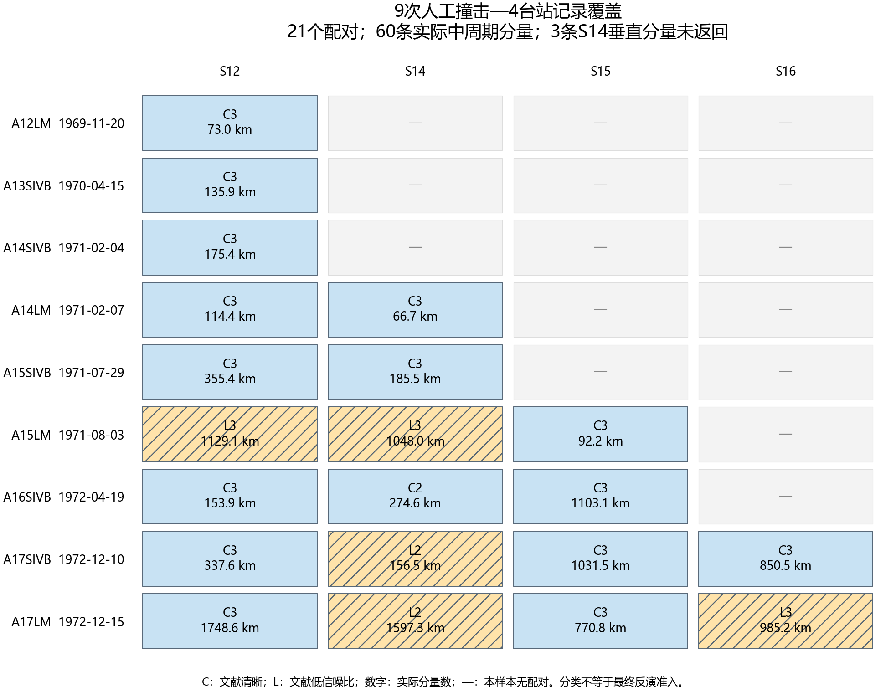

图1：C/L分别表示文献清晰/低信噪比，后随实际分量数；距离来自统一球面重算。灰格表示本样本无配对，不自动判定该站当时停机。最终频带和时间窗仍须逐道准入。

### 2. 台站坐标、观测覆盖与研究角色

坐标使用NASA公布的ALSEP位置，而非登月舱位置；东经、北纬为正，西经、南纬为负。参考系为DE421的Mean Earth/Polar Axis。小数位保留来源精度，不表示已经独立测到相应定位精度。[NASA台站来源](https://nssdc.gsfc.nasa.gov/planetary/lunar/lunar_sites.html)

| 台站 | 纬度°N | 经度°E | LOLA像元高程/m | 记录事件 | 文献清晰 | 实有MP分量 | 距离范围/km | 研究角色 |
|---|---|---|---|---|---|---|---|---|
| S12 | -3.0098 | -23.4249 | -1428.5 | 9 | 8 | 27 | 73.0–1748.6 | 风暴洋/月海邻近参考走廊；两条已研究S-IVB路径为起点 |
| S14 | -3.64419 | -17.47768 | -1063.0 | 6 | 3 | 15 | 66.7–1597.3 | Fra Mauro喷出物与破碎区背景；与S12共同事件联合 |
| S15 | 26.13406 | 3.62991 | -1924.0 | 4 | 4 | 12 | 92.2–1103.1 | Hadley–Apennine/盆缘背景；A15LM近距验证 |
| S16 | -8.9759 | 15.4986 | 2.0 | 2 | 1 | 6 | 850.5–985.2 | Descartes/Cayley高地背景；目前以远距检验为主 |

S12与S14球面相距约181.1 km，可作为联合研究走廊，但不能合成一个虚拟台站。表中LOLA高程来自原生像元，相对1737.4 km参考球，不是独立测量的台站精密海拔。S15台站位于低处不意味着周边没有山地；“高地”地质单元也不能按高程正负简单划分。

本样本中S12有9次记录、S14有6次、S15有4次、S16有2次。S16只有一条文献清晰人工撞击配对，距离约851 km，无法独立约束局地高地的a、σv、H三个参数。S12短周期传感器故障；S14部分垂直通道故障；当前主比较限定中周期MHZ/MH1/MH2，不能以旧SP文件存在认定SP可用。

按Zhang2025 Table1整理的LP运行总跨度如下，首末时刻取到秒；这不表示跨度内没有停机、模式切换或通道故障。

| 台站 | 表中LP最早起始/UTC | 最后结束/UTC | 本样本的模式及限制 |
|---|---|---|---|
| S12 | 1969-11-19 14:23:23 | 1977-09-30 18:50:51 | 本批事件处于peaked模式时段；SP故障 |
| S14 | 1971-02-05 17:44:33 | 1977-09-30 18:50:51 | 本批处于peaked时段；1972年三次撞击的MHZ未返回 |
| S15 | 1971-07-31 18:52:00 | 1977-09-30 18:50:51 | 本批记录处于peaked时段；A15 S-IVB早于部署 |
| S16 | 1972-04-21 20:20:00 | 1977-09-30 18:50:51 | 本批记录处于peaked时段；A16 S-IVB早于部署 |

模式判断来自运行表，仍须用具体响应历元和增益历史逐道复核，不能取代仪器检查。[Zhang2025原文Table1](https://doi.org/10.1029/2025EA004710)。

### 3. 全部事件及源参数

事件名称中的A16表示Apollo16任务撞击，并不表示由S16接收。A16 S-IVB撞击时S16尚未部署。LM表示登月舱上升级，S-IVB表示土星上面级；两类入射条件不同。[NASA撞击来源](https://nssdc.gsfc.nasa.gov/planetary/lunar/apollo_impact.html)

| 事件 | 地面接收时刻/UTC | 纬度°N | 经度°E | 撞速/km s⁻¹ | 撞击动能/J | 相对水平入射角/° | 记录台站 |
|---|---|---|---|---|---|---|---|
| A12LM | 1969-11-20 22:17:17.7 | -3.94 | -21.2 | 1.68 | 3360000000 | 3.7 | S12 |
| A13SIVB | 1970-04-15 01:09:41.0 | -2.555 | -27.8875 | 2.58 | 46300000000 | 76 | S12 |
| A14SIVB | 1971-02-04 07:40:55.4 | -8.181 | -26.0305 | 2.54 | 45200000000 | 69 | S12 |
| A14LM | 1971-02-07 00:45:25.7 | -3.42 | -19.67 | 1.68 | 3250000000 | 3.6 | S12、S14 |
| A15SIVB | 1971-07-29 20:58:42.9 | -1.2897 | -11.8245 | 2.58 | 46100000000 | 62 | S12、S14 |
| A15LM | 1971-08-03 03:03:37.0 | 26.36 | 0.25 | 1.70 | 3440000000 | 3.2 | S12、S14、S15 |
| A16SIVB | 1972-04-19 21:02:04 | 1.921 | -24.623 | 2.5–2.6 | 45900000000 | 约79 | S12、S14、S15 |
| A17SIVB | 1972-12-10 20:32:42.3 | -4.1681 | -12.3307 | 2.55 | 47100000000 | 55 | S12、S14、S15、S16 |
| A17LM | 1972-12-15 06:50:20.8 | 19.97 | 30.49 | 1.67 | 3150000000 | 4.9 | S12、S14、S15、S16 |

NASA原表能量单位erg，本表仅乘10⁻⁷转为J；撞击动能不等于地震辐射能。时刻为地面接收，约晚于月面真实撞击1.3 s；现有图未擅自扣除。A16 S-IVB时刻与能量为估计，起时约有4 s不确定性；源方位和耦合效率尚待核实。元数据见[tables/events_and_domains.csv](tables/events_and_domains.csv)。

### 4. 地形底图与范围框

底图为NASA/PDS LOLA LDEM_64 V3.1，原生64像元/度，即0.015625°，南北间距约474 m；东西间距乘cos纬度。相对早期0.25°底图线性采样细16倍，但采样间距不等于所有位置的独立地形分辨率。产品包含栅格化插值；正式模型若网格更细，不得把插值出来的细节当作新观测。[LOLA产品入口](https://pds-geosciences.wustl.edu/missions/lro/lola.htm)

当前裁片覆盖38°W–40°E、18°S–40°N，DN×0.5得到米高程，相对1737.4 km参考球，像元中心注册。地形提取和经度拼接核验见[地形溯源](sources/lola_data_provenance.json)。旧尺寸不符的float图未采用。

星号为源、三角为台站；大圆连线是地理示意，不代表散射能量只走线附近。全记录框包含该事件全部已记录站，近距候选框按文献清晰且<400 km选择。两类框都不是地质单元边界或已收敛的生产域。图上不另标不足2 km的窄小地貌；该制图要求不限制地下相关尺度a。

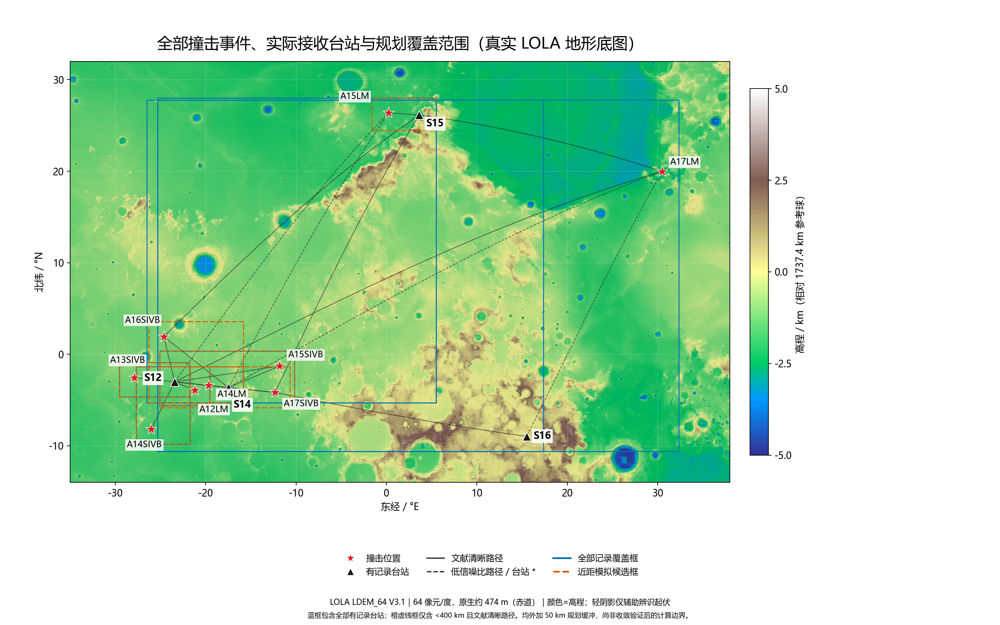

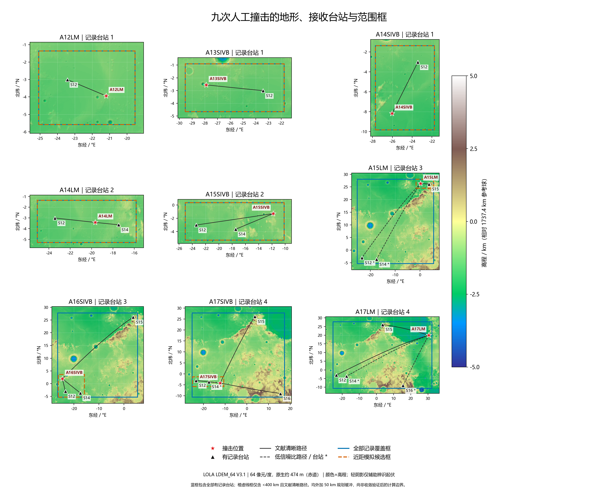

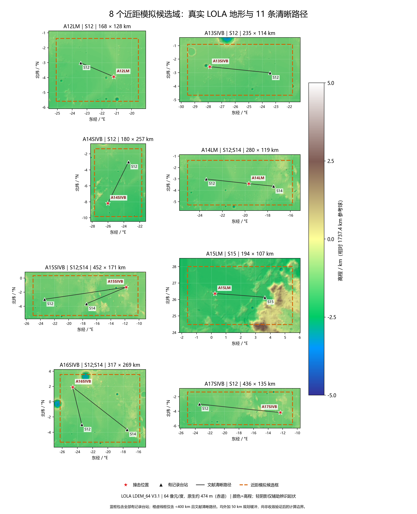

### 5. 21个实际配对与缺失分量

距离统一以R=1737.4 km及NASA坐标重算。保留文献距离列用于追溯，原波形图注可能仍使用文献距离，差异不能被误判成源站身份改变。缺样率范围为实际返回分量在ATT −300至3600 s展示窗内的最小—最大值；不是整日档案覆盖率。

| 事件 | 站 | 重算/km | 文献/km | 文献类别 | 实有分量 | 缺失 | 原始缺样/% | 逐站检查图 |
|---|---|---|---|---|---|---|---|---|
| A12LM | S12 | 73.0 | 73.5 | 清晰 | MHZ/MH1/MH2 | 无 | 0.00–0.17 | [三阶段](assets/A12LM_S12_three_stages.png) |
| A13SIVB | S12 | 135.9 | 135.9 | 清晰 | MHZ/MH1/MH2 | 无 | 1.16–1.28 | [三阶段](assets/A13SIVB_S12_three_stages.png) |
| A14SIVB | S12 | 175.4 | 175.4 | 清晰 | MHZ/MH1/MH2 | 无 | 3.14–3.36 | [三阶段](assets/A14SIVB_S12_three_stages.png) |
| A14LM | S12 | 114.4 | 115.3 | 清晰 | MHZ/MH1/MH2 | 无 | 3.46–3.73 | [三阶段](assets/A14LM_S12_three_stages.png) |
| A14LM | S14 | 66.7 | 65.7 | 清晰 | MHZ/MH1/MH2 | 无 | 1.15–1.96 | [三阶段](assets/A14LM_S14_three_stages.png) |
| A15SIVB | S12 | 355.4 | 355.3 | 清晰 | MHZ/MH1/MH2 | 无 | 1.38–1.45 | [三阶段](assets/A15SIVB_S12_three_stages.png) |
| A15SIVB | S14 | 185.5 | 185.5 | 清晰 | MHZ/MH1/MH2 | 无 | 2.33–2.90 | [三阶段](assets/A15SIVB_S14_three_stages.png) |
| A15LM | S12 | 1129.1 | 1128.9 | 低SNR | MHZ/MH1/MH2 | 无 | 0.00–0.00 | [三阶段](assets/A15LM_S12_three_stages.png) |
| A15LM | S14 | 1048.0 | 1047.8 | 低SNR | MHZ/MH1/MH2 | 无 | 0.00–0.01 | [三阶段](assets/A15LM_S14_three_stages.png) |
| A15LM | S15 | 92.2 | 92.2 | 清晰 | MHZ/MH1/MH2 | 无 | 0.41–1.64 | [三阶段](assets/A15LM_S15_three_stages.png) |
| A16SIVB | S12 | 153.9 | 153.9 | 清晰 | MHZ/MH1/MH2 | 无 | 1.67–1.76 | [三阶段](assets/A16SIVB_S12_three_stages.png) |
| A16SIVB | S14 | 274.6 | 274.5 | 清晰 | MH1/MH2 | MHZ | 2.33–2.61 | [三阶段](assets/A16SIVB_S14_three_stages.png) |
| A16SIVB | S15 | 1103.1 | 1102.9 | 清晰 | MHZ/MH1/MH2 | 无 | 0.00–0.28 | [三阶段](assets/A16SIVB_S15_three_stages.png) |
| A17SIVB | S12 | 337.6 | 337.5 | 清晰 | MHZ/MH1/MH2 | 无 | 1.31–1.46 | [三阶段](assets/A17SIVB_S12_three_stages.png) |
| A17SIVB | S14 | 156.5 | 156.5 | 低SNR | MH1/MH2 | MHZ | 17.52–17.80 | [三阶段](assets/A17SIVB_S14_three_stages.png) |
| A17SIVB | S15 | 1031.5 | 1031.4 | 清晰 | MHZ/MH1/MH2 | 无 | 0.00–0.22 | [三阶段](assets/A17SIVB_S15_three_stages.png) |
| A17SIVB | S16 | 850.5 | 850.3 | 清晰 | MHZ/MH1/MH2 | 无 | 0.00–0.53 | [三阶段](assets/A17SIVB_S16_three_stages.png) |
| A17LM | S12 | 1748.6 | 1748.5 | 清晰 | MHZ/MH1/MH2 | 无 | 0.03–0.03 | [三阶段](assets/A17LM_S12_three_stages.png) |
| A17LM | S14 | 1597.3 | 1597.2 | 低SNR | MH1/MH2 | MHZ | 3.58–3.62 | [三阶段](assets/A17LM_S14_three_stages.png) |
| A17LM | S15 | 770.8 | 771.1 | 清晰 | MHZ/MH1/MH2 | 无 | 0.02–0.02 | [三阶段](assets/A17LM_S15_three_stages.png) |
| A17LM | S16 | 985.2 | 984.9 | 低SNR | MHZ/MH1/MH2 | 无 | 0.00–0.01 | [三阶段](assets/A17LM_S16_three_stages.png) |

三条S14 MHZ缺失对应A16SIVB、A17SIVB、A17LM；没有拿其他事件/分量填补。文件存在不等于数据完整，原始缺样也不同于处理裁边；分量级63行明细见[tables/trace_stage_comparison.csv](tables/trace_stage_comparison.csv)。

### 6. 近距候选域清单

8个事件域覆盖11条首轮目标路径。一个事件的多个接收器可以由同次传播同时输出，所以配对数不等于作业数。地理框已有50 km缓冲，仍需第四册的扩域、底界与PML验证。

| 事件 | 目标接收器 | 西/东边界°E | 南/北边界°N | 东西×南北/km |
|---|---|---|---|---|
| A12LM | S12 | -25.08167 / -19.54323 | -5.58889 / -1.36091 | 167.6 × 128.2 |
| A13SIVB | S12 | -29.54186 / -21.77054 | -4.65869 / -0.90611 | 235.4 × 113.8 |
| A14SIVB | S12 | -27.70396 / -21.75144 | -9.82989 / -1.36091 | 179.6 × 256.8 |
| A14LM | S12、S14 | -25.08086 / -15.82172 | -5.29308 / -1.36091 | 280.3 × 119.2 |
| A15SIVB | S12、S14 | -25.08086 / -10.16854 | -5.29308 / 0.35919 | 451.8 × 171.4 |
| A15LM | S15 | -1.61764 / 5.49755 | 24.48517 / 28.00889 | 193.5 × 106.9 |
| A16SIVB | S12、S14 | -26.27896 / -15.82172 | -5.29308 / 3.56989 | 317.1 × 268.8 |
| A17SIVB | S12 | -25.08233 / -10.67327 | -5.81699 / -1.36091 | 436.1 × 135.1 |

### 7. 逐事件记录图册：先原始，再处理

每组先显示地形/范围，再显示未去响应DU，最后显示名义响应校正的0.3–0.9 Hz速度。原始总览为名义时间；处理总览为ATT校正时间，两者不宜直接作亚秒对齐判断。单站三阶段图使用同一ATT轴。各图不逐道归一化；纵轴刻度可能不同，应读单位和刻度。

橙色为处理边缘标记，灰色为原始缺样；短段未处理和缺失分量另列。图件是现有处理的可追溯展示，不等同最终反演准入。0.3–0.5 Hz位移参照另列链接，与速度图区分。

#### 7.1 A12LM

地面接收时刻：1969-11-20T22:17:17.7；源位置：-3.94°N，-21.2°E。配对：S12 73.0 km。

近距目标站：S12；规划尺寸约167.6×128.2 km。[近距图](assets/A12LM_local_terrain_domain.png)。

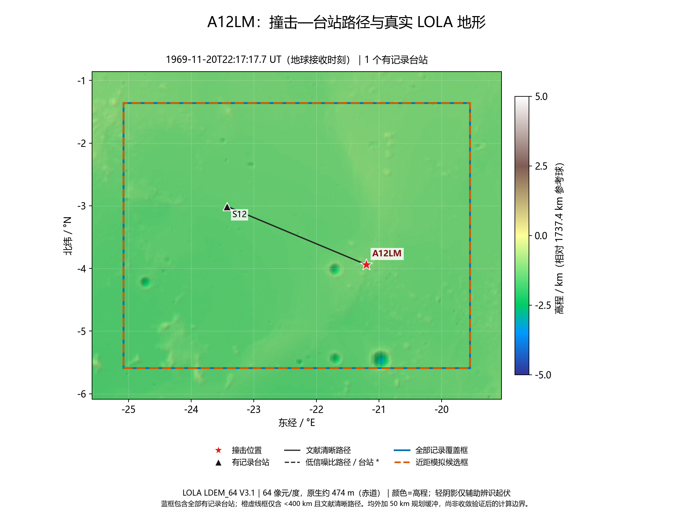

**原始档案：DU，名义时间。**

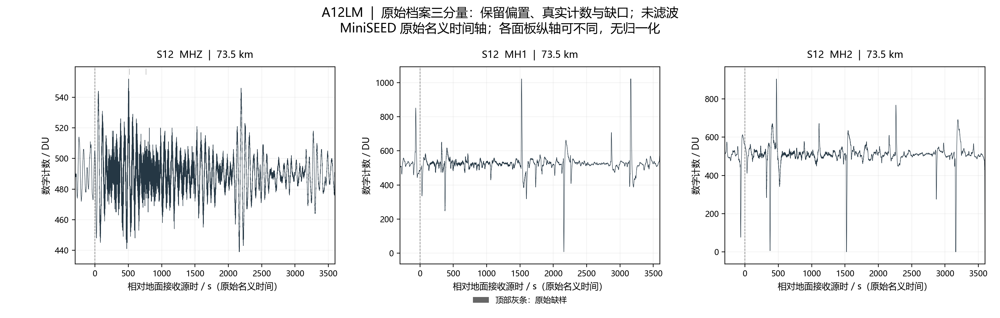

**处理预览：0.3–0.9 Hz名义速度，ATT时间。**

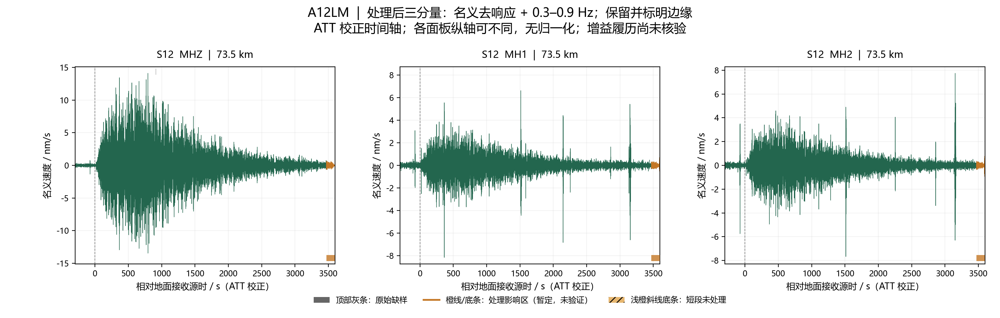

[独立0.3–0.5 Hz位移参照](assets/A12LM_literature_displacement_03_05_overview.png)；[S12三阶段](assets/A12LM_S12_three_stages.png)。

#### 7.2 A13SIVB

地面接收时刻：1970-04-15T01:09:41.0；源位置：-2.555°N，-27.8875°E。配对：S12 135.9 km。

近距目标站：S12；规划尺寸约235.4×113.8 km。[近距图](assets/A13SIVB_local_terrain_domain.png)。

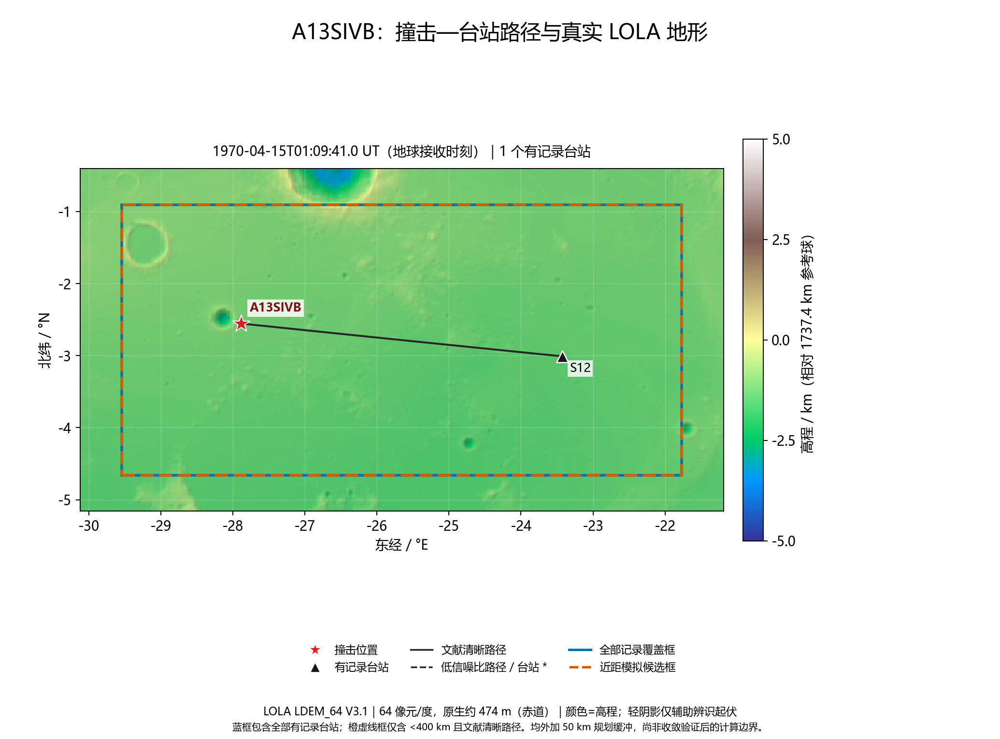

**原始档案：DU，名义时间。**

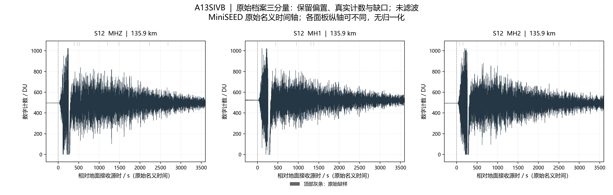

**处理预览：0.3–0.9 Hz名义速度，ATT时间。**

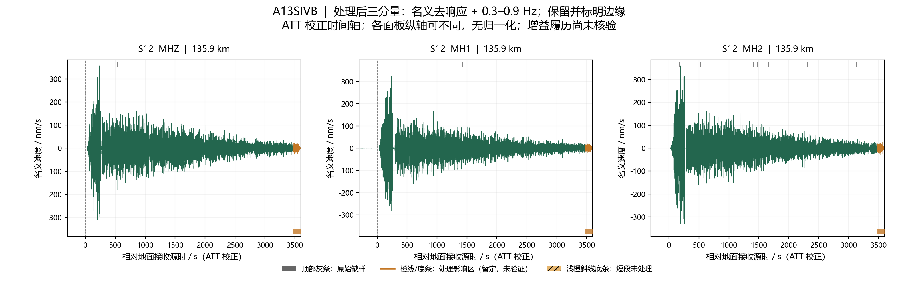

[独立0.3–0.5 Hz位移参照](assets/A13SIVB_literature_displacement_03_05_overview.png)；[S12三阶段](assets/A13SIVB_S12_three_stages.png)。

#### 7.3 A14SIVB

地面接收时刻：1971-02-04T07:40:55.4；源位置：-8.181°N，-26.0305°E。配对：S12 175.4 km。

近距目标站：S12；规划尺寸约179.6×256.8 km。[近距图](assets/A14SIVB_local_terrain_domain.png)。

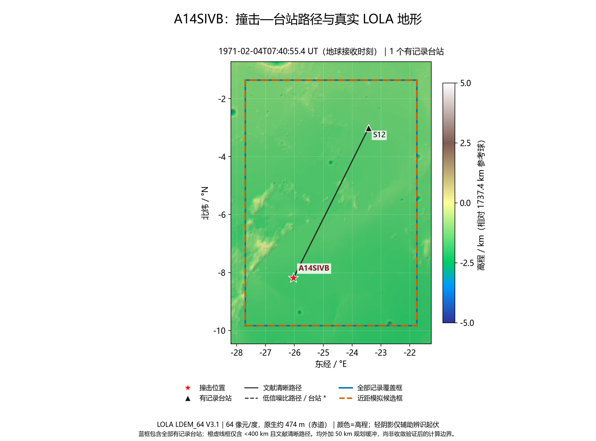

**原始档案：DU，名义时间。**

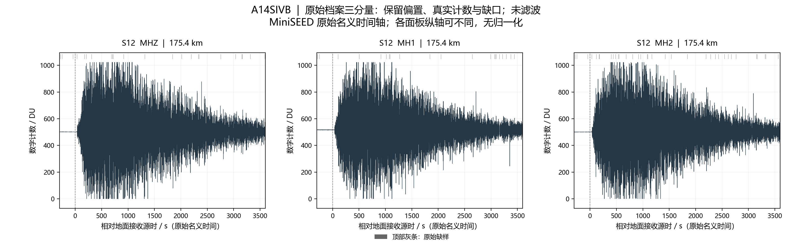

**处理预览：0.3–0.9 Hz名义速度，ATT时间。**

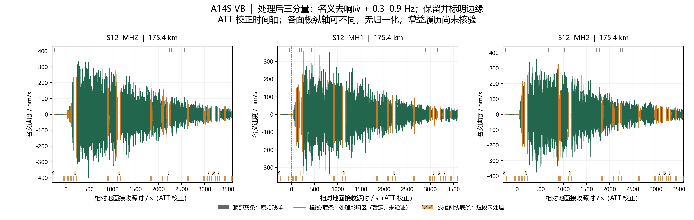

[独立0.3–0.5 Hz位移参照](assets/A14SIVB_literature_displacement_03_05_overview.png)；[S12三阶段](assets/A14SIVB_S12_three_stages.png)。

#### 7.4 A14LM

地面接收时刻：1971-02-07T00:45:25.7；源位置：-3.42°N，-19.67°E。配对：S12 114.4 km；S14 66.7 km。

近距目标站：S12、S14；规划尺寸约280.3×119.2 km。[近距图](assets/A14LM_local_terrain_domain.png)。

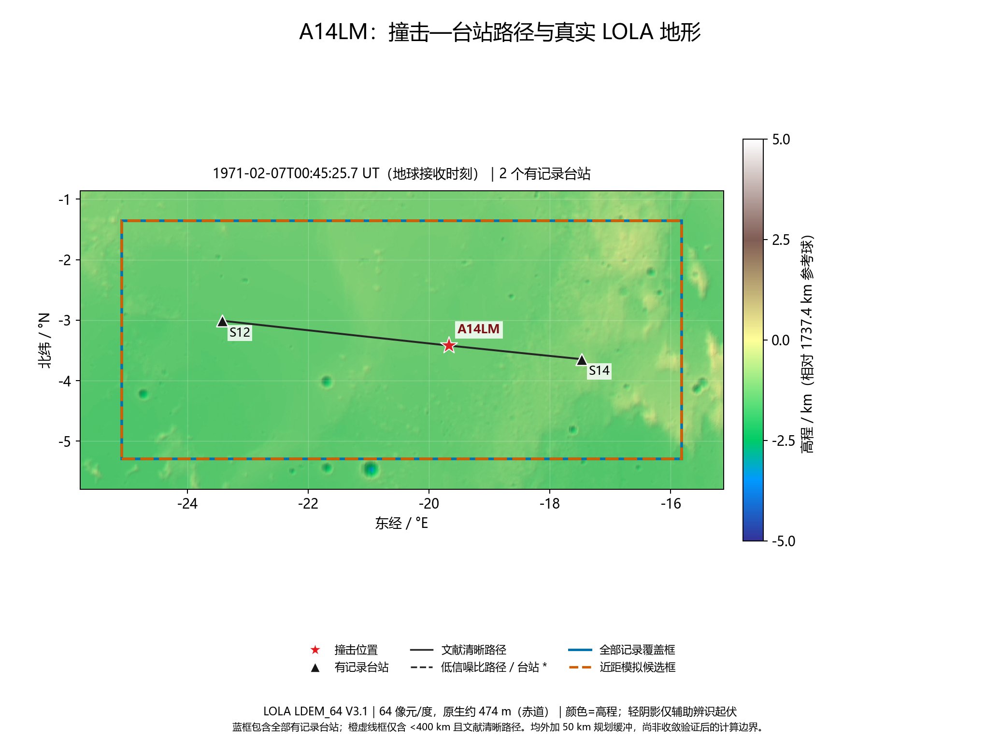

**原始档案：DU，名义时间。**

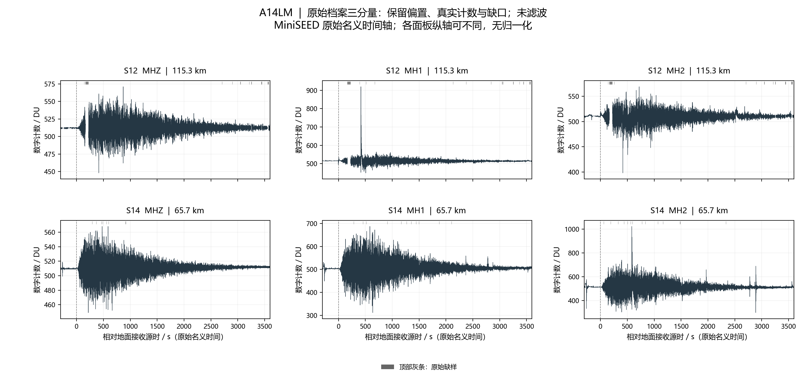

**处理预览：0.3–0.9 Hz名义速度，ATT时间。**

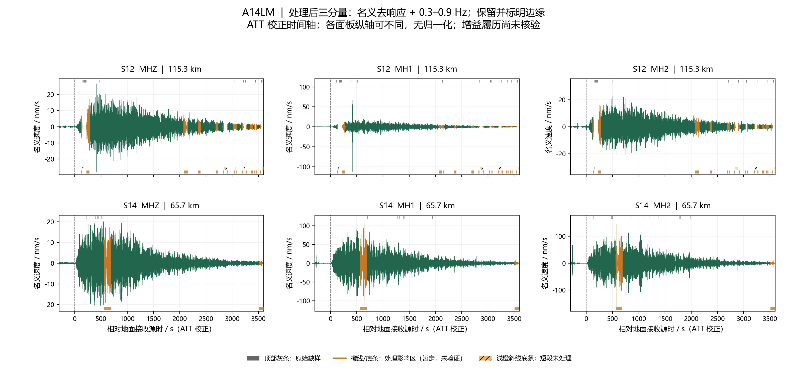

[独立0.3–0.5 Hz位移参照](assets/A14LM_literature_displacement_03_05_overview.png)；[S12三阶段](assets/A14LM_S12_three_stages.png)；[S14三阶段](assets/A14LM_S14_three_stages.png)。

#### 7.5 A15SIVB

地面接收时刻：1971-07-29T20:58:42.9；源位置：-1.2897°N，-11.8245°E。配对：S12 355.4 km；S14 185.5 km。

近距目标站：S12、S14；规划尺寸约451.8×171.4 km。[近距图](assets/A15SIVB_local_terrain_domain.png)。

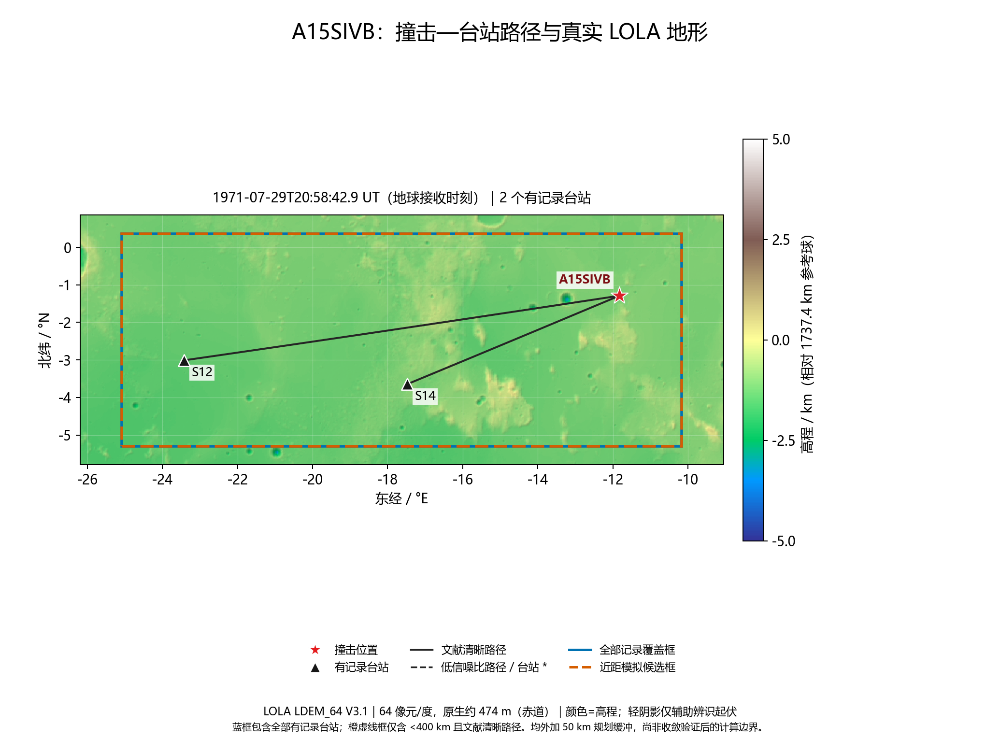

**原始档案：DU，名义时间。**

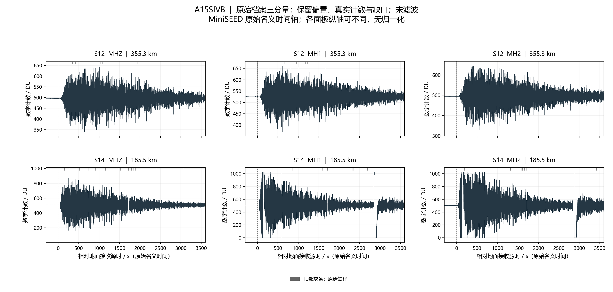

**处理预览：0.3–0.9 Hz名义速度，ATT时间。**

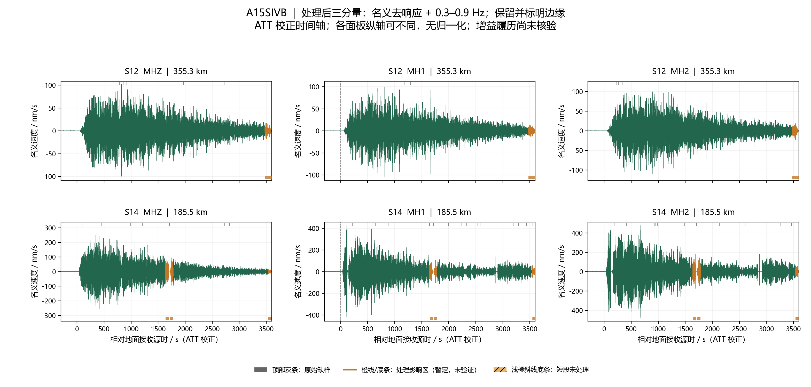

[独立0.3–0.5 Hz位移参照](assets/A15SIVB_literature_displacement_03_05_overview.png)；[S12三阶段](assets/A15SIVB_S12_three_stages.png)；[S14三阶段](assets/A15SIVB_S14_three_stages.png)。

#### 7.6 A15LM

地面接收时刻：1971-08-03T03:03:37.0；源位置：26.36°N，0.25°E。配对：S12 1129.1 km（低SNR）；S14 1048.0 km（低SNR）；S15 92.2 km。

近距目标站：S15；规划尺寸约193.5×106.9 km。[近距图](assets/A15LM_local_terrain_domain.png)。

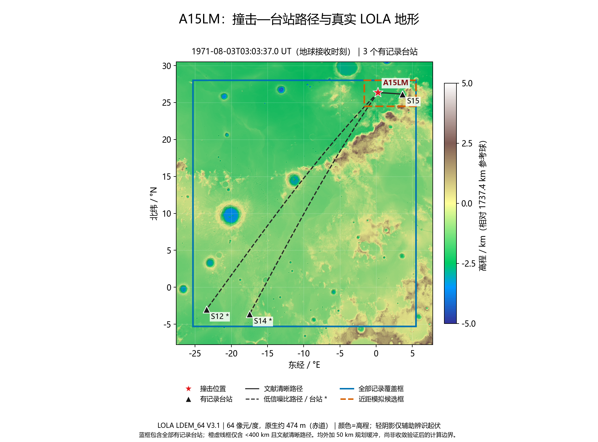

**原始档案：DU，名义时间。**

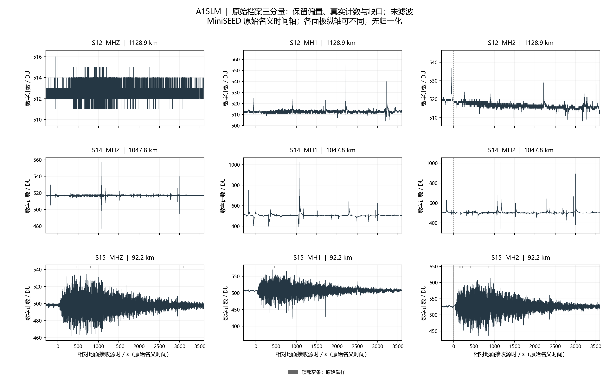

**处理预览：0.3–0.9 Hz名义速度，ATT时间。**

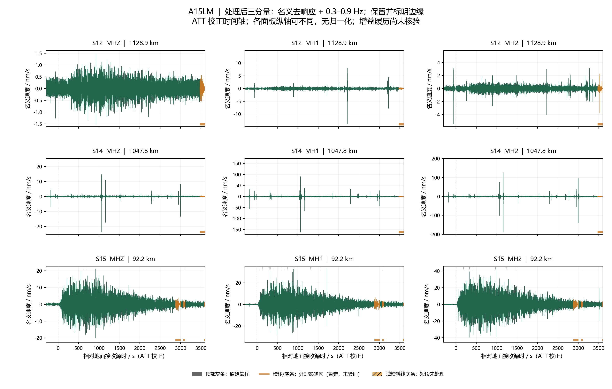

[独立0.3–0.5 Hz位移参照](assets/A15LM_literature_displacement_03_05_overview.png)；[S12三阶段](assets/A15LM_S12_three_stages.png)；[S14三阶段](assets/A15LM_S14_three_stages.png)；[S15三阶段](assets/A15LM_S15_three_stages.png)。

#### 7.7 A16SIVB

地面接收时刻：1972-04-19T21:02:04；源位置：1.921°N，-24.623°E。配对：S12 153.9 km；S14 274.6 km；S15 1103.1 km。

近距目标站：S12、S14；规划尺寸约317.1×268.8 km。[近距图](assets/A16SIVB_local_terrain_domain.png)。

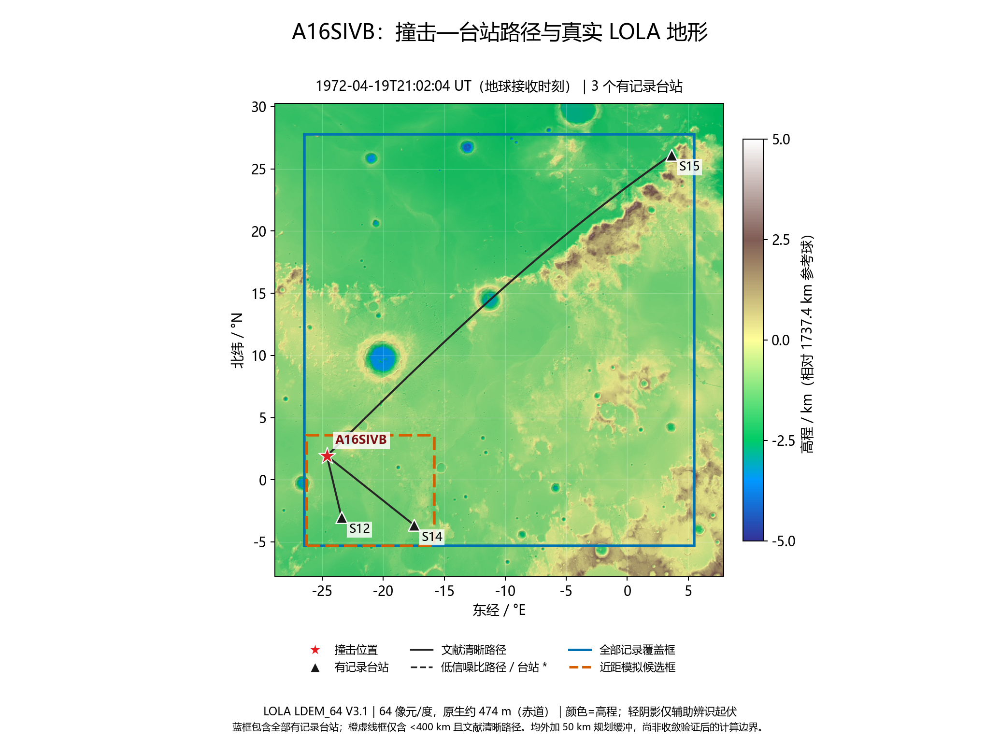

**原始档案：DU，名义时间。**

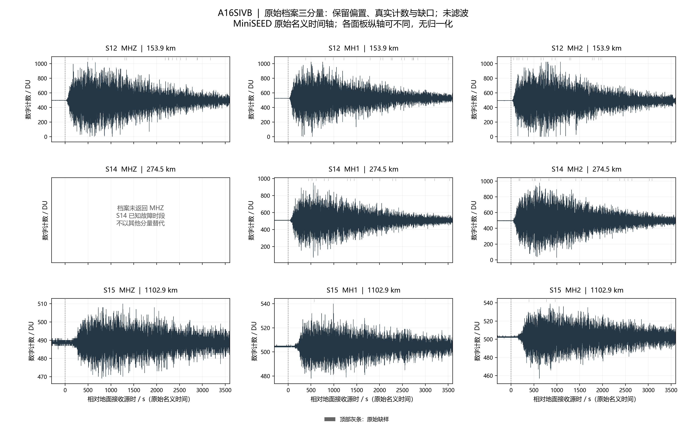

**处理预览：0.3–0.9 Hz名义速度，ATT时间。**

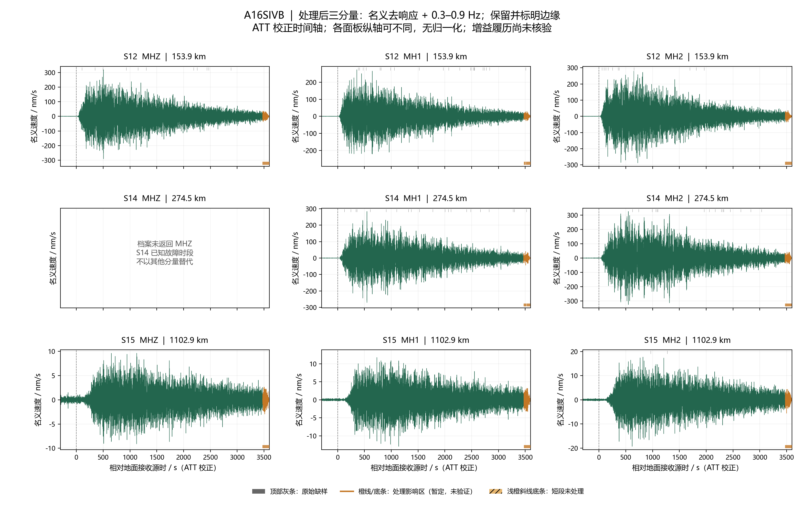

[独立0.3–0.5 Hz位移参照](assets/A16SIVB_literature_displacement_03_05_overview.png)；[S12三阶段](assets/A16SIVB_S12_three_stages.png)；[S14三阶段](assets/A16SIVB_S14_three_stages.png)；[S15三阶段](assets/A16SIVB_S15_three_stages.png)。

#### 7.8 A17SIVB

地面接收时刻：1972-12-10T20:32:42.3；源位置：-4.1681°N，-12.3307°E。配对：S12 337.6 km；S14 156.5 km（低SNR）；S15 1031.5 km；S16 850.5 km。

近距目标站：S12；规划尺寸约436.1×135.1 km。[近距图](assets/A17SIVB_local_terrain_domain.png)。

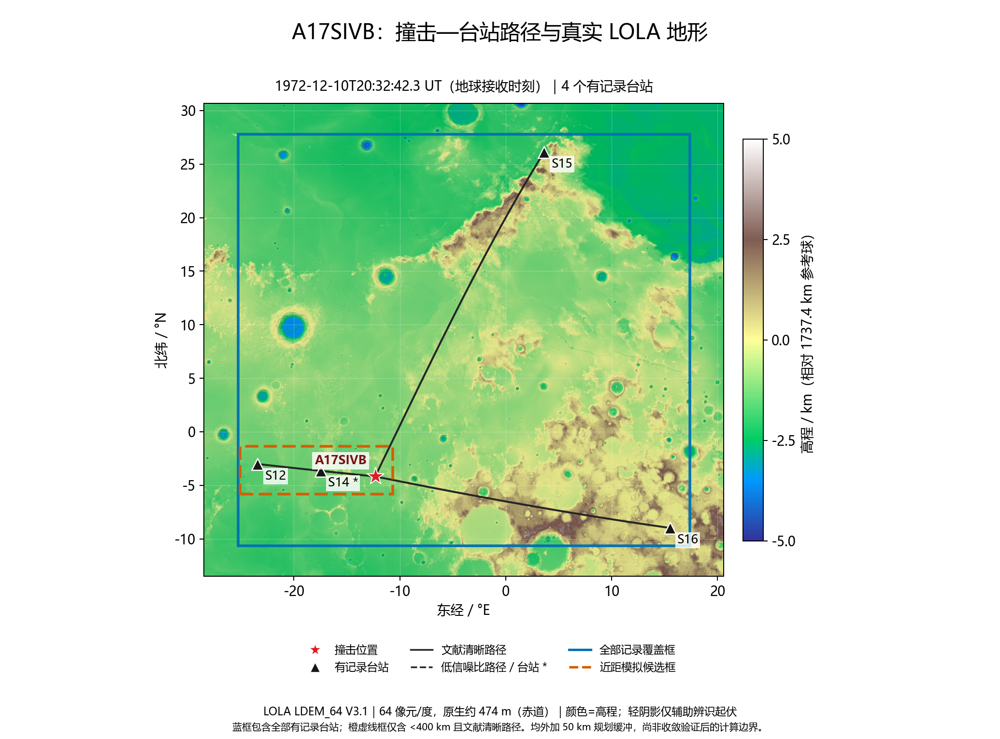

**原始档案：DU，名义时间。**

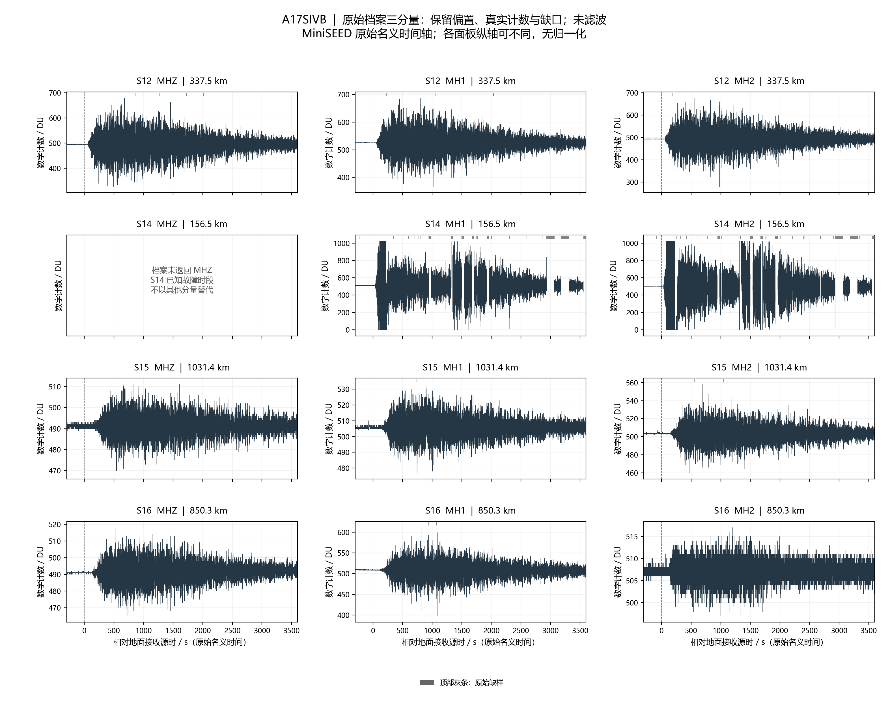

**处理预览：0.3–0.9 Hz名义速度，ATT时间。**

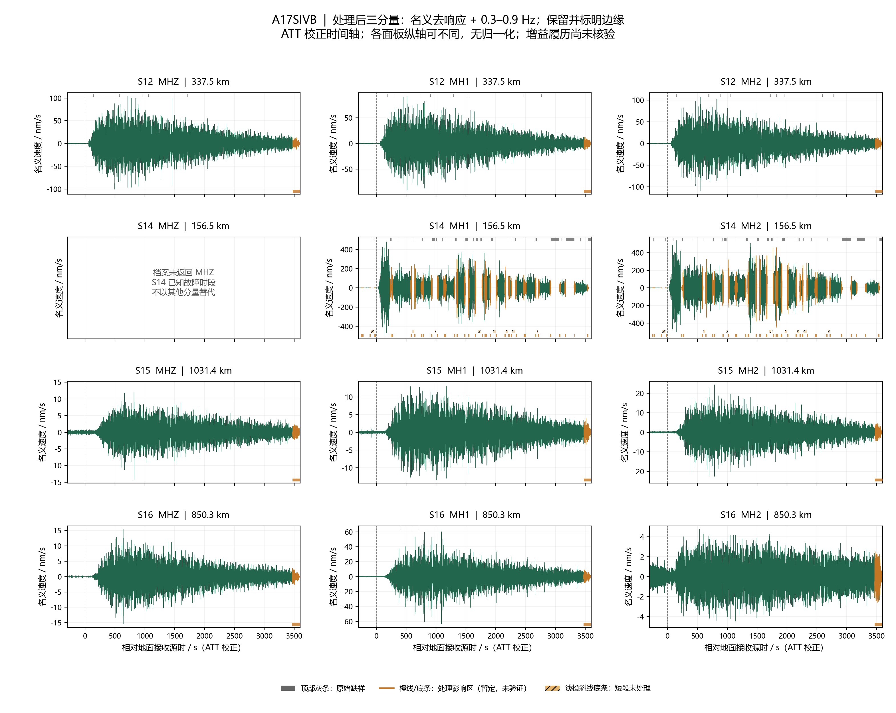

[独立0.3–0.5 Hz位移参照](assets/A17SIVB_literature_displacement_03_05_overview.png)；[S12三阶段](assets/A17SIVB_S12_three_stages.png)；[S14三阶段](assets/A17SIVB_S14_three_stages.png)；[S15三阶段](assets/A17SIVB_S15_three_stages.png)；[S16三阶段](assets/A17SIVB_S16_three_stages.png)。

#### 7.9 A17LM

地面接收时刻：1972-12-15T06:50:20.8；源位置：19.97°N，30.49°E。配对：S12 1748.6 km；S14 1597.3 km（低SNR）；S15 770.8 km；S16 985.2 km（低SNR）。

本事件保留远距记录，尚未列入近距首批CGFD3D域。

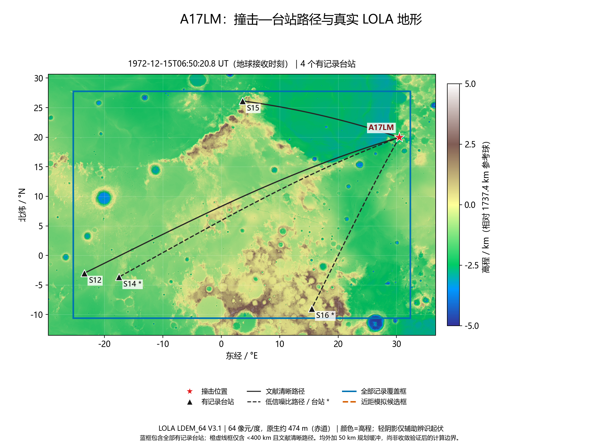

**原始档案：DU，名义时间。**

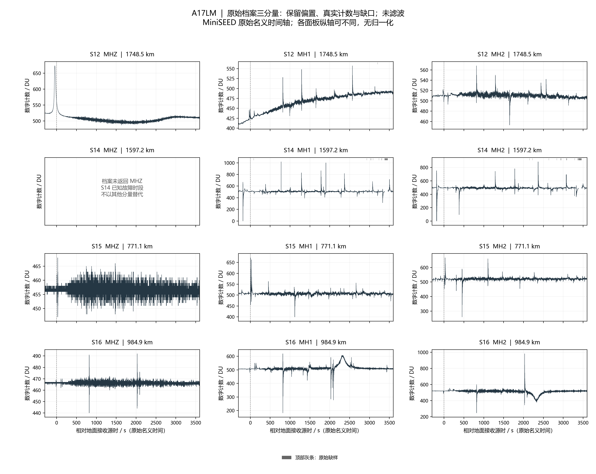

**处理预览：0.3–0.9 Hz名义速度，ATT时间。**

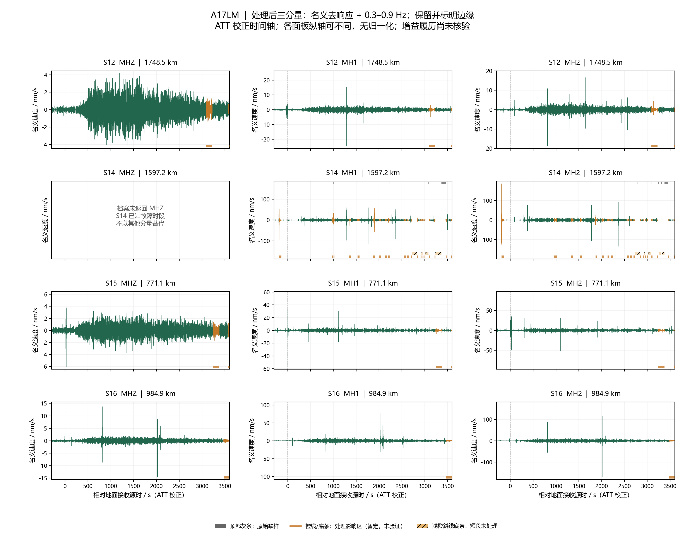

[独立0.3–0.5 Hz位移参照](assets/A17LM_literature_displacement_03_05_overview.png)；[S12三阶段](assets/A17LM_S12_three_stages.png)；[S14三阶段](assets/A17LM_S14_three_stages.png)；[S15三阶段](assets/A17LM_S15_three_stages.png)；[S16三阶段](assets/A17LM_S16_three_stages.png)。

### 8. 资料使用边界与下一步

本图册的“丰富记录”指当前人工撞击样本中已审计配对，不是各地貌均有均衡独立样本。S12资料最多，S16不足以开展同等自由度的局地反演；特定陨石坑的独立样本尚未成立。天然撞击、深月震及浅月震可作为扩展，但需新的震源和覆盖审计。

阅读包包含完整图件、统计表和模型规范，不复制原始MiniSEED、旧SAC、派生NPZ或大幅DEM。原始文件在工程中的路径已写入[tables/pair_record_summary_current.csv](tables/pair_record_summary_current.csv)，此前波形资料包保存可复核数据。本次整理没有改写任何观测样点。

---

## 第二册｜分区域三维冯卡尔曼散射模型反演设计

> 区域结构更新（2026-11-05）：当前只采用S12、S14、S15三套独立模型，固定背景、莫霍、Q及材料CSV以[第08章](08_S12_S14_S15三个区域模型.md)和[第09章](09_三区域结构文献核对与背景更新.md)为准。本章旧M1/完整VPREMOON共同背景、W共享区域、12 km共同内壳界面及旧计算计数均保留追溯，不再作为执行输入。冯卡尔曼数学定义可继续参考，深度函数莫霍截断须换为本次区域界面；不新增其他模型族。尚未运行新波场。

修订：2026-11-05。本版取代旧第二册的模型选择与搜索范围；[旧设计留档](sources/02_散射模型与参数设计_20261029历史版.md)。本次完成设计，未执行新的CGFD3D传播，未产生区域最优参数。第四册64项、旧88项等计划不自动等于本版反演计算量。

### 1. 科学目标和最终交付

目标是：**在真实起伏地表条件下，使用统一的三维冯卡尔曼速度扰动模型，估计不同月震区域各自的散射模型参数与不确定性。**旧工作提供地形处理及受控模型基础；本轮的主体从“比较若干随机模型”转为“同一模型族内的分区域参数反演”。

各区域完整参数描述为 θr=(ar,σ₁r,σ₂r,h₁r,Hr,νr)：相关长度、上/下两段相对速度扰动标准差、两段分界、散射层底部深度、谱形参数。六项是完整描述，并非首轮同时自由反演六项。先固定层界、谱形及幅度比，估计a和整体幅度；再根据分辨能力释放H和上下层幅度比。

最终交付每区的散射参数表、模型预测与实测对比、接受集合/后验、参数权衡和留出事件预测。所有候选使用固定的真实地形与选定区域背景，仅改变散射模型参数。无法分辨的参数报告条件约束、上下界或未约束，不用预设值冒充区域结果。

S12/S14/S15/S16是台站，不是四个互不相交的地下区域。首先估计路径有效参数，再在共同物理域内检验局地分区参数是否可辨识；不能将整条长路径的散射都归于接收站下方。

### 2. 已核定的旧项目散射参数参照

本次直接读取原始《设计说明.docx》、2026-09-14更正的参数JSON、投稿包README和作者确认记录。最终论文选择简单四层方案：

| 项目 | 已确认的论文设计值 | 本次处理 |
|---|---|---|
| 平坦参考界面 | 0、5、10、30、40 km | 旧记录；新区域采用最可靠区域背景，无可靠结果则用月球平均模型 |
| Vp | 3.2、3.2、5.5、7.55 km/s | 背景历史记录，不直接用于新区域 |
| Vs | 2.3、2.3、3.18、4.36 km/s | 背景历史记录，不直接用于新区域 |
| 密度 | 2600、2760、2760、3360 kg/m³ | 背景历史记录，不直接用于新区域 |
| 随机介质 | 三维冯卡尔曼，零均值相对速度扰动 | 所有区域统一模型族 |
| 相关长度a | **4.5 km** | 必须包含在新搜索中 |
| σ₁/σ₂ | **0–5 km为9%，5–10 km为5%** | 作为旧设计基准，不作为新区域结果 |
| 起伏模型扰动位置 | 对应介质层，而非统一水平切片 | 保留层界定义 |
| 附加低速层 | 当地地表下1 km，Vp=1.38、Vs=0.9 km/s，ρ=2600 kg/m³ | 仅为旧项目记录；新区域不另设低速层竞争试验 |
| 设计Q | 6750、5000、4000、3750 | 设计表不证明实际运行已开启吸收 |

证据原件：

- [原始设计说明](<C:/Users/Administrator/Desktop/起伏月表影响数值模拟/投稿文件/项目背景文件/模型设计与参数_2026-09-13/设计说明.docx>)。
- [最终选择及参数JSON](<C:/Users/Administrator/Desktop/起伏月表影响数值模拟/投稿文件/项目背景文件/模型设计与参数_2026-09-13/当前参数与适用边界.json>)。
- [旧项目模型背景与作者确认](<../../../h/jgr_planets_submission/provenance/MODEL_BACKGROUND_2026-09-13.md>)。

**已核定的是最终论文选择的设计参数；尚未完成生产生成器→材料文件→运行配置→论文波形的逐文件闭环。**简单方案的ν、seed、Vp/Vs扰动互相关、密度是否扰动及实际吸收开关仍需生产文件确认。

早期2 km文字版本、复杂33层模型的650 m及四段幅度、交流MATLAB的1 km/5%/ν=0.25均不覆盖最终简单方案。交流代码分别生成Vp、Vs、ρ的独立随机场，不能凭它推断最终生产耦合。

原设计说明用“主频×最小波长”解释4.5 km存在量纲错误：两者乘积是速度。保留已确认的4.5 km输入值，但不引用这一推导。a是介质参数，不应随着分析频带改变而重新设为Vs/f，否则是在不同频带比较不同介质。

### 2A. 固定区域背景：可靠区域结果优先，缺失部分使用月球平均模型

本轮只有散射模型矩阵。真实LOLA地形、每事件震源、各区域背景速度/密度/分层和吸收设置在搜索前确定，搜索中保持固定；不再以它们构建多组科学问题。数值收敛、材料统计和随机种子重复仍是必要质量检查，并非额外物理模型族。

#### 选择规则

“最可靠”按实际区域覆盖、观测类型、深度/频率适用性、分辨率与不确定性、数据和数值模型是否公开来判断，不简单选最新年份或最复杂模型。优先使用可重建的区域Vp(z)、Vs(z)与界面；只有壳厚或平均速度的论文只约束相应量，不将其扩写成完整剖面。背景界面与散射层底H是不同参数，莫霍深度不等于散射深度。

统一的无区域约束后备选择为[Garcia等2019月球一维模型集合](https://doi.org/10.1007/s11214-019-0613-y)中的M1原始中位数模型，作为月球平均意义的统一参考。已下载[作者数据v2](https://zenodo.org/records/21476963)，核对原始.nd及readme：原.nd为集合中位数，新.dat为均值及±1标准差，不混合二者统计量。当前采用带Vp、Vs、密度和Q字段的原.nd作为完整后备模型；新均值速度另行展示。M1无明确定义的莫霍，50 km标签是软件占位，不能作为区域界面。具体节点、单位、两张剖面图及采用边界见[具体模型参数与剖面图](06_具体模型参数与剖面图.md)。已取得后备数值不等于完成各区最可靠背景的最终筛选。

#### 当前已查到的区域依据及采用边界

| 区域 | 已核查的相关研究 | 可用信息 | 背景选择状态 |
|---|---|---|---|
| R12 | Kim2025；Onodera2022；Zhang2026 | Kim提供局地壳厚与平均Vs；Onodera提供匹配相关路径的浅层建模背景；Zhang提供撞击/台站壳厚约束 | 有区域约束，需整理可重建层表；缺失深度段和参数用M1补足，不能仅凭某篇波形拟合把背景称为区域实测 |
| R14 | Zhang2026；既有Apollo区域结构文献 | 应核对S14约束与源侧/站侧分离；Kim2025的主要反演未保留S14 | 在可靠区域数值未核齐前用M1，不能因接近S12就复制S12全部背景 |
| R15 | Kim2025；Zhang2026 | 局地壳厚及平均速度约束，需核对层内结构 | 局地结果只约束明确参数，其余用M1；不照搬S12低速层 |
| R16 | Kim2025；Torrent Duch2025；Zhang2026 | 转换波、干涉反射及走时约束；不同方法的界面解释应先统一 | 尚不宣称某一结果最可靠；对照观测支撑后固定一个背景，缺失项用M1 |

本轮直接检查的[Kim2025](https://doi.org/10.1029/2024GL114506)正文§3给出S12/S15/S16壳厚32.2±6.7、29.4±6、41.1±10.6 km，以及平均Vs 2.6±0.4、2.2±0.3、2.9±0.6 km/s。这些是区域约束，**不是可直接输入CGFD3D的完整Vp/Vs/密度分层表**。

新增核查的[Zhang2026](https://doi.org/10.1029/2025JE009453)使用撞击到时约束源侧和台站侧月壳厚度，其单层壳速度参数化不等于深度细分速度剖面。出版社注明2026-06-13更正，后续提取表格必须使用更正后的版本。该文纳入背景选取，不增加另一套散射模型族。[Torrent Duch2025](https://doi.org/10.1029/2025JE009090)作为S16界面解释的独立参照。

每区最终只交付一个冻结背景文件及来源表：深度顶/底、Vp、Vs、ρ、吸收设置、该行对应文献/页表、直接区域约束或月球平均补足。对部分约束、存在冲突或尚未取得数值的字段保持待核，不能现在声称已完成“最可靠背景”的最终筛选。优先完成背景数值整理，再启动散射搜索；无需先运行多套背景波形进行竞争。

### 3. 统一数学定义和物理含义

#### 3.1 三维速度扰动与功率谱

\[
V_\alpha(\mathbf x)=V_{\alpha0}(\mathbf x)[1+q_\alpha(\mathbf x)],\quad \alpha=P,S.
\]

单位方差、零均值随机场η的三维冯卡尔曼谱采用角波数k（rad/km）、长度a（km）：

\[
P_\eta(\mathbf k)=A[1+(a_xk_x)^2+(a_yk_y)^2+(a_zk_z)^2]^{-(\nu+3/2)}.
\]

A由方差归一化确定。首轮各向同性ax=ay=az=a；约定C(r)=(2π)⁻³∫P(k)exp(ik·r)d³k，则归一化协方差为

\[
R(r)=\frac{2^{1-\nu}}{\Gamma(\nu)}(r/a)^\nu K_\nu(r/a),\quad R(0)=1,\quad\nu>0.
\]

ν=0.5给出指数协方差exp(−r/a)，仍属于冯卡尔曼族；一般ν下a不是1/e距离。ν改变高波数尾，不能在比较区域a时省略ν。ν=0在无截止的无限三维波数域产生高波数方差发散；若旧模型使用近零ν/带限实现，须核实其物理截止，不宣称它是网格无关的连续有限方差模型。[Sato 2018](https://doi.org/10.1093/gji/ggy319)用于谱与输运方法背景。

用高斯白噪声生成冯卡尔曼相关场不等于使用高斯自相关函数：概率分布与空间协方差是不同概念。本轮不把高斯ACF作为另一个主模型族。

#### 3.2 两层幅度、谱形与材料耦合

旧基准为对应浅两层9%/5%。新反演初步取qP=qS=σr(d)ηr(x)，保持局部Vp/Vs；密度保持背景。**这是降低维数的新分支约定，并非已证实的旧生产规则。**正式计算前核定并固定耦合规则；不将耦合方式设为独立科学问题或增加竞争分支。

首轮h₁=5 km、H=10 km，固定b=σ₂/σ₁=5/9。扩展时用连续幅度剖面：

\[
\sigma_r(d)=\{[1-T(d;h_1,w_1)]\sigma_{1,r}+T(d;h_1,w_1)\sigma_{2,r}\}[1-T(d;H_r,w_H)].
\]

T在d≤h−w/2为0，在d≥h+w/2为1，中间为{1−cos[π(d−h+w/2)/w]}/2。新分支拟取w₁=wH=1 km，这是项目平滑选择，不是文献反演值。H为渐变中心，H=10 km时10.5 km归零。旧复现采用原层界处理，不将新渐变倒写为旧模型。

新简化分支使用同一η贯穿两层，仅改变σ，避免引入不相关边界；独立分层场是另一实现分支，混合方差须计算权重平方与协方差。目标σ指局部平稳平台的相对标准差，不是最大幅度；每个模型另存实际均值、RMS、极值和深度统计。

优先按对应起伏介质界面定义散射层；缺乏地下界面的区域，先以当地地表下垂向深度d=h(x,y)−z构造恒厚参考，固定采用这一深度定义，不另做参考面比较。恒厚是假设，不能称为已知地下几何。将背景低速层、散射幅度分层和地表几何分别保存。

### 4. 文献约束与迁移边界

| 研究 | 原研究信息与定位 | 本次用途 |
|---|---|---|
| [Jiang等2015](https://doi.org/10.6038/cjg20150519)，§2.3/§4、表4 | 冯卡尔曼；a=2 km；1/3/5/7/9%试验；观测比较偏好3%–5%；上月壳15 km | 弱扰动长尺度参考；二维天然月震约束不能直接作为四区域三维结果 |
| [Onodera等2021](https://doi.org/10.1029/2020JE006406)，表2–3/讨论 | S12两条撞击路径，约0.2/0.6 km分层尺度和不同强散射深度 | 短尺度、层厚和路径差异的参考；上限幅度不直接换成标准差 |
| [Onodera等2022](https://doi.org/10.1029/2022JE007558)，§2.4/§3.3 | A14/A16 S-IVB→S12，650 m指数相关、5%–10%标准差的三维模型比较 | ν=0.5子族的直接对照；不是旧4.5 km、9%/5%的来源 |
| [Gillet等2017](https://doi.org/10.1016/j.pepi.2016.11.001)，摘要/反演方法 | 联合峰时与尾波衰减约束深度变化扩散/吸收；浅10 km约D=2 km²/s，Qi约2400 | 学习散射/吸收分离和多指标约束；全月D不唯一对应区域a、σ |
| [Nunn等2024](https://doi.org/10.3847/PSJ/ad83d2)，§5.1.1、表2 | 最大±50%随机扰动，20/50/80 km深度分支 | 厚散射层竞争解释；±50%不是σ=50%，仅借鉴深度分支，保持本项目冯卡尔曼谱 |
| [Blanchette-Guertin等2015 GRL](https://doi.org/10.1002/2015GL066151) | 巨风化层侧向层厚变化影响月震波形 | 支持区域H变化与源侧/接收侧分离，不预定地貌强弱 |
| [Sollberger等2016](https://doi.org/10.1002/2016GL070883)、[Keil等2024](https://doi.org/10.1029/2024EA003742) | Apollo17浅层主动源与近表非均质研究 | 独立近站场地分支；米级尺度/高频参数不能推广到全部远距路径 |

这些工作包括参数扫描、观测匹配、输运反演，不能统称为已完成四区域a–σ–H联合反演。Kim 2026用于事件定位、偏振和观测依据，不提供四区域冯卡尔曼参数。所有下述范围均是本项目搜索设计，不是直接抄录的区域置信区间。

### 5. 区域划分与观测组织

| 区域 | 首批组织方式 | 首要约束/限制 |
|---|---|---|
| R12：S12月海邻域及走廊 | 先复现A14/A16 S-IVB→S12，再加入其他合格事件 | 文献三维对照最直接；先估路径有效参数 |
| R14：S14 Fra Mauro邻域及走廊 | 与S12共享事件联合；保留独立响应、分量和质量掩码 | S14故障/削顶；检验R12/R14是否可分辨 |
| R15：S15盆缘过渡带 | 近距LM与其他合格事件分源族比较 | 控制LM震源、浅低速层与盆缘背景；稀疏记录不支持全部自由度 |
| R16：S16高地邻域及远距走廊 | 完整远距传播域内联合源侧、沿途和接收侧贡献 | 不能把整条长路径的散射归于站下高地 |

A12/A14可以共域模拟，但参数是否合并由分辨能力决定。区域窗须用独立地质图、源站覆盖及目标尺度预先定义；DEM颜色和拟合残差不能临时决定边界。陨石坑区需要坑内/外匹配路径后单独建立，不能将四站机械对应为四种地貌。

实施两个层级：首先对各路径组完整域赋予统一参数，得到明确标记的“路径有效模型”；然后在同一物理介质内进行空间分区联合反演。一条记录同时依赖多个区域。用全波场参数扰动的灵敏度检查区域区分能力，不用直线穿越长度代替多次散射敏感范围。

分区实现：各区有母体场qr=σr(d)ηr及非负权重Wr，ΣWr=1。独立场混合可用q=Σ√Wr qr，使集合方差为ΣWrσr²；相关场须补交叉协方差。边界过渡区是明确的非平稳区域，不宣称仍有单一精确冯卡尔曼ACF。拼接验收属于数值质量检查，不增加物理模型问题；边界宽度、重叠区及实际统计全部保存。

### 6. 共同搜索范围及分阶段释放

四区使用相同起始包络，差异由观测约束出现，避免在先验里人为规定高地强、月海弱。

| 参数 | 旧基准 | 新搜索设计 | 来源/性质 |
|---|---:|---|---|
| a/km | 4.5 | 包络0.2–6；初筛0.2、0.65、1.3、2、4.5、6 | O21/O22短尺度、Jiang 2 km、旧项目4.5；1.3/6为项目布点与外扩 |
| σ₁ | 0.09 | 包络0.01–0.15；初筛0.03、0.05、0.09、0.12、0.15 | 覆盖Jiang/O22场景，扩展边界是本项目检验 |
| b=σ₂/σ₁ | 5/9 | 首轮固定；可分辨后0–1（项目限定，结论注明这一先验） | 继承旧下降趋势，但不把它当既定区域结论 |
| h₁/km | 5 | 固定为5；若区域分层有可靠对应界面则预先固定为该值 | 其他节点为本项目敏感性选择 |
| H/km | 10 | 首轮10；第二阶段10/15/20/30；必要时50/80 | 旧项目/O21/O22/Jiang浅层依据及Nunn/Gillet深部动机；不是各区先验均值 |
| ν | 生产值仍待核齐 | 核实旧生产值后固定；不安排多个ν分支 | 旧值未核齐则保持待定，不猜填或开展谱形竞争 |
| ax/ay/az | 尚未逐文件核实 | 固定各向同性，不开展各向异性分支 | 暂不放开全部方向尺度 |
| 背景与Qi | 旧设计及执行情况分开 | 每区域预先确定一个背景和吸收设置，整个散射搜索中固定 | 防止背景、吸收误差全部被σ/H吸收 |

首轮每区只估计(a,σ₁)，固定σ₂=(5/9)σ₁、h₁=5、H=10及统一ν分支。第二阶段先释放H，再释放b；h₁、ν及各向同性固定，不再增加这些竞争分支。R12优先开展恢复试验；R14依赖同源多站联合；R15/R16按实际分辨能力决定是否释放额外参数。a按对数尺度布点，概率先验在贝叶斯实现时另行明确；设计节点不是后验样本。

如参数最优贴边，扩展边界重算。ν固定后，各区域结果统一注明其条件性。σ增加不保证所有频率散射都增强，区域强弱必须在相同频率、背景、谱形和深度定义下比较。

### 7. 从模拟到反演的实施流程

#### 7.1 基准、初筛与计算规模

先核齐旧模型的散射生成规则，同时完成各区域固定背景的选取。旧4.5 km、9%/5%只作为散射参数起点，不将旧简化背景强加给各区域。所有正式候选使用真实LOLA地形，不安排平坦/起伏、无/有低速层或震源机制对比。

首轮候选为6个a×5个σ₁=30点，每点先3个共同种子，固定H、b、ν，得到90次参数—实现评估/事件。四路径组为120个参数记录；实际传播次数按各组独立震源数计算，一个事件域同时输出多个台站，不能按分量重复计作业。旧4.5 km/9%/5%点已包含在网格中，不重复计算。无散射仅可用于求解器的必要数值检查，不纳入本轮科学模型矩阵。

这只是设计规模，不是已批准运行预算。先测少量全域作业的耗时、内存、带宽和记录长度，再决定网格搜索或空间填充采样/代理模型。三个种子只作筛查；入围模型逐步增加实现直到预测区间与排序相对观测误差稳定，使用未参与筛选的新种子验证。不可选择最贴合的一颗种子当区域解。

#### 7.2 观测与预测特征

每事件—台站—分量保留处理来源、仪器响应、有效时窗与可信频带。继续使用已发表产品或作者代码；原始波形保留，不强制全部滤为0.3–0.5 Hz。反演频带取仪器可信带、该记录信噪比有效带、数值可解析带的交集；观测和模拟用相同物理量及分析滤波。“展示不滤波”不等于反演可以忽略带宽。

缺口、削顶和时标疑点采用掩码，不能补零后当有效尾波。缺失分量不是低能量。首选多频段对数包络；辅助使用峰时、完整窗内T90、早期相干性、频谱、三分量相对能量。固定每带的平滑周期数并报告秒数，与旧20 s峰时比较时另算同口径指标。截断记录的累计能量分位不等于完整T90。

归一化可减少源幅度干扰但丢失绝对幅度；两种信息不能重复当独立约束。包络、峰时和T90相互相关，宜用包络主拟合、其他量验证，或估计联合协方差。

#### 7.3 随机实现、似然和干扰参数

设观测特征y，预测集合均值m(θ)。一种拟实施的近似高斯模型为

\[
-2\log L=(y-m)^T\Sigma^{-1}(y-m)+\log|\Sigma|+C,\quad
\Sigma=\Sigma_{obs}+\Sigma_{seed}+\Sigma_{model}.
\]

Σseed表示不同介质实现的预测离散度，不能除以种子数并误当自然变异消失；有限集合均值的估计误差另计。参数相关的方差必须保留log行列式项，避免高方差模型因残差被缩小而受偏爱。高维协方差不稳定时减少独立特征、使用收缩估计，或先用明确命名的加权误差目标；不将阈值接受集合称为贝叶斯后验。

各事件按可追溯依据固定源模型，同事件所有台站共用源参数；场地、背景和吸收在散射搜索前固定，不逐条记录任意调源、Q和增益，也不另设震源/场地模型比较。事件权重先归一化，防止S12记录较多而完全主导地区比较。波形采样点不等于独立观测数。

#### 7.4 分辨率和独立验证

1. 合成恢复：用已知区域参数产生观测，并注入对应噪声、缺口、响应误差；检查能否恢复a–σ–H及R12/R14差异。
2. 全波场灵敏度：分别扰动各区参数，检查灵敏度列的共线性和奇异值；不可区分时合并分区或保留联合约束。
3. 整事件留出：不能把同一事件的部分台站/时间点随机分开后称为独立事件验证。
4. 在固定背景、吸收、ν和处理产品下，用新的随机种子验证散射参数；不开展背景/低速层/吸收的竞争试验，结果明确为给定背景条件下的估计。
5. 用未参与拟合的事件验证所选散射参数；有效性检查服务于区域参数估计，不扩展成多问题模型对照。

### 8. CGFD3D物理实现和验收

先在均匀物理坐标母体网格生成η，再采样到曲线网格；FFT白噪声乘√P，不直接乘P。正确构造奇数/偶数FFT波数并转换角波数。母体归一化后裁切，重叠域从同一场取样；相同seed加不同FFT体积并不等于相同介质。

此次交流脚本采用独立分层/分块场、名义dz生成谱再映射到变厚层，需检查物理垂向相关尺度与接缝；其奇数网格的零频及实场对称性也需验证。它不是已证实的最终简单模型生成器，不据此断言生产计算有相同问题。

必须逐项验收：

- 实际深度带均值/RMS、三方向非周期ACF和PSD；记录ν、a、物理波数截止及网格。
- λmin=Vs,min/fmax与介质最短保留尺度共同约束网格。旧约200 m网格不能自动覆盖a=0.2 km或小ν高波数尾；对每个入围模型做材料谱和传播联合收敛。
- 网格改变时保持同一物理场及物理带限，不让随机实现差异冒充数值误差。
- Vp、Vs、ρ为正，μ=ρVs²>0，K=ρ(Vp²−4Vs²/3)>0；不静默裁剪高斯场极值来掩盖非物理解。
- 地表、地下界面、低速层、散射窗、吸收边界分别保存；不同散射候选采用统一的固定地形与坐标规则。
- 域覆盖源站和散射敏感体积，检查曲率、出界能量与边界反射。旧300×300×40 km不是所有远距事件通用域。
- 生产输入记录背景ID、区域窗、a/ν/σ₁/σ₂/h₁/H、过渡定义、Vp/Vs/ρ耦合、seed、源、DEM、网格、吸收实现、有效频带及文件哈希。

### 9. 结果表和实施状态

| 区域 | 有效事件/频带/时窗 | a与区间 | σ₁/σ₂与区间 | H与区间 | 固定ν/h₁/背景 | 可分辨性与留出预测 | 解释范围 |
|---|---|---|---|---|---|---|---|
| R12 | 待本轮质量准入汇总 | 待反演 | 待反演 | 条件固定或待反演 | 必须明示 | 待验证 | 路径/局地分开 |
| R14 | 背景历史记录，不直接用于新区域 | 待反演 | 待反演 | 背景历史记录，不直接用于新区域 | 背景历史记录，不直接用于新区域 | 与R12混淆检验 | 必要时合并 |
| R15 | 背景历史记录，不直接用于新区域 | 待反演 | 待反演 | 背景历史记录，不直接用于新区域 | 背景历史记录，不直接用于新区域 | 稀疏覆盖限制 | 条件约束 |
| R16 | 背景历史记录，不直接用于新区域 | 待反演 | 待反演 | 背景历史记录，不直接用于新区域 | 背景历史记录，不直接用于新区域 | 源侧/沿途/站侧分离 | 不直接等同站下 |

区间须标为后验可信区间、重复噪声试验区间或阈值接受集合，不能混用。最终比较同频率、同参数定义下的区域差异，不仅列一个σ大小排序。

本轮已完成统一模型族、旧最终设计核对、区域反演目标、共同搜索包络、逐步释放和验收规格。还需生产生成器及ν/seed/耦合、实际材料与运行配置、区域窗口和有效记录准入，之后才能执行反演。已确认的4.5 km设计不因交流旧脚本回退；未核齐的生产字段保持未知。

---

## 第三册｜原始记录、处理方法、清洗与反演准入

版本：2026-10-29。现有波形已完成原始计数核对和分阶段预览，本册统一方法、状态与下一步质控；不将已有滤波结果称为已完成Zhang2025清洗。全部逐事件图见[第一册](01_事件台站与记录图册.md)，文献依据见[第五册](05_文献依据与论文组织.md)。

### 1. 数据的四个层次

| 层次 | 本项目含义 | 当前数量或状态 |
|---|---|---|
| 档案存在 | 已下载的事件—台站现代MiniSEED文件 | 21份；含时标及实际返回的中周期分量 |
| 原始分量存在 | MHZ/MH1/MH2候选63个位置中有实际数据 | 60条；3条S14 MHZ未返回，保留缺失说明 |
| 处理可追溯 | 原始DU、掩码、时间轴及名义响应处理可核对 | 60条；生成速度和独立位移参照 |
| 可用于指定反演 | 人工异常、响应/增益、频段和时间窗等均通过 | 尚未签发最终准入清单；不能写成60条全合格 |

另有81份JAXA旧档案SAC作为对照来源；其单位和既有处理历史未全部核实，不能对它们盲目重复去响应。现代档案的“原始”指本次下载的未去响应数字计数，不是从未经过档案恢复的遥测比特流。〔N22〕

### 2. 时间、单位、分量与文件保全

原始数据数字计数为DU。缺样sentinel −1被转为缺测掩码，不画成负振幅；0和1023作为实际返回值保留，可能涉及轨值/削顶但不能直接删除。60条记录的raw_counts及original_gap_mask已逐点与原始MiniSEED核对一致。

原始总览使用MiniSEED名义时间；三阶段对照和处理图使用ATT局部仿射校正时间。本轮只改变样点时间坐标，没有重采样原始计数。零点沿用NASA地面接收撞击时刻，未额外减约1.3 s。因此不能从原始总览与处理总览的横坐标差异直接判断滤波造成了真实相位偏移；应查看统一ATT轴的三阶段图。

ATT局部校正不替代全天复杂时钟异常恢复。相位级比较还需核对：响应使用的标称采样参数与有效时间步长的差异、跳时或拼接段、地面接收/事件源时刻转换，以及A16 S-IVB起时不确定性。

MHZ为垂直分量，MH1/MH2保留仪器水平轴。本轮未将其直接命名为径向/切向或南北/东西。要计算R/T分量，应先核查方位、极性及响应，再按每条源—站路径旋转；同事件所有分量共用时间与幅值约定。故障垂直分量不能用水平分量冒充。

所有新增清洗应生成派生文件，保留原始文件SHA-256、处理版本和修改区间。未通过质量门的样点继续保留原始数据供复查；不能把“未用于拟合”变成“从档案中删除”。

### 3. 当前已经执行的处理链

#### 3.1 速度分支

原始DU → 临时补最多2个缺样点 → 按更长缺口切为连续段 → ≥60 s段去线性趋势/均值 → 3%渐消与名义响应校正 → 带通 → 恢复原始缺口掩码。

| 步骤 | 当前明确设置 | 身份及限制 |
|---|---|---|
| 临时插值 | 最多2个样点，线性插值，只供算子执行 | 项目规则；输出恢复缺样，邻近样点仍可能受影响 |
| 段长 | 至少60 s | 项目计算规则；不足段有原始值但未处理 |
| 响应 | StationXML名义响应，output=VEL | 完整增益命令历史尚未重建，物理幅值为名义校准 |
| 预滤波四角 | 0.05、0.1、1.5、2.0 Hz | 是去响应的稳定化范围，不是最终有效通带 |
| water-level | 不使用 | 与四角预滤波共同定义当前处理 |
| 渐消 | 每端3% | 需做长尾与短段敏感性，不视为无影响 |
| 带通 | 0.3–0.9 Hz，另存0.3–0.5 Hz | Butterworth N=4设计、前后向零相执行；N=4不是前后向组合的总阶数 |
| 边缘标记 | 每段端部max(20 s, 段长3%) | 橙色保留显示；此宽度仅是初步标记，不保证外侧绝无污染 |

已有图不逐道峰值归一化、不自动去尖峰、不实施glitch响应拟合，也未修复S14采集畸变。按名义nm/s显示便于阅读，不能据此声称跨站绝对振幅已经认证。

#### 3.2 独立位移参照

位移分支采用Nunn官方示例的四角预滤波[0.1,0.3,0.9,1.1] Hz，output=DISP，再作0.3–0.5 Hz带通，单位nm；沿用本项目短缺口和渐消策略。它不是把速度图纵轴改个单位，也不是对带通速度简单数值积分。

Nunn2024图件还涉及约25 s包络平滑。当前位移参照展示有符号波形，未做该包络步骤，故不能声称完整复现其图1。后续比较文献时应另建对应分支，并保存处理差异。〔N22、N24、O21、O22〕

### 4. 波形空白、边缘和异常如何区分

| 图中现象 | 数据含义 | 统计处理 |
|---|---|---|
| 灰色缺口条 | 原始档案缺样 | 不补零算能量；原始/处理均保留缺测 |
| 短段无处理曲线 | 原始存在，但未满足60 s段长 | 单列未处理比例，不能算作档案缺失 |
| 橙色曲线 | 已计算但位于处理边缘标记区 | 显示供检查；拟合排除或单独验证 |
| 连续有值的尖峰/缓慢回归 | 可能为spike、glitch或真实信号 | 在DU域结合采样形态、响应及多通道判断 |
| 固定DU平台 | 可能为内部削顶或量化 | 检查直方图与连续平台；不仅查0/1023 |
| 缺失分量文字占位 | 档案未返回该道 | 不生成替代曲线；不纳入三分量完整能量 |

本轮通过每段只执行一次完整处理链，减少了旧流程重复裁边产生的空白。显示增加不等于新增可靠观测。以下示例统计均针对ATT轴−300至3600 s，不等于整份档案的缺失率。

<!-- GAP_EXAMPLES -->
| 记录 | 原始缺样 | 旧显示空白 | 新显示空白 | 新边缘标记 | 短段未处理 |
|---|---|---|---|---|---|
| A14SIVB→S12 MHZ | 3.36% | 30.51% | 9.73% | 16.27% | 6.38% |
| A15LM→S15 MHZ | 0.41% | 2.96% | 0.41% | 4.82% | 0.00% |
<!-- END_GAP_EXAMPLES -->

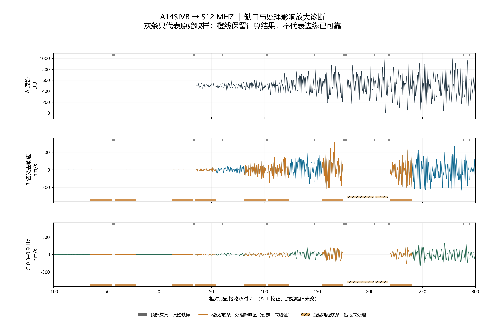

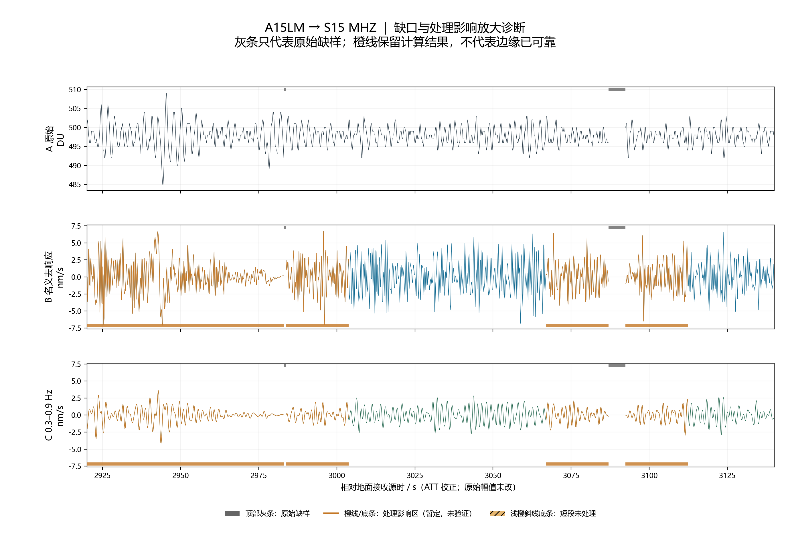

处理完整性核验得到60/60原始计数和掩码一致；共221个连续段完成计算、106个短段未处理，速度与位移分支均无执行失败段。这说明处理执行可追溯，不代替地震学质量判断。[完整统计](tables/trace_stage_comparison.csv)

### 5. 文献候选频带与本项目有效频带

| 用途 | 候选范围 | 来源及使用条件 |
|---|---|---|
| 初始公共比较 | 0.3–0.5 Hz | N24人工撞击比较；需逐事件/分量/时窗质控 |
| 第一扩展 | 0.5–0.9 Hz | N24经验范围；与主带独立检查，合并图可显示0.3–0.9 |
| 高频条件扩展 | 0.9–1.5 Hz | O22两条S12路径先例，不能推广为所有台站固有通带 |
| 低频诊断 | 0.1–0.3 Hz | 当前旧自动筛查包含此带；不作为默认反演通带 |
| 另一文献场景 | 0.05–0.4 Hz | J15二维自然月震模型，须重新核验本数据的低频响应与噪声 |

台站的有效滤波频段不能用一行固定数字概括。最终应写成“事件×台站×分量×物理量×时间窗×处理版本”的准入表，分别说明增长段和晚时尾波；奈奎斯特频率不是可用通带。

#### 5.1 现存240项初筛的准确含义

旧处理文件中60道各检查4个子带，共240项，30项满足当时保守初筛。噪声窗为−500至−50 s；信号窗从max(50 s, 文献距离/8 km/s)到1800 s。通过规则包括：RMS信号/噪声≥3、带内至少60% PSD频点功率比≥9、噪声与信号有效比例≥95%、ATT通过，以及未触发粗量化/粗削顶排除。以上阈值是项目初筛选择。

这套表引用的是`impact_reference`旧处理版本，**尚未按新版waveform_comparison_v2重新运行**。因此表中的不通过不等于原始记录不可用，30项也不能作为新版处理的新增合格数量。旧规则仅查ADC两端，亦未覆盖Zhang2025指出的内部削顶。新版本显示恢复后，需要以最终掩码重算筛查，并人工核验，而非直接继承结论。

旧表还标记26条分量前噪声粗量化。噪声RMS很小可能夸大SNR，应检查计数分布、PSD噪声底及其他安静窗口；不能因此称前噪声为人为填充。文献清晰但自动初筛不通过的矛盾必须记录并解释。

<!-- BAND_SCREEN_TABLE -->
| 事件 | 台站 | 0.1–0.3 Hz | 0.3–0.5 Hz | 0.5–0.9 Hz | 0.9–1.5 Hz |
|---|---|---|---|---|---|
| A12LM | S12 | — | — | — | — |
| A13SIVB | S12 | — | — | — | — |
| A14SIVB | S12 | — | — | — | — |
| A14LM | S12 | — | — | — | — |
| A14LM | S14 | — | — | — | — |
| A15SIVB | S12 | — | — | — | — |
| A15SIVB | S14 | — | — | — | — |
| A15LM | S12 | — | — | — | — |
| A15LM | S14 | — | — | — | — |
| A15LM | S15 | — | — | — | — |
| A16SIVB | S12 | — | — | — | — |
| A16SIVB | S14 | — | — | — | — |
| A16SIVB | S15 | — | MHZ | MHZ | MHZ |
| A17SIVB | S12 | — | — | — | — |
| A17SIVB | S14 | — | — | — | — |
| A17SIVB | S15 | — | MHZ | MHZ | MHZ |
| A17SIVB | S16 | — | — | — | MH2 |
| A17LM | S12 | MH1/MH2 | MHZ/MH1/MH2 | MHZ/MH1/MH2 | MHZ/MH1/MH2 |
| A17LM | S14 | — | — | — | — |
| A17LM | S15 | — | MHZ | MHZ/MH2 | MH2 |
| A17LM | S16 | MH1/MH2 | MH1/MH2 | MH1/MH2 | MH1/MH2 |
<!-- END_BAND_SCREEN_TABLE -->

表中“—”表示未通过旧自动筛查，不表示无记录。所有最终qualified_band当前留空。完整240项数值与原因见[历史初筛明细](tables/impact_modern_band_screen.csv)。

### 6. 按Zhang2025建立清洗分支

该论文的关键是区分技术伪信号，并针对机制处理。Glitch采用仪器对加速度、速度和位移阶跃的组合响应，在原始DU域拟合并减去；偏置与线性趋势不随伪信号一并减去。LP插值8倍到约53 samples/s是发生时刻细化，不创造新的真实带宽。S14幅值偏移按数字代码异常修正，但失真机制及残余削顶仍有限制。〔Z25〕

当前九个人工撞击早于Table2从1973年开始的两段明确幅值偏移时段，不能直接套其DU平移表。论文指出的早期511 DU削顶及其他计数异常仍值得检查。原文公开116个较大天然撞击的部分垂直分量清洗结果，不是本项目人工撞击的现成清洗产品。

| 新分支 | 输入与操作 | 要验证什么 | 状态 |
|---|---|---|---|
| C0 保留异常基线 | 现有原始→响应→带通 | 作为比较基线，标异常而不删除 | 已有预览 |
| C1 去spike | 明确的单点/少点异常，保留判定依据 | 不删除真实高频波包，检查局部谱 | 待分类与试验 |
| C2 单glitch拟合 | 孤立、未饱和、响应明确的DU段 | 残差不吸收真实到时、包络增长和长尾 | 待实现/作者代码核验 |
| C3 S14采集诊断 | 多通道直方图、内部平台和位结构 | 区分偏移、削顶及真实非平稳信号 | 待逐道检查；不直接套表 |
| C4 受控注入 | 较干净真实片段加入已知伪信号 | 检查恢复误差、误删率及指标偏差 | 待执行 |

清洗效果应同时展示原始DU、拟合伪信号、残差、物理波形、谱及能量包络。残差变小或图像更平滑不足以证明更接近真值。严重削顶丢失的信息仍可不可恢复，应保留排除或降权状态。详尽方法和图表导读见[Zhang2025附录综述](附录_Zhang2025数据清洗论文综述.md)。

### 7. 推荐的反演准入协议

每个事件—台站—分量应依次回答以下问题，生成一条带理由和版本的记录：

1. **身份和文件：**源、台站、通道、地点码、日期、起止时间、来源、原始哈希能否互相对应？旧SAC是否重复校准？
2. **时标：**名义时间、ATT、源时刻和可能跳时是否明确？相位/峰时的允许误差是否大于尚未解决的时钟误差？
3. **仪器：**模式、响应历元、增益、方向、极性和故障期是否核对？若只做名义校准，允许哪些形状指标、禁止哪些绝对能量结论？
4. **异常：**缺样、spike、glitch、内部削顶、标定信号是否分类？哪些区间原样保留、修复、排除或待定？
5. **子带和时窗：**对早期、峰值邻域及晚尾分别评估SNR和有效覆盖；处理边缘、长缺口、平滑支持窗附近均须评估。
6. **处理敏感性：**预滤波、渐消、滤波器、清洗分支、时间校正和包络窗的合理变化，是否比模型差异还大？
7. **准入签发：**允许的指标、分量、频带与时间窗；无法判断者填待核，不能猜填合格。

建议表字段见[tables/qualification_template.csv](tables/qualification_template.csv)。模板没有预填通过结论。初筛阈值不宜在看完模型拟合之后反复调整，避免择优保留支持某模型的数据。

### 8. 包络、峰时和能量的统一定义

建议先保存每个带通速度分量v_c(t)，再定义平滑平方包络I_c(t)=K_W * v_c²(t)，其中K_W是归一化窗核，宽度W、边界处理与单位要记录；如果改用Hilbert包络或RMS包络，需要另立指标版本，不能混算。

三分量总量可定义Σ_c I_c，但只允许在分量齐全、方向和增益可比且采用共同有效掩码时使用。只有两水平分量时，标为水平和，不与三分量总能量直接比值。几何扩散、震源及散射也会改变振幅，单条能量衰减不是纯吸收测量。

定义两种延迟：t_peak−t_origin与t_peak−t_first_arrival；分别保存。Z25使用首波至最大能量延迟，不能混入从撞击时刻计时的结果。首波不清楚时给区间或标不可用，不人为选一个有利到时。

累计能量E(t)=∫v²dt仅在有效样点和明确支持窗上估计，保留实际Δt。不能将缺口填零后计算T90并称完整持续时间；可报告共同连续窗内的部分能量指标，或将未见尾波结束的记录标为右删失。采样覆盖率高也不保证缺口没有恰好覆盖峰值。

Q_c拟合须记录采用的是振幅包络还是平方能量包络，因为指数衰减系数相差因子；同时记录频率、几何时间因子、噪声底与拟合窗。一般模型可写I(t,f)∝t^(−p)exp(−2πft/Q_c)，但p及该形式的适用性必须由所选方法确定，不能视为所有散射条件下恒成立。Q_c不直接等于Qᵢ或Q_sc。〔G17、Z25；本项目观测算子定义〕

### 9. 下一步最小可完成工作

先复核A14/A16 S-IVB→S12，逐道标出原始异常、时钟和响应问题；选一个孤立glitch作受控示范，不从最复杂饱和段开始。再以同一新版掩码重跑子带/分窗检查，形成“允许形状指标”和“允许绝对幅值”的分级准入。

只有在这些观测选择冻结之后，才向模型比较流程交付具体目标窗和误差范围。若两条参考路径的清洗不确定性暂时大于模型差异，可以先做合成恢复与数值基准，但不能把处理不确定性隐藏在散射参数中。

---

## 第四册｜CGFD3D接入、模拟矩阵与模型验证

> 区域结构更新（2026-11-05）：当前只采用S12、S14、S15三套独立模型，固定背景、莫霍、Q及材料CSV以[第08章](08_S12_S14_S15三个区域模型.md)和[第09章](09_三区域结构文献核对与背景更新.md)为准。本章旧M1/完整VPREMOON共同背景、W共享区域、12 km共同内壳界面及旧计算计数均保留追溯，不再作为执行输入。冯卡尔曼数学定义可继续参考，深度函数莫霍截断须换为本次区域界面；不新增其他模型族。尚未运行新波场。

> 2026-11-05版本说明：本册原计划/文献框架保留。新的区域反演目标、三维冯卡尔曼模型和参数范围以[新版第二册](02_散射模型与参数设计.md)为准；旧作业矩阵尚未按新规格重新编排。

版本：2026-10-29。求解器沿用旧项目CGFD3D；运行配置由用户后续提供。本册完成可执行工作所需的科学规格与作业规划，不虚构配置键名、硬件能力或运行结果。当前新增正式传播作业为0。

### 1. 从科学设计到生产输入的接口

科学模型须先冻结以下内容：事件、接收器、地理范围、背景、DEM、随机介质、源、吸收、目标频带、时间窗及可比较指标。CGFD3D适配器再负责单位/坐标转换、网格、材料、源站文件和输出映射，不能在适配时悄悄改变模型。

| 待接入信息 | 为什么必要 | 交付后如何检查 |
|---|---|---|
| CGFD3D版本/提交及一个可运行实例 | 不同版本接口、边界和衰减能力可能不同 | 在原环境重现实例并保存日志，不靠名字推断功能 |
| 实际配置文件与源站/网格样例 | 确定坐标、单位、分量、网格顺序、插值和源语义 | 用单源均匀介质检查到时、极性和输出物理量 |
| 材料导出/读入格式 | 现有NetCDF是求解器中立预览 | 往返检查尺寸、范围、单位、属性和数值统计 |
| 自由表面与曲线网格设置 | 地形与强低速层改变稳定性及数值误差 | 平地解析/参考解、起伏表面基准、网格Jacobian |
| 吸收边界及黏弹性配置 | 长尾可能被边界或数值吸收污染 | 扩域、加深、PML参数和Q实现对照 |
| 硬件与并行方式 | 大域可能需要大量内存和长时间 | 小规模实测峰值内存、每步时间、I/O后估算生产作业 |
| 输出采样与站点位置规则 | 影响响应卷积、滤波和近地表记录 | 保存真实输出Δt和接收器在自由表面下的位置 |

这些是既定运行前置项；本次整理不再次要求用户提前提供。未接入前可以完成数据准入、参数表、合成恢复设计和模型材料核验。

### 2. 地理范围、曲率与边界

第一册的全记录范围框用于展示所有实际记录台站，近距框用于首轮作业规划。两种框都加了50 km地理缓冲，但该缓冲未经过晚尾传播验证。不能用一张矩形框直接宣告3600 s计算域足够大。

球面距离采用R=1737.4 km。对于长度L的圆弧，其弦与弧中点的矢高为s=R[1−cos(L/2R)]：这是曲率尺度诊断，不是平面传播误差的直接百分比。约355 km路径对应约9 km量级矢高，因此“距离小于400 km”只是一项计算分批规则，不能证明平面近似有效。

两类可接受策略：①CGFD3D在实际支持的曲线坐标/网格中表达相应月球曲率；②若采用局部平面域，先量化其与球面参考在目标频带、到时和包络上的差异。不要在同一研究中对长距资料使用未验证的平面模型而仍声称局部深度可精确反演。

边界检查需分别改变侧界、底界、PML厚度和强度。PML能抑制人工反射，却不能补回真实月球中从截断域外返回的散射能量。既要确认没有非物理反射，也要检验截断域是否遗漏目标晚尾机制。所需深度还受莫霍、背景梯度、源和目标时间窗约束，不能令底界恰好等于H。

### 3. 网格、时间步与频带

先按目标最高频率fmax、全域最小有效Vs和数值格式确定波长约束：Δh≤Vs,min/(nλ fmax)。另以Δh≤a_min/n_a检查随机尺度采样。初步预算可用nλ=10、n_a=5，**这两个数是项目预检查值，不是CGFD3D普适收敛证明**。高波数谱尾、近表低速、曲线网格畸变和强扰动极值会提出更严格限制。〔数值方法：Z12、Z14；随机场验证：SE18〕

时间步须根据该版本离散格式、Vp,max、最小物理网格间距和曲线网格指标确定CFL条件，不能仅用规则网格一个经验常数。若含黏弹性，还应检查其稳定性和目标Q在频带内的实际实现。

例如最低Vs=500 m/s、最高频率0.5 Hz且取10点/波长，波长条件给Δh≤100 m；若还要表示a=0.2 km且每尺度至少5格，则需≤40 m。这只是公式示例，500 m/s不是已核实的生产域最小Vs。真正网格必须使用生成材料的极小值和收敛结果。

#### 3.1 计算规模示例

下表按每个近距规划框、垂向40 km、规则等间距100 m估算；节点数含两端，假设32个float32数组作为内存量级示例。40 km深度、32数组和100 m均不是正式配置，不包括额外PML/halo、进程通信、工作数组、磁盘输出或曲线网格开销，也不保证满足全部a和频带要求。

<!-- RESOURCE_TABLE -->
| 事件域 | Nx×Ny×Nz | 节点数/十亿 | 32数组估算/GiB |
|---|---|---|---|
| A12LM | 1677×1283×401 | 0.86 | 103 |
| A13SIVB | 2355×1139×401 | 1.08 | 128 |
| A14SIVB | 1797×2569×401 | 1.85 | 221 |
| A14LM | 2804×1193×401 | 1.34 | 160 |
| A15SIVB | 4519×1715×401 | 3.11 | 370 |
| A15LM | 1936×1070×401 | 0.83 | 99 |
| A16SIVB | 3172×2689×401 | 3.42 | 408 |
| A17SIVB | 4362×1352×401 | 2.36 | 282 |
<!-- END_RESOURCE_TABLE -->

网格间距从100 m减半到50 m，三维节点数约增8倍；若时间步也减半，同样时长的计算量约增16倍。真实比例需基准测量。不能为了把模型放入单机而未经分析抬高最小Vs、抹平地形、增大a或缩短晚尾，然后仍声称模拟了原模型。

输出优先保存所有接收器全时段波形，体积快照稀疏采样且单独预算；体积逐时保存会显著放大I/O。计算可按阶段降低最高频率或先做短时调试，但要明确研究问题的相应缩小。

### 4. 数值验证顺序与通过标准

| 级别 | 试验 | 主要检查 | 通过后才能做什么 |
|---|---|---|---|
| N0 | 均匀平地、简单点源 | 到时、极性、几何衰减、源归一化、分量及单位 | 接入背景与地形 |
| N1 | 分层无随机，平地/地形 | 自由表面、界面、源站位置与坐标变换 | 加入随机材料 |
| N2 | 固定η的多网格 | 波形、包络、峰时、谱与RMS/ACF稳定性 | 比较散射参数 |
| N3 | 固定模型扩域/加深/PML变化 | 边界反射、晚尾能量和指标稳定性 | 延长目标分析窗 |
| N4 | 固定模型增加随机实现 | 指标均值、中位数、离散度与排名稳定性 | 统计比较模型族 |
| N5 | 合成真值恢复/留出 | 是否能恢复a、σv、H或仅恢复组合 | 决定真实数据能报告哪些量 |

阈值应在看完真实模型排序前预设，结合观测误差而定。可将到时/峰时误差、包络对数误差和能量比例误差分别报告；不能只以“图看起来相近”验收。若数值误差大于候选模型间差异，应继续收敛或缩小主张，而非给出虚假的最佳值。〔阈值和顺序为项目设计〕

### 5. 现有88项与新增事件级基线清单

#### 5.1 保留的两路径参数筛查

旧清单有7组参数×3种子×2路径×2地形，再加4个无随机对照，共88项，只针对A14/A16 S-IVB→S12。它是单因素敏感性设计，尚未运行，不覆盖所有区域。7组为：

| 组 | a/km | σv | H/km | 与中心的差别 |
|---|---:|---:|---:|---|
| B | 0.65 | 0.10 | 10 | 中心模型 |
| A03 | 0.30 | 0.10 | 10 | 较小相关尺度 |
| A13 | 1.30 | 0.10 | 10 | 较大相关尺度 |
| S05 | 0.65 | 0.05 | 10 | 较弱RMS |
| S15 | 0.65 | 0.15 | 10 | 较强RMS |
| H035 | 0.65 | 0.10 | 3.5 | 较薄扰动层 |
| H20 | 0.65 | 0.10 | 20 | 较厚扰动层 |

旧清单未完整编码背景、密度耦合、深度约定和生产域。应作为历史科学计划保留，在适配生产输入时补足字段，并避免与新作业重复计算。不能将三条单因素曲线的最低点拼成联合最优。

#### 5.2 新增64项事件级基线设计

本次整理新增[事件级基线清单](tables/event_baseline_jobs_v3.csv)，对应8个近距候选事件域，覆盖11条首轮目标路径。每个事件域设置平坦/真实地形两种条件；各含1个R0无随机模型和3个种子的R1中心模型，即8×2×(1+3)=64项。

清单以事件和接收器集合为单位，同一传播计算可输出多个台站。A17 S-IVB近距框内的S14作为低信噪比辅助接收器可同时输出，但不计入11条优先目标。A17 LM及框外台站属于远距阶段，未被偷偷删除或替换。

新基线明确B0、Dsurf深度、βρ=0、固定同场Vp/Vs扰动、ν=0.5和拟议Qᵢ=2400；这些是本次综合设计的主控制选择。βρ=0.8、其他Q和其他背景另列敏感性分支。Q实际实现、曲率、网格、Δt和边界尚待配置与基准验证，故清单不是可直接提交求解器的作业文件。

先运行A14/A16 S-IVB两个事件域，共16项；其余6个域是48项扩展。**16是64的子集，不应相加成80；新64项与旧88项也不能简单相加作为独立生产总量。**A16新事件域同时面向S12/S14，地理范围与旧单路径作业不同。

600 s只作为调试时长；3600 s为条件目标，最终拟合窗不超过观测质量、到峰状态和数值收敛三者共同允许的范围。当前清单所有条目均为planned_not_executed。

#### 5.3 联合搜索与后续分支

两条参考路径具备质量和数值条件后，建立a–σv、σv–H联合误差面。完整3×3×3网格若用3种子、2事件、2地形，会有324个随机模型作业，另加4个R0，合计328；这是预算示例，未生成或授权为必须全部运行的生产计划。

可优先沿单因素显示的权衡谷选点，再做局部加密。R2/R3/R7/S先采用少量可解释的结构分支，只有观测显示明确需求再增加连续参数。R4、R8和R5的新增自由度与算力成本需分别说明。任何自适应取点都应保存历史，最终验证集不得参与选点。

### 6. 观测与合成必须经过一致的比较算子

CGFD3D输出的位移或速度须与观测物理量一致，统一方向、极性、采样、带通、平滑、分析窗及缺口掩码。可采用两条互相检查的路径：

1. 对观测去响应后，在物理量域比较合成；保留响应不确定性。
2. 将合成卷积相应仪器响应转入计数域，再与原始观测比较；前提是模式、增益及单位已确认。

两条方法不是可以混合归一化的同一结果。主比较还应对合成施加与观测相同的有效支持窗，避免拿完整合成能量与缺口观测能量直接比较。掩码只是公平比较，不代表将合成缺口当作真实传播现象。

### 7. 指标、目标函数及干扰参数

先报告单项误差，再组合。建议指标为：包络形状、首波/峰值时间、固定窗能量、分窗能量比例、尾波斜率、频谱与分量分配。清洗和数值误差较大的指标应停用或降权并说明理由。

对正值包络可定义诊断误差

\[
J_I=\frac{1}{N_\mathrm{valid}}\sum_{t\in\Omega}\left[\log(I_\mathrm{syn}+\epsilon_I)-\log(I_\mathrm{obs}+\epsilon_I)\right]^2.
\]

ε_I应根据噪声和单位设定并记录，不可随模型改变。对数可防止单个峰值支配误差，但低信噪尾部也可能被放大，因此Ω必须先质控。目标函数是项目选择，不是新的物理散射公式。

组合可写J=Σw_k J_k，权重从训练资料的噪声、尺度及研究目标确定；保留各项原值，不只交一个总分。高度相关的能量/包络指标不能被当作独立观测重复增加证据。若采用似然或贝叶斯方法，需要明确残差相关结构和先验；缺少这些时使用“可接受模型集合”比“精确后验”更恰当。

源幅度与共同时间偏移作为事件级干扰参数，不能逐站任意优化。若需要站点项，必须以响应/场地证据约束，并报告其与介质的权衡。方差归一化或逐道峰值归一化会失去哪些振幅信息，应在拟合前声明。

### 8. 可辨识性、留出与区域比较

| 主要权衡 | 为什么发生 | 减弱混淆的设计 |
|---|---|---|
| a–σv | 不同谱和幅度可能给相近散射效应，依赖ka | 多个合格子带、联合误差面、相干部分与谱 |
| σv–H | 薄强层与厚弱层都可能展宽尾波 | 多距离、早晚窗、深度分支和共同源多站 |
| H–背景 | 梯度、低速层和界面可改变捕获与到时 | 独立到时约束、B0/B1/B2整组比较 |
| 散射–Qᵢ | 能量重分配和耗散都改变尾波 | 同时看增长段、峰时和衰减，固定后释放Q |
| 区域–源–场地 | 单事件单站缺少独立比较 | 同站多源、同源多站、LM/S-IVB分组及独立场地分支 |
| 地形–层界 | 地形随动深度改变了地下界面 | Dsurf/Dref控制与四组归因 |

训练起点为A14/A16 S-IVB→S12；其他合格S12事件先用于预测。扩展到S12/S14共同事件时，留出应按整个事件分组，不能把一个事件的两个站或三个分量拆到训练/验证而声称独立。只有9个事件，任何数据划分均需展示事件名单，避免夸大统计精度。

每个候选组合先用3个种子筛查，报告种子分布，不挑最好的一条。若模型族排序随种子变化，应增加实现或报告无法区分。合成真值恢复应覆盖中心及边界参数、不同源/背景和缺口噪声；若只能恢复某个组合量，就报告该组合或界限，不能强求a、σv、H三个精确数值。

区域模型可先设共享统计参数，再允许某一研究单元仅改变σ或H，最后比较更复杂结构。新增参数只有在独立预测改进超过处理、源、种子和数值误差时才值得保留。不能预设高地一定更强，或将没有明显改善等同于证明各区完全一样。

### 9. 阶段交付与完成定义

| 阶段 | 必交文件/图表 | 完成判据 | 当前状态 |
|---|---|---|---|
| P0 观测整理 | 事件、台站、21配对、63位置状态、原始图 | 来源与计数可核对 | 已完成整理 |
| P1 准入与清洗 | 新版子带/分窗表、异常清单、处理敏感性 | 每个拟合量有明确允许窗 | 部分完成，最终准入待做 |
| P2 求解器接入 | 配置、网格/材料/源站、N0/N1 | 单位、坐标、基本传播正确 | 待运行配置 |
| P3 数值收敛 | N2/N3和随机场QA | 目标指标误差小于研究所需分辨力 | 未执行 |
| P4 参考路径 | 初始16项及有条件参数筛查 | 两路径多指标可比较且不掩盖误差 | 已规划，未运行 |
| P5 跨事件与区域 | 留出预测、共享/分区比较 | 新结构提升独立预测 | 未执行 |
| P6 论文 | 主图、可复现输入、限制与数据声明 | 所有结论有观测/模拟/验证对应 | 大纲已规划 |

现有旧项目的短时波场只能作为方法和地形机制背景，不能替代上述长窗计算。没有通过P3/P5前，论文应称模型设计或方法检验，不能声称已确定四区域最适散射模型。

### 10. 论文结果图与数据归档

建议主图依次为：①LOLA源站与模拟域；②原始/清洗/处理对照及缺口；③统一物理谱的模型和深度RMS；④四组地形—介质控制；⑤参考路径多分量/多频带比较；⑥a–σ、σ–H权衡与种子分布；⑦完整事件留出预测；⑧受约束的区域解释与替代机制。

每个run_id关联模型规范、网格、源站、DEM、源时间函数、Q、seed、代码版本、机器/并行设置、开始结束时间、日志、接收器输出和检查状态。清单状态依次为planned、prepared、validated_input、running、completed、numerically_accepted、scientifically_evaluated；求解器退出0不直接等于最后两个状态。

已有材料和评分代码可作为原型，但评分测试输入中的解析包络不是Apollo真实观测。生产运行后应保存计算失败、被拒模型和拒绝原因，避免只留下最好图形而失去可复现性。

---

## 第五册｜文献依据、论证边界与论文组织

> 2026-11-05版本说明：本册原计划/文献框架保留。新的区域反演目标、三维冯卡尔曼模型和参数范围以[新版第二册](02_散射模型与参数设计.md)为准；旧作业矩阵尚未按新规格重新编排。

版本：2026-10-29。本册将既有定向文献审计整合为研究设计依据；没有宣称系统穷尽所有月球散射研究。引用元数据、正文证据、参数采用和本项目建议分开列出。DOI可解析不等于每一个数值都得到原文支持。

### 1. 证据如何进入模型设计

**直接路径参考**优先：与本项目相同撞击和接收站、相近频率、明确随机场定义的模拟，适合作为起点。**其他月球场景**可以提出竞争机制，但深浅震、主动源、接收函数和全球模拟不能直接提供本路径后验。**一般理论和数值方法**提供ACF、传播和边界定义，不把其中地球参数迁移为月球取值。**项目选择**用于控制维数和预算，应明确标注，不能在旁边放一个引用就称其为文献测值。

### 2. 核心证据矩阵

<!-- LITERATURE_MATRIX -->
| 研究与原文定位 | 对象、方法与参数 | 本项目怎样采用 |
|---|---|---|
| [Onodera2021](https://doi.org/10.1029/2020JE006406)，§2/Table2–3 | A14/A16 S-IVB→S12，二维P–SV；上/下a=0.2/0.6 km，上层底7.5 km，总深度南10/北20 km；波动上限28%/14% | 两层竞争结构；不把上限换成RMS；二维与三维幅度传播差异须检验。 |
| [Onodera2022](https://doi.org/10.1029/2022JE007558)，§2.2–2.4/§3.3 | 同两条S12路径，三维指数ACF；a=0.65 km，生成速度场1σ约5%–10%，强扰动至约10 km | 主起点。生成器ε=0.024–0.042和场的1σ分列；不是四区域各自反演。 |
| [Dainty与Toksöz1977](https://journal.geophysicsjournal.com/JofG/article/download/102/64)，p385–386/Fig6 | 直接比较A14LM→S14、A15LM→S15，0.45 Hz扩散包络；D约2 km²/s，Q=5000 | 给S14/S15增加独立包络基准；自由程不是a，未给连续随机场σ。 |
| [Jiang等2015](https://html.rhhz.net/dqwlxb/2015-5-1675.htm)，§2–4/Table3–4 | S12自然浅震/深震；二维，0.05–0.4 Hz；von Kármán，固定a=2 km、标准差约3%–5%、H=15 km、Q=6750 | 低σ长a竞争端元；a受原网格约束，不是独立反演值。移植到本频带和三维属于新检验。 |
| [Sollberger2016](https://doi.org/10.1002/2016GL070883)，§3–5/Fig4–5 | Apollo17局部主动源，二维浅部分层，界面4/60/410 m；von Kármán，逐层速度变化70/70/50/25% | 支持浅表高反差机制；百分比不是已核实RMS，a/Hurst仍缺附件核查。不能推广为10 km厚强层。 |
| [Keil2024](https://doi.org/10.1029/2024EA003742)，模拟部分/Appendix A | Apollo17 EP3与LSPE，二维；Hurst0.5、a=10 m、最大速度偏差70%；高频、百米局部尺度 | 独立浅层机制及随机实现敏感性先例；不用它给中周期百公里路径赋70% RMS。 |
| [Blanchette-Guertin2015 GRL](https://doi.org/10.1002/2015GL066151)，§1–4/Fig1–3 | 理想盆地声子法；外侧H=5–60 km，盆内0或5 km；显示源区和边缘散射能量贡献 | 支持H(x,y)、源侧/接收侧对照；不是A15实测层厚。 |
| [Blanchette-Guertin2015 JGR](https://doi.org/10.1002/2014JE004654)，Table1 | 声子法；H=5/15/30/60 km，界面最大对比25/75/95%，Qi=2000/4500/6500等 | 检查厚度、吸收与背景速度权衡；界面对比和散射间距不等于连续场σ和a。 |
| [Shi2023](https://doi.org/10.1029/2022JE007676)，§2–4/Fig4,6–8 | Apollo浅源接收函数；二维指数ACF；a=1/4 km，ε=0.1/0.2等，浅部10–20 km；0.2–0.8 Hz | 较强扰动、较长尺度竞争与PRF稳定性检验；ε归一化待查，不视为本项目路径σ后验。 |
| [Zhang2022](https://doi.org/10.1029/2022JE007222)，§2–3/§5 | 月震全球波场；节点独立随机、最大计算幅度50%；约70%来自外推，深度20–130 km试验不敏感 | 高对比分支的动机；物理a未独立控制，不能称“σ50%–70%已验证”。 |
| [Nunn2024](https://doi.org/10.3847/PSJ/ad83d2)，Table2/§5 | 多人工撞击，AxiSEM3D；最大±50%，线性减至20/50/80 km为零 | 与主族分开比较；需控制离散谱和背景，不能把节点尺度当月球相关尺度。 |
| [Gillet2017](https://doi.org/10.1016/j.pepi.2016.11.001)，深度扩散模型 | 多事件综合；最上10 km D约2 km²/s、Qsc≤10，Qi约2400；更深散射过渡约80–100 km | 独立能量输运约束；强层深度与广义过渡深度分开，不由D唯一解a/σ。 |
| [Kim2025](https://doi.org/10.1029/2024GL114506)，§2/SI引用 | 转换波/偏振的三维合成验证使用a=750 m、15%速度/密度非均质；SI未取得 | 支持早到偏振与独立背景检查；15%统计定义暂不升级为RMS，非区域散射反演。 |
| [Torrent Duch2025](https://doi.org/10.1029/2025JE009090)，§5–6 | S16尾波自相关晚到更稳定；弱局地散射与更锐利界面均可解释 | 保留区域强弱的双向假设；不预设高地最强，也不直接赋a=1–4 km。 |
| [Eaton2024](https://doi.org/10.1093/gji/ggae098)，§3–4/Fig9 | 包含A14LM→S14、A15SIVB→S12、A17SIVB→S12；多尺度熵与频率相关 | 增加统计状态辅助诊断；注意低能量频带和噪声影响。未提供本项目a/σ/H三元组。 |
| [Onodera2025会议摘要](https://www.hou.usra.edu/meetings/lpsc2025/pdf/1144.pdf)，两页 | Szilard虚拟源站，地形+随机介质；a=.65 km，1σ10%，上20 km扰动 | 联合地形/介质/界面试验先例；会议模拟，非真实Apollo反演。 |
<!-- END_LITERATURE_MATRIX -->

上表沿用已完成的正文/作者版本审计；本次重点复核NASA源站坐标、LOLA官方产品说明及O22出版社入口。部分支持材料仍未取得的条目保持待核状态。本次未下载新的背景数值表、未运行论文作者的清洗程序，也没有新增散射反演结果。

### 3. 文献中的“散射强度”为什么不能直接排成一个数字序列

不同论文的模型变量并不等价：连续随机场通常给a、σv和谱形；二维波动计算可能只给有界波动上限；声子模型使用散射间距和界面速度对比；扩散拟合给D、输运长度或等效Q；接收函数研究又可能以转换相是否保存为目标。即使同为百分比，所指可能是RMS、最大值、逐层对比或代码参数ε。

因此本研究建立三个并列层次：①观测指标，如峰时、包络、频谱与尾波斜率；②指定模型内的a、σv、H与Qᵢ；③有明确适用条件的等效输运参数。只有通过模型映射和不确定性检验才跨层比较，不直接把它们混为同一个“散射强度”。

### 4. 各候选地貌目前能够获得的文献约束

| 单元/场景 | 最相关证据 | 设计上的采用 | 尚不能声称 |
|---|---|---|---|
| S12近侧路径 | O21/O22同两次S-IVB三维/二维研究 | a约0.65 km、场1σ约5%–10%、强扰动约10 km作为主参考 | 这是整个月海或所有S12路径的唯一真实参数 |
| S14邻近喷出物/破碎区 | D77近距扩散例、AM22场地、Z25数据失真 | 独立检查源/场地与仪器，再做S12/S14联合 | D约2 km²/s唯一决定a或σv；S14异常全是地质原因 |
| S15盆缘近距 | D77近距人工撞击包络、BG15G侧向层厚机制 | 对比S12迁移模型、源侧/站侧与H(x,y) | 盆缘的σv已被单独反演，或地形颜色代表散射强度 |
| S16高地接收站与远距路径 | TD25尾波自相关、N24全网人工撞击 | 保留弱局地散射与界面解释，作为远距预测 | 高地必然最强；单个851 km路径等于台站附近局地结构 |
| 特定陨石坑 | 当前尚未完成坑内/外路径匹配 | 后续独立地质图与新增事件扩样 | 已具有独立且丰富的陨石坑区域反演样本 |

A12/A14相邻的工作窗口可以联合成研究走廊，台站仍分开建模。地形大区域应用边界/范围表示，窄于2 km的地貌不另作标签；但该展示要求不限制地下a的取值。LOLA高程为几何依据，地质单元需另用地质图核实。

### 5. 数据论文与清洗论文的分工

Nunn2022解决档案恢复、时标、格式和公开可用性，说明“从哪里取得哪些原始计数”。Zhang2025针对仪器/采集伪信号提出清洗方法，说明“已有数值中哪些可能不是有效地面运动”。二者不能相互替代；下载现代档案不等于全部glitch已去除，做带通也不等于完成Zhang清洗。

Zhang2025从1743个天然撞击中选116个较大事件，检查1595条记录，其中390条满足峰峰值>20 DU；128条较好、256条污染、6条超限，污染记录中182条作者认为可处理。182/256约71.1%只属于这一筛选样本，不能外推为全Apollo修复成功率。公开产品仅部分垂直分量得到处理。

清洗影响与散射解释相连：glitch改变局部峰值和延迟，S14持续畸变可能改变尾波衰减；这些结果要求我们报告处理敏感性，而不是从论文中直接读出区域a、σv、H。详细正文综述、方法窗长、图页导读和适用边界已完整附于[附录](附录_Zhang2025数据清洗论文综述.md)。

### 6. 拟议论文主线

可用工作题目：**真实月表地形约束下Apollo人工撞击记录的散射模型检验：从共享统计结构到路径差异**。标题是否使用“区域反演”应由最终可辨识性和留出验证结果决定，当前不预支结论。

| 章节 | 需要回答的问题 | 应提供的证据 |
|---|---|---|
| 引言 | 为什么已有地形必要性验证之后，还需要真实路径多模型比较？ | 长尾与非唯一性文献；前期地形工作只作动机 |
| 数据与区域 | 哪些事件、台站、分量和时间窗真正可用？ | 第一册完整清单、LOLA地图、来源与缺失项 |
| 预处理与质控 | 观测特征对清洗和响应是否稳定？ | 原始/处理对照、异常分类、频带分窗准入 |
| 模型与数值方法 | 每个a、σ、H、背景、源及地形设定来自哪里？ | 第二册公式、证据表、材料QA、求解器配置 |
| 数值与可辨识性验证 | 哪些差异超过网格、边界、种子和处理误差？ | 第四册N0–N5、合成恢复和权衡面 |
| 观测比较结果 | 共享模型能解释哪些路径，哪些需要增加结构？ | 多指标拟合、完整事件留出、失败案例 |
| 讨论 | 区域差异是否可与地貌联系？还有哪些替代解释？ | 源/场地/背景/Q/清洗敏感性；独立地质依据 |
| 结论与数据可用性 | 数据真正支持什么、未约束什么、如何复现？ | 参数集合或界限、输入输出清单、原始来源和代码 |

前期地形试验不需要在新文中大量重复。新稿主要贡献应由“实际资料约束、可追溯模型、数值验证和独立预测”构成。若目前数据只支持走廊等效参数，论文应据此组织，而不是为凑四区域强行拟合。

### 7. 主文、补充材料与组会展示的分配

主文保留事件—台站总图、核心记录质量、少量可解释模型、关键权衡和留出预测。补充材料保存全部逐道原始/处理图、240项历史筛查及新版结果、来源表、网格/PML/种子测试、各模型被接受/拒绝原因。组会优先讲“记录是否可靠—模型为何这样设—下一步运行能判别什么”，不用展示所有旧版图表。

对于空白数据、清洗未解决记录和未收敛模型，应展示其对结论的影响；不能只把它们移入补充材料后从样本分母中消失。所有图件的观测、数值模拟、理论示意和计划状态须有可辨识标记。

### 8. 新资料扩展的优先次序

第一优先是现有9次人工撞击的质量和模型验证，因为时空条件比天然月震更明确。第二优先是Z25公开的116个较大天然撞击：下载后核实事件身份、台站、分量、单位、时标、清洗范围、位置和不确定性，再决定能否用于区域约束；不能因为样本数大就假定震中与源谱同样确定。

深月震重复簇可用于重复性和路径稳定性，但深度、震源机制、路径及源时长与撞击不同；浅月震可补充距离和方位，却需要独立源信息。Apollo17主动源主要约束局部浅层，不能与被动网人工撞击混算台站数量。新的事件类型应另建目录与准入，不改变本册9事件主样本的统计口径。

### 9. 参考文献编号与核查状态

<!-- REFERENCE_CATALOG -->
| 编号 | 研究/入口 | 正文定位与当前状态 | 用于本项目时的限制 |
|---|---|---|---|
| NASA-I | [NASA：Apollo撞击位置、时刻、速度与动能](https://nssdc.gsfc.nasa.gov/planetary/lunar/apollo_impact.html) | 数据表及注释；本次官网复核 | 坐标/源条件，非地震辐射能 |
| NASA-S | [NASA：ALSEP坐标](https://nssdc.gsfc.nasa.gov/planetary/lunar/lunar_sites.html) | ALSEP行；本次官网复核 | 源站统一参考系 |
| LOLA | [NASA/PDS LOLA数据产品](https://pds-geosciences.wustl.edu/missions/lro/lola.htm) | LDEM_64标签及本地溯源 | 采样约474 m，非绝对有效分辨率保证 |
| N22 | [Nunn等2022：Apollo档案恢复](https://doi.org/10.3847/PSJ/ac87af) | 档案方法及官方示例；已有项目核查 | 原始计数/时标/响应，不是全部伪信号清洗 |
| N24 | [Nunn等2024：人工撞击与三维模拟](https://doi.org/10.3847/PSJ/ad83d2) | Table1/2，§2/5；已有正文核查，本轮IOP入口未成功返回 | 记录覆盖、0.3–0.5 Hz比较、高对比模型 |
| O21 | [Onodera等2021：二维人工撞击路径](https://doi.org/10.1029/2020JE006406) | §2，Table2–3；已有正文核查 | 两层尺度与上限幅度，不作RMS换算 |
| O22 | [Onodera等2022：三维散射定量评估](https://doi.org/10.1029/2022JE007558) | §2.2–2.6、§3.3；已有正文核查，本次出版社入口复核 | 两条S12路径主参考 |
| B14 | [Besserer等2014：月壳密度/孔隙度](https://doi.org/10.1002/2014GL060240) | 通过O22 §2.3及来源审计引用 | 背景依据，不是σv来源 |
| J15 | [Jiang等2015：月震散射数值模型](https://doi.org/10.6038/cjg20150519) | §2–4，Table3–4；中文期刊全文已核查 | 二维自然月震的低σ长a竞争场景 |
| D77 | [Dainty与Toksöz1977：月球扩散包络](https://journal.geophysicsjournal.com/JofG/article/download/102/64) | p385–386/Fig6；已有公开原文核查 | A14LM/S14、A15LM/S15；D不等于a |
| G17 | [Gillet等2017：深度变化散射与吸收](https://doi.org/10.1016/j.pepi.2016.11.001) | 扩散/衰减模型；已有核查 | D、Q与过渡深度，非随机场唯一映射 |
| BG15G | [Blanchette-Guertin等2015 GRL：侧向层厚](https://doi.org/10.1002/2015GL066151) | §1–4/Fig1–3；已有正文核查 | H(x,y)和源区贡献的机制证据 |
| BG15J | [Blanchette-Guertin等2015 JGR：声子模拟](https://doi.org/10.1002/2014JE004654) | Table1；已有正文核查 | 界面对比、厚度及Q的替代参数化 |
| SO16 | [Sollberger等2016：Apollo17浅层主动源](https://doi.org/10.1002/2016GL070883) | §3–5/Fig4–5；支持材料未取得 | 浅部高反差；a和百分比统计定义仍有限制 |
| KE24 | [Keil等2024：浅部散射与主动源](https://doi.org/10.1029/2024EA003742) | 模拟部分/AppendixA；已有正文核查 | a=10 m等局部高频场景，不推广到百公里域 |
| AM22 | [Amrouche等2022：浅部结构与场地](https://doi.org/10.1029/2022JE007396) | §6；已有项目来源审计 | 浅层场地分支，非a/σ/H区域反演 |
| SH23 | [Shi等2023：散射对接收函数的影响](https://doi.org/10.1029/2022JE007676) | §2–4/Fig4/6–8；ε归一化待核 | 长尺度分支；不直接将ε写为RMS |
| Z22 | [Zhang等2022：全球波场浅部非均质](https://doi.org/10.1029/2022JE007222) | §2–3/5；已有正文核查 | 最大扰动/节点尺度与物理a分开 |
| K25 | [Kim等2025：转换波与偏振](https://doi.org/10.1029/2024GL114506) | §2及SI引用；SI未取得 | 15%统计定义未升级为RMS |
| TD25 | [Torrent Duch等2025：S16尾波自相关](https://doi.org/10.1029/2025JE009090) | §5–6；已有正文核查 | 弱局地散射与更锐利界面均保留 |
| E24 | [Eaton2024：熵与频率相关](https://doi.org/10.1093/gji/ggae098) | §3–4/Fig9；已有正文核查 | 辅助统计，不给a/σ/H三元组 |
| O25A | [Onodera等2025 LPSC会议摘要](https://www.hou.usra.edu/meetings/lpsc2025/pdf/1144.pdf) | 两页会议模拟；非期刊区域反演 | 虚拟源站的机制设计 |
| Z25 | [Zhang等2025：Methods for Cleaning Apollo Passive Seismic Data](https://doi.org/10.1029/2025EA004710) | 17页正文已读；SI未核实；作者代码未运行 | glitch与S14采集问题，详见附录 |
| SE18 | [Sato与Emoto2018：ACF/PSD与波动散射](https://doi.org/10.1093/gji/ggy319) | §2/式2a–b；已有来源审计 | 一般理论；地球数值不转作月球先验 |
| GA19 | [Garcia等2019：月球内部结构综述/模型](https://doi.org/10.1007/s11214-019-0613-y) | 模型及作者数据；新数值表未接入 | 独立背景；背景不确定性不是短尺度σv |
| VP12 | [Garcia等2012：VPREMOON勘误](https://doi.org/10.1016/j.pepi.2012.03.009) | Table6；已有来源审计 | 背景表须用勘误，QP/QS非散射Q |
| Z12 | [Zhang等2012：曲线网格地震波数值方法](https://doi.org/10.1111/j.1365-246X.2012.05472.x) | §2–5；已有方法来源审计 | 数值基准，不保证本项目具体网格合格 |
| Z14 | [Zhang等2014：曲线网格吸收边界](https://doi.org/10.1093/gji/ggu124) | 理论/测试；已有来源审计 | 边界方法；50 km等数值仍为项目选择 |
<!-- END_REFERENCE_CATALOG -->

完整既有BibTeX保留在[references目录说明](references/README.md)，按原来源文件分存，避免合并时静默覆盖不同键或字段。本次不把缺失附件、摘要级信息或不同场景参数升级为已验证区域数值。

### 10. 本次综合版相对旧稿的明确修订

1. 将“候选区域圆窗”降为早期规划，主样本改为真实事件—接收器和路径域。
2. 将原始、文献清晰、初筛、最终可用四类状态拆开；统一60实有分量和3缺失位置。
3. 将新版波形与旧240项初筛分开，禁止把旧通过状态自动复制到新版处理。
4. 明确H的渐消中心约定、βρ主控制与旧预览差异，以及同seed不同FFT体积不保证同介质。
5. 形成8事件域64项拟议基线清单，说明首批16项的子集关系及旧88项的有限适用范围。
6. 增加真实曲率、计算规模、边界能量损失、反演可辨识性和事件级留出要求。
7. 将“最优模型”保留为后续计算和验证后的结果，当前只交付有依据、可审查的设计。

---

## 具体背景模型参数与图件

> 区域结构更新（2026-11-05）：当前只采用S12、S14、S15三套独立模型，固定背景、莫霍、Q及材料CSV以[第08章](08_S12_S14_S15三个区域模型.md)和[第09章](09_三区域结构文献核对与背景更新.md)为准。本章旧M1/完整VPREMOON共同背景、W共享区域、12 km共同内壳界面及旧计算计数均保留追溯，不再作为执行输入。冯卡尔曼数学定义可继续参考，深度函数莫霍截断须换为本次区域界面；不新增其他模型族。尚未运行新波场。

2026-11-05。已获取作者原始数值文件，以下区分完整参考模型、局地观测约束和项目散射输入。未执行传播或区域反演。

### 1. 已取得的完整背景参数

来源：[Garcia2019作者数据v2](https://zenodo.org/records/21476963)。原`.nd`为集合中位数，新`.dat`为集合均值/±1标准差，作者readme已随原文件保存。为避免混合不同统计量，当前完整后备背景选原M1中位数`.nd`；新均值仅单独展示和导出，不与旧密度/Q拼成“作者均值模型”。这是对前版“均值背景”措辞的具体修正。

表中密度和Q为作者文件指定值，不宣称它们全部由独立观测反演。M1连续变化，无明确定义的莫霍；50 km占位标签不得用作各地区域壳厚。节点之间线性插值是本项目实施选择，不人为添加层间跳跃。

| 深度 km | Vp km/s | Vs km/s | 密度 g/cm³ | Qp | Qs |
|---:|---:|---:|---:|---:|---:|
| 0 | 4.04 | 2.32 | 3.5 | 6750 | 6750 |
| 10 | 4.65 | 2.68 | 3.5 | 6750 | 6750 |
| 20 | 5.26 | 3.05 | 3.5 | 6750 | 6750 |
| 30 | 5.9 | 3.42 | 3.5 | 6750 | 6750 |
| 40 | 6.51 | 3.79 | 3.5 | 6750 | 6750 |
| 50 | 7.1 | 4.12 | 3.5 | 6750 | 6750 |
| 60 | 7.57 | 4.38 | 3.5 | 6750 | 6750 |
| 70 | 7.62 | 4.42 | 3.5 | 6750 | 6750 |
| 80 | 7.63 | 4.42 | 3.5 | 6750 | 6750 |
| 90 | 7.64 | 4.42 | 3.5 | 6750 | 6750 |
| 100 | 7.64 | 4.42 | 3.5 | 6750 | 6750 |

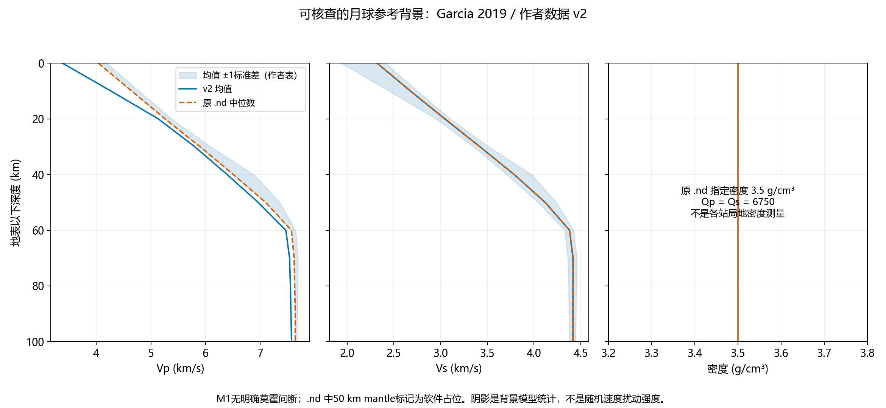

[完整节点CSV](tables/M1_median_0_100km.csv)；[均值速度CSV](tables/M1_mean_velocity_0_100km.csv)。图只展示上100 km，原始.nd保留全深度；不得以图的100 km截断替代长路径计算域设计。Qp/Qs为P/S波吸收设置，不是散射Q。

### 2. 已有的具体区域约束

[Kim2025](https://doi.org/10.1029/2024GL114506)正文§3（本地PDF第7页，期刊第6页）给出：

| 台站 | 壳厚 km | 平均月壳Vs km/s | 完整局地Vp/Vs/密度层表 |
|---|---|---|---|
| S12 | 32.2±6.7 | 2.6±0.4 | 不能由这两个数唯一确定 |
| S14 | 该文无对应结果 | 该文无对应结果 | 暂用统一后备背景 |
| S15 | 29.4±6.0 | 2.2±0.3 | 不能由这两个数唯一确定 |
| S16 | 41.1±10.6 | 2.9±0.6 | 不能由这两个数唯一确定 |

图中误差按作者正文的±报告值展示，不另命名为95%区间。当前四区域都可以使用上述完整M1作为有来源的后备背景；这不代表四区真实结构相同。S12/S15/S16存在局地约束，尚不能因此宣称已建立最可靠的完整区域剖面。禁止把平均Vs直接填满整个深度，或在M1上任意移动莫霍并称为论文模型。

### 3. 可直接审阅的散射模型输入

统一三维冯卡尔曼。旧起点a=4.5 km，浅0–5 km标准差9%，5–10 km为5%；ν待生产配置核齐后固定。它是搜索起点，不是四区各自最优结果。

首轮a={0.2,0.65,1.3,2,4.5,6} km，σ₁={3,5,9,12,15}%，σ₂=(5/9)σ₁，h₁=5 km，H=10 km，共30种散射参数组合/区域。随后在入围a/σ附近搜索H={10,15,20,30} km。各区用同一范围，观测决定地区差别。所有离散取值的文献动机见第二册；这些范围是项目设计，不是局地区域观测区间。

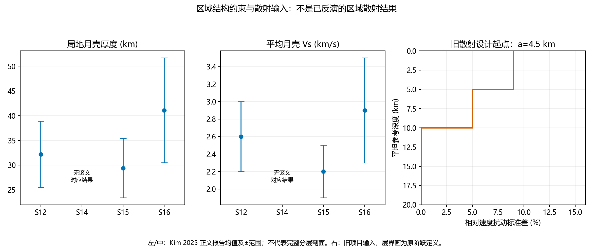

上述右图画旧阶跃幅度；新模型若采用第二册1 km余弦渐变，H为过渡中心，不应把两者冒称同一离散实现。真实起伏域按对应层界定义深度。随机介质三维切片暂不伪造：ν尚未核定，仅画明确的参数剖面。

[首轮30组候选参数CSV](tables/首轮30组散射候选参数.csv)。该表供四区域共同搜索使用，不是已完成的120次模拟。完整来源与各尺度的设计动机见[第二册](02_散射模型与参数设计.md)。

数据留档：`data/raw/background_models`下保存原始压缩包及提取文件。主模型压缩包MD5为`01ce54281b0df0e308bcd5d91e11664c`，已与作者仓库核对。均值不确定性绘图将上下界深度网格线性插值到均值网格；不将插值解释为新增分辨率。

---

## 源—站路径与固定背景下的三维冯卡尔曼散射模拟方案

> 区域结构更新（2026-11-05）：当前只采用S12、S14、S15三套独立模型，固定背景、莫霍、Q及材料CSV以[第08章](08_S12_S14_S15三个区域模型.md)和[第09章](09_三区域结构文献核对与背景更新.md)为准。本章旧M1/完整VPREMOON共同背景、W共享区域、12 km共同内壳界面及旧计算计数均保留追溯，不再作为执行输入。冯卡尔曼数学定义可继续参考，深度函数莫霍截断须换为本次区域界面；不新增其他模型族。尚未运行新波场。

版本：2026-11-05（详细方案）。本文件更新第二册中的区域组织、背景选择、深度参数化和计算矩阵。旧30组参数表保留追溯，本版首轮改为24组。**这是有明确数值的科学设计及材料表，不是已运行的CGFD3D配置，也不是区域反演结果。**

### 1. 首先决定：到底反演什么区域

建议采用“**源—站对提供观测，多条覆盖路径联合确定一个有效区域模型**”的组织方式。

单个台站只是接收位置。其波形受到震源附近、整条传播路径、台站附近及地下界面共同影响，强散射尾波还会访问直达路径之外的体积。把所有S12记录拟合出的参数直接称为“S12台站下方参数”是不成立的。另一方面，每个源—站对独立设置一套任意介质，会让同一地点在不同事件中拥有不同参数，也无法形成自洽的区域模型。

因此区分三种对象：

| 对象 | 本项目定义 | 如何使用 |
|---|---|---|
| 观测单元 | 一个撞击事件、一台站、一个有效分量及频带 | 保存质量掩码，计算单条残差 |
| 正演单元 | 一个事件及本次域内所有有效台站 | 一次波场计算同时提取多个站，避免按配对重复计算 |
| 反演单元 | 具有相互覆盖路径的一组空间区域 | 多个事件共享固定背景及散射统计参数；重叠位置使用同一随机场实现 |

本版不增加一套地质分区竞争试验。先做可辨识的路径组有效模型；只有现有记录支持空间拆分时，才将有效参数进一步解释为局地参数。

#### 1.1 当前观测集合允许的实际分组

距离来自项目已核查的[源站几何表](../../results/impact_audit/event_station_domains.csv)，不是本轮重新定位结果。“清晰”是先前文献审计状态，仍须按实际处理后记录核验准入。

| 组 | 首轮训练记录 | 独立事件检查 | 当前能回答的问题 |
|---|---|---|---|
| W：S12/S14西部重叠传播走廊 | A14SIVB→S12，175.41 km；A16SIVB→S12/S14，153.87/274.55 km；A15SIVB→S12/S14，355.35/185.54 km | A13SIVB→S12，135.86 km；A17SIVB→S12，337.58 km；A12LM→S12，73.01 km；A14LM→S12/S14，114.36/66.70 km | 首先估一个西部路径组有效散射模型；S12与S14残差分开报告，不预设二者相同地质性质 |
| N15：A15LM—S15近距走廊 | A15LM→S15，92.18 km | 当前集合无独立近距事件；长距记录只能作额外一致性检查 | 一条盆缘路径的条件性有效模型，不能扩称整个Hadley–Apennine区域 |
| L16：含S16的长距路径 | A17SIVB→S16，850.55 km | A17LM→S16为低信噪比，不自动纳入 | 暂不单独反演Descartes/Cayley局地散射参数；需要全路径建模及新增近距记录 |

W组为3个训练事件、5条源—站记录，4个检查事件、5条记录；加N15为原有8事件、11近距候选配对。A16SIVB→S14缺MHZ，仅合格水平分量参与，不补零。A17SIVB→S14低信噪比及缺分量记录不进入上述主集合。N15的单事件不能将随机种子重复当成新的观测事件。

**回答台站还是源站对：优先按实际源—站路径覆盖组织区域；台站名称只用于索引。** W组初始共用参数是当前数据条件下减少未知数的选择，不是证明月海与Fra Mauro高地散射相同。若共同模型持续不能同时解释合格记录，停止称其为统一地区结果；先排查数据、震源和固定背景偏差，而不是为了拟合任意增加分区。

### 2. 从Onodera 2022具体学习什么

本轮核对了本地论文正文§2.2–2.6、§3.1–3.3以及Figure 3、5、8、10；还核对了[作者公开仓库](https://github.com/Onodera0726/JGR_Onodera2022)。正文出处：[Onodera et al., 2022](https://doi.org/10.1029/2022JE007558)。

| 项目 | 原文能够确认的内容 | 对本方案的落实 |
|---|---|---|
| 事件逻辑 | 用A16SIVB→S12约束后，再用A14SIVB→S12检查并调整 | 多事件共享参数，不逐事件无限调参 |
| 随机场 | 三维各向同性指数自相关，是冯卡尔曼的特例；正文主比较a=650 m，生成速度场1σ约5%–10% | 本版明确固定ν=0.5，搜索a及实际场标准差 |
| 输入幅度 | 生成器ε=0.024–0.042与生成场1σ=5%–10%并列出现 | 不把ε原样移植到CGFD3D；统一用生成后的相对速度标准差验收 |
| 深度分布 | 初始强扰动约至5 km；Figure 8再比较渐弱、3.5 km薄强层、10 km厚强层，深部仍有弱扰动 | 用一个连续参数化表达强度、深浅幅度比及强散射厚度，保留深部弱尾段 |
| 拟合对象 | 峰值到达、能量变化、包络形状和三分量共同约束 | 不仅拟合尾波衰减斜率；不要求随机尾波逐相位重合 |
| 背景 | GRAIL/样品约束的密度—孔隙率—速度关系；地形与莫霍独立定义 | 平均背景与随机场分开冻结，H不控制背景速度界面 |

Figure 8不能支持“浅部10%一直恒定至10 km、10 km以下严格为零”这个简化。它也不能单凭图像给出所有小台阶的精确数字。本版没有将图上估读值冒充作者表格。

正文可直接重建的浅部关系为：

\[
\rho(d)=2308+786[1-\exp(-d/9.8)]\quad\mathrm{kg/m^3},
\]
\[
\phi(d)=1-\rho(d)/3094,\qquad
V_P(d)=\frac{7.15}{\sqrt{1-\phi}}\exp\left[\frac{(\phi^2-7)\phi}{2(1-\phi)}\right]\quad\mathrm{km/s}.
\]

这是A12相关建模背景，d以km计。原文以散射层Vp/Vs=2、固结层√3构造Vs。**本方案不让这个比值分界随待反演H移动**，否则每次修改“散射层厚度”也修改了平均Vs，违背只搜索散射参数的目标。

本轮出版社SI链接返回403，未取得Table S1、S4及各层完整输入；公开GitHub树只有README和9个模拟波形CSV，没有材料生成器或完整输入层表。故本版不声称逐项复现Onodera原始背景、Q或Case 4γ。公开波形已降采样至6.6 Hz并经过0.3–1.5 Hz滤波，它们适合方法对照，不能标成未滤波原始观测。

### 3. 固定背景的明确选择

#### 3.1 当前采用一个完整、有数值来源的月球平均后备模型

本版选用**Garcia 2011 VPREMOON在Garcia 2019作者归档中的`MoonGarcia_PEPI_2011.nd`**。前版M1保留为背景资料，不再作为本版生产设计的分层输入，也不与本版构成背景竞争试验。

选择理由是：原M1的50 km标签不是被定义/反演的莫霍，且上部密度统一指定为3.5 g/cm³；目前需要一个同时含明确浅层界面、壳幔跃变、Vp、Vs、ρ、Qp、Qs的可重建后备背景。选择VPREMOON并不意味着它是最新或唯一最优模型，而是当前有完整公开数值、且符合“缺完整区域结构时使用月球平均模型”的后备选择。

来源：[Garcia 2011](https://doi.org/10.1016/j.pepi.2011.06.015)、[2012勘误](https://doi.org/10.1016/j.pepi.2012.03.009)、[Garcia 2019综述](https://doi.org/10.1007/s11214-019-0613-y)、[作者归档](https://zenodo.org/records/21476963)。采用归档节点，不凭旧图重建；勘误涉及源位置及压力计算，长距扩展到深部前须另核其影响。本文件导出的0–110 km节点来自作者归档。

Kim2025给出的S12/S15/S16壳厚32.2±6.7、29.4±6.0、41.1±10.6 km及平均Vs是局地约束，不是完整速度、密度、Q剖面；尤其不能把单站壳厚平铺到数百km源站走廊。暂不把这些数强行拼入全域背景。S16局地壳厚与后备28 km差异较大，是不能声称本方案已完成S16局地模型的重要原因。Zhang2026等区域层表尚待完整核齐，未完成这一步不称“最终最可靠区域模型”。

#### 3.2 固定数值表

在高程h=0的参考柱中，输入如下。速度单位km/s，密度kg/m³。重复深度是界面上、下两侧，不可平均掉。

| 深度/层段 | Vp | Vs | ρ | Qp | Qs | 实施方式 |
|---|---:|---:|---:|---:|---:|---|
| 0–1 km | 1.00 | 0.50 | 2600 | 6750 | 6750 | 表层固定常值 |
| 1–12 km | 3.20 | 1.80 | 2762 | 6750 | 6750 | 上月壳固定常值 |
| 12–28 km | 5.50 | 3.30 | 2762 | 6750 | 6750 | 下月壳固定常值 |
| 28 km下侧 | 7.54 | 4.34 | 3312 | 6750 | 6750 | 明确壳幔跃变 |
| 40 km | 7.55 | 4.34 | 3314 | 6750 | 6750 | 与相邻节点线性插值 |
| 65.4 km | 7.57 | 4.35 | 3318 | 9000 | 4000 | 与相邻节点线性插值 |
| 90 km | 7.59 | 4.36 | 3322 | 9000 | 4000 | 与相邻节点线性插值 |
| 110 km | 7.61 | 4.37 | 3325 | 9000 | 4000 | 供100 km试算域插值；不把110 km当全模型底界 |

源文件：[原始.nd](../../data/raw/background_models/MoonGarcia_PEPI_2011.nd)；[导出节点CSV](tables/固定背景_Garcia2011_原始节点_0_110km.csv)。在12、28 km处保留跃变；连续段内包括Q均使用作者节点线性插值，此插值规则是本项目固定实施规则。ρ以SI单位输入CGFD3D；图/原始CSV仍标g/cm³，明确乘1000转换。

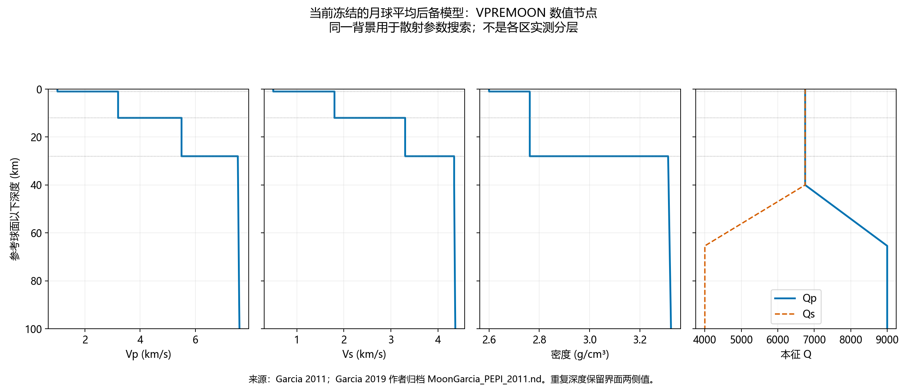

#### 3.3 Q具体怎样固定

表中的Qp、Qs表示P/S波**本征吸收**，不是散射Q。随机速度起伏已经显式产生散射，不能再将文献散射Q当吸收输入，否则重复衰减。上述Q是归档材料字段，不称各走廊独立反演得到的Q。

选择目标为准入频带内近似常Q，参考频率1 Hz；采用CGFD3D实际支持的吸收实现。松弛机制参数须由目标Q和频带转换，不能把Q数值直接当阻尼率。材料输入验收时做均匀介质传播检查，在0.3、0.6、1.0、1.5 Hz等落入准入带的频点核对衰减和相速度。目标Q偏差不超过5%作为项目验收阈值，验证之后固定；超差先修正吸收实现，不靠加大σ弥补。未确认求解器接口前，不能称已完成吸收配置。

固定Q得到的是“条件于这个Q背景”的散射参数。不同时反演Q，不宣称Q不确定性已经消失。尾波衰减严重不符时，应停止区域物性解释并查明背景问题。

### 4. 地形与地下界面的三维几何

采用R=1737.4 km参考球。对位置(λ,φ,r)，定义LOLA高程h(λ,φ)、地表半径rs=R+h，以及当地地表以下深度d=rs−r。背景深部参考深度z=R−r。两种深度不可混用。

固定界面如下：

1. 自由表面r=R+h，取真实LOLA，不扫描平地版本。
2. 表层底r=R+h−1 km，即当地地表下1 km；表层厚度固定。
3. 上/下月壳界面r=R−12 km；莫霍r=R−28 km，为后备模型同心球面。
4. 28 km以下按参考球深度读取月幔节点。地形不能简单向下复制到所有深部界面。

上述浅层随地形、深层同心球面的组合是**本项目三维化规则**，不是从LOLA观测到了地下界面。LOLA只约束地表。在获得可靠区域地下界面图之前，不凭陨石坑轮廓或DEM颜色创造地下结构。固定背景在所有散射候选中逐网格相同。

当前已核验LOLA LDEM_64原生裁片，64像元/度，南北采样约474 m。文件`data/raw/lola_impact_64/ldem_64_W38_E40_S18_N40_native.npz`包含原始DN、经纬度及比例。高程m=DN×0.5，不能重复减参考半径。旧`ldem_64_float.img`尺寸异常，不使用。生产映射统一采用双线性插值，保存映射后的高程数组与哈希；不因速度模型不同再次平滑地形。不标注小于2 km的地貌名称，但也不以2 km作为擅自删除地形的阈值。

LDEM_64是已验证的当前产品，并非处处独立474 m测量。如果正式网格需要更高采样的LOLA产品，先统一更换并冻结全组地形，然后全部候选重用；把474 m插到25 m不叫获得25 m新地形。来源：[PDS产品说明](https://ode.rsl.wustl.edu/moon/pagehelp/Content/Missions_Instruments/Lunar%20Reconnaissance%20Orbiter%20%28LRO%29/LOLA/GDR/GDRDEM.htm)。

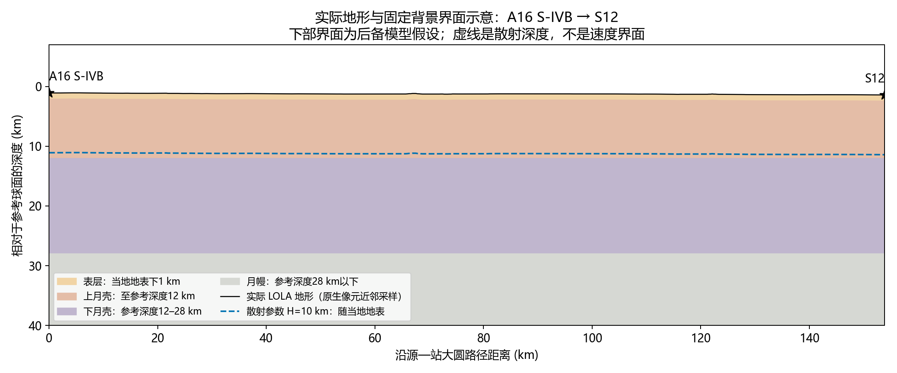

图沿A16SIVB—S12大圆路径，从实际原生地形近邻取样，仅用于展示；生产插值规则见上。横轴距离、纵轴深度采用不同尺度，图有垂向夸大，不能据此判断真实坡角。蓝虚线是示例H=10 km，和速度界面不相同。

### 5. 唯一随机介质族：三维冯卡尔曼

\[
V_P(\mathbf x)=V_{P0}(\mathbf x)[1+q(\mathbf x)],\qquad
V_S(\mathbf x)=V_{S0}(\mathbf x)[1+q(\mathbf x)],
\]
\[
q(\mathbf x)=\sigma(d;\theta)\eta(\mathbf x),\quad
\langle\eta\rangle=0,\quad\langle\eta^2\rangle=1.
\]

P/S使用同一个相对扰动场，因此局地Vp/Vs保持背景比值；ρ、Qp、Qs不加随机扰动。此耦合是明确的项目选择，不声称Onodera和旧项目都采用相同设置。

各向同性三维谱为：

\[
P_\eta(k)=A\,[1+(ak)^2]^{-(\nu+3/2)},\qquad k\text{以rad/km计}.
\]

本版新设计固定ν=0.5，因而P∝[1+(ak)²]⁻²，自相关为exp(−r/a)，与Onodera指数特例一致。**这不是声称查明旧论文生产ν=0.5**；旧ν仍未核定。旧项目继承的是a=4.5 km、浅/深9%/5%的设计参照，不能将本版波形称作旧生产模型复现。若后续必须严格继承已核定的另一ν，应统一改版后冻结，不增加ν竞争分支。

FFT生成要乘√P而非P；实空间白噪声经谱滤波后回到实场，去均值并归一化，再乘σ(d)。k=2πf空间，不能把cycles/km直接代入ak。随机场在物理距离坐标中生成，不在拉伸曲线网格的索引距离中生成。地形和非均匀深度包络会使最终场非平稳，冯卡尔曼定义针对母体场η。

每个候选、每个种子在W母域生成一份场，各事件截取相同位置的同一场。禁止每个事件重抽介质来挑最好拟合。初筛使用共同随机相位，减少候选比较中的随机差；最终用5个种子检查统计稳定性。

### 6. 速度扰动强度—深度关系：明确函数和数值

采用四个待估统计量：**θ=(a,σ0,b,H)**。σ0是浅层相对速度标准差，b控制下部强散射层相对浅层的幅度，H是强散射平台结束深度。所有深度相对当地地表，H不是莫霍，不改变Vp0或ρ。

#### 6.1 名义分段关系

| 地表下深度 | 相对扰动标准差 | 参数地位 |
|---|---|---|
| 0至H/2 | σ0 | 待搜索幅度 |
| H/2至H | bσ0 | 待搜索深浅比例 |
| H至H+5 km | 从bσ0余弦衰减至1% | 过渡长度固定5 km |
| H+5 km至莫霍上方1 km | 1% | 固定深部弱扰动假设 |
| 莫霍上方最后1 km | 平滑降至0 | 固定终止规则 |
| 月幔 | 0 | 当前只反演月壳随机非均质 |

H/2处采用全宽1 km余弦平滑，避免随机场幅度硬截断。弱扰动1%、5 km尾段及莫霍处归零均为项目闭合假设，**不是Onodera原文精确数值**。如果H+5已接近/超过莫霍，尾段受莫霍窗截断，不强行扩展到月幔；保存该位置实际σ(d)。这些假设固定，不新增深部尾段竞争模型。

给出可直接编码的函数。定义下降窗

\[
T(d;c,w)=\begin{cases}
1,&d\le c-w/2,\\
\tfrac12[1+\cos(\pi(d-c+w/2)/w)],&|d-c|<w/2,\\
0,&d\ge c+w/2.
\end{cases}
\]

则

\[
\sigma(d)=\{0.01+(b\sigma_0-0.01)T(d;H+2.5,5)
+(\sigma_0-b\sigma_0)T(d;H/2,1)\}\,
T(d;d_M-0.5,1),
\]

其中dM=rs−(R−28)=28+h，是当地地表到固定莫霍的距离。单位均为km；σ是小数而非百分数。这样H改变时，仅随机扰动深度分布变化，背景材料和所有界面完全不变。

参考输入取a=4.5 km、σ0=0.09、b=5/9、H=10 km：浅平台9%，第二平台5%，10–15 km衰减至1%，更深为弱扰动至莫霍。这保留旧设计的浅层幅度参照，同时显式补充本次的弱深部尾段，**不再称为旧模型逐点复制**。

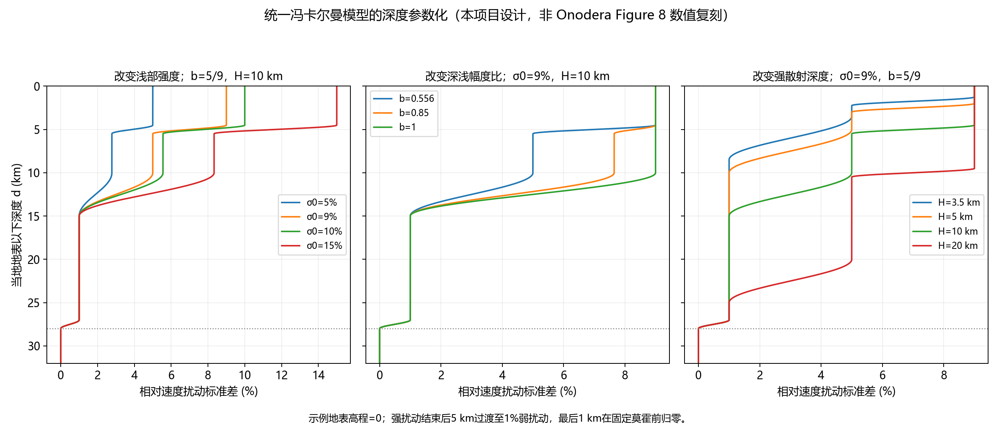

图中改变的均是同一冯卡尔曼随机介质族的参数，不是引入不同物理机制；所有曲线都是项目设计，未拟合观测。

#### 6.2 参数搜索的具体取值及来源

| 参数 | 本次节点 | 依据与限定 |
|---|---|---|
| a/km | 0.2、0.65、1.3、2、4.5、6 | 0.65直接对应Onodera2022主对照；0.2来自Onodera2021浅层尺度背景；2来自已有月壳数值研究背景；4.5为旧最终设计；1.3和6为项目布点。二维尺度不作为三维已反演值 |
| σ0 | 5%、9%、10%、15% | 5%/10%覆盖Onodera生成场标准差，9%继承旧设计，15%为项目外扩 |
| b | 5/9、0.85、1.0 | 5/9继承旧幅度比；0.85与1为检查深部维持强扰动的项目节点，不称Figure 8精确读数 |
| H/km | 3.5、5、10、20 | 3.5/5/10对应Onodera薄层、初始、较厚强层的深度动机；20为项目外扩；本版不同时搜索50/80 km |
| ν | 固定0.5 | 明确采用冯卡尔曼指数特例 |
| 深部弱σ | 固定1% | 项目闭合假设；不由论文图像反推 |

浅平台分界采用H/2，是本项目参数化选择，可让H=3.5 km时仍有两段有效平台，且在旧H=10 km时恰为5 km。不能同时又固定h1=5 km，否则H<5 km时产生空层及冗余参数。

同一(a,σ)在不同背景Vs、频率和深度下散射效率不同。最终同时报告a、σ(d)、H、频带及固定背景，不能只以σ大小给所有地区排“散射最强”。a不是平均自由程，也不直接等于陨石坑直径。

### 7. 从统计模型到材料网格的检查

1. 先生成并冻结背景Vp0、Vs0、ρ0、Qp、Qs和界面；哈希写入每个候选清单。
2. 在加宽母域生成η，边界至少留6a的统计缓冲，生成后裁去FFT周期边界影响。缓冲不是波动计算PML。
3. 统一使用实际截断到网格可分辨波数的谱，在相同网格与带宽上归一化。提高网格分辨率会增加指数谱高波数功率，收敛检查时应固定物理谱截止，不能把介质改变误认为数值误差。
4. 在远离地表、界面与过渡的统计窗检查均值、标准差、三方向ACF及PSD；分层绘制实际RMS随深度。归一化母体η，不逐水平面强制标准化破坏垂向协方差。
5. 统计目标误差暂定：均值绝对值<0.05σ，充分大统计窗的RMS偏差<5%；小窗给出抽样误差，不强行修正。ACF与理论比较时以有限网格截断后的目标谱为准。
6. 检查Vp>0、Vs>0、ρ>0、μ=ρVs²>0、K=ρ(Vp²−4Vs²/3)>0；保存极值。高斯场无硬界限，若罕见实现产生非物理速度则拒绝该实现并记录，不能静默截断却仍称原分布。
7. 所有候选密度、Q、地形、源、吸收边界不变；随机种子固定为1105、2113、3251、4421、5563。这些种子是项目复现标识。

### 8. CGFD3D的计算域、网格与资源

#### 8.1 域与曲率

采用[现有事件域表](../../results/impact_audit/local_simulation_candidates.csv)作为几何起点，同一事件的S12/S14一起输出。原表50 km缓冲仅为初始值，不能认定适用于尾波。有效空间先含源、所有接收站及50 km侧向缓冲，底深先取参考深度100 km；PML在此之外。

PML初始20个网格点，作为数值试算设置而非通过验证的结论。对入围模型将侧向缓冲50增至100 km、底深100增至150 km，检查所拟合0–600 s窗的包络、峰时和能量。如果差异超过5%或峰时超过15 s，继续扩域或缩短可解释时间窗。吸收边界仅能减小假反射，不能补回被小域移除的真实散射回返能量。域检查属于同一模型的数值验收。

月球曲率必须保留：本项目175 km路径弓高约2.2 km，355 km路径更大，已经不可忽略。使用球面/曲面映射的真实物理度量；CGFD3D若只有平面地形实现，需要先核实曲率接入，不能仅把经纬度乘常数后当作球面波场。850 km以上记录不纳入本轮局地计算预算。

#### 8.2 频率、网格和时间步不能凭经验写死

候选分析带为0.3–0.9 Hz，扩展至0.9–1.5 Hz须逐记录响应、噪声及清洗结果支持。它们是设计候选，不是所有站已验收频段。用户不要求固定0.3–0.5 Hz，故本版不使用该窄带作为唯一目标。观测与合成必须采用相同带宽和算子；原始/已发表清洗波形另外保存，不覆盖。

网格要求采用实际扰动后最小Vs和最大Vp计算：

\[
\Delta_{\max}\le \min\{V_{S,\min}/(N_\lambda f_{\max}),a_{\min}/5\},
\]

Nλ暂取8作为设计值，最终依CGFD3D实际差分算子及色散测试。以Vs,min=0.30 km/s、fmax=0.9 Hz计，波长限制约41.7 m，a_min=0.2 km要求40 m；取浅层25 m作为试算目标。若fmax=1.5 Hz，波长限制为25 m。实际场Vs更低则继续加密，不能将0.30视为保证下界。

时间步初始采用保守估计Δt≤0.35/[Vp,max√(Δx⁻²+Δy⁻²+Δz⁻²)]。均匀25 m、Vp,max=8 km/s给约0.00063 s，可先取0.0005 s；这不是曲线网格的稳定性证明，最终用实际度量、吸收实现和代码CFL条件计算。

上述表层Vs=0.5 km/s会使成本很高，这是采用真实低速背景需要正视的代价。仅按300×200×100 km、均匀25 m估计就有约3840亿节点；每节点20个float32字段约30.7 TB，尚未含PML、通信和临时数组。**不直接提交整个候选矩阵。** 先核实旧CGFD3D是否支持稳定的分层加粗/非均匀网格、已有生产并行规模与可用资源。深部加粗只能在真实算子允许、保持局部波长与a解析度时采用。资源不足时，统一调整可支持频带与网格，并明确哪些小a仍可分辨，不能悄悄提高最小速度或删去低速层。

初始模拟时长1200 s，主要拟合首波后至600 s内的能量增长及早尾波。若2倍峰时超出有效模拟/观测窗口，该记录不计算相应指标，不截短后冒称完整尾波。全1–2小时尾波不作为首轮要求。

### 9. 震源与观测算子也必须冻结

每个事件建立唯一源文件：坐标、月面撞击时刻、源类型、埋深、时间函数、方向/矩张量、幅度及来源。已有NASA时间字段有Earth-received含义，不能不作时间基准核对就称月面t0。不得重复减1.3 s修正。

S-IVB优先沿用旧项目已验证源实现及该事件已发表参数；LM单独建立事件源，不继承相同标定。没有可核验的事件源时间函数时，本版给出设计默认值：各向同性Mxx=Myy=Mzz、非对角为0，0.1 km等效埋深，因果半余弦矩率脉冲持续1 s、积分归一为1。该默认值是线性远场等效源假设，不是撞击深度测量或已证实最优源；源近场排除在拟合之外。1 s选择需在散射搜索前检查是否覆盖所有准入频带，有问题统一修订源文件后冻结，不逐候选修改。

若绝对矩/力未由独立证据确定，主拟合采用归一化包络、峰时及相对分量能量；不得声称恢复绝对能量或撞击效率。允许对每个事件用同一个标量振幅因子联合匹配其所有站及分量，并明确它是消去的干扰参数；不得每个台站/分量独立缩放而再声称解释了相对振幅。

保留合格处理结果的出处和缺样掩码。偏振滤波、去仪器响应及其他非标量算子须对模型施加相应观测算子，或在主拟合中使用对全波场能量无此选择性偏置的已发表处理产品。偏振增强后的直达波记录不自动适合散射尾波能量反演。对缺分量仅比较可观测子集，不把两分量能量称三分量总能量。

### 10. 具体计算矩阵：只比较散射模型

阶段A：固定b=5/9、H=10 km，6个a×4个σ0，共24个候选；先用种子1105。W组每候选3个事件，共72次传播，得到5条配对；N15每候选1事件，共24次。不是24×4台站重复计算。

阶段B：保留阶段A中3组不同(a,σ0)的优选组合，各扫描3个b×4个H，共36组；其中3组与阶段A已有b=5/9、H=10重复，实际新增33组。每个区域参数集合共57个不同组合。W累计171次事件传播，N15累计57次。

阶段C：每组最终3个候选增加4个种子，使总重复达到5。W新增3候选×4种子×3事件=36次；N15新增12次。W训练总计207次，N15总计69次。W的4个独立检查事件，对3个候选×5个种子计算，共60次。

**合计规划336次事件级传播**，不含域/网格验收、故障重跑及边界外扩。此数是预估计划，未执行；前期测算资源和统计区分度后允许缩小保留集合，但需记录删减规则。若最优贴在a、σ或H边界，下一批扩展边界，而不是把边界值当精确结果。

阶段B只围绕初筛前三点，可能漏掉与深度参数存在强权衡的另一a/σ盆地。因此这是分阶段模型筛选，不是穷尽288组全网格或已得到全局最优。检查入围集之外的近优a/σ是否具有明显不同残差形态；有则纳入同一参数族的扩展搜索，并更新作业数量。不得以57组称完成完整后验采样。

阶段A参数见[24组表](tables/新版首轮24组散射参数.csv)，固定项与搜索项见[方案JSON](tables/详细模拟方案_固定项与搜索项.json)。JSON是设计清单，不是可直接被CGFD3D读入的参数文件。

### 11. 怎样判定最合适的模型

首先使用所有候选共有的有效记录、分量、频带和时间窗。弱记录缺失率不能因某模型拟合更好而临时放宽。

对速度平方构造能量序列，扣除估计的噪声能量并保留掩码，再用30 s窗、15 s步长平滑作为Onodera方法参照。短事件若该窗不可用则在搜索前统一设定新窗。缺样窗口按实际有效占比判定，不插零造成虚假衰减。

主要评分采用有效窗内归一化对数能量包络残差，噪声底以下不取对数拟合；按事件等权、再在事件内按台站和合格分量等权，防止多站事件或长记录支配目标。正演的5个随机实现给出模型均值及离散度，不挑单个最好种子。

另外列出以下诊断，不重复堆叠为未经标定的总分：

- 首波至能量峰的时间差及包络上升宽度；30 s窗意味着峰时精度不能声称远优于15 s。
- 峰值/有效窗平均幅度比，明确采用幅度还是能量，不能直接混用Onodera的不同指标定义。
- 有效窗累计能量曲线及晚/早能量比。
- Z/R/T相对能量，在有效旋转和合格分量均齐全时使用。
- 文献预期表面波强峰是否仍明显存在；若缺失分量则相应诊断不计。

绝对波形相位仅辅助看首波及可辨识相位，随机尾波不以逐采样点L2作为唯一误差。最终报告“在冻结背景与频带下最受支持的候选集合”，包含多事件残差、随机种子离散、边界贴靠及参数权衡。未定义概率似然和先验时，不把候选排名称贝叶斯后验。

W模型若在训练集表现良好但不能解释留出事件，不能称区域通用模型。N15因为只有一条近距事件，其(a,σ0,b,H)通常会高度权衡；报告接受范围，必要时固定b/H仅给a/σ条件约束，不强求四个精确值。S16现阶段不提供虚假的局地最优表。

### 12. 实施顺序与交付状态

| 次序 | 具体工作 | 验收输出 |
|---|---|---|
| 1 | 按本版选择冻结背景，核对原文件及单位、双深度跃变、Q映射 | Vp0/Vs0/ρ/Q材料表与背景剖面 |
| 2 | 根据实际事件域读取LOLA，曲面坐标和地形/地下界面分别保存 | 地形数组、分层界面、源站位置图及剖面 |
| 3 | 接入CGFD3D实际源/吸收/网格接口并完成小规模稳定性和成本测量 | 可复核的单作业配置、内存与耗时估计 |
| 4 | 按本函数生成随机介质，验收σ(d)、ACF、PSD、极值和背景哈希一致性 | 各候选材料统计与切片 |
| 5 | A16/A14→S12先验证流程，再加入W训练的同源多站 | 数据与合成相同算子的包络对照 |
| 6 | 按A/B/C阶段筛选，保留同源多站联合残差 | 候选排名、接受集合、种子误差 |
| 7 | 运行W留出事件；单列N15条件结果；S16不越界解释 | 路径组参数表、预测能力和局限 |

本轮已完成：数值背景表、明确的固定几何规则、四参数深度函数、24组首轮表、作业计数、3张设计图，以及正文/公开仓库证据核对。尚未完成：Onodera补充输入获取、各走廊最可靠区域完整背景核齐、CGFD3D生产接口与资源核验、事件源冻结、正式传播和观测反演。**因此当前可以评审设计，但不能把图件称为三维材料生产验收或模拟结果。**

### 13. 关键来源与证据身份

| 来源 | 用途 | 不支持的推断 |
|---|---|---|
| Onodera2022，§2–3/Figure 8，doi:10.1029/2022JE007558 | 三维随机介质、两事件检查、深度分布和包络方法 | 不提供本方案4个地区已测得参数；未取得SI不能填原表Q |
| Onodera2021，doi:10.1029/2020JE006406 | 较小尺度及路径侧向变化的研究背景 | 二维幅度/上限不直接等于三维标准差 |
| Garcia2011及Garcia2019归档 | 本版完整固定背景数值节点 | 不是所有台站局地最可靠实测结构 |
| Kim2025，doi:10.1029/2024GL114506 | 台站局地壳厚/平均Vs约束 | 不能单独生成完整ρ/Q/Vp/Vs层表 |
| Nunn2024，doi:10.3847/PSJ/ad83d2 | 人工撞击记录与分量可用性审计 | 文献“清晰”不替代本项目逐记录准入 |
| PDS LOLA及本地下载溯源 | 真实地形表面 | 不观测地下界面，也不等于输出网格分辨率 |
| 旧最终论文设计文件 | a=4.5 km、0–5 km 9%及5–10 km 5%参照 | 不证明旧ν、随机耦合或吸收开关已核定 |

材料归档补充包MD5已核对为`0a21ba7875a3c22ecab76b30c936cd5d`。图表由本地作者数值节点、已核查源站几何及LOLA裁片生成；扰动深度曲线为明确标识的项目设计函数。

---

## Zhang等（2025）Apollo被动地震数据清洗论文综述

更新：2026-10-29。阅读目的：理解Apollo记录中的仪器和采集伪信号，判断其如何影响尾波与散射研究，并确定哪些方法可以迁移到本项目。文中“作者结果”“本文解读”和“项目建议”分别表述；没有把带通滤波等同于完成该论文的清洗。

### 1. 论文与阅读入口

**Xiang Zhang, Philippe Lognonné, Taichi Kawamura, Zongbo Xu, Henri Samuel, Grégory Sainton, Marouchka Froment, Sabrina Menina, Keisuke Onodera (2025). Methods for Cleaning Apollo Passive Seismic Data. Earth and Space Science, 12(12), e2025EA004710.** 首次在线发表日期为2025年12月17日。

- [出版社全文](https://agupubs.onlinelibrary.wiley.com/doi/full/10.1029/2025EA004710)
- [出版社PDF原文（17页）](https://agupubs.onlinelibrary.wiley.com/doi/pdf/10.1029/2025EA004710)
- [DOI永久入口](https://doi.org/10.1029/2025EA004710)
- [作者公开数据与MATLAB代码](https://doi.org/10.18715/IPGP.2024.lsc22f10)
- [本项目BibTeX](references/waveform_cleaning_reference.bib)

阅读时优先看Figure 2、4、8、9、10以及Table 2、3。前两图帮助识别问题，中间两图展示如何清洗，最后一图将清洗与尾波参数联系起来。本文按章节、图表定位，方便与原文核对。

**本次阅读范围。**已读取出版社17页正文的完整文本，并按章节、图注和表格核对方法与统计。项目保存了[带页码及行号的正文提取文本](sources/publisher_pdf_web_extracted.txt)、[获取情况](sources/acquisition_status.json)和[引用元数据](sources/crossref_metadata.json)。正文标明采用Creative Commons Attribution开放许可。

出版社PDF直接下载返回403，在线页图截图也未成功，因此项目目前没有PDF原件；上面的PDF链接供直接阅读。图表讨论依据正文、图注及可解析表格，没有据未显示的图像读取曲线数值。补充材料尚未取得，作者代码和公开波形尚未运行或复现；本综述不将这些部分写成已核实结果。

### 2. 核心贡献与结论边界

这篇论文的核心贡献是：**把Apollo波形中几类容易混淆的技术伪信号区分开，针对其中部分问题提出修正方法，并展示修正可能改变用于解释月球散射和衰减的观测指标。** 它首先是一篇数据方法论文。

作者着重处理两类问题：一种是在记录上叠加具有仪器响应形态的瞬态信号，即glitch；另一种是Apollo 14数字采集造成的幅值偏移和削顶。二者的产生环节、波形特征与可恢复程度不同，不能用一套普通带通滤波替代处理。论文也整理了尖峰、标定信号、时间及档案问题。〔§2–3〕

它没有给出本项目需要的各区域相关尺度、速度扰动RMS和扰动层厚，也没有通过三维模拟证明某个区域的散射模型最优。对我们的作用，是提高用于约束模型的观测可信度，避免将仪器异常误解释成地下非均质或地形效应。〔本文解读〕

### 3. 为什么必须区分不同档案的“原始数据”

论文实际分析使用JAXA解码Exabyte磁带后的ASCII数据。它同时回顾了早期IPGP miniSEED与Nunn等2022年重新整理档案的不同做法：有的版本为固定采样率而重采样，有的版本保留数字计数、将实际时间信息另存。作者强调，不同档案已经修过哪些问题、还保留哪些问题，必须先弄清。〔§1、§2.2〕

与本项目直接相关的三点是：

1. **DU不是物理振幅。**采集为10位数字量，通常用0–1023表示；地面位移或速度需要与仪器模式和响应相联系。
2. **时间不完全均匀。**实际采样随时间变化，地面站切换和软件时钟还可能带来更复杂问题。仅有一个标称采样率不能证明全记录时间已准确。
3. **档案缺样不等于仪器跳变。**传输错误、损坏帧或被档案排除的数据，与有数值但被伪信号污染的数据，应分开保存和判断。

我们当前使用EarthScope发布的XA档案，并保留ATT。不能直接复制作者针对JAXA记录做过的每项校正，否则可能重复修正时间或误用已经改变的样点。这里的“保留原始”，应理解为保留本次下载版本及其元数据，而不是假设存在一种无需说明来源的唯一原始波形。〔项目应用〕

### 4. 论文识别了哪些问题

| 问题 | 原始波形或计数分布中的特征 | 论文的解释与处理方向 | 不能混淆的边界 |
|---|---|---|---|
| Glitch：仪器瞬态响应 | 快速出现、随后缓慢回到基线；可持续十至数百秒，形态受仪器模式影响 | 用仪器对加速度、速度和位移阶跃的响应组合拟合，再减去伪信号 | 不是一个普通缺样点，也不是所有高振幅都应被删除 |
| S14幅值偏移 | 某些DU区间在直方图中缺失，波形不对称，多通道同时出现 | 根据异常幅值区间作分段平移，尝试恢复合理分布 | 这是幅值轴上的缺档，不是时间轴上缺失了一段记录 |
| S14内部削顶 | 在447、511等内部DU值附近形成平台或直方图峰，未必触及0或1023 | 识别并限定用途；平移修正不能恢复已被截掉的变化 | 不能只检查ADC两端0/1023就断言没有削顶 |
| Spike：少量样点尖峰 | 单点或少量点突变，缺少稳定的仪器衰减形态 | 结合既有去尖峰方法或位翻转的计数关系修正 | 单点离群与持续glitch不是同一种拟合问题 |
| 标定信号 | 已知地面指令触发，常成对出现，形态受仪器响应控制 | 借助指令时刻及响应模型识别；与事件重叠时才讨论去除 | 标定信号可以很像glitch，需要日志支持 |
| 传输、存储与时标异常 | 缺样、重复帧、站间错配、时间跳变等 | 先确认档案版本的已有修正，损坏区需要单独标记 | 插值产生的数值不能重新标为实测观测 |

定位：glitch见§2.1.1/Fig.2–3；S14畸变见§2.1.2/Fig.4–6；尖峰见§2.1.3/Fig.7；标定见§2.1.4；档案问题见§2.2。

**对“空白”的重要补充：**论文讨论的S14直方图“无记录区间”常指某些幅值代码没有出现，并不表示该时段没有采样。我们之前讨论的波形空白则是在时间轴上缺样或被处理排除。二者都可能被叫作gap，但其物理含义完全不同。

### 5. Glitch清洗方法如何工作

#### 5.1 在原始DU域拟合具有物理形态的伪信号

作者先根据LP peaked、LP flat或SP选择仪器响应，再用仪器对三种阶跃输入的响应作线性组合。为了说明方法，可将局部拟合模型写成：

\[
\widehat d(t)=b_0+b_1(t-t_g)
+A_a g_a(t-t_g;\theta)
+A_v g_v(t-t_g;\theta)
+A_u g_u(t-t_g;\theta).
\]

这里，\(g_a,g_v,g_u\)分别表示仪器对单位加速度、速度和位移阶跃的响应；\(t_g\)是伪信号发生时刻；\(\theta\)表示响应参数。**这是本综述的符号化解释，不是原文给出的编号公式。**

拟合包括阶跃幅度、发生时刻和响应参数，也容许偏置与线性趋势。论文对LP涉及\(K_2\)，SP对应\(G_1\)，另有阻尼\(h\)和固有频率\(f_0\)，采用混合拉格朗日乘子法与网格搜索；网格搜索涉及响应参数及发生时刻。不能把完整问题简化成“总共只有四个未知量”。〔§3.1〕

清洗时，作者从原始记录中减去拟合的阶跃响应组合，**不将拟合的偏置和线性趋势一并减掉**。其意图是尽量保留伪信号之外的原始波形，而非把整段数据重新塑造成一个理想波形。也正因为拟合窗口中含有真实地震信号，必须检查拟合是否把真实信号一起吸收。后一点是本项目应用时需要验证的风险。

#### 5.2 插值和拟合窗的实际设置

| 项目 | 原文设置 | 解释 |
|---|---|---|
| LP内部时间细化 | 三次样条插值8倍至53 samples/s | 用于更细地估计glitch发生时刻，不增加仪器真实带宽 |
| 拟合起点 | 源时刻前120点，约2秒 | 这里是细化后的时间网格，不是原始LP的120点 |
| LP peaked事件后窗口 | 4800点，约90秒 | 随响应衰减尺度选择 |
| LP flat事件后窗口 | 8000点，约150秒 | flat模式通常需要更长窗口 |
| SP事件后窗口 | 1200点，约22秒 | SP响应尺度较短 |

定位：§3.1。原文保留了约数；不应将这些窗长变成所有事件的自动固定删窗。

Figure 8展示一个较清晰的单glitch去除例子，既有局部拟合和残差，也有整个撞击记录的前后对照。它支持“这种模型能够解释并去除某些明确的单个瞬态”，但不证明所有重叠、长周期或饱和glitch都能处理。作者把多glitch联合或迭代拟合作为改进方向，并明确提醒不完整或超过记录限幅的情况需谨慎。〔§3.1/Fig.8〕

#### 5.3 为什么普通带通不能代替这一步

论文指出glitch能量可以进入LP较敏感的频率范围。若它与月震信号在频带上重叠，保留目标频带的带通也会保留它。仪器响应校正还可能改变其形状。因此，“去响应+带通后更像月震尾波”不意味着伪信号已经被移除。对于散射研究，必须检查峰值附近的原始DU形态，并在清洗后比较局部残差、包络和谱，而不是只看图是否更平滑。〔§2.1.1、§3.1及项目解读〕

### 6. S14数字采集失真：最需要谨慎迁移的部分

#### 6.1 幅值偏移与内部削顶不同

作者发现某些异常跨多个通道同时发生，且计数阈值具有64 DU间隔等规律，提出复用A/D系统中某些位受限或翻转的解释。例如原文以第5低有效位由1变0说明16 DU偏移：470可以变为454。〔§2.1.2〕

这是一种有数字结构和跨通道现象支持的机制解释，作者同时承认缺少能复现当年硬件故障的技术实验验证。不能把“可能的位故障”写成已完全证明的唯一成因。〔§3.2〕

以下为Table 2报告的**最小确认时段**和计数缺档。边界随信号是否达到异常阈值才可识别，不等于硬件故障的精确开始/结束时刻。

| 计数缺档 | 1973-01-18至1973-07-20 | 1974-07-06至1977-09-30 |
|---|---|---|
| 第一段DU | 407–415，共9个代码 | 404–415，共12个代码 |
| 第二段DU | 469–479，共11个代码 | 464–479，共16个代码 |
| 第三段DU | 537–543，共7个代码 | 534–543，共10个代码 |
| 第四段DU | 598–607，共8个代码 | 594–607，共14个代码 |

Figure 9展示平移后波形和直方图更对称，但仍有削顶。作者明确说明：恢复类似高斯的分布不保证精确恢复原始信号；错误应用修正仍可能产生错误数据。幅值已经被压成同一个值时，丢失的信息不能仅通过平移找回。〔§3.2/Fig.9〕

#### 6.2 对我们九次人工撞击的含义

当前事件发生于1969—1972年，**均早于Table 2两段明确列出的幅值偏移时段**。不能据这张表，给本批S14波形直接加减固定DU。另一方面，论文指出S14前两年曾在511 DU发生内部削顶，并讨论了不完全受Table 2时段限制的479 DU计数偏少现象；因此，时间不重合也不能证明我们的S14记录没有采集问题。〔§2.1.2及本项目事件表〕

适当做法是逐事件、逐分量检查DU直方图、连续平台、差分序列和同时发生的多分量异常。只有观测确实符合某种异常机制，才进一步讨论修正；不能为了让直方图接近高斯而强行改变真实的非平稳地震信号。后一句是本综述的方法学判断，不是作者提供的自动判据。

### 7. 数据清洗效果：样本和分母要读准确

作者从Nakamura目录的1743次天然陨石撞击中，按包络幅度选择最大的116次，再人工查看四台站记录，并筛选峰峰值超过20 DU的记录。统计链为：〔§4/Table 3〕

| 层级 | 数量 | 不能如何解读 |
|---|---:|---|
| 天然撞击目录事件 | 1743 | 不是本项目人工撞击目录 |
| 选出的较大撞击事件 | 116 | 不是所有月震的随机样本 |
| 四台站各分量记录 | 1595 | 不是1595个独立事件 |
| 满足幅值筛选的记录 | 390 | 不能推断其余1205条均因伪信号而报废 |
| 其中较好记录 | 128 | 有些仍含容易去除的尖峰 |
| 其中伪信号污染记录 | 256 | 与饱和记录单列 |
| 其中作者判断可处理 | 182 | 是256条的子集，不能再与256相加 |
| 饱和/超限记录 | 6 | 未被证明能完整恢复 |

校验：128+256+6=390。182/256约为71.1%，它描述该幅值筛选样本内污染记录的可处理比例，**不是全Apollo档案71.1%的修复成功率**。128+182=310只是依据分类得到的潜在较好或可处理记录数，也不是310个独立撞击事件，更不表示作者发布了310条完整三分量清洗成果。〔算术推导与边界解释〕

作者公开的是这116个天然撞击的**部分处理版本，仅处理垂直分量**，并附MATLAB去glitch程序。它是后续天然撞击扩样的重要资源，不能替代本项目九个人工撞击的清洗。公开波形尚未在本项目下载比对；数据README中的单位、时标和修改范围也须在使用前核对。〔§4/Data Availability〕

### 8. Figure 10说明了什么，没说明什么

Figure 10将波形和包络的清洗前后变化，与尾波品质因子\(Q_c\)及延迟时间\(t_d\)联系起来。本文的\(t_d\)从**首波到达**计到能量最大值；不能与从撞击发生时刻计时的指标直接混合。〔§4/Fig.10〕

原文结论需要分类型阅读：

- 对示例中的glitch，清洗会改变局部包络形态和峰值定位，因此影响\(t_d\)。
- 单独去glitch前后的\(Q_c\)差别较小，误差范围仍有重叠；不能说论文证明所有尾波衰减估计都会被大幅改变。
- 对S14较持续的记录畸变，修正前后包络斜率及\(Q_c\)出现更明显差异，说明采集失真可能影响整段尾波解释。
- 图中的有限事件不是对全部台站、频段和事件类型的系统误差标定。作者也承认样本量限制，并将进一步散射分析留作后续工作。

\(Q_c\)是从尾波衰减行为得到的量，不应直接改名为内禀吸收\(Q_i\)、散射\(Q_s\)或速度扰动RMS。清洗改变\(Q_c\)，说明观测指标对数据处理敏感；要进一步映射为相关尺度、扰动强度和层厚，仍需本项目的传播模型和可辨识性检验。〔项目解读〕

### 9. 关键图表导读

| 图表 | 建议重点看什么 | 与本项目的联系 |
|---|---|---|
| Figure 2 | 不同仪器/模式下glitch形态，尤其有结构的衰减 | 区别持续仪器瞬态与单点尖峰 |
| Figure 3 | 比较前先统一响应，并按不同昼夜长度处理统计 | 不把不同仪器原始计数和不同时间尺度直接比较 |
| Figure 4–6 | 波形、DU直方图、谱图联合识别S14异常 | 必须检查内部DU阈值，不能只看0/1023 |
| Table 2 | 幅值缺档与最小确认时段 | 当前人工撞击早于这些明确偏移时段，禁止机械套表 |
| Figure 7 | 单点尖峰的局部采样形态 | 自动异常标记后需要回看真实样点 |
| Figure 8 | 原始glitch、拟合与残差，以及整个事件前后对照 | 可作为后续单glitch试验的展示模板 |
| Figure 9 | 分布改善与残余削顶并存 | 波形变对称不等于已恢复真实能量 |
| Table 3 | 事件、记录、污染和可处理子集的不同分母 | 以后报告“可用数量”必须说明统计单位 |
| Figure 10 | 局部峰时与整体衰减受不同伪信号影响 | 对\(t_d\)和\(Q_c\)分别做处理敏感性分析 |

PDF页码导读（按论文打印页码，提取文本中的`P`编号从0起）：Figure 2在第4页，Figure 7在第10页，Figure 8在第12页，Figure 9在第13页，Figure 10在第14页。建议先在原文中看Figure 8的拟合与残差，再看Figure 9仍然保留的削顶，最后读Figure 10中不同指标的变化。这里提供的是阅读定位，不是对未成功渲染的原图作视觉质量评定。

### 10. 论文的价值与局限

**主要价值。**第一，问题分类建立在原始数字量、仪器响应和采集系统上，而不只凭滤波后曲线判断；第二，揭示了S14内部幅值代码异常，提醒研究者别把全部区域差异都交给地质解释；第三，给出实际记录的拟合和尾波指标前后比较，说明清洗不是单纯美化图形；第四，提供部分清洗样本与程序，便于后续检查和复现。

**适用范围和局限。**

1. **真实输入信号通常未知。**残差更小、直方图更对称或尾波更平滑，均不足以独立证明恢复了真实地震波形。需要独立分量、相邻记录或受控注入试验支持。〔方法学评价〕
2. **S14硬件解释仍有假设。**作者承认缺少相应硬件复现实验，平移修正不保证精确恢复。〔作者明确限制〕
3. **饱和和重叠瞬态难处理。**清晰单glitch是最有力示例；多重glitch、极长或不完整响应并未获得通用解决方案。〔作者明确限制〕
4. **样本有强幅值选择。**116个较大撞击和20 DU记录筛选，不能保证方法对弱信号、全部深浅月震及所有任务时期同样有效。〔对采样设计的评价〕
5. **公开产品是部分清洗。**仅处理垂直分量；横向分量、完整增益和时标问题不会因下载了“cleaned”文件自动全部消失。〔产品边界与项目提醒〕
6. **并未给出我们的散射参数后验。**该文没有从这些改进数据求出A12/A14/A15/A16各区域的\(a,\sigma_v,H\)。〔研究范围〕

### 11. 对本项目最直接的发现

#### 11.1 论文中的一个传输错误实例就在我们的事件窗附近

§2.2点名S12在**1971-02-04 07:40:10**的Barker码异常，指出新档案将无法恢复的损坏数据标为缺样。我们A14 S-IVB采用的地面接收撞击时刻是07:40:55.4，两者相差约45.4秒。

本次独立读取本地原始数组，在该邻域确实找到MHZ缺口：名义相对时间约**−43.64至−40.62秒**，ATT校正后约**−44.78至−41.76秒**。这表明原文讨论的问题与本项目同一事件窗直接相关。但两个时标并不逐秒完全相同，尚未检查遥测帧，**不能据时间接近就声称已完成逐帧因果对应**，更不能把整幅图中的空白全部归因于这一例。〔论文证据与本项目核验分列〕

#### 11.2 原先只查0/1023的削顶初筛还不够

此前审计保留了触及0或1023的可疑轨值标记。这能发现某些异常，却覆盖不了文中447、511等内部削顶。下一轮质量控制应补充内部平台和计数直方图检查；既不能漏掉内部失真，也不能把正常低振幅量化分布自动定性为硬件故障。〔项目建议，尚未执行新分类〕

#### 11.3 展示改善不等于完成论文的清洗

本项目已完成的[原始与处理对照](03_波形处理与反演准入.md)保留原始DU、两种时间轴、响应/滤波阶段和独立缺口标记，修正了旧显示中反复裁边导致的空白扩大。它**尚未实施本论文的glitch响应拟合、S14幅值畸变校正或饱和恢复**。因此当前产物应称分阶段预览与质量检查，不能称“已按Zhang2025清洗”。

### 12. 建议的后续研究流程

以下是根据论文提出的本项目方案，不是论文已完成的工作。

| 阶段 | 具体工作 | 必须保存的证据 | 进入下一步的条件 |
|---|---|---|---|
| P0 保全与对齐 | 锁定原始版本、哈希、缺口、名义/ATT时间 | 原始文件、处理日志、时标映射 | 已完成的保全结果可复核，复杂时钟异常另核 |
| P1 异常分类 | DU直方图、局部差分、平台长度、多分量同步性、标定日志联合检查 | 每个异常的类型、时刻、分量、判断依据 | 先区分真实地震、缺样、spike、glitch、采集失真 |
| P2 单glitch试验 | 先选一个孤立、未饱和、响应明确的案例，拟合阶跃响应及残差 | 原始/拟合/残差全窗，参数搜索范围和敏感性 | 不能通过消除真实到时或尾波增长来换取更小残差 |
| P3 受控验证 | 在相对干净的真实片段注入已知glitch或人工缺口 | 恢复误差、频谱和\(t_d,Q_c\)变化 | 验证不误删事件、不制造能量；明确不能恢复的区间 |
| P4 参数敏感性 | 同频带、同物理量、同积分窗比较原始处理/去spike/去glitch等分支 | 每个指标的改变量及不确定性 | 处理差异不能被误当成区域散射差异 |
| P5 合成波形约束 | 对通过检查的窗口使用一致处理链比较CGFD3D | 数据掩码、响应与滤波算子、随机种子和域收敛 | 此后才估计\(a,\sigma_v,H\)及其权衡 |

首批适合从一条已有文献约束的S12路径和一个较清楚的孤立仪器瞬态开始；S14先做原始计数诊断，尤其不应直接套1973年以后的幅值平移表。具体试验对象须以刚生成的原始三分量图和局部窗口为依据。

### 13. 组会可直接采用的论文评价

Zhang等（2025）从仪器响应和数字采集过程出发，说明Apollo尾波中的局部峰值与整体衰减可能受到不同类型技术伪信号的影响。其单glitch响应拟合与S14计数分布诊断，为重新利用部分受污染记录提供了方法；但饱和信息损失、S14修正的机制不确定性、样本选择及公开产品的部分处理范围，限制了结果的直接推广。对于本项目，最重要的推进是先建立可追溯的异常分类和清洗敏感性验证，再用经过检查的观测约束散射模型，避免让介质参数替仪器问题作解释。

### 14. 证据与资料索引

- [论文正式引用](references/waveform_cleaning_reference.bib)
- [方法与样本证据逐项核查](sources/zhang2025_methods_evidence.md)
- [原始与处理波形对照](03_波形处理与反演准入.md)
- [本轮处理文献综述](sources/waveform_processing_literature_review.md)
- [原始计数完整性审计](sources/waveform_raw_integrity_audit.json)

全文链接与图表定位为原文证据；本地缺口时刻为本项目数据核验；模型迁移和P0–P5为本综述建议。这三类内容不能混写成论文已经证明的结果。
